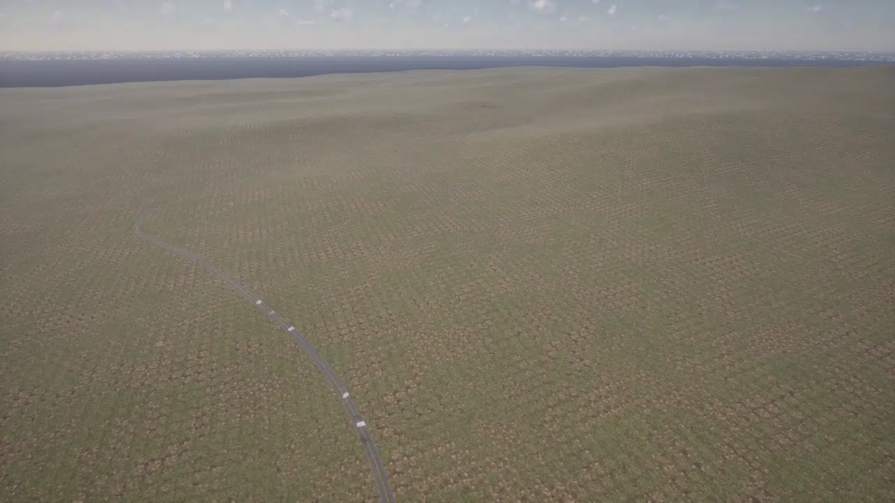
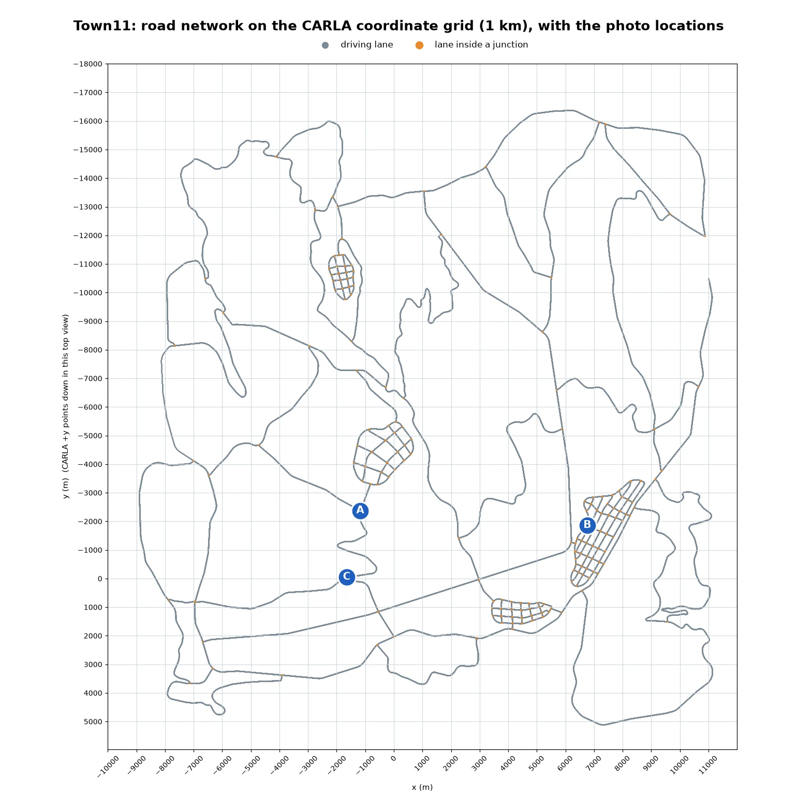
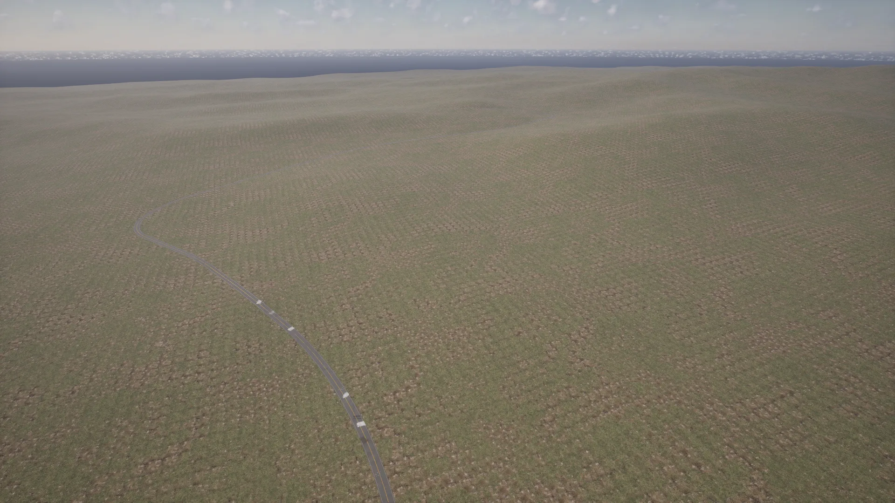
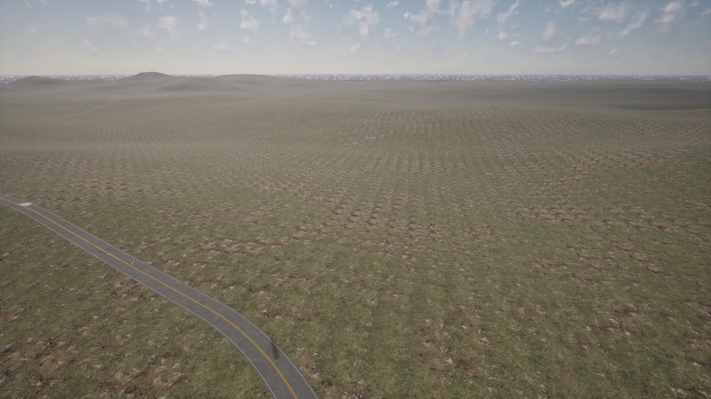
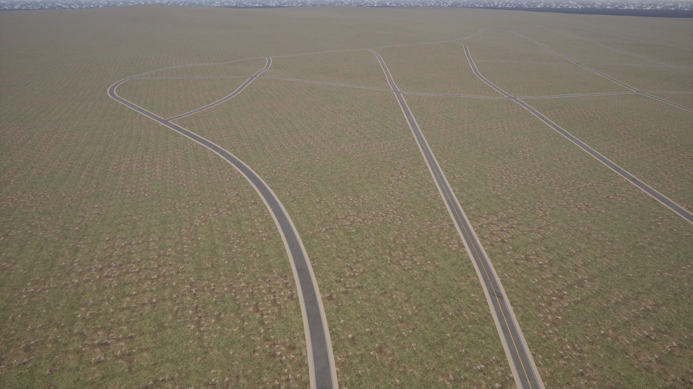

# Town11


<div class="img-caption">Town11 from above: a road over the hills, a cluster of gridded junctions and a single-lane road across the grassland.</div>

Town11 is a large [World Partition](core_large_maps.md) map without decoration such as buildings, sidewalks or vegetation. The road network consists of sprawling single-lane roads interspersed with small clusters of gridded junctions. The landscape has some hills and elevations and a grass-like texture.

Town11 was the first large map integrated into CARLA, as a proof of concept for large maps. Its asset files in the Unreal Editor are a simple example of how a large map is organised.

| | |
| --- | --- |
| __Map name__ | `Town11` |
| __In the default package__ | no: install a [content pack](map_content_packs.md) that contains it, such as AdditionalMaps, or use a source build |
| __Map type__ | a large [World Partition](core_large_maps.md) map: the server streams the cells around the vehicle with `role_name=hero` |
| __Size__ | about 20 x 21.5 km of roads, between 20 and 790 m of altitude |
| __Spawn points__ | 3166, from `world.get_map().get_spawn_points()` |
| __Junctions__ | 174, with 547 traffic lights |

Load it like any other map:

```py
world = client.load_world('Town11')
```

Only the cells around the ego vehicle are loaded. Spawn the ego with `role_name=hero` before placing sensors, as described in [Large maps](core_large_maps.md).

- [__Road network__](#road-network)
- [__Hills and grassland__](#hills-and-grassland)
- [__Gridded junctions__](#gridded-junctions)

---
## Road network

Long single-lane roads, one lane in each direction, cross the hills between four clusters of gridded junctions. The plot below uses CARLA coordinates on a 1 km grid. To look at a place, read its coordinates from the plot and take the nearest spawn point for the hero, so the area streams in, then move the spectator above it:

```py
# CARLA coordinates of photo B: X 6763, Y -1864
target = carla.Location(6763, -1864, 0)
spawn = min(world.get_map().get_spawn_points(), key=lambda t: t.location.distance(target))
bp = world.get_blueprint_library().find('vehicle.lincoln.mkz')
bp.set_attribute('role_name', 'hero')
hero = world.spawn_actor(bp, spawn)
world.get_spectator().set_transform(carla.Transform(spawn.location + carla.Location(z=150), carla.Rotation(pitch=-90)))
```


<div class="img-caption">The road network of Town11 from the Map API on the CARLA coordinate grid, with the location of each photo on this page.</div>

---
## Hills and grassland

The terrain rises and falls between the clusters, and the roads follow it.


<div class="img-caption">A road winding over the hills, seen from above location A.</div>


<div class="img-caption">A single-lane road across the grassland at location C.</div>

---
## Gridded junctions

Each cluster is a small grid of streets, with traffic lights at every junction.


<div class="img-caption">The largest cluster of gridded junctions, seen from above location B.</div>
