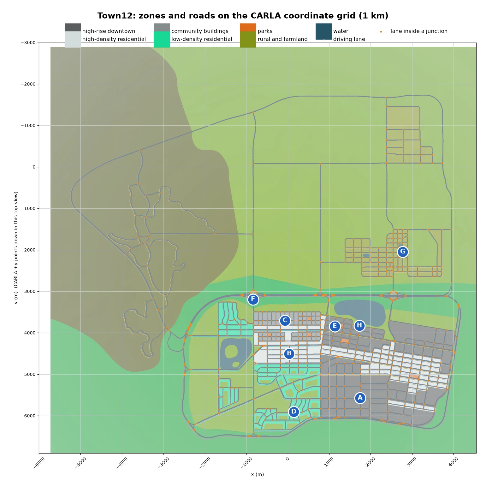
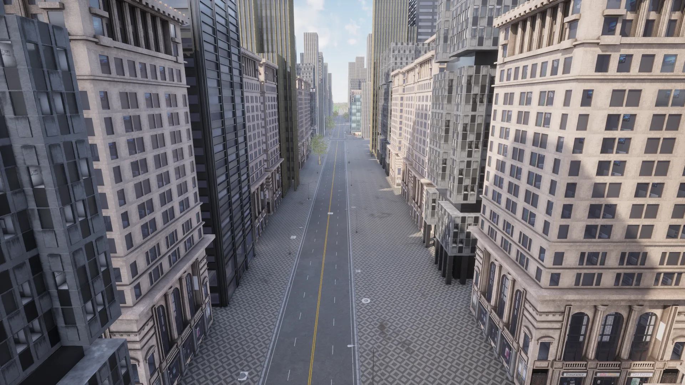
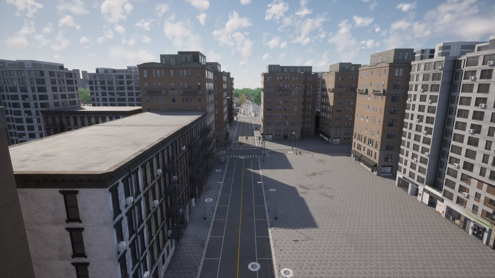
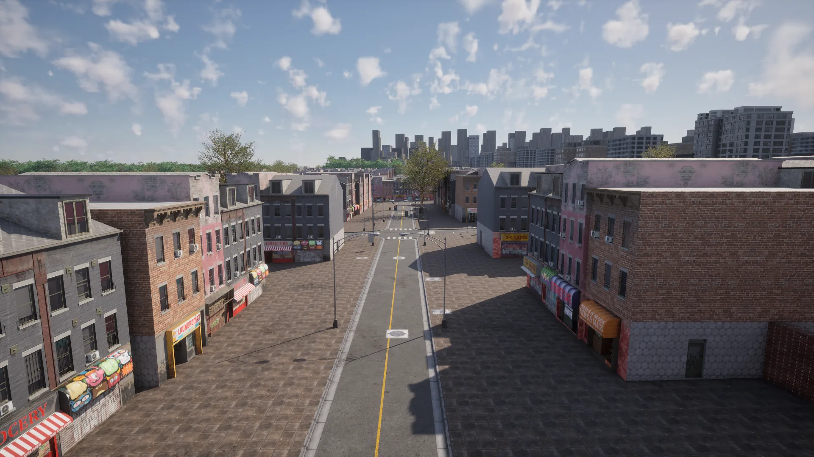
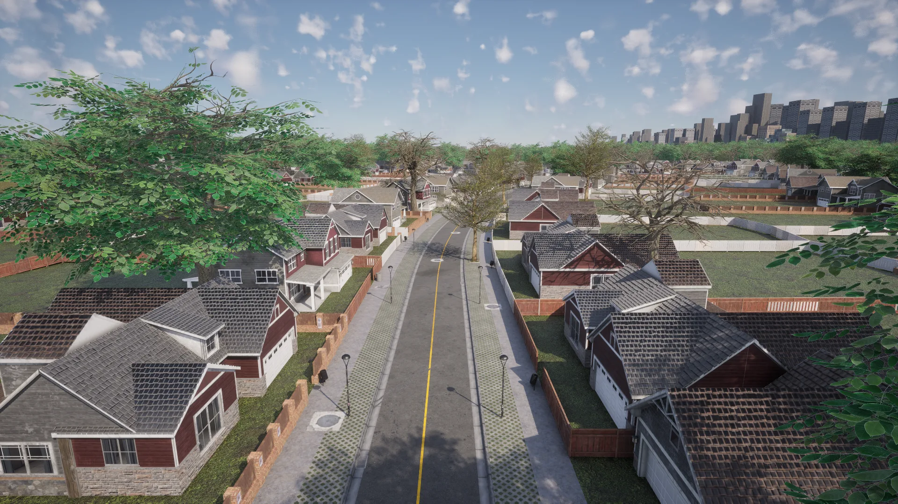
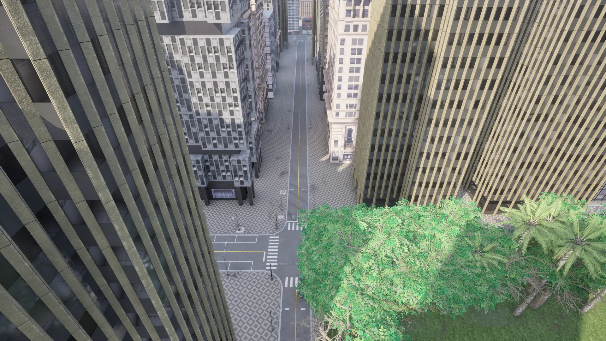
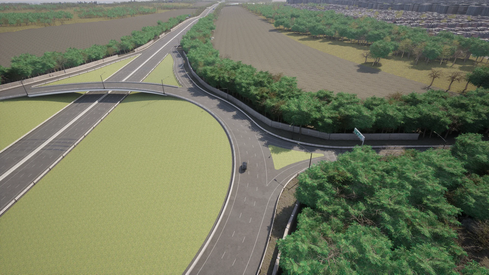
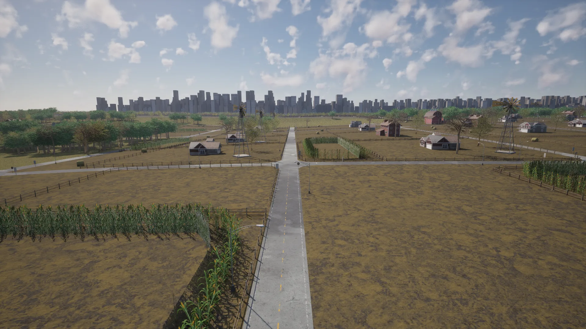
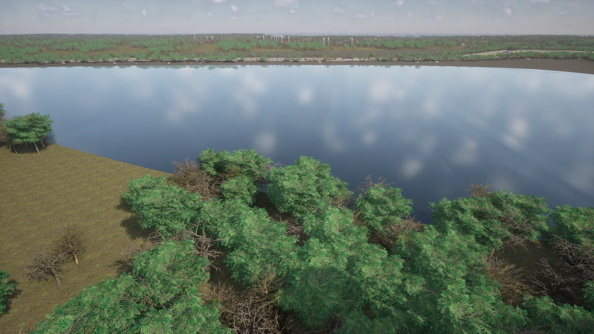

# Town12


<div class="img-caption">Town12: the high-rise downtown, a high-density residential street, the low-density suburbs, a highway roundabout and the farmland.</div>

Town12 is a large [World Partition](core_large_maps.md) map of about 10 x 10 km. Its road layout is partially inspired by the city of [Amarillo in Texas, USA](https://www.google.com/maps/place/Amarillo,+TX,+USA/@35.2018863,-101.9450251,11z). It has numerous contrasting regions, including urban, residential and rural areas, along with a large highway system with a ring road around the city. The architectural styles reflect those of many medium to large cities across North America.

| | |
| --- | --- |
| __Map name__ | `Town12` |
| __In the default package__ | no: use a source build, or install it from a [content pack](map_content_packs.md) |
| __Map type__ | a large [World Partition](core_large_maps.md) map: the server streams the cells around the vehicle with `role_name=hero` |
| __Size__ | about 9.4 x 8.3 km of roads |
| __Spawn points__ | 10422, from `world.get_map().get_spawn_points()` |
| __Junctions__ | 628, with 1101 traffic lights |

Load it like any other map:

```py
world = client.load_world('Town12')
```

Only the cells around the ego vehicle are loaded. Spawn the ego with `role_name=hero` before placing sensors, as described in [Large maps](core_large_maps.md).

!!! Note
    [Town13](map_town13.md) is designed as a train-test pair with Town12: same kind of layout, different building styles, textures and vegetation.

- [__Zones and coordinates__](#zones-and-coordinates)
- [__High-rise downtown__](#high-rise-downtown)
- [__High-density residential__](#high-density-residential)
- [__Community buildings__](#community-buildings)
- [__Low-density residential__](#low-density-residential)
- [__Parks__](#parks)
- [__Highways and intersections__](#highways-and-intersections)
- [__Rural and farmland__](#rural-and-farmland)
- [__Water__](#water)

---
## Zones and coordinates

The plot below shows the road network on the CARLA coordinate grid, coloured by zone, with a letter at the place of each photo on this page. To look at a place, read its coordinates from the plot and take the nearest spawn point for the hero, so the area streams in, then move the spectator above it:

```py
# CARLA coordinates of photo A: X 1656, Y 5569
target = carla.Location(1656, 5569, 0)
spawn = min(world.get_map().get_spawn_points(), key=lambda t: t.location.distance(target))
bp = world.get_blueprint_library().find('vehicle.lincoln.mkz')
bp.set_attribute('role_name', 'hero')
hero = world.spawn_actor(bp, spawn)
world.get_spectator().set_transform(carla.Transform(spawn.location + carla.Location(z=150), carla.Rotation(pitch=-90)))
```


<div class="img-caption">The road network of Town12 from the Map API on the CARLA coordinate grid, over the zone layout the map was designed with, with the location of each photo on this page.</div>

---
## High-rise downtown

The downtown area is a large span of high-rise skyscrapers arranged in blocks on a regular grid of roads, resembling the downtown areas of many large American and European cities.


<div class="img-caption">A downtown street between skyscrapers, at location A.</div>

---
## High-density residential

The high-density residential areas have many 2 to 10 storey apartment buildings, with commercial properties like cafes and retail stores at street level.


<div class="img-caption">Apartment buildings around a junction, at location B.</div>

---
## Community buildings

The community buildings are a set of 2 to 4 storey apartment buildings in a colourful bohemian style, with cafes and boutiques on the ground floors, next to the downtown area of the city.


<div class="img-caption">Low apartment buildings with shops on the ground floor, at location C.</div>

---
## Low-density residential

The low-density residential regions reflect the classic suburbs of many American cities, with one and two storey homes surrounded by fenced gardens and garages.


<div class="img-caption">A suburban street of detached houses with fenced gardens, at location D.</div>

---
## Parks

The dense residential and downtown areas are broken up by small islands of green communal space.


<div class="img-caption">A small park between the office towers, at location E.</div>

---
## Highways and intersections

Town12 has an extensive highway system, including 3 to 4 lane highways with large roundabout junctions and intersections.


<div class="img-caption">One of the roundabouts of the ring road, at location F.</div>

---
## Rural and farmland

Town12 also has rural regions with characteristic farm buildings like wooden barns and farmhouses, windmills, grain silos, cornfields, hay bales and rural fencing. These areas have unmarked country roads and single-lane interurban roads.


<div class="img-caption">Farmland with cornfields and farmhouses, with the city skyline behind, at location G.</div>

---
## Water

There are several bodies of water in Town12, including two large lakes and several ponds. Some lie next to the city, where they reflect the skyline upside down, a challenge for autonomous driving agents.


<div class="img-caption">The lake next to the city, at location H.</div>
