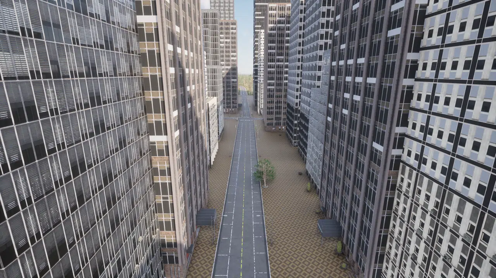
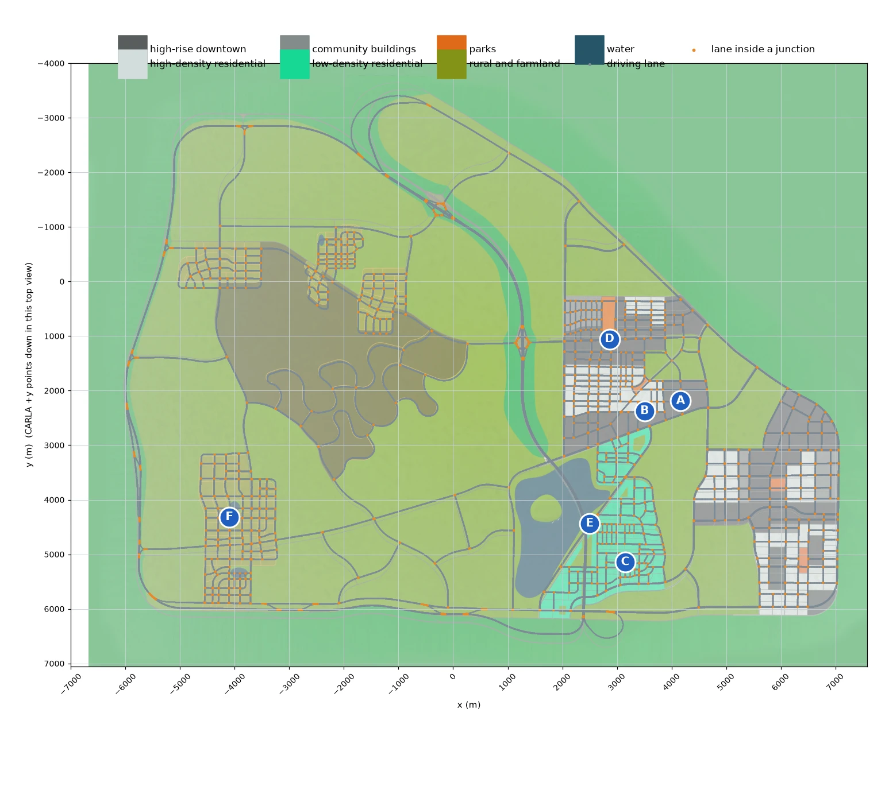
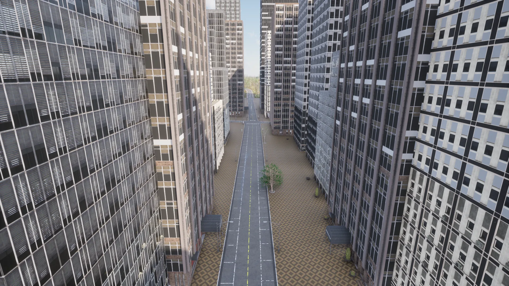
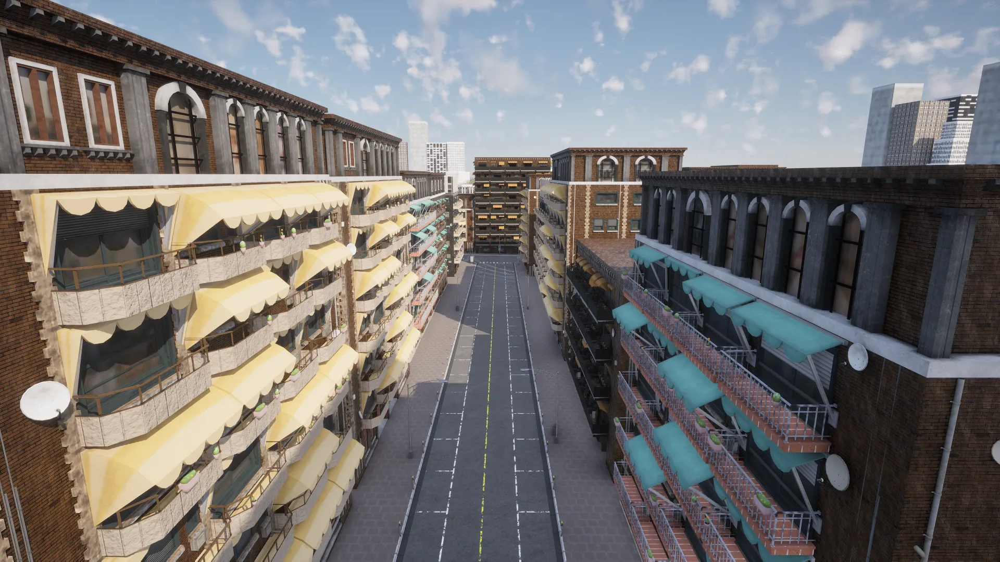
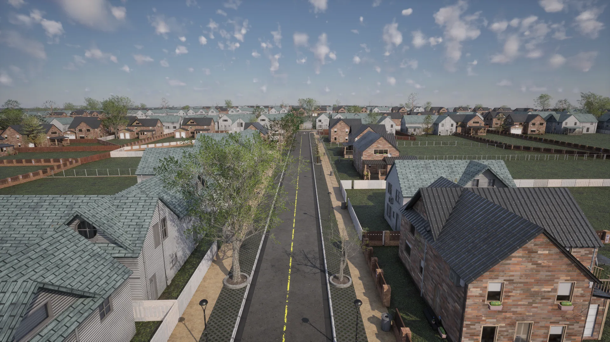
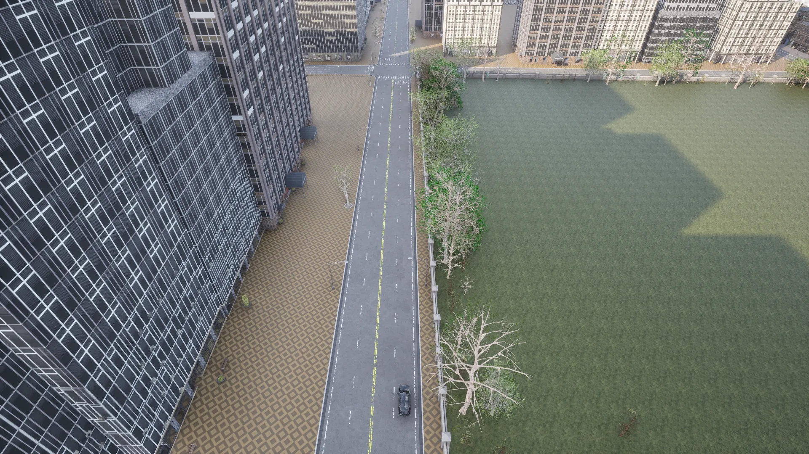
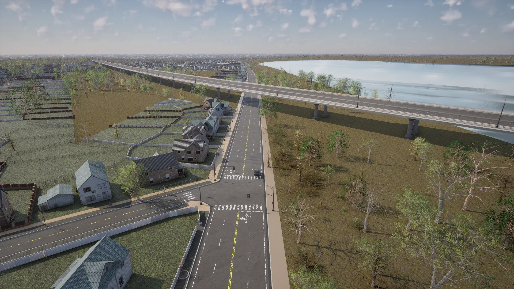
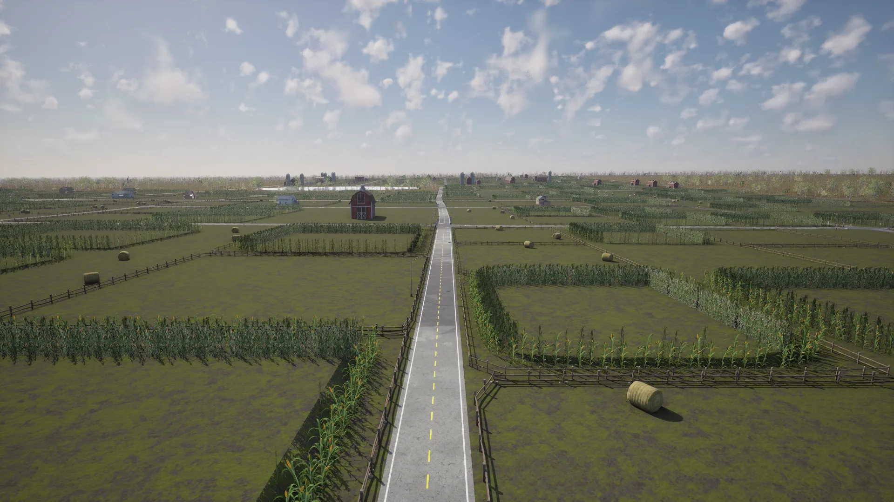

# Town13


<div class="img-caption">Town13: the high-rise downtown, a high-density residential street, the low-density suburbs, the causeway over the lake and the farmland.</div>

Town13 is a large [World Partition](core_large_maps.md) map of a scale similar to [Town12](map_town12.md), with distinct features. It has numerous contrasting regions, including urban, residential and rural areas and a large lake with a central island, along with a large highway system with a ring road around the city. The architectural styles reflect those of many medium to large cities across North America and Europe.

!!! Note
    Town13 is designed as a __train-test pair__ with Town12. The two towns share many features, but differ in the styles of buildings, road and pavement textures, and vegetation. Producing training data in one and testing in the other helps expose overfitting in an autonomous driving stack.

| | |
| --- | --- |
| __Map name__ | `Town13` |
| __In the default package__ | no: install a [content pack](map_content_packs.md) that contains it, such as AdditionalMaps, or use a source build |
| __Map type__ | a large [World Partition](core_large_maps.md) map: the server streams the cells around the vehicle with `role_name=hero` |
| __Size__ | about 13 x 10 km of roads |
| __Spawn points__ | 12478, from `world.get_map().get_spawn_points()` |
| __Junctions__ | 774, with 1138 traffic lights |

Load it like any other map:

```py
world = client.load_world('Town13')
```

Only the cells around the ego vehicle are loaded. Spawn the ego with `role_name=hero` before placing sensors, as described in [Large maps](core_large_maps.md).

- [__Zones and coordinates__](#zones-and-coordinates)
- [__High-rise downtown__](#high-rise-downtown)
- [__Community buildings__](#community-buildings)
- [__High-density residential__](#high-density-residential)
- [__Low-density residential__](#low-density-residential)
- [__Parks__](#parks)
- [__Highways and intersections__](#highways-and-intersections)
- [__Rural and farmland__](#rural-and-farmland)

---
## Zones and coordinates

The plot below shows the road network on the CARLA coordinate grid, coloured by zone, with a letter at the place of each photo on this page. To look at a place, read its coordinates from the plot and take the nearest spawn point for the hero, so the area streams in, then move the spectator above it:

```py
# CARLA coordinates of photo A: X 4254, Y 2167
target = carla.Location(4254, 2167, 0)
spawn = min(world.get_map().get_spawn_points(), key=lambda t: t.location.distance(target))
bp = world.get_blueprint_library().find('vehicle.lincoln.mkz')
bp.set_attribute('role_name', 'hero')
hero = world.spawn_actor(bp, spawn)
world.get_spectator().set_transform(carla.Transform(spawn.location + carla.Location(z=150), carla.Rotation(pitch=-90)))
```


<div class="img-caption">The road network of Town13 from the Map API on the CARLA coordinate grid, over the zone layout the map was designed with, with the location of each photo on this page.</div>

---
## High-rise downtown

The downtown area is a large span of high-rise skyscrapers arranged in blocks on a regular grid of roads, resembling the downtown areas of many large American and European cities.


<div class="img-caption">A downtown street between skyscrapers, at location A.</div>

---
## Community buildings

The community buildings are a set of 2 to 4 storey apartment buildings in a colourful bohemian style, with businesses on the ground floors, next to the downtown area of the city (medium grey in the zone plot).

---
## High-density residential

The high-density residential areas have many 2 to 10 storey apartment buildings, with commercial properties like cafes and retail stores at street level. Many of the blocks have balconies with sun shades, similar to those of sunny southern European countries.


<div class="img-caption">Apartment buildings around a junction, at location B.</div>

---
## Low-density residential

The low-density residential regions reflect the suburbs of many European cities, with one and two storey homes surrounded by fenced gardens and garages.


<div class="img-caption">A suburban street of detached houses, at location C.</div>

---
## Parks

The dense residential and downtown areas are broken up by small islands of green communal space.


<div class="img-caption">A park lawn beside the downtown towers, at location D.</div>

---
## Highways and intersections

Town13 has an extensive highway system, including 3 to 4 lane highways, large roundabouts and a causeway over a large body of water.


<div class="img-caption">A raised highway beside the lake, at the edge of the suburbs, at location E.</div>

---
## Rural and farmland

Town13 also has rural regions with characteristic farm buildings like wooden barns and farmhouses, windmills, grain silos, cornfields, hay bales and rural fencing. These areas have unmarked country roads and single-lane interurban roads.


<div class="img-caption">A rural road through the farmland, at location F.</div>
