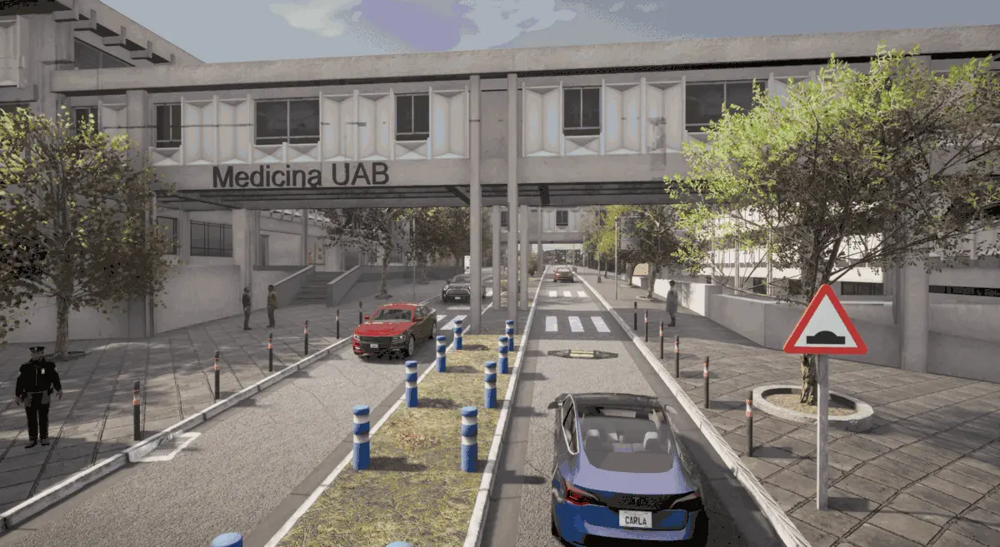
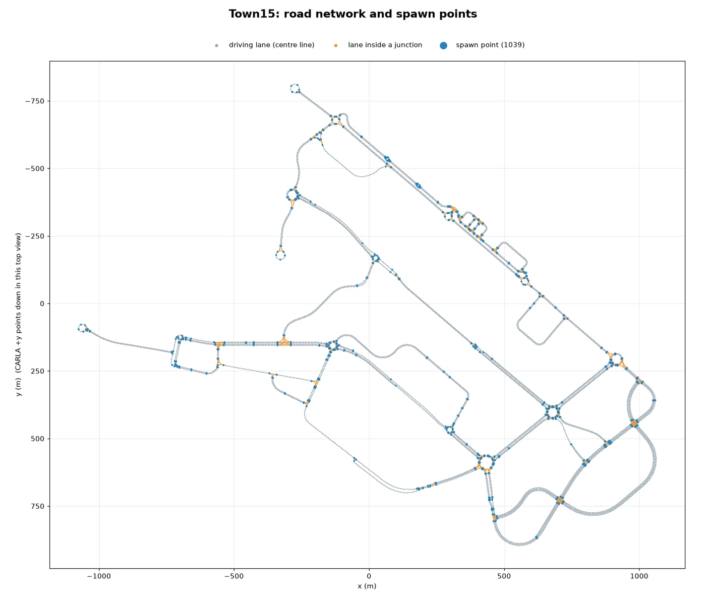
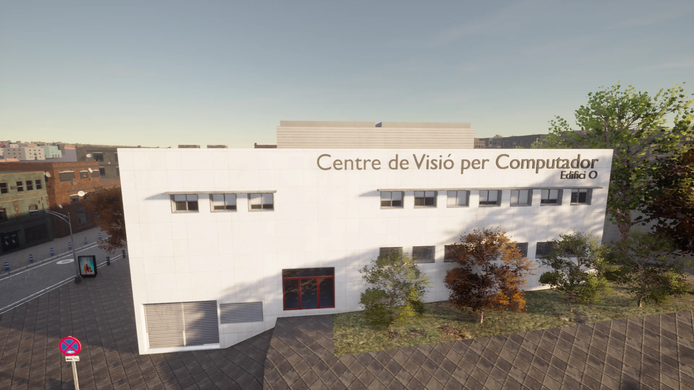
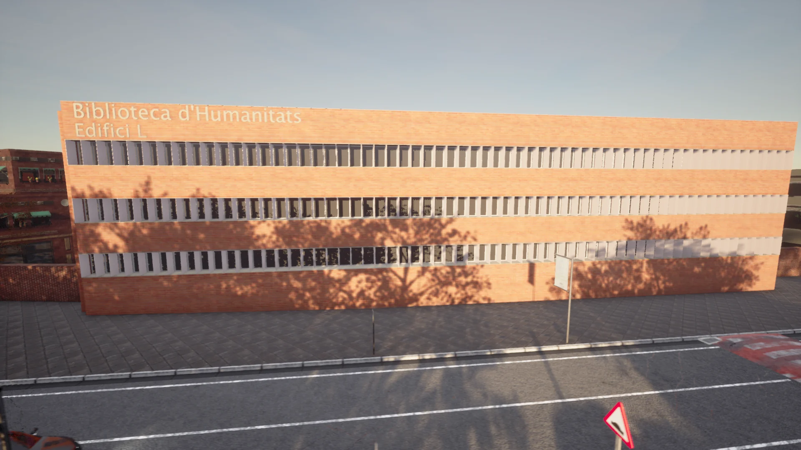
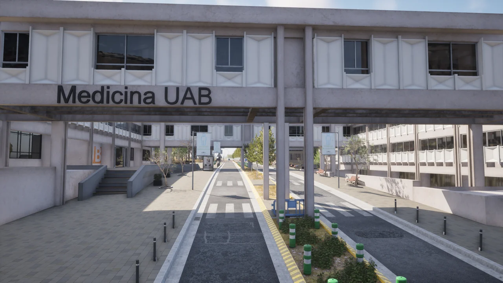
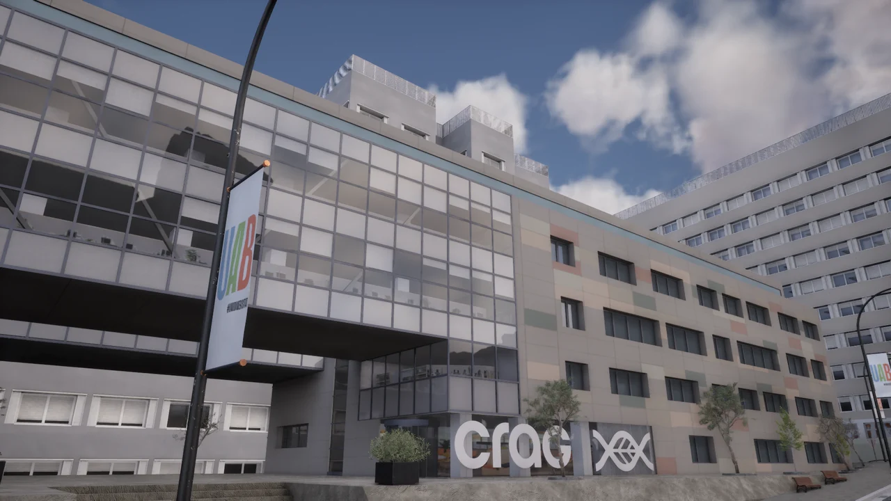
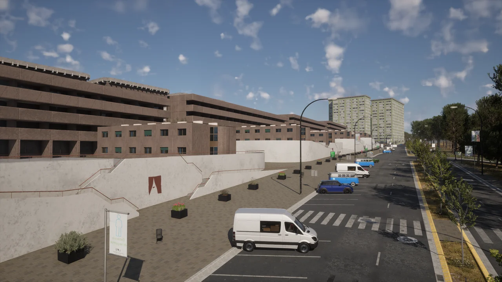

# Town15


<div class="img-caption">Views of Town15, a model of the Autonomous University of Barcelona campus.</div>

Town15 is a map based on the road layout of the Autonomous University of Barcelona (Universitat Autònoma de Barcelona). Some emblematic buildings of the campus are modelled in the map, including the humanities library, the medicine building and the Computer Vision Center, the birthplace of CARLA.

| | |
| --- | --- |
| __Map name__ | `Town15` |
| __Package available__ | Base package |
| __Map type__ | a large [World Partition](core_large_maps.md) map: the server streams the cells around the vehicle with `role_name=hero` |
| __Size__ | about 2.1 x 1.7 km of roads |
| __Spawn points__ | 1039, from `world.get_map().get_spawn_points()` |

Load it like any other map:

```py
world = client.load_world('Town15')
```

Only the cells around the ego vehicle are loaded. Spawn the ego with `role_name=hero` before placing sensors, as described in [Large maps](core_large_maps.md).

- [__Road network__](#road-network)
- [__Computer Vision Center__](#computer-vision-center)
- [__Humanities Library__](#humanities-library)
- [__Faculty of Medicine__](#faculty-of-medicine)
- [__CRAG__](#crag)
- [__Vila Universitària__](#vila-universitaria)

---
## Road network

The campus roads connect through roundabouts, with a long avenue along the north-east side and a loop of wider roads in the south-east.


<div class="img-caption">The road network of Town15 from the Map API, with its 1039 spawn points.</div>

---
## Computer Vision Center

The Computer Vision Center (CVC, Centre de Visió per Computador in Catalan) is a world-renowned research centre in computer vision, and the home of the CARLA development team.


<div class="img-caption">The Computer Vision Center building in Town15.</div>

---
## Humanities Library

Known as the Biblioteca d'Humanitats in Catalan, this building houses literature covering many disciplines for the students and researchers of the Autonomous University of Barcelona.


<div class="img-caption">The Biblioteca d'Humanitats in Town15.</div>

---
## Faculty of Medicine

The medicine buildings of the campus are joined across the road by a bridge with the name of the faculty, one of the best-known views of the campus.


<div class="img-caption">The Medicina UAB bridge over the road.</div>

---
## CRAG

The Centre for Research in Agricultural Genomics, with its glass entrance block and the CRAG lettering at the door.


<div class="img-caption">The CRAG building.</div>

---
## Vila Universitària

The student village of the campus: rows of brick residence blocks on terraces along the avenue.


<div class="img-caption">The residence blocks of the Vila Universitària from the avenue.</div>
