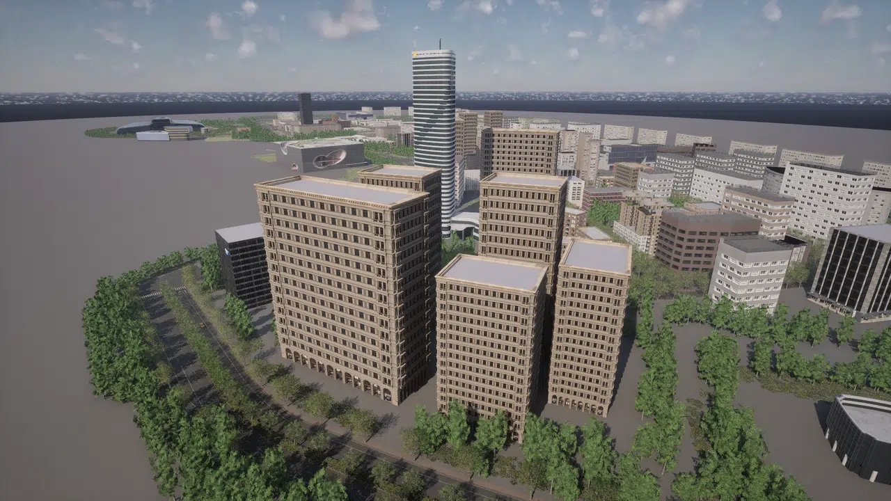
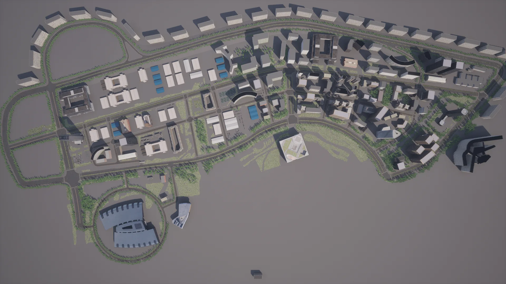
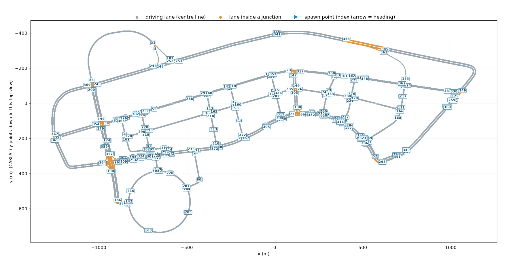
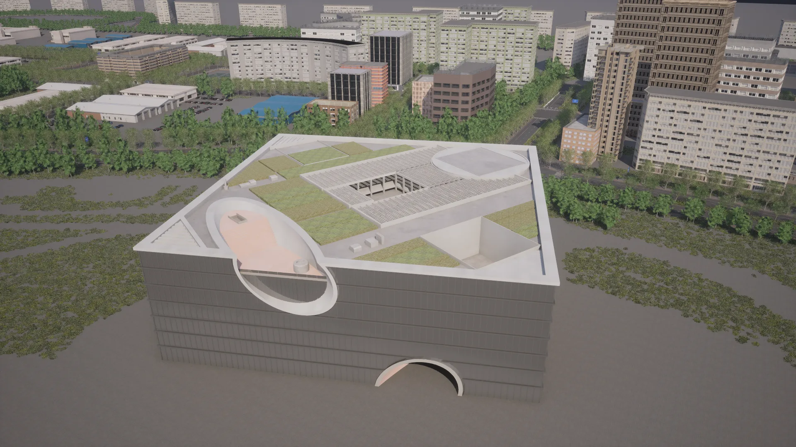
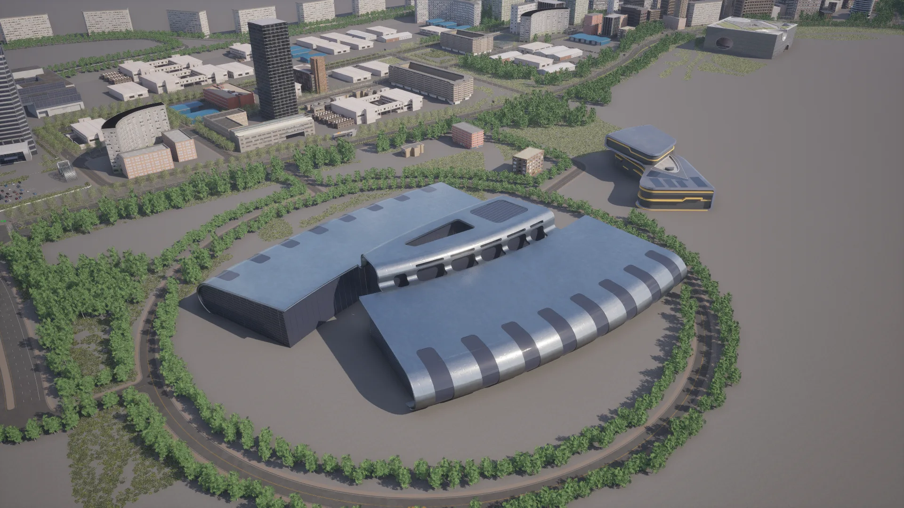
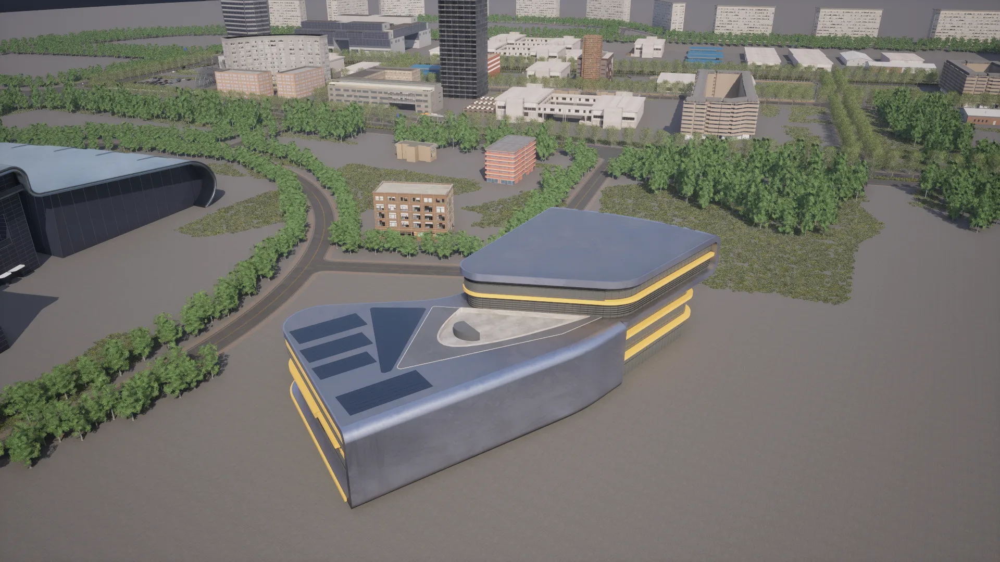
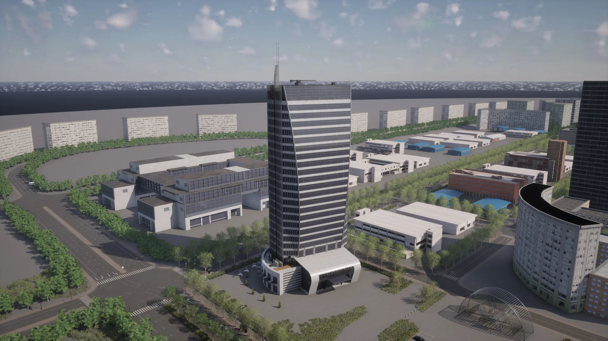
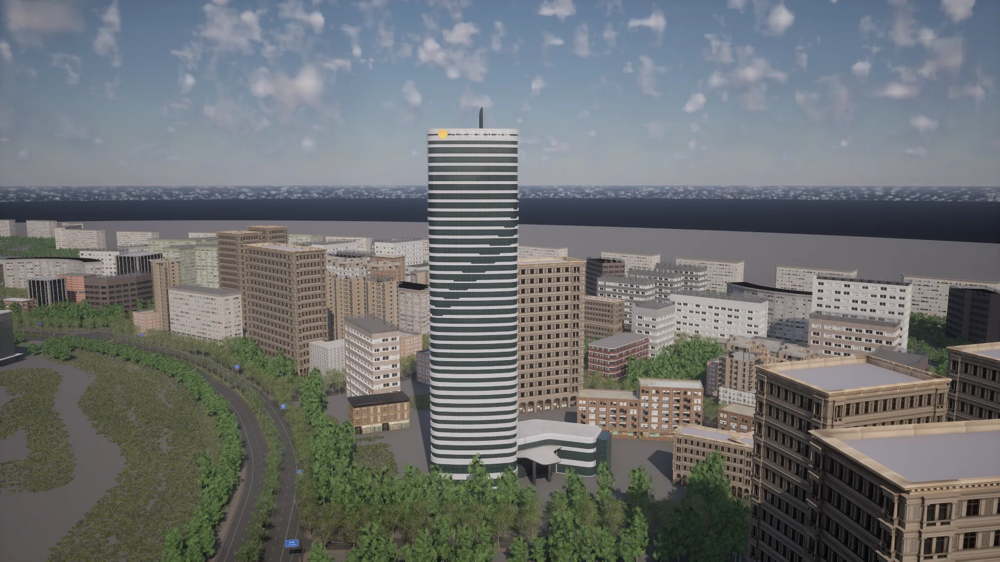
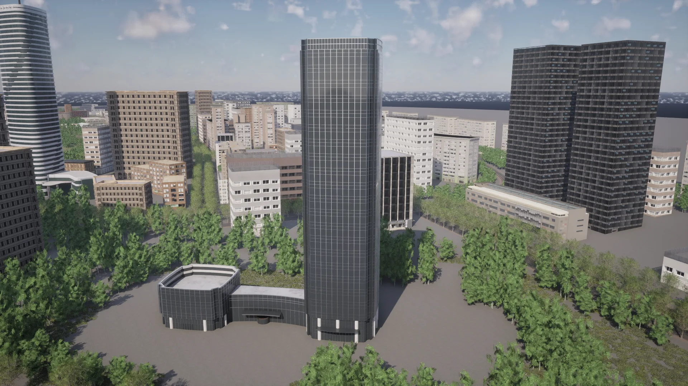
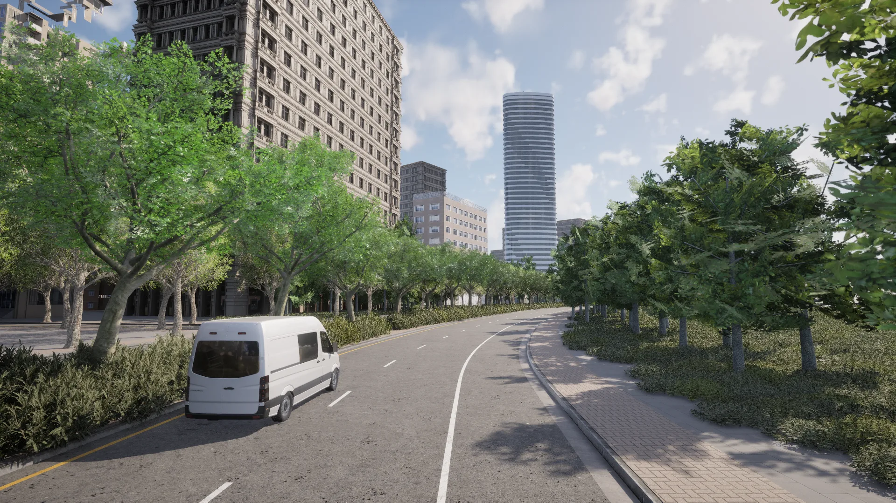

# Town_C


<div class="img-caption">Town_C from above the centre, from directly overhead, at the Poly Grand Theatre, at the Automotive Exhibition Center, at the Sorl Hotel and in a tree-lined avenue.</div>

Town_C is a map contributed by CARLA consortium members and sponsors [Synkrotron](https://www.synkrotron.ai/). It is a city on flat open land modelled on the Shanghai International Automobile City in Jiading, Shanghai, with recreations of some of its landmark buildings: the Shanghai Poly Grand Theatre, the Shanghai Automotive Exhibition Center, the Shanghai Auto Museum, the SIAC building, the Sorl Hotel and the YuTian building. Around them are a high-rise centre, an industrial area of warehouses and long rows of apartment blocks along a ring road.

| | |
| --- | --- |
| __Map name__ | `Town_C` |
| __Package available__ | [Additional maps package](https://github.com/carla-simulator/carla/releases/tag/1.0), or a source build |
| __Size__ | about 2.4 x 1.15 km of roads |
| __Spawn points__ | 373, from `world.get_map().get_spawn_points()` |
| __Junctions__ | 43, with 64 traffic lights |

Load it like any other map:

```py
world = client.load_world('Town_C')
```

- [__Road network__](#road-network)
- [__Landmark buildings__](#landmark-buildings)
- [__The centre__](#the-centre)

---
## Road network

A ring road with up to four lanes in each direction circles the city. Inside it, long avenues run across the city, linked by cross streets, and a loop road on the south-west side surrounds the Automotive Exhibition Center.


<div class="img-caption">Town_C from above, oriented like the plot below: the rows of apartment blocks along the north side, the industrial area on the left, the high-rise centre on the right and the Automotive Exhibition Center inside its loop road at the bottom left.</div>


<div class="img-caption">The road network of Town_C from the Map API, with the index of each spawn point.</div>

---
## Landmark buildings

The landmark meshes are under `Content/Carla/Static/Static/Town_C/Building/`, each named after the building it recreates. The coordinates are the centre of each building in CARLA coordinates.

| Building | CARLA coordinates (x, y) |
| --- | --- |
| Shanghai Poly Grand Theatre | 131, 181 |
| Shanghai Automotive Exhibition Center | -642, 566 |
| Shanghai Auto Museum | -404, 503 |
| SIAC building | -904, 146 |
| Sorl Hotel | 552, 119 |
| YuTian building | 873, 27 |


<div class="img-caption">The Shanghai Poly Grand Theatre: a glass-clad cube cut through by cylinders, with gardens on its roof.</div>


<div class="img-caption">The Shanghai Automotive Exhibition Center inside its loop road, with the Auto Museum behind it on the right.</div>


<div class="img-caption">The Shanghai Auto Museum, with its curved floors and yellow bands.</div>


<div class="img-caption">The SIAC building, a glass tower with a spire, at the west end of the city.</div>


<div class="img-caption">The Sorl Hotel, a striped cylindrical tower at the edge of the high-rise centre.</div>


<div class="img-caption">The YuTian building, a dark glass tower in a circle of trees, at the east end of the city.</div>

The map also places several buildings of the university campus of [Town15](map_town15.md), such as the CRAG building, the Faculty of Medicine and the Humanities Hall, among its blocks.

---
## The centre

The east of the city is a dense centre of office towers and apartment blocks, with tree-lined avenues.


<div class="img-caption">The high-rise centre from above, with the Sorl Hotel and the Automotive Exhibition Center on the horizon.</div>


<div class="img-caption">A tree-lined avenue in the centre.</div>
