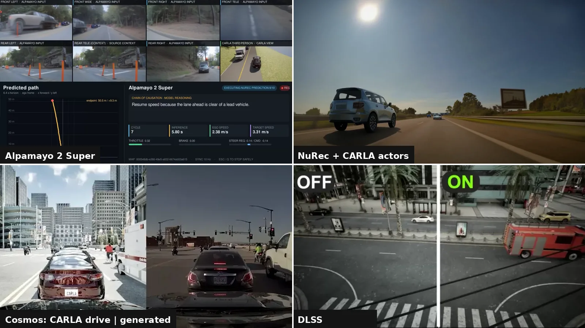
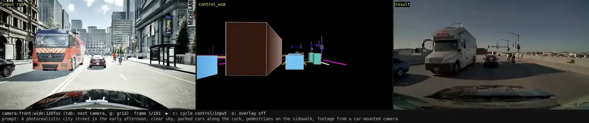
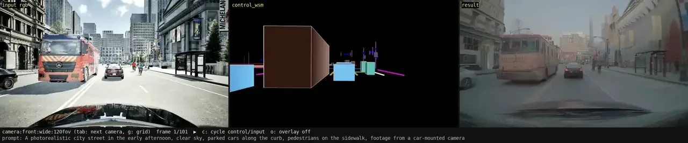
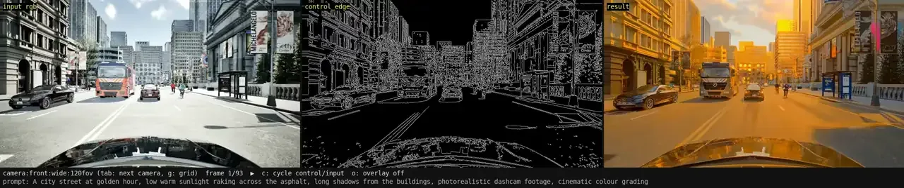
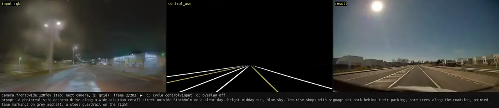

# NVIDIA in CARLA

NVIDIA sponsors CARLA's development and contributes the technologies below to the Unreal Engine 5 line.

Top left: the Alpamayo 2 Super dashboard, with its camera inputs, predicted path and reasoning. Top right: a CARLA SUV path traced into a NuRec scene reconstructed from a real highway drive. Bottom left: a CARLA drive and the Cosmos 3 output generated from it. Bottom right: one camera of a multi-camera rig, native rendering (OFF) against DLSS Super Resolution (ON).

- [__Alpamayo 2 Super__](#alpamayo-2-super)
- [__Neural reconstruction__](#neural-reconstruction)
- [__Cosmos__](#cosmos)
- [__DLSS__](#dlss)
- [__Combined workflows__](#combined-workflows)

---
## Alpamayo 2 Super

The NVIDIA Alpamayo 2 Super example provides closed-loop vision-language-action driving in CARLA. It captures the model's seven-camera input and ego-motion history, displays the predicted trajectory and Chain of Causation reasoning, and tracks the prediction with CARLA vehicle controls. The example attaches to an existing map and preserves traffic initialized by other scripts. Start with the [Alpamayo 2 Super user guide](nvidia_alpamayo.md), then see [architecture and control](nvidia_alpamayo_architecture.md) or [troubleshooting](nvidia_alpamayo_troubleshooting.md) as needed.

---
## Neural reconstruction

Neural reconstruction (NuRec) learns a 3D representation of a real place from recorded sensor data, so one recorded drive can be re-simulated with the trajectory perturbed, the sensor rig changed or rendered assets inserted. CARLA runs it through NVIDIA's Neural Reconstruction Engine container and its gRPC API; the [neural reconstruction page](nvidia_nurec.md) covers installing and using it.

---
## Cosmos

Cosmos turns a CARLA drive into input for NVIDIA's Cosmos video world models, which generate photoreal variations of a recorded run — a different weather, time of day or road surface over the same trajectory. `PythonAPI/examples/nvidia/cosmos/` captures frame-exact multi-camera clips with their depth, segmentation and edge control videos, exports the ground truth as an NVIDIA ClipGT scene package, and submits generation jobs through the `carla-cosmos` CLI.

Cosmos 3 on a CARLA drive. Left, the CARLA camera (<code>input rgb</code>); centre, the world-scenario control (<code>control_wsm</code>) rendered from the ground truth CARLA exports, with the lane lines and a box per actor; right, the generated footage. The prompt asked for a city street in the early afternoon.

Each control video steers the generation differently. The world-scenario control keeps only the road layout and the actors, so the model is free to invent the rest; adding depth and segmentation controls captured from the same drive keeps more of the CARLA street, and an edge control keeps its outlines while the prompt changes the light:

The same drive generated with depth and segmentation controls added to the world-scenario one (the centre panel shows only the world-scenario control). The buildings and the street keep the layout of the CARLA scene.

Cosmos Transfer 2.5 on the same street, guided by the edge control (centre) extracted from the CARLA frames, relit as golden hour by the prompt.

The capture client, the CLI and the job server run today, and a mock worker lets the whole pipeline be exercised without a GPU. The workers for Cosmos 3 and Transfer 2.5 are written but still awaiting validation on GPU hardware. `PythonAPI/examples/nvidia/cosmos/README.md` covers installing and running it.

---
## DLSS

NVIDIA's Deep Learning Super Sampling (DLSS) is integrated into the CARLA simulator itself:

- __DLSS Ray Reconstruction__ denoises the path-traced frames of the [ray-traced lens camera](ref_sensors.md#ray-traced-lens-camera) (`sensor.camera.rt_lens`), enabling real-time path tracing with physically exact lens distortion at low sample counts.
- __DLSS Super Resolution__ can upscale any camera sensor: the camera renders internally at a fraction of its output resolution and DLSS reconstructs the full-size image, reducing the GPU cost of large multi-camera rigs.

The [rendering options page](core_rendering.md#nvidia-dlss) covers both in detail.

---
## Combined workflows

The technologies above also work together, with CARLA keeping the physics, the clock, the actors and the ground truth:

- __Scenic + NuRec + CARLA assets__: a [Scenic](https://scenic-lang.org) scenario drives CARLA vehicles and pedestrians inside a scene reconstructed from a real drive, and the hybrid pipeline composites them into the recorded camera. See [Hybrid rendering example](nvidia_nurec.md#hybrid-rendering-example).
- __NuRec + Alpamayo 2 Super__: Alpamayo drives a NuRec scene in closed loop, seeing neural renders of the real place from wherever it actually drove. See [Run with NuRec cameras](nvidia_alpamayo.md#run-with-nurec-cameras).
- __NuRec + Cosmos__: `PythonAPI/examples/nvidia/cosmos/demos/nurec_to_cosmos.py` conditions Cosmos on a NuRec scene: on its world model (the scene's own OpenDRIVE map and ego trajectory, exported as a ClipGT scene package), on the neural render of the real place, or on both with Cosmos 3.

A NuRec drive recorded at night (left) becomes a clear day (right). Cosmos 3 follows the world-scenario control (centre) built from the scene's road network and ego trajectory.

