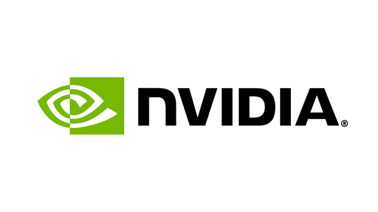

# NVIDIA in CARLA

NVIDIA sponsors CARLA's development and contributes the technologies below to the Unreal Engine 5 line.

- [__Alpamayo 2 Super__](#alpamayo-2-super)
- [__Neural reconstruction__](#neural-reconstruction)
- [__DLSS__](#dlss)

---
## [Alpamayo 2 Super](nvidia_alpamayo.md)

The NVIDIA Alpamayo 2 Super example provides closed-loop vision-language-action driving in CARLA. It captures the model's seven-camera input and ego-motion history, displays the predicted trajectory and Chain of Causation reasoning, and tracks the prediction with CARLA vehicle controls. The example attaches to an existing map and preserves traffic initialized by other scripts. Start with the [Alpamayo 2 Super user guide](nvidia_alpamayo.md), then see [architecture and control](nvidia_alpamayo_architecture.md) or [troubleshooting](nvidia_alpamayo_troubleshooting.md) as needed.

---
## [Neural reconstruction](nvidia_nurec.md)

Neural reconstruction (NuRec) learns a 3D representation of a real place from recorded sensor data, so one recorded drive can be re-simulated with the trajectory perturbed, the sensor rig changed or rendered assets inserted. CARLA runs it through NVIDIA's Neural Reconstruction Engine container and its gRPC API; the [neural reconstruction page](nvidia_nurec.md) covers installing and using it.

---
## DLSS

NVIDIA's Deep Learning Super Sampling (DLSS) is integrated into the CARLA simulator itself:

- __DLSS Ray Reconstruction__ denoises the path-traced frames of the [ray-traced lens camera](ref_sensors.md#ray-traced-lens-camera) (`sensor.camera.rt_lens`), enabling real-time path tracing with physically exact lens distortion at low sample counts.
- __DLSS Super Resolution__ can upscale any camera sensor: the camera renders internally at a fraction of its output resolution and DLSS reconstructs the full-size image, reducing the GPU cost of large multi-camera rigs.

Please refer to the [rendering options documentation](adv_rendering_options.md#nvidia-dlss) for details.
