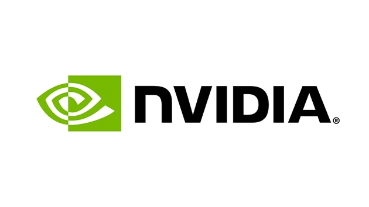
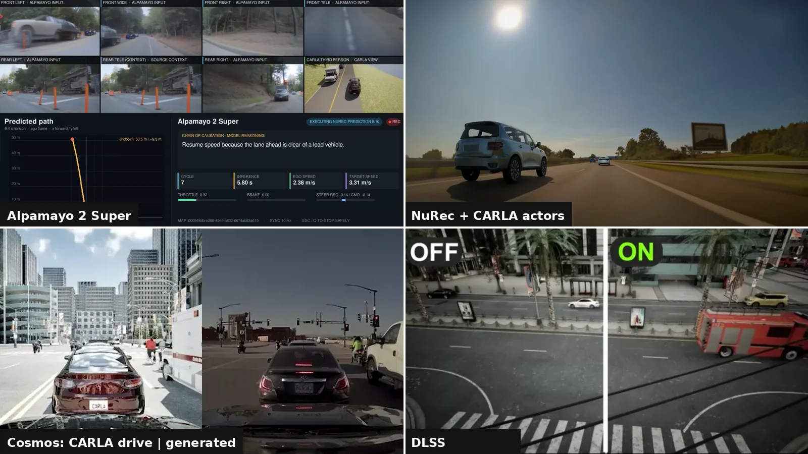
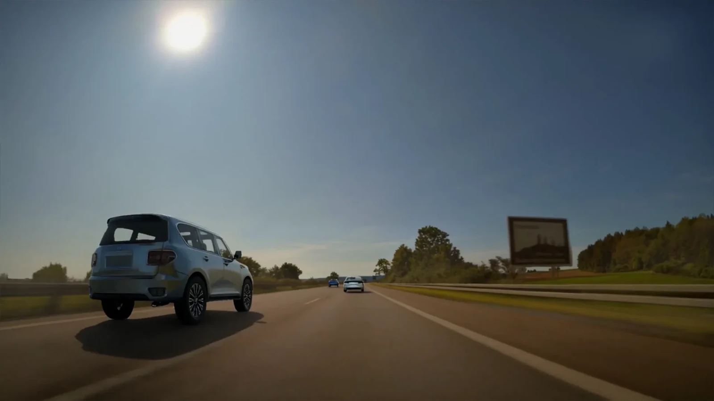
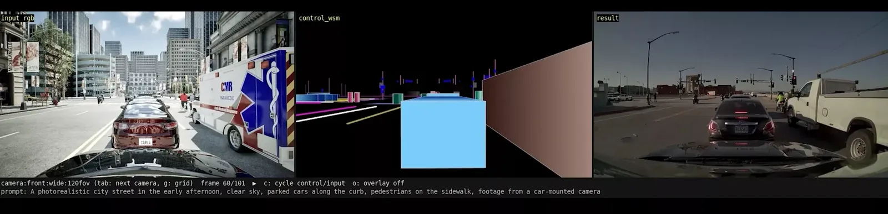
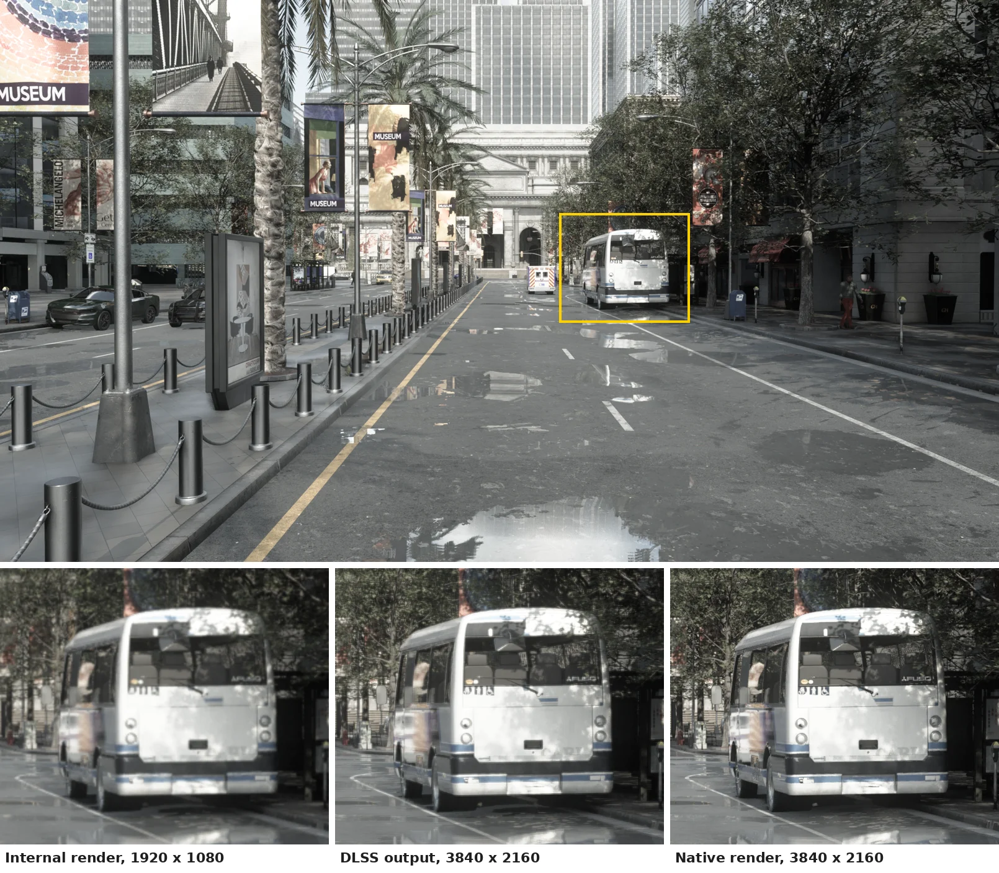
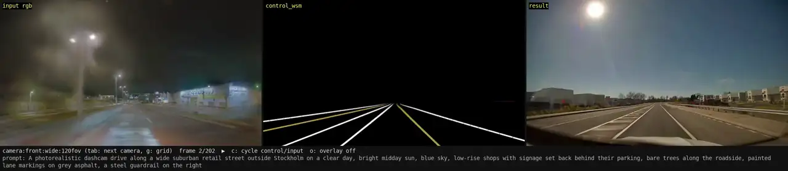

# NVIDIA in CARLA

NVIDIA sponsors CARLA's development and contributes the technologies below to the Unreal Engine 5 line.

Top left: the Alpamayo 2 Super dashboard, with its camera inputs, predicted path and reasoning. Top right: a CARLA SUV path traced into a NuRec scene reconstructed from a real highway drive. Bottom left: a CARLA drive and the Cosmos 3 output generated from it. Bottom right: one camera of a multi-camera rig, native rendering (OFF) against DLSS Super Resolution (ON).

- [__Alpamayo 2 Super__](#alpamayo-2-super)
- [__Neural reconstruction__](#neural-reconstruction)
- [__Cosmos__](#cosmos)
- [__DLSS__](#dlss)
- [__Combined workflows__](#combined-workflows)

---
## Alpamayo 2 Super

The NVIDIA Alpamayo 2 Super example provides closed-loop vision-language-action driving in CARLA. It captures the model's seven-camera input and ego-motion history, displays the predicted trajectory and Chain of Causation reasoning, and tracks the prediction with CARLA vehicle controls. The example attaches to an existing map and preserves traffic initialized by other scripts. Start with the [Alpamayo 2 Super user guide](nvidia_alpamayo.md), then see [architecture and control](nvidia_alpamayo_architecture.md) or [troubleshooting](nvidia_alpamayo_troubleshooting.md) as needed.

---
## Neural reconstruction

A CARLA SUV overtakes the ego on the left inside the neural reconstruction of a recorded highway drive. The vehicle is path traced, lit by the scene's sun and casts its shadow on the reconstructed road.

NVIDIA NuRec turns recorded camera and LIDAR data into a 3D scene that can be rendered from new viewpoints. CARLA loads the scenario's OpenDRIVE road network, spawns the recorded actors and runs the simulation loop, while NVIDIA's Neural Reconstruction Engine (NRE) container renders photoreal camera frames at the poses CARLA reports each tick. Because CARLA owns the loop, a real drive can be perturbed with the full CARLA API: the ego re-driven, vehicles handed to the Traffic Manager, assets inserted.

The [hybrid rendering example](nvidia_nurec.md#hybrid-rendering-example) composites CARLA vehicles and pedestrians into the neural scene with the ray-traced lens cameras.

<a href="../nvidia_nurec" class="btn btn-neutral" title="Go to NVIDIA NuRec">
Go to NVIDIA NuRec</a>

---
## Cosmos

A CARLA camera frame (left), the world-scenario control video rendered from its ground truth (centre) and the frame Cosmos generated from them with the prompt shown below (right).

Cosmos works after the simulation, not during it. `PythonAPI/examples/nvidia/cosmos/` captures frame-exact multi-camera clips from a CARLA run with their depth, segmentation and edge control videos, exports the ground truth as an NVIDIA ClipGT scene package, and submits generation jobs through the `carla-cosmos` CLI. NVIDIA's Cosmos video world models then generate photoreal variations of the run, such as a different weather, time of day or road surface over the same trajectory.

The capture client, the CLI and the job server run today, and a mock worker exercises the whole pipeline without a GPU; the Cosmos 3 and Transfer 2.5 workers are awaiting validation on GPU hardware.

<a href="../nvidia_cosmos" class="btn btn-neutral" title="Go to NVIDIA Cosmos">
Go to NVIDIA Cosmos</a>

---
## DLSS

A 3840 &times; 2160 RGB camera with DLSS Super Resolution at <code>dlss_screen_percentage=50</code>: it renders internally at 1920 &times; 1080 and DLSS reconstructs the 4K image. The crops of the framed area compare the internal render (scaled up), the DLSS output and a native 4K render.

DLSS Super Resolution lowers the cost of a camera: with `enable_dlss=True` the camera renders internally at `dlss_screen_percentage` of its output resolution (`50.0` by default) and DLSS reconstructs the full-size image. It is opt-in per camera and needs `enable_postprocess_effects=True`. It is meant for RGB rigs, not for ground-truth cameras, because reconstructed pixels corrupt label and depth maps.

`PythonAPI/examples/manual_control_5cam.py` spawns a five-camera rig and toggles DLSS with `D`, so the difference can be compared live.

<a href="../core_dlss" class="btn btn-neutral" title="Go to NVIDIA DLSS">
Go to NVIDIA DLSS</a>

---
## Combined workflows

The technologies above also work together, with CARLA keeping the physics, the clock, the actors and the ground truth:

- __Scenic + NuRec + CARLA assets__: a [Scenic](https://scenic-lang.org) scenario drives CARLA vehicles and pedestrians inside a scene reconstructed from a real drive, and the hybrid pipeline composites them into the recorded camera. See [Hybrid rendering example](nvidia_nurec.md#hybrid-rendering-example).
- __NuRec + Alpamayo 2 Super__: Alpamayo drives a NuRec scene in closed loop, seeing neural renders of the real place from wherever it actually drove. See [Run with NuRec cameras](nvidia_alpamayo.md#run-with-nurec-cameras).
- __NuRec + Cosmos__: `PythonAPI/examples/nvidia/cosmos/demos/nurec_to_cosmos.py` conditions Cosmos on a NuRec scene: on its world model (the scene's own OpenDRIVE map and ego trajectory, exported as a ClipGT scene package), on the neural render of the real place, or on both with Cosmos 3.

A NuRec drive recorded at night (left) becomes a clear day (right). Cosmos 3 follows the world-scenario control (centre) built from the scene's road network and ego trajectory.

