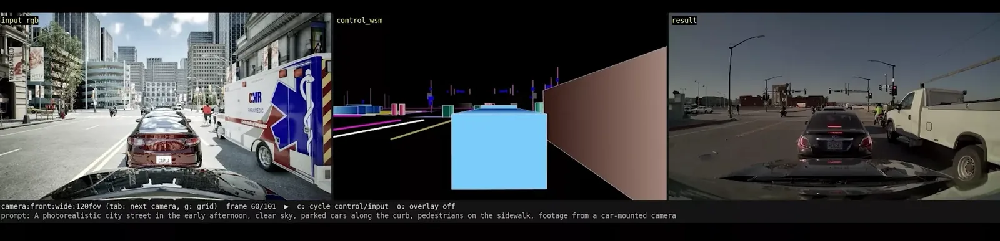
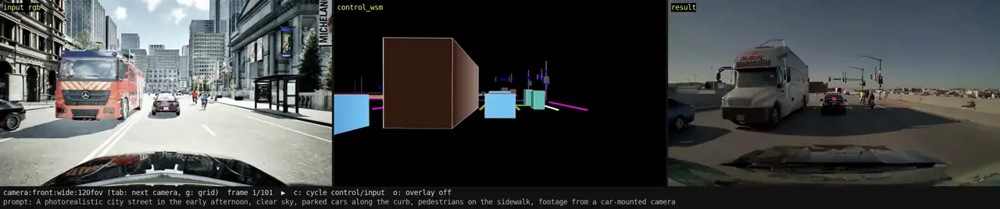
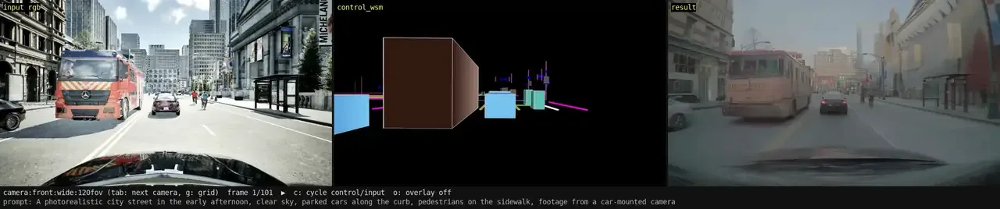
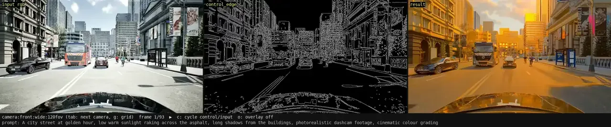
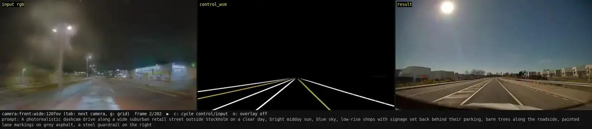

# NVIDIA Cosmos


<div class="img-caption">A CARLA camera frame (left), the world-scenario control video rendered from its ground truth (centre) and the frame Cosmos generated from them (right).</div>

NVIDIA Cosmos is a family of video world models. Given a video and one or more __control videos__ (depth, segmentation, edges, or a render of the road layout and the actors), a Cosmos model generates new photoreal footage that follows the controls, with the appearance described by a text prompt. CARLA uses it after the simulation, not during it: a run is captured once, and Cosmos turns it into any number of photoreal variations (another weather, time of day or road surface) over exactly the same trajectory and with the same ground truth.

- [__How it works__](#how-it-works)
- [__Control videos__](#control-videos)
- [__Capturing a clip__](#capturing-a-clip)
- [__Submitting jobs__](#submitting-jobs)
- [__NuRec and Cosmos__](#nurec-and-cosmos)
- [__Status__](#status)

---
## How it works

The integration lives in `PythonAPI/examples/nvidia/cosmos/` and has three parts:

1. __Capture.__ A client attached to a running CARLA server records frame-exact multi-camera clips: the RGB video, its depth, segmentation and (optionally) edge control videos, and the ground truth exported as an NVIDIA ClipGT scene package (ego, obstacles, calibration, lane lines, road boundaries, crosswalks, traffic lights and signs).
2. __Submit.__ The `carla-cosmos` CLI, or the `carla_cosmos` Python package, uploads the clip with a prompt and the controls to use, and queues a generation job on a Cosmos job server.
3. __Generate and collect.__ A worker on NVIDIA GPUs runs the model (Cosmos 3, Cosmos Transfer 2.5, or Transfer 2.5 AV for the seven-camera rig) and the client downloads the result, with a side-by-side viewer video of input, control and output.

---
## Control videos

The controls decide how much of the CARLA scene survives in the generated video. They are rendered from the same drive, so the output keeps CARLA's trajectory, actors and ground truth whatever the prompt changes.


<div class="img-caption">Cosmos 3 on a CARLA drive. Left, the CARLA camera (<code>input rgb</code>); centre, the world-scenario control (<code>control_wsm</code>) rendered from the ground truth CARLA exports, with the lane lines and a box per actor; right, the generated footage. The prompt asked for a city street in the early afternoon.</div>

Each control video steers the generation differently. The world-scenario control keeps only the road layout and the actors, so the model is free to invent the rest; adding depth and segmentation controls captured from the same drive keeps more of the CARLA street, and an edge control keeps its outlines while the prompt changes the light:


<div class="img-caption">The same drive generated with depth and segmentation controls added to the world-scenario one (the centre panel shows only the world-scenario control). The buildings and the street keep the layout of the CARLA scene.</div>


<div class="img-caption">Cosmos Transfer 2.5 on the same street, guided by the edge control (centre) extracted from the CARLA frames, relit as golden hour by the prompt.</div>

---
## Capturing a clip

With a CARLA server running on port 2000:

```sh
cd PythonAPI/examples/nvidia/cosmos
./scripts/install_client.sh          # venv beside the example, carla wheel and carla-cosmos
client/.venv/bin/python demos/single_view_live.py \
    --port 2000 --frames 60 --vehicles 10 --out ./clips --capture-only
```

This spawns a hero vehicle driven by the Traffic Manager, captures 60 frames at 30 fps with a single forward camera and writes the clip: a `manifest.json` (CARLA version, map, weather, rig, seed), one video per stream (RGB, depth, instance and semantic segmentation, optional edges) and the `scene/` ground-truth package. Two rigs ship: `single_720p`, one forward camera, and `nvidia_av7`, the seven cameras of NVIDIA's reference vehicle with its extrinsics. A clip can also be captured deterministically from a [recorder](core_recorder.md) log with `demos/single_view_replay.py`.

---
## Submitting jobs

```sh
export COSMOS_URL=http://<server>:<port> COSMOS_TOKEN=<token>
carla-cosmos models
carla-cosmos submit --clip clips/<clip_id> --backend cosmos3-nano \
    --prompt "overcast, wet road" --control depth=clip --control seg=clip --control edge=derive --wait --out ./results
```

Each `--control` names a control and where it comes from: `clip` uses the video captured with the run, `derive` has the server compute it from the RGB, and `scene` renders it from the ground-truth package (`wsm`, `hdmap_bbox`). An optional weight follows the source (`depth=clip:0.7`). `--wait` waits for the job and downloads the result. Results are stored under the `--out` directory, one folder per clip and job, with the generated videos, the controls, a `viewer_*.mp4` side-by-side video and a `job.json` with the request and timings. The `demos/` folder has short Python API examples for each backend.

Without a GPU, `carla-cosmos serve --mock` starts a local job server with a mock worker that returns the input after a short delay, so the whole pipeline (upload, validation, queue, download) can be tried before a Cosmos server is available.

---
## NuRec and Cosmos

`PythonAPI/examples/nvidia/cosmos/demos/nurec_to_cosmos.py` conditions Cosmos on a [NuRec](nvidia_nurec.md) scene: on its world model (the scene's own OpenDRIVE map and ego trajectory, exported as a ClipGT scene package), on the neural render of the real place, or on both with Cosmos 3.


<div class="img-caption">A NuRec drive recorded at night (left) becomes a clear day (right). Cosmos 3 follows the world-scenario control (centre) built from the scene's road network and ego trajectory.</div>

---
## Status

The capture client, the CLI and the job server run today, and the mock worker exercises the whole pipeline without a GPU. The Cosmos 3 and Transfer 2.5 workers are written but still awaiting validation on GPU hardware. `PythonAPI/examples/nvidia/cosmos/README.md` covers installation, the server and every option, and NVIDIA's [Cosmos documentation](https://docs.nvidia.com/cosmos/) covers the models themselves.
