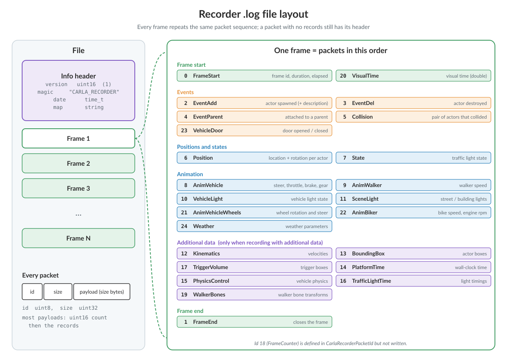
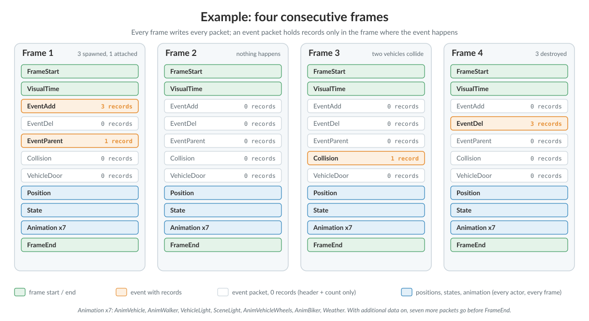

# Recorder Binary File Format

The recorder system saves all the info needed to replay the simulation in a binary file,
using little endian byte order for the multibyte values.

*   [__1- Strings in binary__](#1-strings-in-binary)  
*   [__2- Info header__](#2-info-header)  
*   [__3- Packets__](#3-packets)  
	*   [Packet 0 - Frame Start](#packet-0-frame-start)  
	*   [Packet 1 - Frame End](#packet-1-frame-end)  
	*   [Packet 2 - Event Add](#packet-2-event-add)  
	*   [Packet 3 - Event Del](#packet-3-event-del)  
	*   [Packet 4 - Event Parent](#packet-4-event-parent)  
	*   [Packet 5 - Event Collision](#packet-5-event-collision)  
	*   [Packet 6 - Position](#packet-6-position)  
	*   [Packet 7 - TrafficLight](#packet-7-trafficlight)  
	*   [Packet 8 - Vehicle Animation](#packet-8-vehicle-animation)  
	*   [Packet 9 - Walker Animation](#packet-9-walker-animation)  
*   [__4- Frame Layout__](#4-frame-layout)  
*   [__5- File Layout__](#5-file-layout)

In the next image representing the file format, we can get a quick view of all the detailed
information. Each part that is visualized in the image will be explained in the following sections:


<div style="text-align: right"><i>Recorder .log layout: info header, frames, packet header, and the 25 packet ids in the order each frame writes them.</i></div>

In summary, the file format has a small header with general info (version, magic string, date and the map used) and a collection of packets of different types (25 types at the time of writing, and the list keeps growing). Every packet starts with the same two fields, its id (`uint8`) and the size of its payload in bytes (`uint32`), so a reader can skip a packet it does not know.

---
## 1- Strings in binary

Strings are written as their length in bytes (`uint16`), followed by their UTF-8 characters with no null terminator. For example, the string `Town06` is saved as:

```
06 00 | 54 6f 77 6e 30 36
length  T  o  w  n  0  6
```

All values are little-endian. In the tables below, `string` means this encoding, and a vector (`double x, y, z`) is three `double` values.

---
## 2- Info header

The info header has general information about the recorded file. Basically, it contains the version
and a magic string to identify the file as a recorder file. If the header changes then the version
will change also. Furthermore, it contains a date timestamp, as a `std::time_t` — seconds since the Unix epoch, 1 January 1970 —
and a string with the name of the map that was used for the recording.

| Type | Field | Description |
| --- | --- | --- |
| `uint16` | version | File format version, currently `1`. |
| `string` | magic | Always `CARLA_RECORDER`. |
| `int64` (`std::time_t`) | date | Seconds since the Unix epoch. |
| `string` | map | Name of the map, e.g. `Town10HD_Opt`. |

A sample info header, in hex:

```
version  01 00                                            # 1
magic    0e 00 43 41 52 4c 41 5f 52 45 43 4f 52 44 45 52  # "CARLA_RECORDER" (length 14)
date     a0 f5 d1 6a 00 00 00 00                          # 1792144800 = 2026-10-16 10:00:00 UTC
map      0c 00 54 6f 77 6e 31 30 48 44 5f 4f 70 74        # "Town10HD_Opt" (length 12)
```

---
## 3- Packets

Each packet starts with a little header of two fields (5 bytes):

| Type | Field | Description |
| --- | --- | --- |
| `uint8` | id | Packet type, from the table below. |
| `uint32` | size | Size of the data that follows, in bytes. |

* **id**: The packet type
* **size**: Size of packet data

Header information is then followed by the **data**.
The **data** is optional, a **size** of 0 means there is no **data** in the packet.
If the **size** is greater than 0 it means that the packet has **data** bytes. Therefore,
the **data** needs to be reinterpreted depending on the type of the packet.

The header of the packet is useful because we can just ignore those packets we are not interested
in when doing playback. We only need to read the header (first 5 bytes) of the packet and jump to
the next packet just skipping the data of the packet: read `id` and `size`, then move `size` bytes forward.

The packet ids are, from `CarlaRecorderPacketId`:

| Id | Packet | Id | Packet |
| --- | --- | --- | --- |
| 0 | Frame start | 13 | Bounding box |
| 1 | Frame end | 14 | Platform time |
| 2 | Event add | 15 | Physics control |
| 3 | Event del | 16 | Traffic light time |
| 4 | Event parent | 17 | Trigger volume |
| 5 | Collision | 18 | Frame counter |
| 6 | Position | 19 | Walker bones |
| 7 | State (traffic light) | 20 | Visual time |
| 8 | Vehicle animation | 21 | Vehicle wheel animation |
| 9 | Walker animation | 22 | Biker animation |
| 10 | Vehicle light | 23 | Vehicle door |
| 11 | Scene light | 24 | Weather |
| 12 | Kinematics | | |

The sections below describe the payload of packets 0 to 9. Packets 10 to 24 were added later and their layouts are defined by the `CarlaRecorder*` serializers under `Unreal/CarlaUnreal/Plugins/Carla/Source/Carla/Recorder/`.

Use an **id** over 100 for custom packets of your own, because this list keeps growing.

### Packet 0 - Frame Start

This packet marks the start of a new frame, and it will be the first one to start each frame.
All packets need to be placed between a **Frame Start** and a **Frame End**.

| Type | Field | Description |
| --- | --- | --- |
| `uint64` | id | Frame number, counted from the start of the recording. |
| `double` | durationThis | Duration of this frame in seconds. Written as `-1` and filled in when the next frame starts. |
| `double` | elapsed | Seconds since the start of the recording, at the start of this frame. |

The packet has no record count: its size is always 24 bytes.

The elapsed time of the next frame is therefore `elapsed + durationThis`.

### Packet 1 - Frame End

This frame has no data and it only marks the end of the current frame. That helps the replayer
to know the end of each frame just before the new one starts.
Usually, the next frame should be a Frame Start packet to start a new frame. Its size is `0`.

### Packet 2 - Event Add

This packet says how many actors we need to create at current frame.

| Type | Field | Description |
| --- | --- | --- |
| `uint16` | total | Number of records that follow. |
| | | Then, per record: |
| `uint32` | id | Actor id when it was recorded. |
| `uint8` | type | Actor type, see below. |
| `double` &times; 3 | location | Spawn location, in centimetres (Unreal units). |
| `double` &times; 3 | rotation | Spawn rotation as roll, pitch, yaw, in degrees. |
| `uint32` | uid | Numeric id of the actor description. |
| `string` | id | Blueprint id, e.g. `vehicle.lincoln.mkz`. |
| `uint16` | total | Number of attributes that follow. |
| | | Then, per attribute: |
| `uint8` | type | Attribute type (`carla.ActorAttributeType`: bool, int, float, string, RGB color, vector). |
| `string` | id | Attribute name. |
| `string` | value | Attribute value, as text. |

The field **total** says how many records follow. Each record starts with the **id** field,
that is the id the actor has when it was recorded (on playback that id could change internally,
but we need to use this id ). The **type** of actor can have these possible values:

  * 0 = Other
  * 1 = Vehicle
  * 2 = Walker
  * 3 = TrafficLight
  * 4 = TrafficSign
  * 5 = Sensor
  * 6 = INVALID

After that, the **location** and the **rotation** where we want to create the actor is proceeded.

Right after we have the **description** of the actor. The description **uid** is the numeric id of
the description and the **id** is the textual id, like 'vehicle.seat.leon'.

Then comes a collection of its **attributes** like color, number of wheels, role, etc.
The number of attributes is variable and should look similar to this:

* number_of_wheels = 4
* sticky_control = true
* color = 79,33,85
* role_name = autopilot

### Packet 3 - Event Del

This packet says how many actors need to be destroyed this frame.

| Type | Field | Description |
| --- | --- | --- |
| `uint16` | total | Number of records that follow. |
| `uint32` | id | Per record: the actor to destroy. |

It has the **total** of records, and each record has the **id** of the actor to remove.

For example, this packet could be like this (hex):

```
03                      # id: 3, Event Del
0e 00 00 00             # size: 14 bytes of data follow
03 00                   # total: 3 records
64 00 00 00             # id 100
65 00 00 00             # id 101
78 00 00 00             # id 120
```

The number 3 identifies the packet as Event Del. The size that follows is the size of the packet's
data: a `uint16` record count plus one `uint32` id per record, so three deletions make
2 + 3 &times; 4 = 14 bytes. Skipping that many bytes lands exactly on the next packet.
The record count says how many ids follow, and each one is an actor to remove — here 100, 101 and 120.

!!! Note
    The record count is a `uint16` in every packet that has one, while the ids and the packet size
    are `uint32`.

### Packet 4 - Event Parent

This packet says which actor is the child of another (the parent).

| Type | Field | Description |
| --- | --- | --- |
| `uint16` | total | Number of records that follow. |
| `uint32` | id | Per record: the child actor. |
| `uint32` | parent | The parent actor. |

The first id is the child actor, and the second one will be the parent actor.

### Packet 5 - Event Collision

If a collision happens between two actors, it will be registered in this packet. Only actors carrying a `sensor.other.collision` report collisions, and nothing attaches that sensor
automatically: a client has to spawn it on the actors whose collisions it wants recorded.

| Type | Field | Description |
| --- | --- | --- |
| `uint16` | total | Number of records that follow. |
| `uint32` | id | Per record: collision sequence number. |
| `uint32` | actor1 | First actor. |
| `uint32` | actor2 | Second actor. |
| `bool` | hero1 | `true` if the first actor has `role_name` hero. |
| `bool` | hero2 | `true` if the second actor has `role_name` hero. |

The **id** is just a sequence to identify each collision internally.
Several collisions between the same pair of actors can happen in the same frame, because physics
frame rate is fixed and usually there are several physics substeps in the same rendered frame.

### Packet 6 - Position

This packet records the position and orientation of all actors of type **vehicle** and
**walker** that exist in the scene.

| Type | Field | Description |
| --- | --- | --- |
| `uint16` | total | Number of records that follow. |
| `uint32` | id | Per record: the actor. |
| `double` &times; 3 | location | Location, in centimetres (Unreal units). |
| `double` &times; 3 | rotation | Rotation as roll, pitch, yaw, in degrees. |

### Packet 7 - TrafficLight

This packet records the state of all **traffic lights** in the scene. Which means that it
stores the state (red, yellow, green or off), whether it is frozen and the time spent in the current state.

| Type | Field | Description |
| --- | --- | --- |
| `uint16` | total | Number of records that follow. |
| `uint32` | id | Per record: the traffic light. |
| `bool` | frozen | `true` if the traffic light group is frozen. |
| `float` | elapsed | Seconds spent in the current state. |
| `uint8` | state | `0` red, `1` yellow, `2` green, `3` off. |

### Packet 8 - Vehicle animation

This packet records the animation of the vehicles, bikes and cycles. This packet stores the
**throttle**, **steering**, **brake**, **handbrake** and **gear** inputs, and then set them at playback.

| Type | Field | Description |
| --- | --- | --- |
| `uint16` | total | Number of records that follow. |
| `uint32` | id | Per record: the vehicle. |
| `float` | steering | Steering input, -1 to 1. |
| `float` | throttle | Throttle input, 0 to 1. |
| `float` | brake | Brake input, 0 to 1. |
| `bool` | handbrake | Handbrake on. |
| `int32` | gear | Current gear. |

### Packet 9 - Walker animation

This packet records the animation of the walker. It just saves the **speed** of the walker
that is used in the animation.

| Type | Field | Description |
| --- | --- | --- |
| `uint16` | total | Number of records that follow. |
| `uint32` | id | Per record: the walker. |
| `float` | speed | Walker speed, used to drive its animation. |

---
## 4- Frame Layout

A frame is a __Frame Start__ packet, the rest of the packets in a fixed order, and a __Frame End__ packet. The order is the one in the layout image above: visual time, the events, positions and traffic light states, the animation packets and, when recording with additional data, the additional-data packets.

The recorder writes __every packet in every frame__, even when it has nothing to store: an empty packet is its header plus a record count of `0`. This is what the replayer expects, although it skips any packet it does not need.

*   __Event__ packets (`EventAdd`, `EventDel`, `EventParent`, `Collision`, `VehicleDoor`) hold records only in the frame where the event happens.
*   __Position__ and __traffic light state__ packets hold one record per actor in every frame. Without them, the replayer cannot move the actors or set the traffic lights.
*   __Animation__ packets are recorded by default, so walkers are animated and vehicle wheels follow the vehicle during a replay.

---
## 5- File Layout

The file starts with the __info header__, followed by the frames one after another. Each frame repeats the same packet sequence, so what changes from one frame to the next is the number of records inside each packet.


<div style="text-align: right"><i>Four consecutive frames of a recording: the event packets fill only in the frame where something happens.</i></div>

In __frame 1__ three actors are spawned and one of them is attached to another, so `EventAdd` and `EventParent` hold records. In __frame 2__ nothing happens and every event packet is empty. In __frame 3__ two vehicles collide, which adds a `Collision` record. In __frame 4__ the three actors are destroyed.
