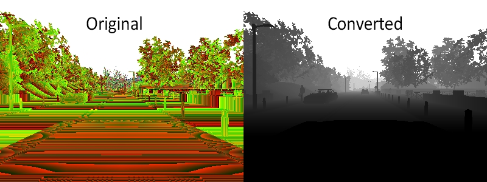
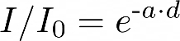
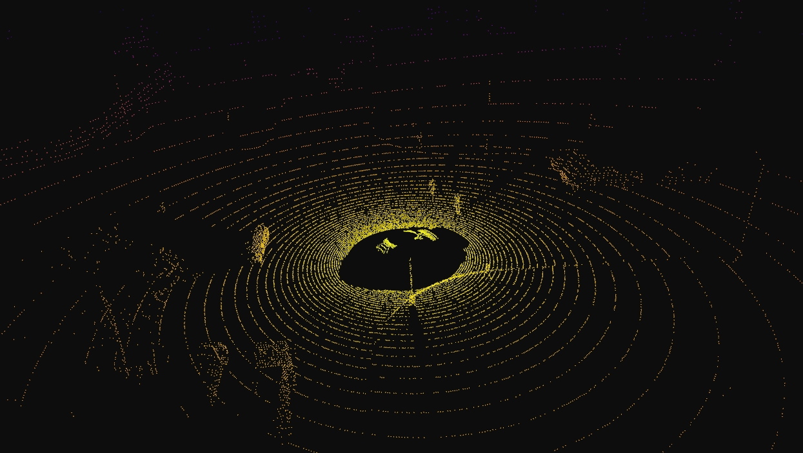
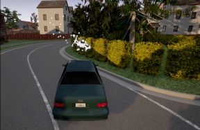
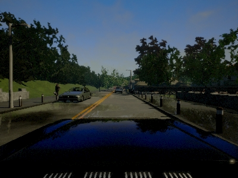
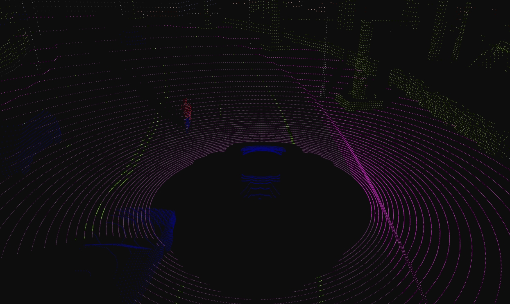
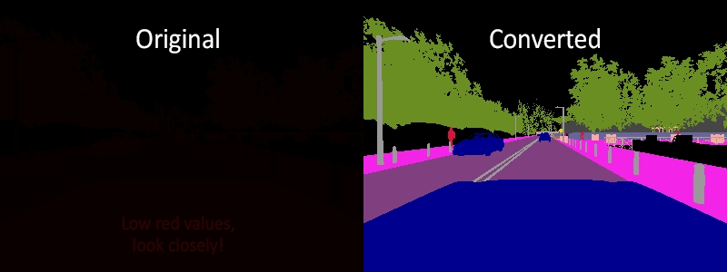
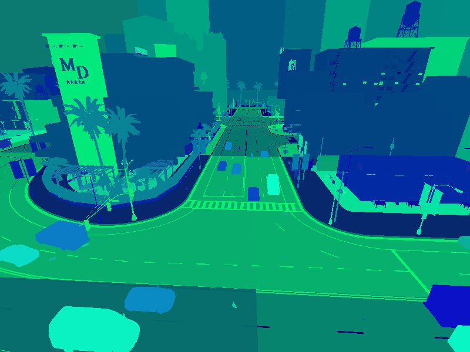
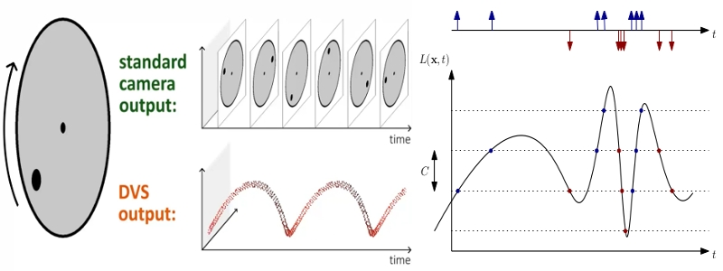
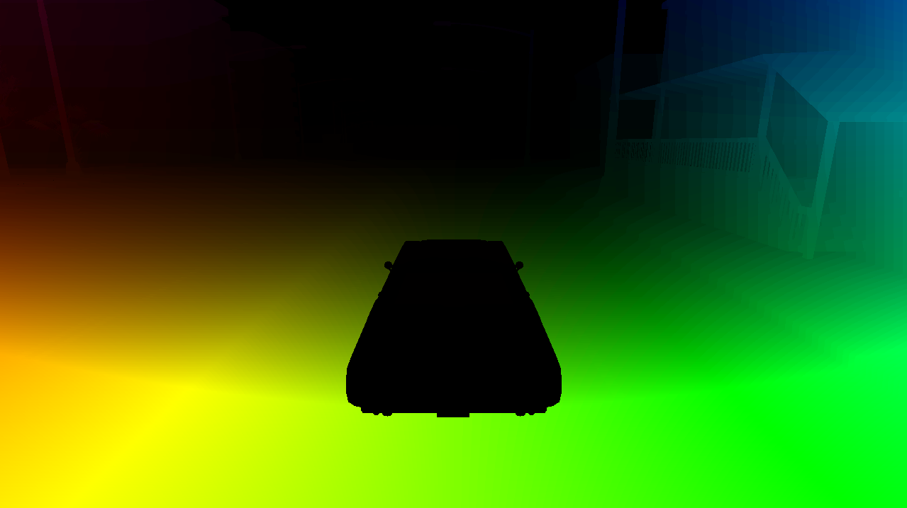

# Sensors reference

Every sensor CARLA ships, what it returns and what it is configured with.

| Blueprint | Output | Section |
| --- | --- | --- |
| `sensor.camera.rgb` | [carla.Image](python_api.md#carla.Image) | [RGB camera](#rgb-camera) |
| `sensor.camera.depth` | [carla.Image](python_api.md#carla.Image) | [Depth camera](#depth-camera) |
| `sensor.camera.semantic_segmentation` | [carla.Image](python_api.md#carla.Image) | [Semantic segmentation camera](#semantic-segmentation-camera) |
| `sensor.camera.instance_segmentation` | [carla.Image](python_api.md#carla.Image) | [Instance segmentation camera](#instance-segmentation-camera) |
| `sensor.camera.normals` | [carla.Image](python_api.md#carla.Image) | [Normals camera](#normals-camera) |
| `sensor.camera.optical_flow` | [carla.OpticalFlowImage](python_api.md#carla.OpticalFlowImage) | [Optical flow camera](#optical-flow-camera) |
| `sensor.camera.dvs` | [carla.DVSEventArray](python_api.md#carla.DVSEventArray) | [DVS camera](#dvs-camera) |
| `sensor.camera.rgb_fisheye`, `depth_fisheye`, `semantic_segmentation_fisheye`, `instance_segmentation_fisheye` | as the pinhole camera each one mirrors | [Fisheye cameras](#fisheye-cameras) |
| `sensor.camera.rt_lens` | [carla.Image](python_api.md#carla.Image) | [Ray-traced lens camera](#ray-traced-lens-camera) |
| `sensor.camera.rt_lens_distance` | [carla.DistanceImage](python_api.md#carla.DistanceImage) | [Ray-traced lens distance camera](#ray-traced-lens-distance-camera) |
| `sensor.camera.rt_lens_instance` | [carla.Image](python_api.md#carla.Image) | [Ray-traced lens instance camera](#ray-traced-lens-instance-camera) |
| `sensor.lidar.ray_cast` | [carla.LidarMeasurement](python_api.md#carla.LidarMeasurement) | [LIDAR sensor](#lidar-sensor) |
| `sensor.lidar.ray_cast_semantic` | [carla.SemanticLidarMeasurement](python_api.md#carla.SemanticLidarMeasurement) | [Semantic LIDAR sensor](#semantic-lidar-sensor) |
| `sensor.lidar.hss_lidar` | [carla.LidarMeasurement](python_api.md#carla.LidarMeasurement) | [Hybrid Solid-State LiDAR sensor](#hybrid-solid-state-lidar-sensor) |
| `sensor.other.radar` | [carla.RadarMeasurement](python_api.md#carla.RadarMeasurement) | [Radar sensor](#radar-sensor) |
| `sensor.other.gnss` | [carla.GnssMeasurement](python_api.md#carla.GnssMeasurement) | [GNSS sensor](#gnss-sensor) |
| `sensor.other.imu` | [carla.IMUMeasurement](python_api.md#carla.IMUMeasurement) | [IMU sensor](#imu-sensor) |
| `sensor.other.collision` | [carla.CollisionEvent](python_api.md#carla.CollisionEvent) | [Collision detector](#collision-detector) |
| `sensor.other.lane_invasion` | [carla.LaneInvasionEvent](python_api.md#carla.LaneInvasionEvent) | [Lane invasion detector](#lane-invasion-detector) |
| `sensor.other.obstacle` | [carla.ObstacleDetectionEvent](python_api.md#carla.ObstacleDetectionEvent) | [Obstacle detector](#obstacle-detector) |
| `sensor.other.v2x` | [carla.CAMEvent](python_api.md#carla.CAMEvent) | [V2X sensor](#v2x-sensor) |
| `sensor.other.v2x_custom` | [carla.CustomV2XEvent](python_api.md#carla.CustomV2XEvent) | [Custom V2X message](#custom-v2x-message) |
| `sensor.other.autoware_gnss` | [carla.GnssMeasurement](python_api.md#carla.GnssMeasurement) | [Autoware GNSS sensor](#autoware-gnss-sensor) |
| `sensor.other.vehicle_status` | [carla.SensorData](python_api.md#carla.SensorData) | [Vehicle status sensor](#vehicle-status-sensor) |

Every sensor takes a `sensor_tick` attribute, the simulation seconds between captures, and every reading carries `frame`, `timestamp` and `transform`: the frame it was taken on, the simulation time in seconds, and the sensor's location and rotation in world coordinates at that moment. The per-sensor tables below list what each one adds.

!!! Note
    `sensor.other.rss` is also registered when the server is built with RSS support. It is documented separately, with the rest of the RSS integration.

!!! Important
    All the sensors use the UE coordinate system (__x__-*forward*, __y__-*right*, __z__-*up*), and return coordinates in local space. When using any visualization software, pay attention to its coordinate system. Many invert the Y-axis, so visualizing the sensor data directly may result in mirrored outputs.

---
## Collision detector

* __Blueprint:__ sensor.other.collision
* __Output:__ [carla.CollisionEvent](python_api.md#carla.CollisionEvent) per collision.

This sensor registers an event each time its parent actor collides against something in the world. Each collision sensor produces one collision event per collision per frame. Multiple collision events may be produced in a single frame by collisions with multiple other actors. To ensure that collisions with any kind of object are detected, the server creates "fake" actors for elements such as buildings or bushes so the semantic tag can be retrieved to identify it.

Collision detectors do not have any configurable attribute.

#### Output attributes

| Sensor data attribute            | Type  | Description        |
| ----------------------- | ----------------------- | ----------------------- |
| `frame`            | int   | Frame number when the measurement took place.      |
| `timestamp`        | double | Simulation time of the measurement in seconds since the beginning of the episode.        |
| `transform`        | [carla.Transform](<python_api.md#carla.Transform>)  | Location and rotation in world coordinates of the sensor at the time of the measurement. |
| `actor`            | [carla.Actor](<python_api.md#carla.Actor>)    | Actor that measured the collision (sensor's parent).           |
| `other_actor`      | [carla.Actor](<python_api.md#carla.Actor>)    | Actor against whom the parent collided.      |
| `normal_impulse`     | [carla.Vector3D](<python_api.md#carla.Vector3D>)    | Normal impulse result of the collision.      |


---
## Depth camera

* __Blueprint:__ sensor.camera.depth
* __Output:__ [carla.Image](python_api.md#carla.Image) per step (unless `sensor_tick` says otherwise).

The camera provides a raw data of the scene codifying the distance of each pixel to the camera (also known as **depth buffer** or **z-buffer**) to create a depth map of the elements.

The image codifies depth value per pixel using 3 channels of the RGB color space, from less to more significant bytes: _R -> G -> B_. The actual distance in meters can be
decoded with:

```text
normalized = (R + G * 256 + B * 256 * 256) / (256 * 256 * 256 - 1)
in_meters = 1000 * normalized
```

Save the output [carla.Image](python_api.md#carla.Image) to disk with a [carla.ColorConverter](python_api.md#carla.ColorConverter), which turns the distance stored in the RGB channels into a `[0, 1]` float and then into grayscale. Two converters give a depth view, `Depth` and `LogarithmicDepth`; both are millimetric, and the logarithmic one reads better for close objects.

```py
raw_image.save_to_disk("path/to/save/converted/image", carla.ColorConverter.Depth)
```





#### Basic camera attributes


| Blueprint attribute       | Type    | Default | Description   |
| ----------------------------- | ----------------------------- | ----------------------------- | ----------------------------- |
| `image_size_x`            | int     | 800     | Image width in pixels.      |
| `image_size_y`            | int     | 600     | Image height in pixels.     |
| `fov`   | float   | 90.0   | Horizontal field of view in degrees.    |
| `sensor_tick` | float   | 0.0    | Simulation seconds between sensor captures (ticks). |


#### Camera lens distortion attributes


| Blueprint attribute      | Type         | Default      | Description  |
| ------------------------- | ------------------------- | ------------------------- | ------------------------- |
| `lens_circle_falloff`    | float        | 5.0         | Range: [0.0, 10.0]       |
| `lens_circle_multiplier` | float        | 0.0         | Range: [0.0, 10.0]       |
| `lens_k`     | float        | \-1.0        | Range: [-inf, inf]       |
| `lens_kcube` | float        | 0.0         | Range: [-inf, inf]       |
| `lens_x_size`            | float        | 0.08        | Range: [0.0, 1.0]        |
| `lens_y_size`            | float        | 0.08        | Range: [0.0, 1.0]        |


#### Output attributes


| Sensor data attribute            | Type  | Description        |
| ----------------------- | ----------------------- | ----------------------- |
| `frame`            | int   | Frame number when the measurement took place.      |
| `timestamp`        | double | Simulation time of the measurement in seconds since the beginning of the episode.        |
| `transform`        | [carla.Transform](<python_api.md#carla.Transform>)  | Location and rotation in world coordinates of the sensor at the time of the measurement. |
| `width`            | int   | Image width in pixels.           |
| `height`           | int   | Image height in pixels.          |
| `fov` | float | Horizontal field of view in degrees.          |
| `raw_data`         | bytes | Array of BGRA 32-bit pixels.     |


---
## GNSS sensor

* __Blueprint:__ sensor.other.gnss
* __Output:__ [carla.GNSSMeasurement](python_api.md#carla.GnssMeasurement) per step (unless `sensor_tick` says otherwise).

Reports current [gnss position](https://www.gsa.europa.eu/european-gnss/what-gnss) of its parent object. This is calculated by adding the metric position to an initial geo reference location defined within the OpenDRIVE map definition.

#### GNSS attributes


| Blueprint attribute      | Type   | Default            | Description        |
| ------------------- | ------------------- | ------------------- | ------------------- |
| `noise_alt_bias`   | float  | 0.0   | Mean parameter in the noise model for altitude.    |
| `noise_alt_stddev` | float  | 0.0   | Standard deviation parameter in the noise model for altitude.  |
| `noise_lat_bias`   | float  | 0.0   | Mean parameter in the noise model for latitude.    |
| `noise_lat_stddev` | float  | 0.0   | Standard deviation parameter in the noise model for latitude.  |
| `noise_lon_bias`   | float  | 0.0   | Mean parameter in the noise model for longitude.   |
| `noise_lon_stddev` | float  | 0.0   | Standard deviation parameter in the noise model for longitude. |
| `noise_seed`       | int    | 0      | Initializer for a pseudorandom number generator.   |
| `sensor_tick`      | float  | 0.0   | Simulation seconds between sensor captures (ticks).            |

<br>

#### Output attributes


| Sensor data attribute            | Type  | Description        |
| ----------------------- | ----------------------- | ----------------------- |
| `frame`            | int   | Frame number when the measurement took place.      |
| `timestamp`        | double | Simulation time of the measurement in seconds since the beginning of the episode.        |
| `transform`        | [carla.Transform](<python_api.md#carla.Transform>)  | Location and rotation in world coordinates of the sensor at the time of the measurement. |
| `latitude`         | double | Latitude of the actor.           |
| `longitude`        | double | Longitude of the actor.          |
| `altitude`         | double | Altitude of the actor.           |


---
## IMU sensor

* __Blueprint:__ sensor.other.imu
* __Output:__ [carla.IMUMeasurement](python_api.md#carla.IMUMeasurement) per step (unless `sensor_tick` says otherwise).

Provides measures that accelerometer, gyroscope and compass would retrieve for the parent object. The data is collected from the object's current state.

The accelerometer reports gravity as `9.81 m/s²` by default. The value is a property of the world, shared by every IMU in it, and changing it changes what the sensors report without touching the physics of the simulation.

```py
world.set_imu_sensor_gravity(1.62)    # the Moon, for the sensors
print(world.get_imu_sensor_gravity())
```

#### IMU attributes


| Blueprint attribute | Type    | Default             | Description         |
| -------------------------------- | -------------------------------- | -------------------------------- | -------------------------------- |
| `noise_accel_stddev_x`          | float   | 0.0    | Standard deviation parameter in the noise model for acceleration (X axis).  |
| `noise_accel_stddev_y`          | float   | 0.0    | Standard deviation parameter in the noise model for acceleration (Y axis).  |
| `noise_accel_stddev_z`          | float   | 0.0    | Standard deviation parameter in the noise model for acceleration (Z axis).  |
| `noise_gyro_bias_x` | float   | 0.0    | Mean parameter in the noise model for the gyroscope (X axis).   |
| `noise_gyro_bias_y` | float   | 0.0    | Mean parameter in the noise model for the gyroscope (Y axis).   |
| `noise_gyro_bias_z` | float   | 0.0    | Mean parameter in the noise model for the gyroscope (Z axis).   |
| `noise_gyro_stddev_x`           | float   | 0.0    | Standard deviation parameter in the noise model for the gyroscope (X axis). |
| `noise_gyro_stddev_y`           | float   | 0.0    | Standard deviation parameter in the noise model for the gyroscope (Y axis). |
| `noise_gyro_stddev_z`           | float   | 0.0    | Standard deviation parameter in the noise model for the gyroscope (Z axis). |
| `noise_seed`        | int     | 0       | Initializer for a pseudorandom number generator.    |
| `sensor_tick`       | float   | 0.0    | Simulation seconds between sensor captures (ticks).             |

<br>

#### Output attributes

| Sensor data attribute            | Type  | Description        |
| ----------------------- | ----------------------- | ----------------------- |
| `frame`            | int   | Frame number when the measurement took place.      |
| `timestamp`        | double | Simulation time of the measurement in seconds since the beginning of the episode.        |
| `transform`        | [carla.Transform](<python_api.md#carla.Transform>)  | Location and rotation in world coordinates of the sensor at the time of the measurement. |
| `accelerometer`      | [carla.Vector3D](<python_api.md#carla.Vector3D>)    | Measures linear acceleration in `m/s^2`.     |
| `gyroscope`        | [carla.Vector3D](<python_api.md#carla.Vector3D>)    | Measures angular velocity in `rad/sec`.      |
| `compass`          | float | Orientation in radians. North is `(0.0, -1.0, 0.0)` in UE.       |


---
## Lane invasion detector

* __Blueprint:__ sensor.other.lane_invasion
* __Output:__ [carla.LaneInvasionEvent](python_api.md#carla.LaneInvasionEvent) per crossing.

Registers an event each time its parent crosses a lane marking.
The sensor uses road data provided by the OpenDRIVE description of the map to determine whether the parent vehicle is invading another lane by considering the space between wheels.
However there are some things to be taken into consideration:

* Discrepancies between the OpenDRIVE file and the map will create irregularities such as crossing lanes that are not visible in the map.
* The output retrieves a list of crossed lane markings: the computation is done in OpenDRIVE and considering the whole space between the four wheels as a whole. Thus, there may be more than one lane being crossed at the same time.

This sensor does not have any configurable attribute.

!!! Important
    This sensor works fully on the client-side.

#### Output attributes

| Sensor data attribute            | Type  | Description        |
| ----------------------- | ----------------------- | ----------------------- |
| `frame`            | int   | Frame number when the measurement took place.      |
| `timestamp`        | double | Simulation time of the measurement in seconds since the beginning of the episode.        |
| `transform`        | [carla.Transform](<python_api.md#carla.Transform>)  | Location and rotation in world coordinates of the sensor at the time of the measurement. |
| `actor`            | [carla.Actor](<python_api.md#carla.Actor>)    | Vehicle that invaded another lane (parent actor).  |
| `crossed_lane_markings`          | list([carla.LaneMarking](<python_api.md#carla.LaneMarking>))      | List of lane markings that have been crossed.      |


---
## LIDAR sensor

* __Blueprint:__ sensor.lidar.ray_cast
* __Output:__ [carla.LidarMeasurement](python_api.md#carla.LidarMeasurement) per step (unless `sensor_tick` says otherwise).

This sensor simulates a rotating LIDAR implemented using ray-casting.
The points are computed by adding a laser for each channel distributed in the vertical FOV. The rotation is simulated computing the horizontal angle that the Lidar rotated in a frame. The point cloud is calculated by doing a ray-cast for each laser in every step.
`points_per_channel_each_step = points_per_second / (FPS * channels)`

A LIDAR measurement contains a package with all the points generated during a `1/FPS` interval. During this interval the physics are not updated so all the points in a measurement reflect the same "static picture" of the scene.

This output contains a cloud of simulation points and thus, it can be iterated to retrieve a list of their [`carla.Location`](python_api.md#carla.Location):

```py
for location in lidar_measurement:
    print(location)
```

The information of the LIDAR measurement is encoded 4D points. Being the first three, the space points in xyz coordinates and the last one intensity loss during the travel. This intensity is computed by the following formula.
<br>


`a` — Attenuation coefficient. This may depend on the sensor's wavelength, and the conditions of the atmosphere. It can be modified with the LIDAR attribute `atmosphere_attenuation_rate`.
`d` — Distance from the hit point to the sensor.

For a better realism, points in the cloud can be dropped off. This is an easy way to simulate loss due to external perturbations. This can done combining two different.

*   __General drop-off__ — Proportion of points that are dropped off randomly. This is done before the tracing, meaning the points being dropped are not calculated, and therefore improves the performance. If `dropoff_general_rate = 0.5`, half of the points will be dropped.
*   __Intensity-based drop-off__ — For each point detected, and extra drop-off is performed with a probability based in the computed intensity. This probability is determined by two parameters. `dropoff_zero_intensity` is the probability of points with zero intensity to be dropped. `dropoff_intensity_limit` is a threshold intensity above which no points will be dropped. The probability of a point within the range to be dropped is a linear proportion based on these two parameters.

Additionally, the `noise_stddev` attribute makes for a noise model to simulate unexpected deviations that appear in real-life sensors. For positive values, each point is randomly perturbed along the vector of the laser ray. The result is a LIDAR sensor with perfect angular positioning, but noisy distance measurement.

The rotation of the LIDAR can be tuned to cover a specific angle on every simulation step (using a [fixed time-step](adv_synchrony_timestep.md)). For example, to rotate once per step (full circle output, as in the picture below), the rotation frequency and the simulated FPS should be equal. <br> __1.__ Set the sensor's frequency `sensors_bp['lidar'][0].set_attribute('rotation_frequency','10')`. <br> __2.__ Run the simulation using `python3 PythonAPI/util/config.py --fps 10`.



#### Lidar attributes


| Blueprint attribute  | Type   | Default    | Description     |
| ----------------------------------------------------------------- | ----------------------------------------------------------------- | ----------------------------------------------------------------- | ----------------------------------------------------------------- |
| `channels`         | int    | 64     | Number of lasers.  |
| `range`            | float  | 50.0  | Maximum distance to measure/raycast in meters.  |
| `points_per_second` | int    | 600000  | Points generated by all lasers per second.    |
| `rotation_frequency`            | float  | 60.0  | LIDAR rotation frequency.       |
| `upper_fov`        | float  | 10.0  | Angle in degrees of the highest laser.        |
| `lower_fov`        | float  | -30.0 | Angle in degrees of the lowest laser.         |
| `horizontal_fov`   | float | 360.0 | Horizontal field of view in degrees, 0 - 360. |
| `atmosphere_attenuation_rate`     | float  | 0.004 | Coefficient that measures the LIDAR instensity loss per meter. Check the intensity computation above. |
| `dropoff_general_rate`          | float  | 0.45  | General proportion of points that are randomly dropped.    |
| `dropoff_intensity_limit`       | float  | 0.8   | For the intensity based drop-off, the threshold intensity value above which no points are dropped.    |
| `dropoff_zero_intensity`        | float  | 0.4   | For the intensity based drop-off, the probability of each point with zero intensity being dropped.    |
| `sensor_tick`      | float  | 0.0   | Simulation seconds between sensor captures (ticks). |
| `noise_stddev`     | float  | 0.0   | Standard deviation of the noise model to disturb each point along the vector of its raycast. |
| `noise_seed`       | int    | 0     | Seed of the random generator behind the drop-off and the noise. Set it to make a run reproducible. |


#### Output attributes

| Sensor data attribute            | Type  | Description        |
| ----------------------- | ----------------------- | ----------------------- |
| `frame`            | int   | Frame number when the measurement took place.      |
| `timestamp`        | double | Simulation time of the measurement in seconds since the beginning of the episode.        |
| `transform`        | [carla.Transform](<python_api.md#carla.Transform>)  | Location and rotation in world coordinates of the sensor at the time of the measurement. |
| `horizontal_angle`   | float | Angle (radians) in the XY plane of the LIDAR in the current frame.           |
| `channels`         | int   | Number of channels (lasers) of the LIDAR.    |
| `get_point_count(channel)`       | int   | Number of points per channel captured this frame.  |
| `raw_data`         | bytes | Array of 32-bits floats (XYZI of each point).      |


<br>

---
## Hybrid Solid-State LiDAR sensor

* __Blueprint:__ sensor.lidar.hss_lidar
* __Output:__ [carla.LidarMeasurement](python_api.md#carla.LidarMeasurement) per step (unless `sensor_tick` says otherwise).

This sensor simulates a Hybrid Solid-State LiDAR implemented using
ray-casting. The default parameters are based on the Hesai AT128
specification. The point cloud is produced by sweeping a configurable
horizontal field of view at a fixed angular resolution centred on the
sensor's forward axis. The sensor does not rotate; each tick re-scans the
same fan, so vehicle motion is the only source of change between frames.

The information of the LiDAR measurement is encoded as 4D points. The first
three components are the hit position in the sensor's local frame (xyz);
the fourth is the intensity after atmospheric attenuation, computed as:


`a` — Attenuation coefficient (`atmosphere_attenuation_rate`). Depends on
the sensor's wavelength and atmospheric conditions.
`d` — Distance from the hit point to the sensor.

Two independent drop-off mechanisms simulate point loss:

* __General drop-off__ — Fraction of rays discarded before tracing. Set with
  `dropoff_general_rate`. Improves performance because dropped rays are not
  cast.
* __Intensity-based drop-off__ — Each detected point has a per-point chance
  of being discarded based on its intensity. `dropoff_zero_intensity` is the
  drop probability at zero intensity; `dropoff_intensity_limit` is the
  intensity above which no points are dropped. Between those, the
  probability is linear.

The `noise_stddev` attribute applies per-ray Gaussian noise along the laser
direction, leaving angular position unaffected.

#### LiDAR attributes

| Blueprint attribute | Type | Default | Description |
| --- | --- | --- | --- |
| `channels` | int | 128 | Number of vertical lasers. |
| `range` | float | 200.0 | Maximum trace distance in meters. |
| `rotation_frequency` | float | 20.0 | Kept for API compatibility; HSS does not rotate. |
| `upper_fov` | float | 12.9 | Angle in degrees of the highest laser. |
| `lower_fov` | float | -12.5 | Angle in degrees of the lowest laser. |
| `horizontal_fov` | float | 120.0 | Horizontal field of view (degrees), symmetric about the forward axis. |
| `horizontal_resolution` | float | 0.1 | Angular spacing (degrees) between consecutive rays in the sweep. Snapped to 0.01° increments internally. |
| `atmosphere_attenuation_rate` | float | 0.004 | Per-metre intensity attenuation coefficient. |
| `dropoff_general_rate` | float | 0.45 | Fraction of rays randomly dropped before tracing. |
| `dropoff_intensity_limit` | float | 0.8 | Intensity threshold above which points are never dropped. |
| `dropoff_zero_intensity` | float | 0.4 | Drop probability for zero-intensity points. |
| `noise_stddev` | float | 0.0 | Stddev of per-point Gaussian distance noise. |
| `noise_seed` | int | 0 | Seed for the per-sensor random engine. |
| `sensor_tick` | float | 0.0 | Simulated seconds between captures. 0 means every tick. |

#### Output attributes

| Sensor data attribute | Type | Description |
| --- | --- | --- |
| `frame` | int | Frame number when the measurement was taken. |
| `timestamp` | double | Simulation time in seconds since episode start. |
| `transform` | [carla.Transform](<python_api.md#carla.Transform>) | Sensor pose at measurement time. |
| `horizontal_angle` | float | Always 0 for HSS (does not rotate). |
| `channels` | int | Number of channels (lasers). |
| `get_point_count(channel)` | int | Points captured this frame in the given channel. |
| `raw_data` | bytes | 32-bit floats laid out as XYZI per point. |

<br>

---
## Obstacle detector

* __Blueprint:__ sensor.other.obstacle
* __Output:__ [carla.ObstacleDetectionEvent](python_api.md#carla.ObstacleDetectionEvent) per obstacle (unless `sensor_tick` says otherwise).

Registers an event every time the parent actor has an obstacle ahead.
In order to anticipate obstacles, the sensor creates a capsular shape ahead of the parent vehicle and uses it to check for collisions.
To ensure that collisions with any kind of object are detected, the server creates "fake" actors for elements such as buildings or bushes so the semantic tag can be retrieved to identify it.


| Blueprint attribute          | Type       | Default    | Description      |
| -------------------------------- | -------------------------------- | -------------------------------- | -------------------------------- |
| `distance` | float      | 5          | Distance to trace.           |
| `hit_radius`     | float      | 0.5       | Radius of the trace.         |
| `only_dynamics`  | bool       | False      | If true, the trace will only consider dynamic objects. |
| `debug_linetrace` | bool       | False      | If true, the trace will be visible.        |
| `sensor_tick`    | float      | 0.0       | Simulation seconds between sensor captures (ticks).    |

<br>

#### Output attributes

| Sensor data attribute            | Type  | Description        |
| ----------------------- | ----------------------- | ----------------------- |
| `frame`            | int   | Frame number when the measurement took place.      |
| `timestamp`        | double | Simulation time of the measurement in seconds since the beginning of the episode.        |
| `transform`        | [carla.Transform](<python_api.md#carla.Transform>)  | Location and rotation in world coordinates of the sensor at the time of the measurement. |
| `actor`            | [carla.Actor](<python_api.md#carla.Actor>)    | Actor that detected the obstacle (parent actor).   |
| `other_actor`      | [carla.Actor](<python_api.md#carla.Actor>)    | Actor detected as an obstacle.   |
| `distance`         | float | Distance from `actor` to `other_actor`.      |


<br>

---
## Radar sensor

* __Blueprint:__ sensor.other.radar
* __Output:__ [carla.RadarMeasurement](python_api.md#carla.RadarMeasurement) per step (unless `sensor_tick` says otherwise).

The sensor creates a conic view that is translated to a 2D point map of the elements in sight and their speed regarding the sensor. This can be used to shape elements and evaluate their movement and direction. Due to the use of polar coordinates, the points will concentrate around the center of the view.

Points measured are contained in [carla.RadarMeasurement](python_api.md#carla.RadarMeasurement) as an array of [carla.RadarDetection](python_api.md#carla.RadarDetection), which specifies their polar coordinates, distance and velocity.
This raw data provided by the radar sensor can be easily converted to a format manageable by __numpy__:
```py
# To get a numpy [[vel, azimuth, altitude, depth],...[,,,]]:
points = np.frombuffer(radar_data.raw_data, dtype=np.dtype('f4'))
points = np.reshape(points, (len(radar_data), 4))
```

The provided script `manual_control.py` uses this sensor to show the points being detected and paint them white when static, red when moving towards the object and blue when moving away:



| Blueprint attribute       | Type    | Default | Description   |
| ----------------------------- | ----------------------------- | ----------------------------- | ----------------------------- |
| `horizontal_fov`          | float   | 30.0   | Horizontal field of view in degrees.    |
| `points_per_second`       | int     | 1500    | Points generated by all lasers per second.          |
| `range` | float   | 100     | Maximum distance to measure/raycast in meters.      |
| `sensor_tick` | float   | 0.0    | Simulation seconds between sensor captures (ticks). |
| `vertical_fov`            | float   | 30.0   | Vertical field of view in degrees.      |
| `noise_seed`              | int     | 0       | Seed of the sensor's random generator. Set it to make a run reproducible. |

<br>

#### Output attributes

| Sensor data attribute | Type            | Description     |
| ---------------- | ---------------- | ---------------- |
| `raw_data`      | bytes | Four 32-bit floats per detection: velocity, azimuth, altitude and depth. Iterating the measurement yields [carla.RadarDetection](python_api.md#carla.RadarDetection) objects instead, and `get_detection_count()` returns how many there are. |

<br>

| RadarDetection attributes    | Type             | Description      |
| ---------------------------- | ---------------------------- | ---------------------------- |
| `altitude`       | float            | Altitude angle in radians.   |
| `azimuth`        | float            | Azimuth angle in radians.    |
| `depth`          | float            | Distance in meters.          |
| `velocity`       | float            | Velocity towards the sensor. |


---
## RGB camera

* __Blueprint:__ sensor.camera.rgb
* __Output:__ [carla.Image](python_api.md#carla.Image) per step (unless `sensor_tick` says otherwise).

The RGB camera acts as a regular camera capturing images from the scene.

If `enable_postprocess_effects` is enabled, a set of post-process effects is applied to the image for the sake of realism:

* __Vignette:__ darkens the border of the screen.
* __Grain jitter:__ adds some noise to the render.
* __Bloom:__ intense lights burn the area around them.
* __Auto exposure:__ modifies the image gamma to simulate the eye adaptation to darker or brighter areas.
* __Lens flares:__ simulates the reflection of bright objects on the lens.
* __Depth of field:__ blurs objects near or very far away of the camera.


The `sensor_tick` tells how fast we want the sensor to capture the data.
A value of 1.5 means that we want the sensor to capture data each second and a half. By default a value of 0.0 means as fast as possible.



#### Camera attributes

| Blueprint attribute | Type | Default | Description |
| --- | --- | --- | --- |
| `image_size_x` | int | 800 | Image width in pixels. |
| `image_size_y` | int | 600 | Image height in pixels. |
| `fov` | float | 90.0 | Horizontal field of view in degrees. |
| `sensor_tick` | float | 0.0 | Simulation seconds between captures. `0.0` captures every step. |
| `enable_postprocess_effects` | bool | True | Apply the post-process chain. With it off the camera returns the raw scene color. |
| `post_process_profile` | str | (empty) | Camera preset to load, a JSON file in `Content/Carla/Config/PostProcess/` on the server: `AutomotiveHDR`, `AutomotiveHDRClean`, `WideHDR8MP`, `LegacyCCD`, `LogHDR`, `Smartphone`, `Cinematic`, `GoPro`, `Dashcam` or your own. Empty (or `Default`) uses the sensor default, console variable `carla.PostProcess.Profile` (`AutomotiveHDR` unless changed). The spectator view uses its own profile, `carla.PostProcess.ViewportProfile` (`Cinematic`). |
| `use_ray_tracing` | bool | True | Render this camera with hardware ray tracing (Lumen HW ray tracing, ray-traced shadows). Set it to `False` to save the per-camera VRAM cost on sensors that do not need it. The console variable `carla.Camera.UseRayTracing` forces it on or off globally, overriding the attribute. |
| `enable_dlss` | bool | False | Enable NVIDIA DLSS Super Resolution: the image renders internally at `dlss_screen_percentage` of the output resolution and is reconstructed to full size, keeping its `image_size_x`&times;`image_size_y` output. Requires `enable_postprocess_effects=True`, and falls back to a bilinear upscale on non-NVIDIA hardware. Not for ground-truth cameras: reconstructed pixels corrupt label and depth maps. |
| `dlss_screen_percentage` | float | 50.0 | Internal rendering resolution as a percentage of the output, when `enable_dlss` is on. Clamped to [25.0, 100.0]. `50.0` renders a quarter of the pixels (DLSS "Performance"), `33.0` about one ninth ("Ultra Performance"). |

__The look of the camera comes from its preset__, not from individual attributes. Exposure, tonemapper, white balance, bloom, lens flare, depth of field, motion blur and chromatic aberration all live in the post-process profile, and are changed by picking another preset or writing one. See [Camera post-process presets](camera_postprocess_presets.md) for what each preset contains and how to author one.

!!! Note
    `use_ray_tracing`, `enable_dlss` and `dlss_screen_percentage` are available on every scene-capture camera (`sensor.camera.rgb`, `depth`, `semantic_segmentation`, `instance_segmentation`, `optical_flow`, `dvs`), not only on the RGB camera.

#### Camera lens distortion attributes

| Blueprint attribute | Type | Default | Description |
| --- | --- | --- | --- |
| `lens_circle_falloff` | float | 5.0 | Range: [0.0, 10.0] |
| `lens_circle_multiplier` | float | 0.0 | Range: [0.0, 10.0] |
| `lens_k` | float | -1.0 | Range: [-inf, inf] |
| `lens_kcube` | float | 0.0 | Range: [-inf, inf] |
| `lens_x_size` | float | 0.08 | Range: [0.0, 1.0] |
| `lens_y_size` | float | 0.08 | Range: [0.0, 1.0] |

For a wide-angle or fisheye projection, with its own intrinsics and distortion coefficients, use the [fisheye cameras](#fisheye-cameras) instead.

#### Exposure-linked motion blur

A real camera blurs what moves during its exposure time, and its auto exposure lengthens that time in the dark. The RGB
camera does the same by default: every capture reads the exposure its own auto exposure settled on, turns it into an
exposure time for an f/`carla.Camera.FNumber` lens at base ISO (`t = N² / 2^EV100`), clamps it between
`carla.Camera.MinExposureMs` and `carla.Camera.MaxExposureMs` (darker scenes raise the gain instead, as a
machine-vision AV camera does) and sets the motion blur to `t` divided by the simulation time between two captures
(1 = a 360° shutter). By day the exposure is a few milliseconds and the image stays sharp; at night it reaches the
cap and moving objects and lights streak. The blur length depends on the simulation time only, not on how fast the
simulator runs, so it is the same in synchronous and asynchronous mode. This also applies below 1920&times;1080,
where the camera otherwise keeps motion blur off.

| Console variable | Default | Description |
| --- | --- | --- |
| `carla.Camera.ExposureMotionBlur` | `1` | `1` derives the motion blur from the exposure time; `0` leaves the motion blur of the post-process profile as it is. |
| `carla.Camera.FNumber` | `2.0` | Lens f-number used to turn the auto exposure into an exposure time. |
| `carla.Camera.MinExposureMs` | `0.05` | Shortest exposure time in milliseconds. |
| `carla.Camera.MaxExposureMs` | `20` | Longest exposure time in milliseconds. |
| `carla.Camera.ExposureLog` | `0` | `1` logs each capture's exposure, exposure time and motion blur amount. |

#### Auto exposure of a new camera

A camera that has just been spawned has no auto exposure history. Its first captures are rendered as camera cuts, so
its auto exposure jumps to the level it settles on: the first image is still metered from scratch, and from the second
one on the exposure is settled, instead of adapting for a few seconds from a default exposure (a bright flash of the
sky every time a client respawns a camera, e.g. `manual_control.py` changing the camera position with TAB).

| Console variable | Default | Description |
| --- | --- | --- |
| `carla.Camera.SpawnCameraCuts` | `2` | Number of first captures of a new camera rendered as camera cuts. `0` restores the old behavior. |


#### Output attributes

| Sensor data attribute            | Type  | Description        |
| ----------------------- | ----------------------- | ----------------------- |
| `frame`            | int   | Frame number when the measurement took place.      |
| `timestamp`        | double | Simulation time of the measurement in seconds since the beginning of the episode.        |
| `transform`        | [carla.Transform](<python_api.md#carla.Transform>)  | Location and rotation in world coordinates of the sensor at the time of the measurement. |
| `width`            | int   | Image width in pixels.           |
| `height`           | int   | Image height in pixels.          |
| `fov` | float | Horizontal field of view in degrees.         |
| `raw_data`         | bytes | Array of BGRA 32-bit pixels.     |

---
## Fisheye cameras

* __Blueprints:__ sensor.camera.rgb_fisheye, sensor.camera.depth_fisheye, sensor.camera.semantic_segmentation_fisheye, sensor.camera.instance_segmentation_fisheye
* __Output:__ the same data as the pinhole camera each one mirrors — [carla.Image](python_api.md#carla.Image) per step (unless `sensor_tick` says otherwise).

Wide-angle versions of the four raster cameras. The scene is rendered into six cube faces and resampled through the chosen lens model, so a field of view past 180&deg; is possible without the stretching a single pinhole render suffers towards its borders. The depth and segmentation variants are distorted the same way as the RGB one, so their pixels stay aligned with it.

The lens models and their coefficients are the ones [`sensor.camera.rt_lens`](#ray-traced-lens-camera) uses, with one difference that matters: these cameras rasterize, so they cost about what their pinhole counterparts cost, while `rt_lens` path-traces the scene and generates its primary rays through the lens itself. Use `rt_lens` when the projection has to be exact; use these when you need a wide-angle image at raster speed.

#### Fisheye attributes

| Blueprint attribute | Type | Default | Description |
| ------------------- | ---- | ------- | ----------- |
| `camera_model` | str | `perspective` | Lens model: `perspective`, `stereographic`, `equidistant`, `equisolid`, `orthographic`, `kannala_brandt`, `ftheta` or `lut`. |
| `k0`, `k1`, `k2`, `k3` | float | 0.0831, 0.0111, 0.0086, 0.0009 | Kannala-Brandt polynomial coefficients. |
| `fov` | float | 90.0 | Horizontal field of view in degrees. |
| `focal_length` | float | 0.0 | Focal length. 0 derives it from `fov`. |
| `fx`, `fy`, `cx`, `cy` | float | 0.0, 0.0, 0.5, 0.5 | Lens intrinsics in normalized viewport units. `fx` at or below 0 keeps the `fov` / `focal_length` projection, centred. |
| `lut` | str | (empty) | `camera_model=lut`: comma-separated R(&theta;) samples, evenly spaced over `[0, theta_max_deg]`. |
| `theta_max_deg` | float | 0.0 | Angle the last `lut` sample corresponds to. |
| `face_size` | int | 0 | Side of each cube-face render target in pixels. 0 uses `max(image_size_x, image_size_y)`; smaller faces cost less GPU memory. |
| `perspective` | bool | False | Rectify the output back to a rectilinear image. Ignored with `equirectangular`, `lut` and Brown-Conrady. |
| `equirectangular` | bool | False | Render an equirectangular (360&deg;) projection instead of the lens model. |
| `longitude_offset` | float | 0.0 | Rotates the equirectangular projection about the vertical axis, in degrees. |
| `fov_mask` | bool | False | Black out everything outside the lens circle. |
| `fov_fade_size` | float | 0.0 | Width of the fade at the edge of that mask. |
| `lens_circle_falloff` | float | 5.0 | Falloff of the lens circle. |
| `image_size_x` | int | 800 | Image width in pixels. |
| `image_size_y` | int | 600 | Image height in pixels. |
| `sensor_tick` | float | 0.0 | Simulation seconds between captures (ticks). |

The RGB variant also takes the exposure, color and lens attributes of the [RGB camera](#rgb-camera).

```py
camera_bp = bp_lib.find('sensor.camera.rgb_fisheye')
camera_bp.set_attribute('camera_model', 'kannala_brandt')
camera_bp.set_attribute('fov', '180')
```

See `PythonAPI/examples/manual_control_fisheye.py` for a working rig.

---
## Ray-traced lens camera

* __Blueprint:__ sensor.camera.rt_lens
* __Output:__ [carla.Image](python_api.md#carla.Image) per step (unless `sensor_tick` says otherwise).

The ray-traced lens camera renders the scene with Unreal Engine's __path tracer__ and generates its primary rays directly through a configurable physical lens model. Where the RGB camera approximates lens distortion as a post-process on a pinhole render, `sensor.camera.rt_lens` distorts the rays themselves, so wide-angle and fisheye projections are geometrically exact, with no resolution loss towards the image borders and no missing field of view.

The sensor requires hardware ray tracing (an NVIDIA RTX-class GPU under Vulkan); unlike the other cameras it has no rasterized fallback, so `use_ray_tracing` cannot be disabled for it.

__Lens models.__ The `camera_model` attribute selects the radial projection:

| `camera_model` | Projection | `distortion_coeffs` |
| -------------- | ---------- | ------------------- |
| `perspective` (default) | Rectilinear (pinhole), r = f·tan(θ) | — |
| `stereographic` | r = 2f·tan(θ/2) | — |
| `equidistant` | r = f·θ (classic fisheye) | — |
| `equisolid` | r = 2f·sin(θ/2) | — |
| `orthographic` | r = f·sin(θ) | — |
| `kannala_brandt` | Kannala-Brandt polynomial fisheye | `k1,k2,k3,k4` |
| `brown_conrady` | Rectilinear + Brown-Conrady distortion | `k1,k2,k3,p1,p2` |
| `lut` | Calibrated θ→r lookup table | — (use the `lut` attribute; needs an explicit `fx`) |
| `ftheta` | NVIDIA rig f-theta polynomial, θ = c0 + c1·r + c2·r² + … (up to 8 terms), r in __pixels__ when `fx = 1/image_size_x` | `c0,c1,…` (up to 8 coefficients) |

If `fx` is left at `0.0`, the focal length is derived automatically so that the requested `fov` spans the image width through the selected projection. An explicit calibration (`fx` > 0, in normalized units where the image half-width is 0.5) always wins over `fov`. `camera_model=ftheta` and `camera_model=lut` need an explicit `fx` (their coefficients are defined against a pixel-space radius, not the normalized one the other models use); if left at `0.0` the sensor logs a warning and falls back to `fx=1.0` (coefficients then act in units of the full image width). Measured against an NVIDIA rig calibration, `ftheta` reprojects with a median error of about 1 pixel.

__Denoising and convergence.__ The path tracer accumulates one batch of `samples_per_pixel` samples per simulation tick and denoises with NVIDIA DLSS Ray Reconstruction (the engine default, `r.PathTracing.Denoiser.Name=DLSSRR`). A static camera converges over successive ticks; a moving camera relies on the denoiser every frame. Low sample counts (`samples_per_pixel` of 4&ndash;16) with the denoiser enabled are the intended real-time operating point; high sample counts approach ground-truth path tracing at a heavy cost per frame. `samples_per_pixel` is clamped to the console variable `r.PathTracing.MaxFramePassCount` (see [Ray-traced lens tuning](adv_rendering_options.md#ray-traced-lens-tuning)), with a warning logged when it clamps: a sensor asking for more samples than the engine can run in one frame can never finish (and denoise) within its tick, and would deliver a partially accumulated — and therefore noisier — image every frame instead of a smaller, fully converged one. Measured on car pixels at 1080p, noise (in 8-bit levels) falls from about 5.7 at 8 samples/pixel to 3.7 at 64, at roughly 54, 54, 74 and 116 ms per tick for 8/16/32/64 samples/pixel respectively (color + instance sensors together); requesting a count above the pass cap measured about four times noisier than the same count kept under the cap.

__Exposure.__ `exposure_mode` selects between `auto` (default) and `manual`. `auto` uses the auto exposure of the camera profile (`post_process_profile`), like `sensor.camera.rgb`, so the path-traced frames follow day and night like the RGB camera; only the upper end of its range is capped by the `carla.RTLens.MaxAutoExposureEV` console variable (EV100 `12` by default), so the path-traced view cannot meter the raw sun disk and go black. `manual` switches to the profile's physical camera exposure, deterministic from frame to frame. Use `manual` when the frame is composited against an external render (e.g. a `show_only_*` layer over an otherwise black background) and the content itself must not drive the histogram. In both modes `exposure_compensation` (in EV, `0.0` = no adjustment, negative darkens, positive brightens) is added to the profile's exposure bias.

__Show-only rendering.__ `show_only_tags`, `shadow_catcher_tags` and `show_only_actor_ids` restrict the capture to a subset of the scene, for compositing:

* `show_only_tags` — comma-separated CARLA semantic label names (e.g. `Car,Truck,Bus,Motorcycle,Bicycle,Pedestrians`, matched case-insensitively as a substring against the label). Only actors carrying at least one of these labels on any primitive component are rendered.
* `shadow_catcher_tags` — same format (e.g. `Roads,Sidewalks`). Actors with these labels are rendered too, but only so they can receive the cast shadows of the `show_only_tags` actors; they are meant to be composited away afterwards (e.g. via their own segmentation mask), not kept in the final image.
* `show_only_actor_ids` — comma-separated CARLA actor ids, added to the render list regardless of their labels.

When any of the three is non-empty, everything else is neither rendered nor casts a shadow into the capture: color captures show only sky/atmosphere in the empty pixels. The actor list is rescanned only when the world's actor count changes (an actor spawns or is destroyed), so a newly spawned actor appears on the next capture at negligible per-tick cost otherwise. Leaving all three empty renders the full scene as usual.

__Readback and synchronous-mode delivery.__ The path-traced render is heavy, so by default (console variable `carla.RTLens.SyncModeBlockingReadback`, default `1`) the two modes behave differently:

* __Synchronous mode__ (`world.tick()`-driven): the image delivered after tick *k* is the render of tick *k* itself — captured, then read back through a single batched GPU sync shared by every camera that tick, before the tick ends. No frame is ever dropped, at any `samples_per_pixel`; the cost is one GPU pipeline drain per tick.
* __Asynchronous mode__: nothing paces the client, so the render never blocks the game thread (which also drives the RPC server). The readback is non-blocking and enqueued for the *previous* tick's capture, so the image delivered on tick *N* was rendered on tick *N-1* (one frame of latency) — frames drop under load rather than stalling the server.

Setting `carla.RTLens.SyncModeBlockingReadback 0` (server console) forces the asynchronous, one-tick-late, droppable readback even in synchronous mode.

`manual_control.py` includes ready-made presets in its camera cycle (pinhole, Kannala-Brandt fisheye 150°, Brown-Conrady barrel), and `manual_control_rtlens.py` boots directly into the fisheye configuration.

#### Ray-traced lens camera attributes

<br>

| Blueprint attribute  | Type     | Default  | Description          |
| ----------------------------------------------------- | ----------------------------------------------------- | ----------------------------------------------------- | ----------------------------------------------------- |
| `image_size_x`       | int      | 800      | Image width in pixels.           |
| `image_size_y`       | int      | 600      | Image height in pixels.          |
| `fov`    | float    | 90.0    | Horizontal field of view in degrees, applied through the selected `camera_model` projection when `fx` is `0.0`. Clamped to 170.0 (half-angles at or beyond 90° are a known shader limitation). |
| `camera_model` | str | `perspective` | Lens projection model. One of `perspective`, `stereographic`, `equidistant`, `equisolid`, `orthographic`, `kannala_brandt`, `brown_conrady`, `lut`, `ftheta`. |
| `distortion_coeffs` | str | (empty) | Comma-separated distortion coefficients; meaning is `camera_model`-specific (Kannala-Brandt: `k1,k2,k3,k4`; Brown-Conrady: `k1,k2,k3,p1,p2`; f-theta: `c0,c1,…` up to 8 terms of θ = Σ cᵢ·rⁱ). |
| `lut` | str | (empty) | Comma-separated θ→r samples for `camera_model=lut`. |
| `fx`, `fy` | float | 0.0 | Normalized focal lengths (image half-width = 0.5). `0.0` derives them from `fov`; `fy` defaults to `fx` (square pixels). `lut` and `ftheta` need an explicit `fx` (e.g. `1/image_size_x` for pixel-unit coefficients). |
| `cx`, `cy` | float | 0.5 | Normalized principal point. |
| `theta_max_deg` | float | 0.0 | Maximum half-angle accepted by the lens, in degrees. `0.0` extends coverage automatically to the frame corners. |
| `aperture_fstop` | float | 0.0 | Physical depth of field. `0.0` means pinhole (no depth of field). |
| `focus_distance_m` | float | 1000.0 | Focus distance in meters when `aperture_fstop` > 0. |
| `ca_shift_r`, `ca_shift_b` | float | 1.0 | Chromatic aberration: per-channel radial scale of the red/blue channels relative to green (`1.0` = none). |
| `samples_per_pixel` | int | 16 | Path-tracer samples accumulated per tick. Lower is faster; 4&ndash;16 with the denoiser is the real-time range. Clamped to `r.PathTracing.MaxFramePassCount` (a warning is logged when clamped). |
| `enable_denoiser` | bool | True | Denoise each frame with DLSS Ray Reconstruction. Disable only for converged ground-truth renders from a static camera. |
| `exposure_mode` | str | `auto` | `auto`: the auto exposure of the camera profile, as on `sensor.camera.rgb`, capped at the top by `carla.RTLens.MaxAutoExposureEV`. `manual`: the profile's physical camera exposure, deterministic frame to frame. |
| `exposure_compensation` | float | 0.0 | Exposure adjustment in EV. `0.0` = no adjustment; negative darkens, positive brightens. Applied in both `exposure_mode` values. |
| `show_only_tags` | str | (empty) | Comma-separated semantic label names; when non-empty, only actors carrying one of these labels (plus `show_only_actor_ids`) are rendered — everything else is neither drawn nor casts a shadow. |
| `shadow_catcher_tags` | str | (empty) | Comma-separated semantic label names; actors with these labels are rendered alongside the `show_only_tags` set so they receive its cast shadows, for later compositing away. |
| `show_only_actor_ids` | str | (empty) | Comma-separated CARLA actor ids, added to the show-only render list regardless of label. |
| `use_ray_tracing` | bool | True | Present for parity with the other cameras, but always effectively `True`: the path tracer has no rasterized fallback. |
| `enable_postprocess_effects` | bool | True | Post-process effects activation. |
| `post_process_profile` | str | (empty) | Named post-process profile applied to the capture. Empty (or `Default`) uses the sensor default (`carla.PostProcess.Profile`, `AutomotiveHDR` unless changed), as for the RGB camera. |
| `sensor_tick` | float | 0.0 | Simulation seconds between sensor captures (ticks). |

#### Output attributes

| Sensor data attribute            | Type  | Description        |
| ----------------------- | ----------------------- | ----------------------- |
| `frame`            | int   | Frame number when the measurement took place.      |
| `timestamp`        | double | Simulation time of the measurement in seconds since the beginning of the episode.        |
| `transform`        | [carla.Transform](<python_api.md#carla.Transform>)  | Location and rotation in world coordinates of the sensor at the time of the measurement. |
| `width`            | int   | Image width in pixels.           |
| `height`           | int   | Image height in pixels.          |
| `fov` | float | Horizontal field of view in degrees.         |
| `raw_data`         | bytes | Array of BGRA 32-bit pixels.     |

---
## Ray-traced lens distance camera

* __Blueprint:__ sensor.camera.rt_lens_distance
* __Output:__ [carla.DistanceImage](python_api.md#carla.DistanceImage) per step (unless `sensor_tick` says otherwise).

The geometric twin of [`sensor.camera.rt_lens`](#ray-traced-lens-camera): it shares the exact same lens attributes (`camera_model`, `distortion_coeffs`, `lut`, `fx`/`fy`/`cx`/`cy`, `theta_max_deg`, `fov`, `aperture_fstop`, `focus_distance_m`, `show_only_tags`, `shadow_catcher_tags`, `show_only_actor_ids`, `sensor_tick`, …) so a color/distance pair can be configured from the same dictionary and stay pixel-aligned, but it renders a single geometry AOV instead of a shaded image: for every pixel, the __Euclidean distance__, in meters, from the camera origin to the primary hit, measured along that pixel's (possibly heavily distorted) lens ray. This is the only meaningful "depth" for a non-pinhole lens, where a pinhole camera's planar view-space Z collapses to zero at 90° off axis.

Depth of field is disabled for this sensor (`focus_distance_m`/`aperture_fstop` have no effect): a defocused primary ray would scatter its origin across the aperture and turn a distance measurement into an average over the circle of confusion. The AOV is exact by construction — one ray through the pixel centre, no anti-aliasing jitter, no temporal blending — so `samples_per_pixel` and `enable_denoiser` default to `1` and `False` and normally should not be changed: extra samples only cost time, and the denoiser must never touch metric data. Post-process attributes (`enable_postprocess_effects`, `post_process_profile`) are not present: this capture never goes through the post-process chain.

Rays that hit nothing (sky) report a large miss distance, `1.0e5` meters (100 km), rather than `0.0`, so a consumer can tell "sky" from "at the camera".

Compared with [`sensor.camera.depth`](#depth-camera): the depth camera encodes a lossy, RGB-packed, millimetre-precision planar depth (distance along the camera's forward axis) into an 8-bit-per-channel `carla.Image`, valid only for a rectilinear pinhole. `sensor.camera.rt_lens_distance` returns an exact float32 Euclidean ray distance (not planar depth) with no encoding loss, and is valid for every lens model the ray-traced lens camera supports, including wide-angle and fisheye projections. Measured against a pinhole reference, the AOV agrees with a rasterized planar depth to a median of about 0.6&nbsp;mm.

```py
import numpy as np

distance_bp = blueprint_library.find('sensor.camera.rt_lens_distance')
distance_bp.set_attribute('image_size_x', '1280')
distance_bp.set_attribute('image_size_y', '720')
distance_sensor = world.spawn_actor(distance_bp, transform, attach_to=vehicle)

def on_distance(image):
    # np.frombuffer wraps the sensor's own buffer without copying it; that
    # buffer is reused by the next capture, so copy before storing or using
    # the array outside this callback.
    distances_m = np.copy(np.frombuffer(image.raw_data, dtype=np.float32))
    distances_m = distances_m.reshape((image.height, image.width))

distance_sensor.listen(on_distance)
```

#### Output attributes

| Sensor data attribute            | Type  | Description        |
| ----------------------- | ----------------------- | ----------------------- |
| `frame`            | int   | Frame number when the measurement took place.      |
| `timestamp`        | double | Simulation time of the measurement in seconds since the beginning of the episode.        |
| `transform`        | [carla.Transform](<python_api.md#carla.Transform>)  | Location and rotation in world coordinates of the sensor at the time of the measurement. |
| `width`            | int   | Image width in pixels.           |
| `height`           | int   | Image height in pixels.          |
| `fov` | float | Horizontal field of view in degrees.         |
| `raw_data`         | bytes | `width * height` float32 values, row major (`np.frombuffer(image.raw_data, np.float32).reshape(height, width)`). Euclidean distance in meters along the pixel's lens ray to the primary hit; `1.0e5` (100 km) where the ray hit nothing. |

---
## Ray-traced lens instance camera

* __Blueprint:__ sensor.camera.rt_lens_instance
* __Output:__ [carla.Image](python_api.md#carla.Image) per step (unless `sensor_tick` says otherwise).

The labelling twin of [`sensor.camera.rt_lens`](#ray-traced-lens-camera): same shared lens attribute surface as the distance camera above, but the geometry AOV it renders is the primary hit's CARLA tag rather than a distance. The output byte layout is identical to the [instance segmentation camera](#instance-segmentation-camera): red channel `R` carries the semantic label, and the green/blue channels carry the 16-bit instance id (`G` low byte, `B` high byte). The id is the __engine's internal actor unique id__ used to build the tag on the GPU, not the id returned by the Python `actor.id` property — treat it as an opaque per-instance key within one episode, not as a value to compare against `actor.id`.

Depth of field is disabled (a defocused ray would blend two actors' ids into one pixel), and — like the distance camera — `samples_per_pixel`/`enable_denoiser` default to `1`/`False` (the AOV is an exact integer read off the primary hit, nothing for a denoiser to do) and post-process attributes are not present.

Measured against the raster [instance segmentation camera](#instance-segmentation-camera) on the same view, per-pixel instance agreement is about 98%. The disagreements are concentrated on silhouette edges (anti-aliasing/coverage differences between the two renderers) and on windscreens and other translucent materials, where the path-traced AOV reports the surface *behind* the glass (the primary ray continues to its geometric hit) while the rasterizer reports the glass itself.

#### Output attributes

| Sensor data attribute            | Type  | Description        |
| ----------------------- | ----------------------- | ----------------------- |
| `frame`            | int   | Frame number when the measurement took place.      |
| `timestamp`        | double | Simulation time of the measurement in seconds since the beginning of the episode.        |
| `transform`        | [carla.Transform](<python_api.md#carla.Transform>)  | Location and rotation in world coordinates of the sensor at the time of the measurement. |
| `width`            | int   | Image width in pixels.           |
| `height`           | int   | Image height in pixels.          |
| `fov` | float | Horizontal field of view in degrees.         |
| `raw_data`         | bytes | Array of BGRA 32-bit pixels. `R` = semantic label (0&ndash;255). `G`, `B` = the 16-bit engine actor id, low/high byte (e.g. `[14, 20, 55]` is a car, semantic tag 14, engine actor id `20 + 55*256`). |

---
## Semantic LIDAR sensor

* __Blueprint:__ sensor.lidar.ray_cast_semantic
* __Output:__ [carla.SemanticLidarMeasurement](python_api.md#carla.SemanticLidarMeasurement) per step (unless `sensor_tick` says otherwise).

This sensor simulates a rotating LIDAR implemented using ray-casting that exposes all the information about the raycast hit. Its behavior is quite similar to the [LIDAR sensor](#lidar-sensor), but there are two main differences between them.

*   The raw data retrieved by the semantic LIDAR includes more data per point.
	*   Coordinates of the point (as the normal LIDAR does).
	*   The cosine between the angle of incidence and the normal of the surface hit.
	*   Instance and semantic ground-truth. Basically the index of the CARLA object hit, and its semantic tag.
*   The semantic LIDAR does not include neither intensity, drop-off nor noise model attributes.

The points are computed by adding a laser for each channel distributed in the vertical FOV. The rotation is simulated computing the horizontal angle that the LIDAR rotated in a frame. The point cloud is calculated by doing a ray-cast for each laser in every step.
```text
points_per_channel_each_step = points_per_second / (FPS * channels)
```

A LIDAR measurement contains a package with all the points generated during a `1/FPS` interval. During this interval the physics are not updated so all the points in a measurement reflect the same "static picture" of the scene.

This output contains a cloud of lidar semantic detections and therefore, it can be iterated to retrieve a list of their [`carla.SemanticLidarDetection`](python_api.md#carla.SemanticLidarDetection):

```py
for detection in semantic_lidar_measurement:
    print(detection)
```

The rotation of the LIDAR can be tuned to cover a specific angle on every simulation step (using a [fixed time-step](adv_synchrony_timestep.md)). For example, to rotate once per step (full circle output, as in the picture below), the rotation frequency and the simulated FPS should be equal. <br>
__1.__ Set the sensor's frequency `sensors_bp['lidar'][0].set_attribute('rotation_frequency','10')`. <br>
__2.__ Run the simulation using `python3 PythonAPI/util/config.py --fps 10`.



#### SemanticLidar attributes


<br>

| Blueprint attribute  | Type           | Default | Description    |
| ------------------------------------- | ------------------ | ------------------- | ------------------------------------- |
| `channels`         | int   | 64    | Number of lasers.  |
| `range`            | float | 50.0 | Maximum distance to measure/raycast in meters. |
| `points_per_second`    | int   | 600000 | Points generated by all lasers per second.   |
| `rotation_frequency`   | float | 60.0 | LIDAR rotation frequency.       |
| `upper_fov`        | float | 10.0 | Angle in degrees of the highest laser.    |
| `lower_fov`        | float | -30.0 | Angle in degrees of the lowest laser.     |
| `horizontal_fov`   | float | 360.0 | Horizontal field of view in degrees, 0 - 360. |
| `sensor_tick`      | float | 0.0  | Simulation seconds between sensor captures (ticks).   |


<br>


#### Output attributes


| Sensor data attribute  | Type           | Description    |
| ------------------------------------- | ------------------------------------- | ------------------------------------- |
| `frame`        | int            | Frame number when the measurement took place.  |
| `timestamp`    | double         | Simulation time of the measurement in seconds since the beginning of the episode.   |
| `transform`    | [carla.Transform](<python_api.md#carla.Transform>)     | Location and rotation in world coordinates of the sensor at the time of the measurement. |
| `horizontal_angle`         | float          | Angle (radians) in the XY plane of the LIDAR in the current frame.     |
| `channels`     | int            | Number of channels (lasers) of the LIDAR.      |
| `get_point_count(channel)` | int            | Number of points per channel captured in the current frame.            |
| `raw_data`     | bytes          | Array containing the point cloud with instance and semantic information. Six 32-bit values per point: the XYZ coordinates and the cosine of the incident angle, as floats, then the index of the object hit and its semantic tag, as unsigned ints. |

---
## Semantic segmentation camera

*   __Blueprint:__ sensor.camera.semantic_segmentation
*   __Output:__ [carla.Image](python_api.md#carla.Image) per step (unless `sensor_tick` says otherwise).

This camera classifies every object in sight by displaying it in a different color according to its tags (e.g., pedestrians in a different color than vehicles).
When the simulation starts, every element in scene is created with a tag. So it happens when an actor is spawned. The objects are classified by their relative file path in the project. For example, meshes stored in `Unreal/CarlaUnreal/Content/Carla/Static/Pedestrian` are tagged as `Pedestrian`.



The server provides an image with the tag information __encoded in the red channel__: A pixel with a red value of `x` belongs to an object with tag `x`.
This raw [carla.Image](python_api.md#carla.Image) can be stored and converted it with the help of __CityScapesPalette__  in [carla.ColorConverter](python_api.md#carla.ColorConverter) to apply the tags information and show picture with the semantic segmentation.

```py
...
raw_image.save_to_disk("path/to/save/converted/image",carla.ColorConverter.CityScapesPalette)
```

The following tags are currently available:

| Value | Tag | Converted color | Description |
| ------- | ---- | ----------------- | ------------- |
| 0 | **Unlabeled** | (0, 0, 0) | Elements that have not been categorized are considered Unlabeled. This category is meant to be empty or at least contain elements with no collisions. |
| 1 | **Roads** | (128, 64, 128) | Part of ground on which cars usually drive. E.g. lanes in any directions, and streets. |
| 2 | **Sidewalks** | (244, 35, 232) | Part of ground designated for pedestrians or cyclists. Delimited from the road by some obstacle (such as curbs or poles), not only by markings. This label includes a possibly delimiting curb, traffic islands (the walkable part), and pedestrian zones. |
| 3 | **Buildings** | (70, 70, 70) | Buildings like houses, skyscrapers,... and the elements attached to them. E.g. air conditioners, scaffolding, awning or ladders and much more. |
| 4 | **Walls** | (102, 102, 156) | Individual standing walls. Not part of a building. |
| 5 | **Fences** | (190, 153, 153) | Barriers, railing, or other upright structures. Basically wood or wire assemblies that enclose an area of ground. |
| 6 | **Poles** | (153, 153, 153) | Small mainly vertically oriented pole. If the pole has a horizontal part (often for traffic light poles) this is also considered pole. E.g. sign pole, traffic light poles. |
| 7 | **TrafficLight** | (250, 170, 30) | Traffic light boxes without their poles. |
| 8 | **TrafficSigns** | (220, 220, 0) | Signs installed by the state/city authority, usually for traffic regulation. This category does not include the poles where signs are attached to. E.g. traffic- signs, parking signs, direction signs... |
| 9 | **Vegetation** | (107, 142, 35) | Trees, hedges, all kinds of vertical vegetation. Ground-level vegetation is considered Terrain. |
| 10 | **Terrain** | (152, 251, 152) | Grass, ground-level vegetation, soil or sand. These areas are not meant to be driven on. This label includes a possibly delimiting curb. |
| 11 | **Sky** | (70, 130, 180) | Open sky. Includes clouds and the sun. |
| 12 | **Pedestrians** | (220, 20, 60) | Humans that walk or ride/drive any kind of vehicle or mobility system. E.g. bicycles or scooters, skateboards, horses, roller-blades, wheel-chairs, etc. |
| 13 | **Rider** | (255, 0, 0) | Humans actively riding bicycles, motorcycles, or scooters. |
| 14 | **Car** | (0, 0, 142) | Standard passenger vehicles, cars, and vans. |
| 15 | **Truck** | (0, 0, 70) | Box trucks, pickup trucks, and large transport vehicles. |
| 16 | **Bus** | (0, 60, 100) | Large public transportation vehicles and buses. |
| 17 | **Train** | (0, 80, 100) | Rail-based transportation like trains and trams. |
| 18 | **Motorcycle** | (0, 0, 230) | Motorized two-wheeled vehicles. |
| 19 | **Bicycle** | (119, 11, 32) | Non-motorized two-wheeled vehicles. |
| 20 | **Static** | (110, 190, 160) | Elements in the scene and props that are immovable. E.g. fire hydrants, fixed benches, fountains, bus stops, etc. |
| 21 | **Dynamic** | (170, 120, 50) | Elements whose position is susceptible to change over time. E.g. Movable trash bins, buggies, bags, wheelchairs, animals, etc. |
| 22 | **Other** | (55, 90, 80) | Everything that does not belong to any other category. |
| 23 | **Water** | (45, 60, 150) | Horizontal water surfaces. E.g. Lakes, sea, rivers. |
| 24 | **RoadLines** | (157, 234, 50) | The markings on the road. |
| 25 | **Ground** | (81, 0, 81) | Any horizontal ground-level structures that does not match any other category. For example areas shared by vehicles and pedestrians, or flat roundabouts delimited from the road by a curb. |
| 26 | **Bridge** | (150, 100, 100) | Only the structure of the bridge. Fences, people, vehicles, an other elements on top of it are labeled separately. |
| 27 | **RailTrack** | (230, 150, 140) | All kind of rail tracks that are non-drivable by cars. E.g. subway and train rail tracks. |
| 28 | **GuardRail** | (180, 165, 180) | All types of guard rails/crash barriers. |
| 29 | **Rock** | (180, 130, 70) | Natural rock formations and large stones. |

<br>

!!! Note
    Read [this](tuto_D_create_semantic_tags.md) tutorial to create new semantic tags.

---
## Instance segmentation camera

*   __Blueprint:__ sensor.camera.instance_segmentation
*   __Output:__ [carla.Image](python_api.md#carla.Image) per step (unless `sensor_tick` says otherwise).

This camera classifies every object in the field of view both by class and also by instance ID. 
When the simulation starts, every element in scene is created with a tag. So it happens when an actor is spawned. The objects are classified by their relative file path in the project. For example, meshes stored in `Unreal/CarlaUnreal/Content/Carla/Static/Pedestrian` are tagged as `Pedestrian`.



The server provides an image with the tag information __encoded in the red channel__: a pixel with a red value of `x` belongs to an object with tag `x`. The green and blue values hold the object's unique id. A pixel with the 8-bit RGB value `[14, 20, 55]` is therefore a car (semantic tag 14) with instance id `20-55`.

#### Basic camera attributes

| Blueprint attribute       | Type    | Default | Description   |
| ----------------------------- | ----------------------------- | ----------------------------- | ----------------------------- |
| `fov`   | float   | 90.0   | Horizontal field of view in degrees.    |
| `image_size_x`            | int     | 800     | Image width in pixels.      |
| `image_size_y`            | int     | 600     | Image height in pixels.     |
| `sensor_tick` | float   | 0.0    | Simulation seconds between sensor captures (ticks). |


---

#### Camera lens distortion attributes

| Blueprint attribute      | Type         | Default      | Description  |
| ---------------------------- | ---------------------------- | ---------------------------- | ---------------------------- |
| `lens_circle_falloff`    | float        | 5.0         | Range: [0.0, 10.0]       |
| `lens_circle_multiplier` | float        | 0.0         | Range: [0.0, 10.0]       |
| `lens_k`     | float        | \-1.0        | Range: [-inf, inf]       |
| `lens_kcube` | float        | 0.0         | Range: [-inf, inf]       |
| `lens_x_size`            | float        | 0.08        | Range: [0.0, 1.0]        |
| `lens_y_size`            | float        | 0.08        | Range: [0.0, 1.0]        |


---

#### Output attributes

| Sensor data attribute            | Type  | Description        |
| ----------------------- | ----------------------- | ----------------------- |
| `fov` | float | Horizontal field of view in degrees.         |
| `frame`            | int   | Frame number when the measurement took place.      |
| `height`           | int   | Image height in pixels.          |
| `raw_data`         | bytes | Array of BGRA 32-bit pixels.     |
| `timestamp`        | double | Simulation time of the measurement in seconds since the beginning of the episode.        |
| `transform`        | [carla.Transform](<python_api.md#carla.Transform>)  | Location and rotation in world coordinates of the sensor at the time of the measurement. |
| `width`            | int   | Image width in pixels.           |


---

## DVS camera

*   __Blueprint:__ sensor.camera.dvs
*   __Output:__ [carla.DVSEventArray](python_api.md#carla.DVSEventArray) per step (unless `sensor_tick` says otherwise).


A Dynamic Vision Sensor (DVS) or Event camera is a sensor that works radically differently from a conventional camera. Instead of capturing
intensity images at a fixed rate, event cameras measure changes of intensity asynchronously, in the form of a stream of events, which encode per-pixel
brightness changes. Event cameras possess distinct properties when compared to standard cameras. They have a very high dynamic range (140 dB
versus 60 dB), no motion blur, and high temporal resolution (in the order of microseconds). Event cameras are thus sensors that can provide high-quality
visual information even in challenging high-speed scenarios and high dynamic range environments, enabling new application domains for vision-based
algorithms.

The DVS camera outputs a stream of events. An event `e=(x,y,t,pol)` is triggered at a pixel `x`, `y` at a timestamp `t` when the change in
logarithmic intensity `L` reaches a predefined constant threshold `C` (typically between 15% and 30%).

``
L(x,y,t) - L(x,y,t-\delta t) = pol C
``

`t-\delta t` is the time when the last event at that pixel was triggered and `pol` is the polarity of the event according to the sign of the
brightness change. The polarity is positive `+1` when there is increment in brightness and negative `-1` when a decrement in brightness occurs. The
working principles depicted in the following figure. The standard camera outputs frames at a fixed rate, thus sending redundant information
when no motion is present in the scene. In contrast, event cameras are data-driven sensors that respond to brightness changes with microsecond
latency. At the plot, a positive (resp. negative) event (blue dot, resp. red dot) is generated whenever the (signed) brightness change exceeds the
contrast threshold `C` for one dimension `x` over time `t`. Observe how the event rate grows when the signal changes rapidly.



The current implementation of the DVS camera works in a uniform sampling manner between two consecutive synchronous frames. Therefore, in order to
emulate the high temporal resolution (order of microseconds) of a real event camera, the sensor requires to execute at a high frequency (much higher
frequency than a conventional camera). Effectively, the number of events increases the faster a CARLA car drives. Therefore, the sensor frequency
should increase accordingly with the dynamics of the scene. The user should find a balance between time accuracy and computational cost.

The provided script [`manual_control.py`][manual_control] uses the DVS camera in order to show how to configure the sensor, how to get the stream of events and how to depict such events in an image format, usually called event frame.

[manual_control]: https://github.com/carla-simulator/carla/blob/ue58-dev/PythonAPI/examples/manual_control.py

Note that due to the sampling method of the DVS camera, if there is no pixel difference between two consecutive synchronous frames the camera will not return an image. This will always occur in the first frame, as there is no previous frame to compare to and also in the event that there has been no movement between frames.


DVS is a camera and therefore has all the attributes available in the RGB camera. Nevertheless, there are few attributes exclusive to the working principle of an Event camera.

#### DVS camera attributes

| Blueprint attribute    | Type    | Default  | Description          |
| ---------------------- | ---------------------- | ---------------------- | ---------------------- |
| `positive_threshold`   | float   | 0.3    | Positive threshold C associated to a increment in brightness change (0-1).     |
| `negative_threshold`   | float   | 0.3    | Negative threshold C associated to a decrement in brightness change (0-1).     |
| `sigma_positive_threshold`         | float   | 0       | White noise standard deviation for positive events (0-1).        |
| `sigma_negative_threshold`         | float   | 0       | White noise standard deviation for negative events (0-1).        |
| `refractory_period_ns`             | int     | 0.0    | Refractory period (time during which a pixel cannot fire events just after it fired one), in nanoseconds. It limits the highest frequency of triggering events.   |
| `use_log`            | bool    | true    | Whether to work in the logarithmic intensity scale.  |
| `log_eps`            | float   | 0.001  | Epsilon value used to convert images to log: `L = log(eps + I / 255.0)`.<br>  Where `I` is the grayscale value of the RGB image: <br>`I = 0.2989*R + 0.5870*G + 0.1140*B`. |

<br>

---

## Optical flow camera

* __Blueprint:__ sensor.camera.optical_flow
* __Output:__ [carla.OpticalFlowImage](python_api.md#carla.OpticalFlowImage) per step (unless `sensor_tick` says otherwise).

The optical flow camera captures the motion perceived from the point of view of the camera. Every pixel recorded by this sensor encodes the velocity of that point projected to the image plane. The velocity of a pixel is encoded in the range [-2,2]. To obtain the motion in pixel units, this information can be scaled with the image size to [-2 * image_size, 2 * image_size].



`get_color_coded_flow()` turns the field into the color wheel above, where hue is the direction of motion and saturation its magnitude. It returns a [`carla.FakeImage`](python_api.md#carla.FakeImage), not a [`carla.Image`](python_api.md#carla.Image): the pixels and `save_to_disk` work the same, but it carries no `frame` or `timestamp`, because it is a visualization rather than a reading of the sensor.

#### Optical flow camera attributes

| Blueprint attribute | Type | Default | Description |
| ------------------- | ---- | ------- | ----------- |
| `image_size_x` | int | 800 | Image width in pixels. |
| `image_size_y` | int | 600 | Image height in pixels. |
| `fov` | float | 90.0 | Horizontal field of view in degrees. |
| `sensor_tick` | float | 0.0 | Simulation seconds between sensor captures (ticks). |

#### Optical flow camera lens distortion attributes

| Blueprint attribute      | Type         | Default      | Description  |
| ------------------------------------------------------- | ------------------------------------------------------- | ------------------------------------------------------- | ------------------------------------------------------- |
| `lens_circle_falloff`    | float        | 5.0         | Range: [0.0, 10.0]       |
| `lens_circle_multiplier` | float        | 0.0         | Range: [0.0, 10.0]       |
| `lens_k`     | float        | \-1.0        | Range: [-inf, inf]       |
| `lens_kcube` | float        | 0.0         | Range: [-inf, inf]       |
| `lens_x_size`            | float        | 0.08        | Range: [0.0, 1.0]        |
| `lens_y_size`            | float        | 0.08        | Range: [0.0, 1.0]        |

#### Output attributes

| Sensor data attribute | Type | Description |
| --------------------- | ---- | ----------- |
| `frame` | int | Frame number when the measurement took place. |
| `timestamp` | double | Simulation time of the measurement in seconds since the beginning of the episode. |
| `transform` | [carla.Transform](<python_api.md#carla.Transform>) | Location and rotation in world coordinates of the sensor at the time of the measurement. |
| `width` | int | Image width in pixels. |
| `height` | int | Image height in pixels. |
| `fov` | float | Horizontal field of view in degrees. |
| `raw_data` | bytes | Two 32-bit floats per pixel: the x and y components of the flow vector. |

<br>

---

## Normals camera

*   __Blueprint:__ sensor.camera.normals
*   __Output:__ [carla.Image](python_api.md#carla.Image) per step (unless `sensor_tick` says otherwise).

This camera renders the surface normal of whatever each pixel sees. The three components of the normal are stored in the red, green and blue channels, each remapped from [-1.0, 1.0] to [0, 255], so a channel value of `v` is a component of `v / 255 * 2 - 1`. A road seen from above gives a pixel close to `[128, 139, 254]`, a normal pointing up. The alpha channel is unused.

#### Basic camera attributes

| Blueprint attribute       | Type    | Default | Description   |
| ----------------------------- | ----------------------------- | ----------------------------- | ----------------------------- |
| `fov`   | float   | 90.0   | Horizontal field of view in degrees.    |
| `image_size_x`            | int     | 800     | Image width in pixels.      |
| `image_size_y`            | int     | 600     | Image height in pixels.     |
| `sensor_tick` | float   | 0.0    | Simulation seconds between sensor captures (ticks). |

<br>

#### Camera lens distortion attributes

| Blueprint attribute      | Type         | Default      | Description  |
| ---------------------------- | ---------------------------- | ---------------------------- | ---------------------------- |
| `lens_circle_falloff`    | float        | 5.0         | Range: [0.0, 10.0]       |
| `lens_circle_multiplier` | float        | 0.0         | Range: [0.0, 10.0]       |
| `lens_k`     | float        | \-1.0        | Range: [-inf, inf]       |
| `lens_kcube` | float        | 0.0         | Range: [-inf, inf]       |
| `lens_x_size`            | float        | 0.08        | Range: [0.0, 1.0]        |
| `lens_y_size`            | float        | 0.08        | Range: [0.0, 1.0]        |

<br>

#### Output attributes

| Sensor data attribute            | Type  | Description        |
| ----------------------- | ----------------------- | ----------------------- |
| `fov` | float | Horizontal field of view in degrees.         |
| `frame`            | int   | Frame number when the measurement took place.      |
| `height`           | int   | Image height in pixels.          |
| `raw_data`         | bytes | Array of BGRA 32-bit pixels.     |
| `timestamp`        | double | Simulation time of the measurement in seconds since the beginning of the episode.        |
| `transform`        | [carla.Transform](<python_api.md#carla.Transform>)  | Location and rotation in world coordinates of the sensor at the time of the measurement. |
| `width`            | int   | Image width in pixels.           |

<br>

---

## V2X sensor

Vehicle-to-everything (V2X) communication is an important aspect for future applications of cooperative intelligent transportation systems. In real vehicles, this requires a dedicated onboard unit (OBU) in each vehicle, that is able to send and receive information over wireless channels. Depending on the region (Europe, China, USA), different physical technologies, protocols and application messaging formats are used.

CARLA currently supports simulation of a simple broadcast wireless channel and two application messages. Protocols for network access and forwarding are not supported yet. The two implemented messages are the [*Cooperative Awareness Message*](#cooperative-awareness-message) according to the European standard ETSI, and a [*custom message*](#custom-v2x-message) type, that can be used to transmit arbitrary string data (e.g. JSON). There are two distinct sensors for V2X communication, that can be used separately, one for each application message type.

Basically, the wireless channel incorporates the following calculation for both sensors:

    ReceivedPower = OtherTransmitPower + combined_antenna_gain - loss

    IF (ReceivedPower >= receiver_sensitivity)
        THEN message is received

To simulate V2X communication, at least two V2X sensors of the same type need to be spawned (at least one sender-receiver pair). Because the received power is calculated on the receiver-side V2X sensor, only the antenna gain that is specified on the receiver-side sensor is incorporated in this calculation. Transmission power and receiver sensitivity can be configured (see [Blueprint attributes](#v2x-sensors-blueprint-attributes)).

The *loss* calculation depends on 
- the visibility condition between sender and receiver: line of sight (no obstacles), non-line of sight obstructed by buildings, or non-line of sight obstructed by vehicles, and
- the scenario: highway, rural, or urban environment

While the visibility is simulated within CARLA, the scenario can be configured by the user (see [Blueprint attributes](#v2x-sensors-blueprint-attributes)), as well as several other attributes of the wireless channel.

### Sensor (sub)types

#### Cooperative Awareness Message

*   __Blueprint:__ sensor.other.v2x
*   __Output:__ [carla.CAMEvent](python_api.md#carla.CAMEvent), a collection of [carla.CAMMessage](python_api.md#carla.CAMMessage), triggered according to the ETSI CAM standard unless configured otherwise

Triggering conditions according to ETSI standard:
- Heading angle change > 4°
- Position difference > 4 m
- Speed change > 5 m/s
- Time elapsed > CAM Generation time (configurable)
- Low Frequency Container Time Elapsed > 500 ms

For the CAM V2X sensor, additional blueprint attributes apply:

| Blueprint attribute     | Type   | Default  | Description                        |
|-------------------------|--------|-------------------------|------------------------------------|
| gen\_cam\_min           | float  | 0.1         |  Minimum elapsed time between two successive CAMs in seconds (s)        |
| gen\_cam\_max           | float  | 1.0       |   Maximum elapsed time between two successive CAMs in seconds (s)          |
| fixed\_rate             | bool   | false [true]     |  Generate a CAM in every CARLA tick (only for debug purposes, will result in slowdown)    |
| `noise_vel_stddev_x` | float  | 0.0   | Standard deviation parameter in the noise model for velocity (X axis). |
| `noise_accel_stddev_x`          | float   | 0.0    | Standard deviation parameter in the noise model for acceleration (X axis).  |
| `noise_accel_stddev_y`          | float   | 0.0    | Standard deviation parameter in the noise model for acceleration (Y axis).  |
| `noise_accel_stddev_z`          | float   | 0.0    | Standard deviation parameter in the noise model for acceleration (Z axis).  |
| `noise_yawrate_bias`   | float  | 0.0   | Mean parameter in the noise model for yaw rate.    |
| `noise_yawrate_stddev` | float  | 0.0   | Standard deviation parameter in the noise model for yaw rate.  |
| `noise_alt_bias`   | float  | 0.0   | Mean parameter in the noise model for altitude.    |
| `noise_alt_stddev` | float  | 0.0   | Standard deviation parameter in the noise model for altitude.  |
| `noise_lat_bias`   | float  | 0.0   | Mean parameter in the noise model for latitude.    |
| `noise_lat_stddev` | float  | 0.0   | Standard deviation parameter in the noise model for latitude.  |
| `noise_lon_bias`   | float  | 0.0   | Mean parameter in the noise model for longitude.   |
| `noise_lon_stddev` | float  | 0.0   | Standard deviation parameter in the noise model for longitude. |
| `noise_head_bias`   | float  | 0.0   | Mean parameter in the noise model for heading.   |
| `noise_head_stddev` | float  | 0.0   | Standard deviation parameter in the noise model for heading. |

#### Custom V2X Message

*   __Blueprint:__ sensor.other.v2x_custom
*   __Output:__ [carla.CustomV2XEvent](python_api.md#carla.CustomV2XEvent), a collection of [carla.CustomV2XData](python_api.md#carla.CustomV2XData), delivered on the tick after a `send()` was called

This sensor is the only one with a [`send()`](python_api.md#carla.Sensor.send) method beside `listen()`. It takes a [carla.CustomV2XBytes](python_api.md#carla.CustomV2XBytes).

The custom V2X message sensor works a little bit different than other sensors, because it has the *send* function in addition to the *listen* function, that needs to be called, before another sensor of this type will receive anything. The transmission of a custom message is only triggered, when *send* is called. Each message given to the *send* function is only transmitted once to all Custom V2X Message sensors currently spawned. Independent communication channels can be created by the sensors 'channel_id' attribute. Only sensors having the same 'channel_id' are communicating with each other. This allows to create different sender/receiver groups within the system.

Example:

    bp = world.get_blueprint_library().find('sensor.other.v2x_custom')
    sensor = world.spawn_actor(bp, carla.Transform(), attach_to=parent)
    message = carla.CustomV2XBytes()
    message.set_bytes(bytearray("Hello CARLA", 'utf-8'))
    sensor.send(message)

### Roadside units

The CAM service reads what the sensor is attached to. On a vehicle it reports the vehicle's dynamics and follows the ETSI generation rules, sending a message when heading, speed or position has changed enough, and at most one every `gen_cam_min` seconds. Attached instead to a traffic light, a traffic sign or another sensor, it registers as a __roadside unit__ and broadcasts at a fixed half-second interval, which is how infrastructure-to-vehicle (V2I) messages are produced.

```py
v2x_bp = world.get_blueprint_library().find('sensor.other.v2x')
rsu = world.spawn_actor(v2x_bp, carla.Transform(), attach_to=traffic_light)
```

### V2X sensors blueprint attributes

| Blueprint attribute     | Type   | Default | Description                        |
|-------------------------|--------|-------------------------|------------------------------------|
| channel\_id             | string  | `Default`       | Only senders and receivers with the same `channel_id` communicate with each other    |
| transmit\_power         | float  | 21.5       | Sender transmission power in dBm                         |
| receiver\_sensitivity   | float  | -99        | Receiver sensitivity in dBm                                |
| frequency\_ghz          | float  | 5.9 | Transmission frequency in GHz. 5.9 GHz is standard for several physical channels.                 |
| noise\_seed             | int    | 0   | Random parameter for initialization of noise                           |
| filter\_distance        | float  | 500      | Maximum transmission distance in meter, path loss calculations above are skipped for simulation speed      |
| __Path loss model parameters__ | | | |
| combined\_antenna\_gain | float  | 10.0   | Combined gain of sender and receiver antennas in dBi, parameter for radiation efficiency and directivity |
| d\_ref                  | float  | 1.0     | reference distance for Log-distance path loss model in meter           |
| path\_loss\_exponent    | float  | 2.7                     |    Loss parameter for non-line of sight due to building obstruction    |
| scenario                | string | `highway`   | Fading noise parameters: `highway`, `rural` or `urban` |
| path\_loss\_model       | string | `winner`     |   General path loss model: `winner` or `geometric`  |
| use\_etsi\_fading       | bool   | true         |   Use the fading params as mentioned in the ETSI publication (true), or use the custom fading standard deviation         |
| custom\_fading\_stddev  | float  | 0.0      |   Custom value for fading standard deviation, only used if `use_etsi_fading` is set to `false`              |
| __CAM generation (`sensor.other.v2x` only)__ | | | |
| gen\_cam\_min          | float  | 0.1      | Shortest interval in seconds between two CAMs |
| gen\_cam\_max          | float  | 1.0      | Longest interval in seconds between two CAMs. A station that has not moved enough to trigger a message sends one anyway after this long |
| fixed\_rate            | bool   | false    | Send a CAM every `gen_cam_max` seconds instead of applying the ETSI triggering rules |


---

## Autoware GNSS sensor

*   __Blueprint:__ sensor.other.autoware_gnss
*   __Output:__ [carla.GnssMeasurement](python_api.md#carla.GnssMeasurement) per step (unless `sensor_tick` says otherwise).

A GNSS receiver for the Autoware stack. In Python it behaves exactly like [sensor.other.gnss](#gnss-sensor), reporting latitude, longitude and altitude with the same noise model. The difference is on the native ROS 2 interface, where it projects the position through the map's MGRS grid and publishes `geometry_msgs/Pose` on `<topic>/pose` and `geometry_msgs/PoseWithCovarianceStamped` on `<topic>/pose_with_covariance`, which is what Autoware's localisation subscribes to. Use the plain GNSS sensor unless you are running Autoware.

#### Autoware GNSS attributes

| Blueprint attribute      | Type   | Default            | Description        |
| ------------------- | ------------------- | ------------------- | ------------------- |
| `noise_alt_bias`   | float  | 0.0   | Mean parameter in the noise model for altitude.    |
| `noise_alt_stddev` | float  | 0.0   | Standard deviation parameter in the noise model for altitude.  |
| `noise_lat_bias`   | float  | 0.0   | Mean parameter in the noise model for latitude.    |
| `noise_lat_stddev` | float  | 0.0   | Standard deviation parameter in the noise model for latitude.  |
| `noise_lon_bias`   | float  | 0.0   | Mean parameter in the noise model for longitude.   |
| `noise_lon_stddev` | float  | 0.0   | Standard deviation parameter in the noise model for longitude. |
| `noise_seed`       | int    | 0      | Initializer for a pseudorandom number generator.   |
| `sensor_tick`      | float  | 0.0   | Simulation seconds between sensor captures (ticks).            |

<br>

#### Output attributes

| Sensor data attribute            | Type  | Description        |
| ----------------------- | ----------------------- | ----------------------- |
| `frame`            | int   | Frame number when the measurement took place.      |
| `timestamp`        | double | Simulation time of the measurement in seconds since the beginning of the episode.        |
| `transform`        | [carla.Transform](<python_api.md#carla.Transform>)  | Location and rotation in world coordinates of the sensor at the time of the measurement. |
| `latitude`         | double | Latitude of the actor.           |
| `longitude`        | double | Longitude of the actor.          |
| `altitude`         | double | Altitude of the actor.           |

<br>

---

## Vehicle status sensor

*   __Blueprint:__ sensor.other.vehicle_status
*   __Output:__ [carla.SensorData](python_api.md#carla.SensorData) per step (unless `sensor_tick` says otherwise).

Reports the state of the vehicle it is attached to, for the Autoware stack. It publishes six messages on the native ROS 2 interface: `VelocityReport`, `SteeringReport`, `ControlModeReport`, `GearReport`, `TurnIndicatorsReport` and `HazardLightsReport`.

!!! Important
    This sensor carries no payload for a Python client. Listening to it delivers a bare `carla.SensorData` with only `frame`, `timestamp` and `transform`; the vehicle state is only available over ROS 2. Read the same values in Python from [carla.Vehicle](python_api.md#carla.Vehicle) instead.

!!! Note
    Unlike the other sensors, this one does not need `enable_for_ros()`. It publishes to the `/vehicle/status/*` topics as soon as it is spawned.

#### Vehicle status attributes

| Blueprint attribute      | Type   | Default            | Description        |
| ------------------- | ------------------- | ------------------- | ------------------- |
| `speed_units`      | string | mps    | Units the speed is reported in.       |
| `sensor_tick`      | float  | 0.0   | Simulation seconds between sensor captures (ticks).            |

<br>

#### Output attributes

| Sensor data attribute            | Type  | Description        |
| ----------------------- | ----------------------- | ----------------------- |
| `frame`            | int   | Frame number when the measurement took place.      |
| `timestamp`        | double | Simulation time of the measurement in seconds since the beginning of the episode.        |
| `transform`        | [carla.Transform](<python_api.md#carla.Transform>)  | Location and rotation in world coordinates of the sensor at the time of the measurement. |
