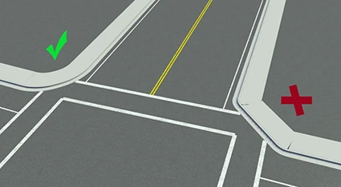
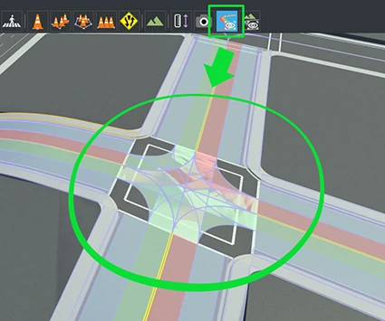
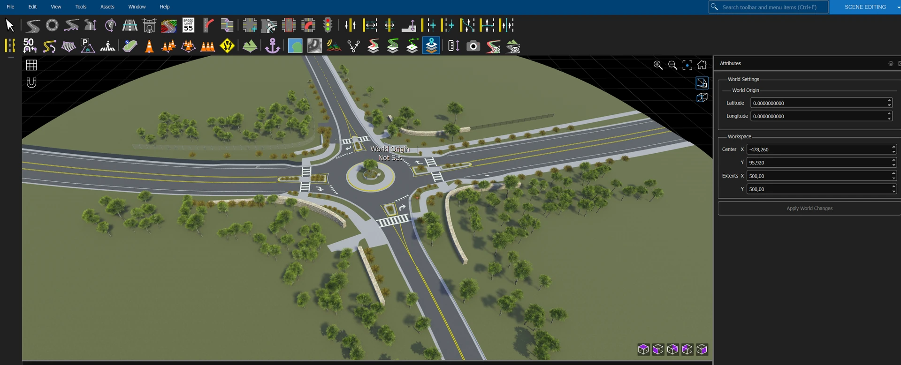
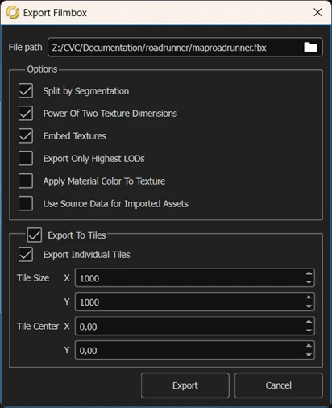
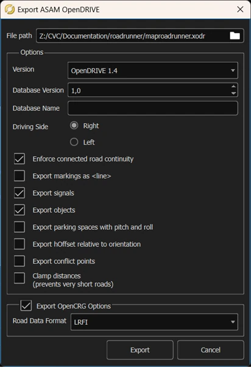

# RoadRunner

RoadRunner is the recommended tool for authoring the road network of a CARLA map. This page covers what it is, how to build a map that imports cleanly, the export settings CARLA expects, and how to export a map that streams well once it is in CARLA.

- [__Introduction to RoadRunner__](#introduction-to-roadrunner)
- [__Before you start__](#before-you-start)
- [__Build the map__](#build-the-map)
- [__Export the map__](#export-the-map)
- [__Import it into CARLA__](#import-it-into-carla)
- [__Large maps__](#large-maps)

---

## Introduction to RoadRunner

RoadRunner is an interactive editor for designing 3D scenes to simulate and test automated driving systems. It produces the road layout, the geometry and the matching OpenDRIVE description — which is what CARLA needs. See the [product page][rr_home] for the full picture.

RoadRunner is part of the MATLAB Campus-Wide Licenses, so many universities provide unlimited academic access; [check][rr_eligibility] whether yours does, and write to *automated-driving@mathworks.com* with access questions. A [trial version][rr_trial_version] is available, and a licence is also available to anyone taking part in the [CARLA Leaderboard][rr_leaderboard].

[rr_home]: https://www.mathworks.com/products/roadrunner.html
[rr_trial_version]: https://www.mathworks.com/products/roadrunner.html
[rr_eligibility]: https://www.mathworks.com/academia/tah-support-program/eligibility.html
[rr_leaderboard]: https://www.mathworks.com/academia/student-competitions/carla-autonomous-driving-challenge.html
[rr_docs]: https://www.mathworks.com/help/roadrunner/ug/install-and-activate-roadrunner.html
[rr_tutorials]: https://www.mathworks.com/support/search.html?fq=asset_type_name:video%20category:roadrunner/index&page=1&s_tid=CRUX_topnav

---

## Before you start

Install RoadRunner by following the [installation guide][rr_docs] on the MathWorks website.

---

## Build the map

Building the map itself is beyond this guide — the [RoadRunner documentation][rr_tutorials] has video tutorials. One constraint matters for CARLA: __centre the map on (0, 0)__, because a map built away from the origin does not line up when it reaches Unreal Engine.

The road layout cannot be changed after export, so validate before you export: check the geometry, and pay attention to junction connections.

A clean junction (left) and a broken one (right): check every junction before exporting.

The `OpenDRIVE Preview Tool` draws the road network as CARLA will read it, which is the quickest way to catch a bad junction:

The OpenDRIVE Preview Tool showing the lanes and junction connections that CARLA will read.

!!! Note
    If the preview shows junction errors, open the `Maneuver Tool` and use `Rebuild Maneuver Roads`.

---

## Export the map

Select the whole map first: open the [World settings tool](https://www.mathworks.com/help/roadrunner/ref/worldsettingstool.html), drag the blue boundary box around everything you want to export, and click _Apply World Changes_.

The World settings tool: the blue boundary box around the map, then <b>Apply World Changes</b>.

__1. Export the geometry.__ `File` → `Export` → `Filmbox (.fbx)`, with:

| Option | Why |
| ------ | --- |
| _Split by Segmentation_ | Divides the mesh by semantic tag, which also improves pedestrian navigation. |
| _Power of Two Texture Dimensions_ | Faster to render. |
| _Embed Textures_ | Keeps the textures inside the mesh file. |

The Filmbox (.fbx) export options, here with the tiling a large map needs.

__2. Export the road description.__ `File` → `Export` → `OpenDRIVE (.xodr)`.

The OpenDRIVE (.xodr) export options, saved with the same name as the .fbx.

!!! Warning
    The `.xodr` and the `.fbx` must share a name; that pairing is what the importer looks for.

---

## Import it into CARLA

Copy the `.fbx` and the `.xodr` into the `Import` folder and run the importer as described in [Importing your road network into CARLA](content_authoring_maps.md#import-the-road-network-into-carla). From there the map is decorated in the editor like any other, which [Create a map](content_authoring_maps.md) covers.

---

## Large maps

__Size.__ Keep a map with elevation at or below 20 km by 20 km; larger maps tend to crash RoadRunner on export.

__Export.__ Add these two options to the Filmbox (.fbx) export above:

| Option | Why |
| ------ | --- |
| _Export to Tiles_ | Splits the map into tiles, and so splits the ground into one mesh per tile. |
| _Export Individual Tiles_ | Writes one file per tile, which is what the importer expects. |

A tiled export produces `<Name>_Tile_<X>_<Y>.fbx` files beside a single `<Name>.xodr`. The importer recognises that set and builds __one__ map from it, keeping each tile's meshes as separate assets; there is no option to import the tiles as separate levels, and nothing is merged into a single mesh.

Tiling is what makes a map stream. CARLA imports one static mesh per mesh node in the `.fbx` and places one actor per mesh, and [World Partition](core_map.md#large-maps-and-world-partition) streams whole actors: a map exported as a single file is a handful of actors that are always resident, however large it is. The same geometry exported in a 2 x 2 grid of tiles came in as 24 meshes rather than 2, which is 24 things the engine can load and unload independently.

__Tile size.__ RoadRunner's default works, and smaller tiles stream better. World Partition loads cells that are a good deal smaller than a default tile, and an actor larger than a cell is placed in a coarser grid and stays resident over a wide area, so reduce the tile size if too much of the map stays loaded at once.

---

If you have any questions about the process, ask in the [GitHub Discussions](https://github.com/carla-simulator/carla/discussions).

<a href="https://github.com/carla-simulator/carla/discussions" target="_blank" class="btn btn-neutral" title="Go to CARLA's GitHub Discussions">
GitHub Discussions</a>

