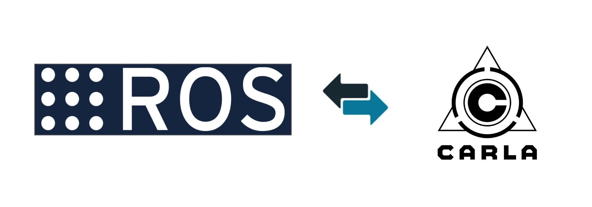

# ROS 2 native interface



CARLA speaks ROS 2 from the server itself — there is no bridge process. Sensors publish and vehicles subscribe as soon as the simulator is started with `-ros2`:

```sh
./CarlaUnreal.sh -ros2
```

- [__Quick start__](#quick-start)
- [__Middleware (RMW)__](#middleware-rmw)
- [__ROS 2 domain id__](#ros-2-domain-id)
- [__Sensor data__](#sensor-data)
- [__Control data__](#control-data)
- [__Related pages__](#related-pages)

!!! Note
    The flag is single-dash, `-ros2`; `--ros2` is also accepted on this branch. A source build has to be configured with `-DENABLE_ROS2=ON`, which is the default in CI but not in a plain configure.

---
## Quick start

```sh
# Terminal 1: the server
./CarlaUnreal.sh -ros2

# Terminal 2: spawn a hero vehicle with a camera, LIDAR, GNSS and IMU
cd PythonAPI/examples/ros2
python3 ros2_native.py --file stack.json

# Terminal 3: see what it publishes
ros2 topic list
ros2 topic echo /clock
```

---
## Middleware (RMW)

The native connector can publish through any of three middlewares. Select one with the `--rmw=` option, which is only valid together with `--ros2`:

```sh
./CarlaUnreal.sh --ros2 --rmw=cyclonedds
```

Accepted values are `fastdds` (the default), `cyclonedds`, and `zenoh`. The native interface itself is built on Linux only, so all three are Linux-only. If the value is not recognized, or names a middleware that was not compiled into the binary, ROS 2 is disabled for that session and an error is logged listing the available middlewares. The published topics and message formats are identical across all middlewares.

`--rmw=zenoh` is compatible with `rmw_zenoh_cpp` peers and requires a Zenoh router (`ros2 run rmw_zenoh_cpp rmw_zenohd`) running before the simulator starts. The session connects to `tcp/localhost:7447` by default; set `ZENOH_SESSION_CONFIG_URI` to point at a different rmw_zenoh config file, or `ZENOH_CONFIG_OVERRIDE` to patch individual keys.

### Fast-DDS transport and shared memory

With `--rmw=fastdds` the simulator restricts the Fast-DDS participant to the **UDPv4 transport only**. Fast-DDS's own builtin default (UDPv4 + shared memory, preferring shared memory for peers on the same host) silently delivers no data whenever the shared-memory path cannot actually be shared, while discovery keeps working — topics appear in `ros2 topic list` but `ros2 topic echo` never receives a sample, with no warning on either side. This happens in three independent, common situations:

- the subscriber runs in a container without `--ipc=host` (separate `/dev/shm` namespace);
- the subscriber runs as a different user than the simulator (Fast-DDS segment files are created `0644`, so cross-user writes into the reader's port fail) — this includes containers running as root against a simulator running as a regular user;
- the subscriber uses an incompatible Fast-DDS generation (for example ROS 2 Humble ships Fast-DDS 2.6, which cannot exchange shared memory with the simulator's 2.14).

Fast-DDS does not fall back to UDP when the shared-memory path is unreachable, so with the stock default any of the above results in silent data loss. The UDPv4-only default makes every subscriber — containerized or not, any user, any ROS 2 distribution — work without configuration.

Same-host power users who want shared-memory (or `LARGE_DATA`) performance back can set the standard [`FASTDDS_BUILTIN_TRANSPORTS`](https://fast-dds.docs.eprosima.com/en/latest/fastdds/env_vars/env_vars.html) environment variable (e.g. `FASTDDS_BUILTIN_TRANSPORTS=DEFAULT`) when launching the simulator; the simulator then leaves the transport selection entirely to Fast-DDS and logs the active choice at startup. For shared memory to actually deliver, the subscriber must share the IPC namespace, run as the same uid, and use a compatible Fast-DDS version. The other middlewares are unaffected: CycloneDDS and Zenoh never use shared memory in this build.

#### Which subscriber setups receive data (`--rmw=fastdds`)

Every combination below was verified against a live simulator (Fast-DDS 2.14.6). "ROS 2 Jazzy" stands for any peer on a Fast-DDS 2.14-generation stack, "ROS 2 Humble" for the 2.6 generation. A ✗ always looks the same: topics are listed, `ros2 topic echo` receives nothing, and neither side logs a warning.

| Subscriber setup | Simulator default (UDPv4 only) | Simulator with `FASTDDS_BUILTIN_TRANSPORTS=DEFAULT` (UDPv4 + SHM) |
|---|---|---|
| Another machine on the network | ✓ UDP | ✓ UDP (SHM is never selected across hosts) |
| Same host, same user, Jazzy | ✓ UDP | ✓ SHM |
| Same host, different user (any distro) | ✓ UDP | ✗ no data — cross-user SHM writes fail |
| Same host, same user, Humble | ✓ UDP | ✗ no data — incompatible SHM generation |
| Container, `--net=host` only | ✓ UDP | ✗ no data — separate `/dev/shm` |
| Container, `--net=host --ipc=host` (default root user) | ✓ UDP | ✗ no data — uid mismatch |
| Container, `--net=host --ipc=host --user <simulator uid>`, Jazzy | ✓ UDP | ✓ SHM |
| Container, `--net=host --ipc=host --user <simulator uid>`, Humble | ✓ UDP | ✗ no data — incompatible SHM generation |
| Any container, subscriber forced to UDP via `FASTRTPS_DEFAULT_PROFILES_FILE` (profile shipped in `PythonAPI/examples/ros2/config/fastrtps-profile.xml`) | ✓ UDP | ✓ UDP |

`--rmw=cyclonedds` behaves like the first column in every row (UDP only, no shared-memory support compiled in). `--rmw=zenoh` is independent of this table entirely; it requires the Zenoh router and `rmw_zenoh_cpp` peers as described above.

---
## ROS 2 domain id

The ROS2 domain id used by the native connector is configurable with the `--ros-domain-id=<N>` option, which is only valid together with `--ros2`:

```sh
./CarlaUnreal.sh --ros2 --ros-domain-id=42
```

`N` must be an integer in the range 0 to 232. The effective domain id is resolved in this order: the `--ros-domain-id` value, then the `ROS_DOMAIN_ID` environment variable, then the default domain 0. Out-of-range values (from either the option or the environment variable) are ignored and the next source is used. Omitting the option keeps the default domain, so existing setups are unchanged. The chosen domain id applies to every middleware (FastDDS, CycloneDDS, and Zenoh), so peers must run on the same domain to discover the topics.

---
## Sensor data

Every spawned sensor publishes by default; the project setting __ROS2 Topics Visible On Startup__ (`ROS2TopicVisibility`, on by default) decides that. Turn it off to publish only the sensors you ask for, and choose per sensor from the client:

```py
sensor.enable_for_ros()
sensor.disable_for_ros()
sensor.is_enabled_for_ros()
```

__Topic names are built from the sensor and its parent.__ Set `ros_name` on the blueprint before spawning; without it the sensor falls back to its type and stream id, for example `rgb123`, which is stable for a run but not across runs.

```py
bp = bp_lib.find('sensor.camera.rgb')
bp.set_attribute('ros_name', 'front_camera')
```

The image is then published to `/carla/front_camera/image`. When the camera is attached to a parent, the parent's own `ros_name` is prefixed, so a camera on a vehicle whose `ros_name` is `ego` publishes to `/carla/ego/front_camera/image`:

```py
ego_bp.set_attribute('role_name', 'hero')   # makes it the ego for the server
ego_bp.set_attribute('ros_name', 'ego')     # names the topic segment
ego = world.spawn_actor(ego_bp, spawn_point)
camera = world.spawn_actor(bp, transform, attach_to=ego)
```

If a stack expects a topic that does not follow that convention, `ros_topic_name` replaces the generated name:

```py
bp.set_attribute('ros_topic_name', '/sensing/camera/traffic_light')
```

The camera then publishes on `/sensing/camera/traffic_light/image` and `/sensing/camera/traffic_light/camera_info`: the override replaces the `/carla/<parent>/<sensor>` part and the per-sensor suffix is still appended under it. LIDAR, semantic LIDAR, HSS LIDAR and radar are the exception and publish on the overridden name verbatim, with no `/point_cloud` suffix.

Two topics are global rather than per sensor: the simulation clock on `/clock`, and the transform tree on `/tf`. The tree is on by default and is turned off with `world.set_publish_tf(False)`.

See the [ROS 2 sensors reference](ros2_native_sensors.md) for details about the message formats used for each sensor type.

---
## Control data

Controls may be sent to one ego vehicle:

```py
bp = world.get_blueprint_library().find('vehicle.lincoln.mkz')
bp.set_attribute('role_name', 'hero')   # the server only subscribes for 'hero' or 'ego'
bp.set_attribute('ros_name', 'ego')     # the name the topics are built from

ego = world.spawn_actor(bp, spawn_point)
```

The `role_name` is what makes the server create a control subscriber at all: it has to be `hero` or `ego`. The `ros_name` is what the topic is named after, so the pair above gives `/carla/ego/vehicle_control_cmd`.

__A vehicle listens on exactly one command surface__, chosen at spawn time by two blueprint attributes, so two topics can never fight over the same frame:

| Attribute | Topic | Message | Control |
| --- | --- | --- | --- |
| none, the default | `/carla/ego/vehicle_control_cmd` | [`carla_msgs/CarlaEgoVehicleControl`](ros2_native_msgs.md#carlaegovehiclecontrol) | Throttle, steer and brake directly |
| `ros2_ackermann_control` | `/carla/ego/ackermann_control_cmd` | [`ackermann_msgs/AckermannDriveStamped`](ros2_native_msgs.md#ackermanndrivestamped) | Target speed, acceleration and steering angle, converted to vehicle control by the server |
| `ros2_autoware_control` | the fixed `/control/command/*` topics | [Autoware messages](ros2_native_msgs.md#autoware-messages) | Autoware's own vehicle interface, see [Autoware](autoware.md) |

Set the attribute before spawning:

```py
bp.set_attribute('ros2_ackermann_control', 'true')
```

Choose whichever suits the stack: `vehicle_control_cmd` for a controller that already produces pedal and steering commands, `ackermann_control_cmd` for one that works in speed and steering angle. `ros2_autoware_control` wins when both it and the Ackermann attribute are set.

The CARLA message types come from the [ros-carla-msgs package](https://github.com/carla-simulator/ros-carla-msgs); every message is defined field by field in [ROS 2 messages](ros2_native_msgs.md).


---
## Related pages

- [ROS 2 sensors](ros2_native_sensors.md) — what each sensor publishes, on which topic and in which message.
- [ROS 2 messages](ros2_native_msgs.md) — the definition of each message, field by field.
- [Autoware](autoware.md) — driving the ego vehicle with the Autoware stack over this interface.
- [ROS bridge](ros_bridge.md) — the separate bridge project, which targets the Unreal Engine 4 line.
