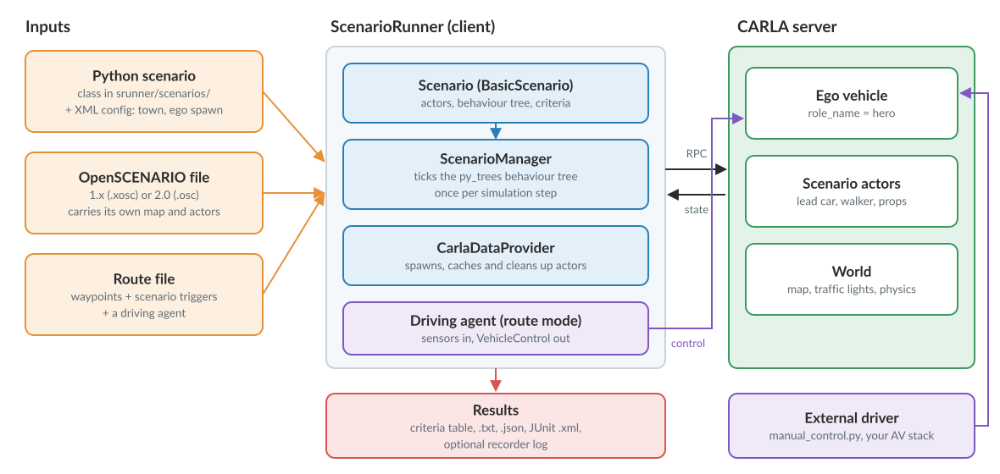
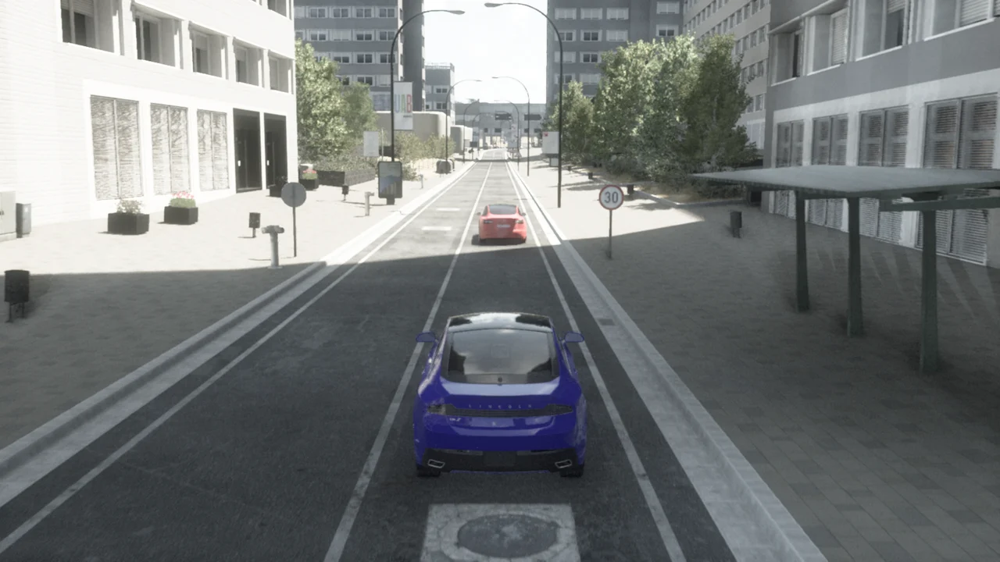
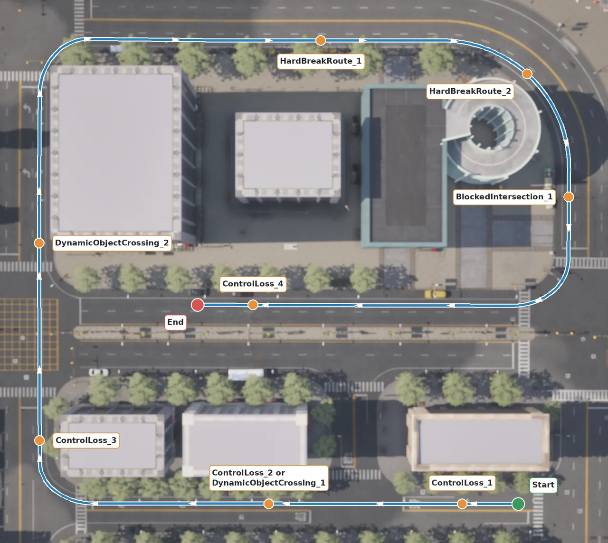
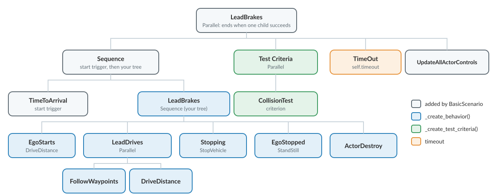

# ScenarioRunner

[ScenarioRunner](https://github.com/carla-simulator/scenario_runner) is the scenario engine for CARLA. A scenario is a scripted traffic situation, such as a lead vehicle braking hard, a pedestrian stepping out or a car running a red light, together with the criteria that decide whether the ego vehicle handled it. ScenarioRunner spawns the actors, plays the situation out on a running CARLA server, and reports a pass or fail for every criterion. Scenarios are written in Python, in OpenSCENARIO, or embedded in a route, and the same scenario can be replayed against a human driver, an autopilot or your own driving stack as many times as needed.

- [__ScenarioRunner and CARLA__](#scenariorunner-and-carla)
- [__Install__](#install)
- [__Run a Python scenario__](#run-a-python-scenario)
- [__Run an OpenSCENARIO file__](#run-an-openscenario-file)
- [__Run a route with a driving agent__](#run-a-route-with-a-driving-agent)
- [__Command-line options__](#command-line-options)
- [__How a scenario is built__](#how-a-scenario-is-built)
- [__Write your own scenario__](#write-your-own-scenario)
- [__Read the results__](#read-the-results)
- [__Limitations on this version__](#limitations-on-this-version)
- [__More information__](#more-information)

!!! agent "Agentic CARLA"
    *"Install the ScenarioRunner that matches my CARLA, run FollowLeadingVehicle_1 with the ego on autopilot and summarise the criteria."*

    Skills: `run-carla-ue58-server`, `install-scenario-runner`, `run-scenario`, `run-openscenario`, `run-route-scenario`, `create-scenario`, `analyze-scenario-results`. [Set up Agentic CARLA](agent_skills.md#set-up-agentic-carla).

---
## ScenarioRunner and CARLA



ScenarioRunner is a separate repository and a pure Python __client__ of the CARLA server: nothing is added to the server, and nothing has to be built. It connects through the [Python API](python_api.md), loads the map the scenario asks for, spawns the scenario actors and then ticks a behaviour tree once per simulation step until the scenario ends or times out.

ScenarioRunner does not drive the ego vehicle (the vehicle with `role_name` `hero`) unless you give it a driving agent. In the Python and OpenSCENARIO modes the ego is spawned and then waits for a driver: `manual_control.py`, the autopilot, or your own stack connected as another client. In route mode a driving agent runs inside ScenarioRunner and sends the ego its controls every tick.

The [CARLA Leaderboard](leaderboard.md) is built on ScenarioRunner. Its evaluator imports ScenarioRunner's route scenarios, atomic behaviours and criteria, so a Leaderboard run needs a ScenarioRunner checkout on `PYTHONPATH`, and a Leaderboard driving agent implements the same `AutonomousAgent` methods (`setup()`, `sensors()`, `run_step()`, `destroy()`) as a ScenarioRunner one.

---
## Install

ScenarioRunner has one branch per CARLA line, and scenarios, town names and blueprint names differ between them. For CARLA on Unreal Engine 5.8 use the __`ue58-dev`__ branch. `master` targets the 0.9.x API of the Unreal Engine 4.26 line, and `ue5-master` the older 0.10.0 release.

__1.__ Install the CARLA client wheel into the interpreter you will use, as described in the [quick start](start_quickstart.md) for a package or in the [Linux build guide](build_linux_ue5.md) for a source build. A virtual environment works as long as the wheel matches its Python version.

__2.__ Clone the branch and install its requirements into the same interpreter. They pin `py-trees==0.8.3`, whose API the scenarios are written against; `antlr4-python3-runtime` is needed only for OpenSCENARIO 2.0.

```sh
git clone -b ue58-dev --single-branch https://github.com/carla-simulator/scenario_runner.git
cd scenario_runner
python3 -m pip install -r requirements.txt
```

__3.__ Set the environment. `SCENARIO_RUNNER_ROOT` is read at run time to find `srunner/scenarios/*.py` and to place recordings. `PythonAPI/carla` of your CARLA tree has to be on `PYTHONPATH` because ScenarioRunner imports the `agents` package ([Traffic Agents](core_agents.md)), which the `carla` wheel does not install.

```sh
export CARLA_ROOT=/path/to/carla
export SCENARIO_RUNNER_ROOT=/path/to/scenario_runner
export PYTHONPATH=$SCENARIO_RUNNER_ROOT:$CARLA_ROOT/PythonAPI/carla:$PYTHONPATH
```

If `scenario_runner.py` fails with `ModuleNotFoundError: No module named 'agents'`, the second path is missing.

__4.__ Start a CARLA server and check the installation by listing the scenarios this checkout can run:

```sh
python3 $SCENARIO_RUNNER_ROOT/scenario_runner.py --list
```

```text
Currently the following scenarios are supported:
SignalizedJunctionRightTurn_1
SignalizedJunctionRightTurn_2
...
ControlLoss_1
FollowLeadingVehicle_1
FollowLeadingVehicleWithObstacle_1
...
```

The `ue58-dev` branch lists 96 configurations, spread over `Town01_Opt` to `Town05_Opt` and `Town10HD_Opt`.

---
## Run a Python scenario

A Python scenario is a class in `srunner/scenarios/` plus a configuration in `srunner/examples/*.xml` that gives it a town, the ego spawn point and its parameters. You select it by the __configuration name__, for example `FollowLeadingVehicle_1`, not by the class name. In `FollowLeadingVehicle` a lead vehicle drives down the road, brakes to a stop before the next intersection, and the ego has to stop behind it without a collision.

__1.__ Start the scenario. `--reloadWorld` loads the town named in the configuration (`Town01_Opt` here) if the server has another map.

```sh
python3 $SCENARIO_RUNNER_ROOT/scenario_runner.py --scenario FollowLeadingVehicle_1 --reloadWorld --output
```

__2.__ In a second terminal, give the ego a driver. `manual_control.py` waits for the vehicle with role name `hero`, then opens a pygame window with keyboard control; `-a` hands the vehicle to the autopilot instead.

```sh
python3 $SCENARIO_RUNNER_ROOT/manual_control.py        # drive with the keyboard
python3 $SCENARIO_RUNNER_ROOT/manual_control.py -a     # or let the autopilot drive
```


<div class="img-caption">The FollowLeadingVehicle scenario on Town10HD_Opt, from an adapted copy of the scenario and its configuration: the FollowLeadingVehicle_1 configuration with a Town10HD_Opt trigger point and a blue Nissan Patrol as the ego, and the scenario class with a white Dodge Charger as the lead instead of the Nissan Patrol it spawns by default. The ego is on autopilot with a 7 m following distance; the lead brakes before the intersection and the ego stops behind it.</div>

The scenario ends when the ego stands still within 20 m of the stopped lead vehicle, and ScenarioRunner prints the result:

```text
 ======= Results of Scenario: FollowVehicle ---- SUCCESS =======
...
 > Criteria Information
╒══════════════════════╤══════════════════════╤═════════╤══════════════╤═══════════════╕
│ Actor                │ Criterion            │ Result  │ Actual Value │ Success Value │
├──────────────────────┼──────────────────────┼─────────┼──────────────┼───────────────┤
│ lincoln.mkz (id=366) │ CollisionTest (Req.) │ SUCCESS │ 0            │ 0             │
├──────────────────────┼──────────────────────┼─────────┼──────────────┼───────────────┤
│                      │ Timeout (Req.)       │ SUCCESS │ 29.38        │ 60            │
├──────────────────────┼──────────────────────┼─────────┼──────────────┼───────────────┤
│                      │ GLOBAL RESULT        │ SUCCESS │              │               │
╘══════════════════════╧══════════════════════╧═════════╧══════════════╧═══════════════╛
```

If nobody drives, the scenario never starts: its start trigger waits for the ego to move (see [How a scenario is built](#how-a-scenario-is-built)), and the run ends after 60 s with `GLOBAL RESULT TIMEOUT`.

`--scenario group:FollowLeadingVehicle` runs every configuration of one class in sequence. `--sync` runs the scenario in [synchronous mode](core_synchrony.md#client-server-synchrony) at `--frameRate` Hz (20 by default), which is what reproducible runs need; ScenarioRunner restores asynchronous mode when it exits normally.

---
## Run an OpenSCENARIO file

ScenarioRunner reads two standards that share a name but not a format:

| | OpenSCENARIO 1.x | OpenSCENARIO 2.0 |
| --- | --- | --- |
| File | `.xosc`, XML with a `Storyboard` of stories, acts and maneuvers | `.osc`, a domain-specific language |
| Option | `--openscenario` | `--openscenario2` |
| Examples | `srunner/osc_examples/*.xosc` | `srunner/osc_examples/*.osc` |

An OpenSCENARIO file carries its own map (the `RoadNetwork` `LogicFile`), entities and ego, so there is no configuration name and no town lookup. `--openscenarioparams` overrides entries of the file's global `ParameterDeclarations`, written as `'name: value, name2: value2'`:

```sh
python3 $SCENARIO_RUNNER_ROOT/scenario_runner.py \
    --openscenario $SCENARIO_RUNNER_ROOT/srunner/osc_examples/FollowLeadingVehicle.xosc \
    --openscenarioparams 'leadingSpeed: 6.0' --output
```

In `FollowLeadingVehicle.xosc` the `hero` is assigned the `external_control` controller, so it waits for a driver exactly like a Python scenario: run `manual_control.py` as above. The other controllers in `srunner/scenariomanager/actorcontrols/`, such as `carla_autopilot` or `simple_vehicle_control`, drive the actor from ScenarioRunner itself; `OscControllerExample.xosc` shows how a controller is assigned.


<div class="img-caption">FollowLeadingVehicle.xosc in a copy adapted to Town15 (map and the ego's start position changed): the blue ego follows the red adversary. The file sets both colours.</div>

ScenarioRunner implements a subset of OpenSCENARIO 1.x; the [OpenSCENARIO support table](https://scenario-runner.readthedocs.io/en/latest/openscenario_support/) lists the actions, conditions and controllers it covers. OpenSCENARIO 2.0 support is experimental and needs `antlr4-python3-runtime` installed.

---
## Run a route with a driving agent

Route mode drives the ego along a route, given as waypoints, and triggers the scenarios placed along it at their trigger points. It is the mechanism the Leaderboard uses. Route files are in `srunner/data/`: `routes_town10.xml` has one route on `Town10HD_Opt`, and the Leaderboard routes `routes_training.xml`, `routes_validation.xml` and `routes_devtest.xml` run on `Town12` and `Town13`.

```sh
python3 $SCENARIO_RUNNER_ROOT/scenario_runner.py \
    --route $SCENARIO_RUNNER_ROOT/srunner/data/routes_town10.xml --route-id 0 \
    --agent $SCENARIO_RUNNER_ROOT/srunner/autoagents/npc_agent.py --output
```

Route mode always reloads the world, and `--agent` switches to synchronous mode. Background traffic is spawned around the ego for the whole route. The driving agents in `srunner/autoagents/` are:

| File | Behaviour |
| --- | --- |
| `npc_agent.py` | Follows the route with a [BasicAgent](core_agents.md) at 30 km/h. The reference check that routes work. |
| `human_agent.py` | Keyboard control in a pygame window. Its configuration file can log the controls to JSON and play them back. |
| `dummy_agent.py` | Returns an empty control. The template for your own agent. |

ScenarioRunner derives the agent class from the file name: `npc_agent.py` must define `NpcAgent`, `my_agent.py` must define `MyAgent`. `--agentConfig` passes a file path to the agent's `setup()`. An agent subclasses `AutonomousAgent` and implements `setup()`, `sensors()`, `run_step()` and `destroy()`, the interface described in [Writing an agent](leaderboard.md#writing-an-agent).


<div class="img-caption">Route 0 of routes_town10.xml on Town10HD_Opt, seen from above: the route as ScenarioRunner interpolates it from the file's waypoints, and the trigger point of each scenario in the file. When several scenarios share a trigger point, ScenarioRunner picks one of them for the run.</div>

A route run reports the route criteria, which are always active, on top of those of each scenario. This run of route 0 with `npc_agent.py` completed the whole route and ran one stop sign:

```text
│ lincoln.mkz (id=595) │ RouteCompletionTest (Req.)   │ SUCCESS │ 100          │ 100           │
│ lincoln.mkz (id=595) │ OutsideRouteLanesTest (Req.) │ SUCCESS │ 0            │ 0             │
│ lincoln.mkz (id=595) │ CollisionTest (Req.)         │ SUCCESS │ 0            │ 0             │
│ lincoln.mkz (id=595) │ RunningRedLightTest (Req.)   │ SUCCESS │ 0            │ 0             │
│ lincoln.mkz (id=595) │ RunningStopTest (Req.)       │ FAILURE │ 1            │ 0             │
│ lincoln.mkz (id=595) │ MinSpeedTest (Req.)          │ SUCCESS │ 167.89       │ 100           │
│ lincoln.mkz (id=595) │ InRouteTest (Req.)           │ SUCCESS │ 0            │ 0             │
│ lincoln.mkz (id=595) │ AgentBlockedTest (Req.)      │ SUCCESS │ 0            │ 0             │
│ lincoln.mkz (id=595) │ ScenarioTimeoutTest (Req.)   │ SUCCESS │ 0            │ 0             │
│                      │ Timeout (Req.)               │ SUCCESS │ 164.3        │ 212           │
│                      │ GLOBAL RESULT                │ FAILURE │              │               │
```

---
## Command-line options

`scenario_runner.py` takes one of `--scenario`, `--openscenario`, `--openscenario2` or `--route`; `--route` cannot be combined with the others, and `--agent` is accepted only with `--route`.

| Option | Default | Effect |
| --- | --- | --- |
| `--scenario NAME` | | Run a Python scenario by configuration name; `group:Class` runs every configuration of that class. |
| `--openscenario FILE` | | Run an OpenSCENARIO 1.x file. |
| `--openscenarioparams 'k: v, ...'` | | Override global `ParameterDeclarations` of the `--openscenario` file. |
| `--openscenario2 FILE` | | Run an OpenSCENARIO 2.0 file. |
| `--route FILE` | | Run the routes of a route file; forces `--reloadWorld`. |
| `--route-id ID` | all routes | Run only this route of the file. |
| `--agent FILE` | | Driving agent for route mode; forces `--sync`. |
| `--agentConfig FILE` | | Configuration file passed to the agent's `setup()`. |
| `--list` | | Print the configuration names this checkout can run, and exit. |
| `--configFile FILE` | | Additional scenario configuration XML. |
| `--additionalScenario FILE` | | Additional scenario implementation `.py`. |
| `--reloadWorld` | off | Reload the world (and load the scenario's town) before starting. |
| `--sync` | off | Run in synchronous mode. |
| `--frameRate HZ` | `20` | Tick rate in synchronous mode. |
| `--repetitions N` | `1` | Run each scenario N times. |
| `--randomize` | off | Let scenarios that support it randomise their parameters. |
| `--waitForEgo` | off | Attach to an ego vehicle spawned by someone else instead of spawning one. |
| `--output` | off | Print the results to stdout. |
| `--file` / `--json` / `--junit` | off | Write the results as `.txt`, `.json` or JUnit `.xml`. |
| `--outputDir DIR` | current directory | Where the result files go. |
| `--record DIR` | | Record the run with the [CARLA recorder](core_recorder.md) to `DIR/<config name>.log`, relative to `SCENARIO_RUNNER_ROOT`, and save the criteria for the metrics module. |
| `--debug` | off | Print the behaviour tree, with the status of every node, on every tick. |
| `--host` / `--port` | `127.0.0.1` / `2000` | CARLA server. |
| `--timeout S` | `120.0` | Client timeout in seconds. |
| `--trafficManagerPort` / `--trafficManagerSeed` | `8000` / `0` | Traffic Manager used by ScenarioRunner. |

---
## How a scenario is built

Every scenario derives from `BasicScenario` (`srunner/scenarios/basic_scenario.py`) and fills in three methods:

| Method | Returns |
| --- | --- |
| `_initialize_actors(config)` | Nothing. Spawns the scenario actors through `CarlaDataProvider.request_new_actor()` and appends them to `self.other_actors`. |
| `_create_behavior()` | The root of a [py_trees](https://py-trees.readthedocs.io/) behaviour tree: what the other actors do and when the scenario ends. |
| `_create_test_criteria()` | A list of criteria, which decide pass or fail. |

A behaviour tree is built from __composites__ and __leaves__. A `Sequence` runs its children one after the other; a `Parallel` runs them together and succeeds when one child succeeds (`SUCCESS_ON_ONE`) or when all do (`SUCCESS_ON_ALL`). The leaves are ScenarioRunner's atomics, in `srunner/scenariomanager/scenarioatomics/`:

| Module | Contains | Examples |
| --- | --- | --- |
| `atomic_behaviors.py` | Actions on actors | `WaypointFollower`, `KeepVelocity`, `StopVehicle`, `LaneChange`, `ActorTransformSetter`, `ActorDestroy` |
| `atomic_trigger_conditions.py` | Conditions that succeed when something happens | `InTriggerDistanceToVehicle`, `InTriggerDistanceToNextIntersection`, `DriveDistance`, `StandStill` |
| `atomic_criteria.py` | Criteria, evaluated for the whole run | `CollisionTest`, `KeepLaneTest`, `OnSidewalkTest`, `RunningRedLightTest`, `RunningStopTest`, `DrivenDistanceTest`, `MaxVelocityTest`, `RouteCompletionTest` |

`BasicScenario` wraps your tree in a root `Parallel` that also holds the criteria, a `TimeOut` and a node that applies the actors' controls. The scenario therefore ends as soon as your tree succeeds or the timeout fires. In front of your tree it puts a start trigger, `InTimeToArrivalToLocation`, which waits until the ego is moving and less than 2 s from its start point; in route mode it waits instead for the ego to reach the scenario's trigger point.



`ScenarioManager` ticks this tree once per simulation step. Each node returns `RUNNING`, `SUCCESS` or `FAILURE`, so a `Sequence` whose current child never succeeds keeps the scenario running until the timeout. `--debug` prints the tree on every tick. A leading `[-]` marks a `Sequence`, `(o)` a `Parallel` and `-->` a leaf; the status after the name is `[*]` for running, `[✓]` for succeeded and `[-]` for not running. This is the tree above while the lead vehicle brakes (the behaviour `Sequence` takes the name of your tree):

```text
LeadBrakes [*]
[-] LeadBrakes [*]
    --> TimeToArrival [✓]
    [-] LeadBrakes [*]
        --> EgoStarts [✓]
        (o) LeadDrives [✓]
            --> FollowWaypoints [-]
            --> DriveDistance [✓]
        --> Stopping [*]
        --> EgoStopped [-]
        --> ActorDestroy [-]
(o) Test Criteria [*]
    --> CollisionTest [*]
--> TimeOut [*]
--> UpdateAllActorControls [*]
```

---
## Write your own scenario

A scenario is two files: the class and its configuration. ScenarioRunner finds the class by matching the configuration's `type` against the classes in `srunner/scenarios/*.py`, so there is no registration step. Files kept outside the checkout are passed with `--additionalScenario` and `--configFile`.

__1.__ The class. In `LeadBrakes`, a car drives 40 m ahead of the ego, brakes to a stop, and the scenario ends when the ego has stopped too:

```py
import py_trees

from srunner.scenariomanager.carla_data_provider import CarlaDataProvider
from srunner.scenariomanager.scenarioatomics.atomic_behaviors import (ActorDestroy,
                                                                      StopVehicle,
                                                                      WaypointFollower)
from srunner.scenariomanager.scenarioatomics.atomic_criteria import CollisionTest
from srunner.scenariomanager.scenarioatomics.atomic_trigger_conditions import (DriveDistance,
                                                                               StandStill)
from srunner.scenarios.basic_scenario import BasicScenario
from srunner.tools.scenario_helper import get_waypoint_in_distance


class LeadBrakes(BasicScenario):
    """A vehicle drives ahead of the ego, brakes to a stop, and the ego must stop behind it."""

    def __init__(self, world, ego_vehicles, config, randomize=False, debug_mode=False,
                 criteria_enable=True, timeout=60):
        self.timeout = timeout  # set before super().__init__(), which builds the tree
        self._map = CarlaDataProvider.get_map()
        # XML parameters arrive as strings in config.other_parameters
        params = config.other_parameters
        self._lead_distance = float(params.get('lead_distance', {'value': 25})['value'])
        self._lead_speed = float(params.get('lead_speed', {'value': 8})['value'])
        super().__init__("LeadBrakes", ego_vehicles, config, world, debug_mode,
                         criteria_enable=criteria_enable)

    def _initialize_actors(self, config):
        ego_wp = self._map.get_waypoint(config.trigger_points[0].location)
        lead_wp, _ = get_waypoint_in_distance(ego_wp, self._lead_distance)
        transform = lead_wp.transform
        transform.location.z += 0.5
        lead = CarlaDataProvider.request_new_actor('vehicle.tesla.model3', transform)
        self.other_actors.append(lead)

    def _create_behavior(self):
        lead, ego = self.other_actors[0], self.ego_vehicles[0]

        # The lead drives along its lane until it has covered 40 m
        drive = py_trees.composites.Parallel(
            "LeadDrives", policy=py_trees.common.ParallelPolicy.SUCCESS_ON_ONE)
        drive.add_child(WaypointFollower(lead, self._lead_speed))
        drive.add_child(DriveDistance(lead, 40))

        root = py_trees.composites.Sequence("LeadBrakes")
        root.add_child(DriveDistance(ego, 2, name="EgoStarts"))   # the ego has driven 2 m
        root.add_child(drive)
        root.add_child(StopVehicle(lead, 1.0))                     # full brake
        root.add_child(StandStill(ego, name="EgoStopped", duration=1))
        root.add_child(ActorDestroy(lead))
        return root

    def _create_test_criteria(self):
        return [CollisionTest(self.ego_vehicles[0])]

    def __del__(self):
        self.remove_all_actors()
```

__2.__ The configuration, `LeadBrakes.xml`. `ego_vehicle` sets the ego's blueprint and spawn point, which is also the scenario's trigger point; any other element becomes an entry of `config.other_parameters`.

```xml
<?xml version="1.0"?>
<scenarios>
    <scenario name="LeadBrakes_1" type="LeadBrakes" town="Town01_Opt">
        <ego_vehicle x="107" y="133" z="0.5" yaw="0" model="vehicle.lincoln.mkz" />
        <lead_distance value="25" />
        <lead_speed value="8" />
    </scenario>
</scenarios>
```

__3.__ Run it, with a driver for the ego as before:

```sh
python3 $SCENARIO_RUNNER_ROOT/scenario_runner.py --scenario LeadBrakes_1 \
    --additionalScenario lead_brakes.py --configFile LeadBrakes.xml --reloadWorld --output
```

Three rules prevent most problems. Spawn actors with `CarlaDataProvider.request_new_actor()`, never `world.spawn_actor()`, so that the atomics can find them and they are cleaned up. Append every actor to `self.other_actors`, or it outlives the scenario. And make sure the tree can end: every child of your root `Sequence` has to succeed at some point, or every run ends at the timeout.

To use the scenario inside a route, reference its `type` in the route file's `scenarios` block with a `trigger_point`, and position the actors relative to `config.trigger_points[0]`, as `_initialize_actors()` above does.

---
## Read the results

`--output` prints three tables: the actors, the simulation time, and the criteria. Each criterion row has:

| Column | Meaning |
| --- | --- |
| __Criterion__ | The criterion's name, with `(Req.)` if it is required or `(Opt.)` if it is optional. An optional criterion is reported but does not affect the global result. |
| __Result__ | `SUCCESS`, `ACCEPTABLE` (not a failure, but not good enough for success) or `FAILURE`. |
| __Actual Value__ / __Success Value__ | What was measured and what was expected, for example the number of collisions against `0`, or the distance driven against the distance required. |

The `Timeout` row compares the game time the scenario took with its timeout. The __global result__ is `FAILURE` if any required criterion failed, `TIMEOUT` if the timeout fired and nothing failed, `ACCEPTABLE` if a criterion ended acceptable, and `SUCCESS` otherwise.

`--file`, `--json` and `--junit` write the same result to `<config name><date-time>.txt`, `.json` and `.xml` in `--outputDir`. The JSON lists each criterion with its expected and actual values. This is the run of `FollowLeadingVehicle_1` that nobody drove:

```json
{
    "scenario": "FollowVehicle",
    "success": false,
    "criteria": [
        {
            "name": "CollisionTest",
            "actor": "lincoln.mkz-193",
            "optional": false,
            "expected": 0,
            "actual": 0,
            "success": true
        },
        {
            "name": "Duration",
            "actor": "all",
            "optional": false,
            "expected": 60,
            "actual": 60.00663017865736,
            "success": false
        }
    ]
}
```

The JUnit file holds one test case per criterion plus `Duration`, with a `failure` element for each one that failed, so a CI system can show scenario runs as tests.

`--record DIR` also saves a CARLA recorder log of the run and the criteria as JSON. The log can be replayed with the [recorder](core_recorder.md), and ScenarioRunner's [metrics module](https://scenario-runner.readthedocs.io/en/latest/metrics_module/) computes your own metrics from the pair without simulating the scenario again.

---
## Limitations on this version

- __Weather is not applied in Python scenarios.__ `BasicScenario` does not set the weather of the configuration, so the `weather` element of an `srunner/examples/*.xml` configuration has no effect. Set the weather yourself with [`world.set_weather()`](core_world.md#weather) if a run depends on it.
- __Town names are resolved.__ The classic towns exist only as `_Opt` variants, so a configuration that asks for `Town01` loads `Town01_Opt`, with a warning. Old blueprint names are translated the same way; two-wheelers have no counterpart and fail.
- __An interrupted synchronous run__ can leave the server in synchronous mode, which makes the world look frozen to every other client. Set `synchronous_mode` back to `False` with `world.apply_settings()`.

---
## More information

The [ScenarioRunner documentation](https://scenario-runner.readthedocs.io/) covers the parts this page summarises in more depth:

- [Getting started](https://scenario-runner.readthedocs.io/en/latest/getting_scenariorunner/)
- [List of scenarios](https://scenario-runner.readthedocs.io/en/latest/list_of_scenarios/)
- [Create a new scenario](https://scenario-runner.readthedocs.io/en/latest/creating_new_scenario/)
- [OpenSCENARIO support](https://scenario-runner.readthedocs.io/en/latest/openscenario_support/)
- [Metrics module](https://scenario-runner.readthedocs.io/en/latest/metrics_module/)

It is written for the `master` branch, so its town and blueprint names and its install steps differ from the ones above.
