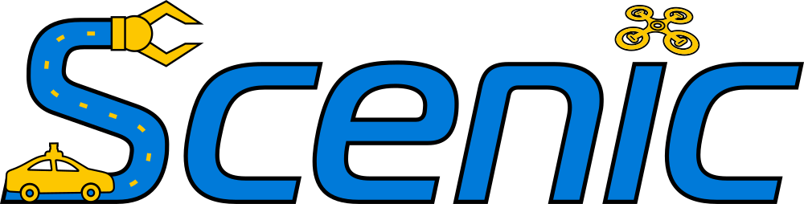

# Scenic



This guide provides an overview of how to use Scenic with CARLA to generate multiple, diverse scenarios with a single scenario definition. It assumes that users have prior knowledge of the Scenic syntax. If you need to learn more about Scenic, then read their ["Getting Started with Scenic"](https://scenic-lang.readthedocs.io/en/latest/quickstart.html) guide and check out the tutorials in the documentation.

- [__Before you begin__](#before-you-begin)
- [__Scenic domains__](#scenic-domains)
- [__Creating a Scenic scenario to use with CARLA__](#creating-a-scenic-scenario-to-use-with-carla)
- [__Run the scenario__](#run-the-scenario)
- [__Parameters of the CARLA model__](#parameters-of-the-carla-model)
- [__The full scenario__](#the-full-scenario)

---

## Before you begin

Before using Scenic with CARLA, you will need to fulfill the following requirements:

- Install the CARLA client wheel from this build, and [Scenic](https://scenic-lang.readthedocs.io/en/latest/quickstart.html#installation), __into the same interpreter__. Scenic reads the blueprint library through the client, so a client that does not match the server fails at spawn time.
- The Python version is the one the CARLA wheel was built for; Scenic itself supports 3.8 and later.
- The example below uses ScenarioRunner's Scenic model, so [install ScenarioRunner](https://github.com/carla-simulator/scenario_runner) on the `ue5-master` branch and add it to `PYTHONPATH`. A scenario that only uses `scenic.simulators.carla.model` does not need it.

---

## Scenic domains

Scenic has a general driving domain which allows users to define scenarios that can be run on any driving simulator. In addition, it has other domains that are specific to each simulator. Check [here](https://scenic-lang.readthedocs.io/en/latest/libraries.html) for more information on Scenic domains.

Of particular importance within each domain are the behavior and actions definitions. Check the links below for reference material to behaviors and actions from the Scenic driving domain and the CARLA domain:

- [Behaviours in the Scenic driving domain](https://scenic-lang.readthedocs.io/en/latest/modules/scenic.domains.driving.behaviors.html)
- [Behaviours in the CARLA domain](https://scenic-lang.readthedocs.io/en/latest/modules/scenic.simulators.carla.behaviors.html)
- [Actions in the Scenic driving domain](https://scenic-lang.readthedocs.io/en/latest/modules/scenic.domains.driving.actions.html)
- [Actions in the CARLA domain](https://scenic-lang.readthedocs.io/en/latest/modules/scenic.simulators.carla.actions.html#module-scenic.simulators.carla.actions)

---

## Creating a Scenic scenario to use with CARLA

This section walks through how to write a basic Scenic script in which a leading vehicle decelerates suddenly due to an obstacle in the road. An ego vehicle then needs to brake suddenly to avoid a collision with the leading vehicle. The [full script](https://github.com/Scenic-Foundation/Scenic/blob/main/examples/carla/Carla_Challenge/carlaChallenge2.scenic) is found in the Scenic repository along with other examples involving more complex road networks.

__1.__ Set the map parameters and declare the model to be used in the scenario:

- An `.xodr` file should be set as the value for the [`map`][scenic_map] parameter, this will be used later to generate road network information. 
- The parameter `carla_map` refers to the name of the CARLA map you would like to use in the simulation. If this is defined then Scenic will load all the assets of the map (buildings, trees, etc.), and if not, then the [OpenDRIVE standalone mode](adv_opendrive.md) will be used.
- The model includes all the utilities specific to running scenarios on CARLA. This should be defined in all the scripts you want to run on CARLA.

```py
## SET MAP AND MODEL
param map = localPath('assets/Town10HD_Opt.xodr')
param carla_map = 'Town10HD_Opt'
model srunner.scenic.models.model
```

[scenic_map]: https://scenic-lang.readthedocs.io/en/latest/modules/scenic.domains.driving.model.html?highlight=map#module-scenic.domains.driving.model

__2.__ Define the constants to be used in the scenario:

The scenario involves two vehicles, the leading vehicle and the ego vehicle. We will define the ego vehicle model, the speeds of both cars, the distance threshold for braking and the amount of brake to apply.

```py
## CONSTANTS
EGO_MODEL = "vehicle.lincoln.mkz"
EGO_SPEED = 7
EGO_BRAKING_THRESHOLD = 12

LEAD_CAR_SPEED = 8
LEADCAR_BRAKING_THRESHOLD = 15

BRAKE_ACTION = 1.0
```

__3__. Define the scenario behaviors:

In this scenario we will use the Scenic [behavior library](https://scenic-lang.readthedocs.io/en/latest/modules/scenic.domains.driving.behaviors.html) to instruct the ego vehicle to follow the lane at the predefined speed and then brake hard when it gets within a certain distance of another vehicle. The leading vehicle will also follow the lane at the predefined speed and brake hard within a certain distance of any objects:

```py
## DEFINING BEHAVIORS
# EGO BEHAVIOR: Follow lane, and brake after passing a threshold distance to the leading car
behavior EgoBehavior(speed=10):
    try:
        do FollowLaneBehavior(speed)

    interrupt when withinDistanceToAnyCars(self, EGO_BRAKING_THRESHOLD):
        take SetBrakeAction(BRAKE_ACTION)

# LEAD CAR BEHAVIOR: Follow lane, and brake after passing a threshold distance to obstacle
behavior LeadingCarBehavior(speed=10):
    try: 
        do FollowLaneBehavior(speed)

    interrupt when withinDistanceToAnyObjs(self, LEADCAR_BRAKING_THRESHOLD):
        take SetBrakeAction(BRAKE_ACTION)
```

__4.__ Generate the road network:

The Scenic [roads library](https://scenic-lang.readthedocs.io/en/latest/modules/scenic.domains.driving.roads.html) is used to generate the road network geometry and traffic information. The road network is represented by an instance of the [`Network`](https://scenic-lang.readthedocs.io/en/latest/modules/scenic.domains.driving.roads.html#scenic.domains.driving.roads.Network) class and is generated from the `.xodr` file defined at the beginning of the script.

```py
## DEFINING SPATIAL RELATIONS
# make sure to put '*' to uniformly randomly select from all elements of the list, 'lanes'
lane = Uniform(*network.lanes)
```

__5.__ Set the scene:

We will now define the starting positions for the vehicles and placement of objects.

- Place a trash can in the middle of the lane:

```py
obstacle = Trash on lane.centerline
```

- Place the leading car driving at the predefined speed along the road at a distance of between 60 and 50 meters behind the obstacle:

```py
leadCar = new Car following roadDirection from obstacle for Range(-60, -50),
        with behavior LeadingCarBehavior(LEAD_CAR_SPEED)
```

- Place the ego vehicle driving at the predefined speed along the road at a distance of between 15 to 10 meters behind the leading vehicle:

```py
ego = new Car following roadDirection from leadCar for Range(-15, -10),
        with blueprint EGO_MODEL,
        with behavior EgoBehavior(EGO_SPEED)
```

- Make it a requirement that the scene takes place more than 80 meters from an intersection:

```py
require (distance to intersection) > 80
```

__6.__ Set an end point so the script knows when the scene is finished:

The scenario will end when the speed of the ego vehicle goes below 0.1 meters per second and is situated less than 30 meters from the obstacle.

```py
terminate when ego.speed < 0.1 and (distance to obstacle) < 30
```

---

## Run the scenario

__1.__ Start the CARLA server.

__2.__ Run the scenario:

```sh
scenic path/to/scenic/script.scenic --simulate --2d
```

A pygame window appears and the scenario plays out repeatedly, sampling a new variation within the bounds the script sets each time. `ctrl + C` stops it.

Without bounds it runs until interrupted. Limit it with `--count`, the number of scenarios to run, and `--time`, the maximum steps per scenario:

```sh
scenic path/to/scenic/script.scenic --simulate --2d --count 1 --time 300
```

The CARLA host and port, and any `param` the script declares, are passed with `--param`:

```sh
scenic path/to/scenic/script.scenic --simulate --2d --param port 3000 --param carla_map Town10HD_Opt
```

---
## Parameters of the CARLA model

The CARLA model declares the global parameters below. Override them in the script with the [`param` statement](https://scenic-lang.readthedocs.io/en/latest/syntax_details.html#param-identifier-value), or on the command line with [`--param`](https://scenic-lang.readthedocs.io/en/latest/options.html#cmdoption-p).

| Name | Type | Default | What it does |
|---|---|---|---|
| `carla_map` | `str` | none | Map to load, e.g. `Town10HD_Opt`. With `None`, CARLA builds the world from the `map` `.xodr` in [OpenDRIVE standalone mode](adv_opendrive.md). |
| `map` | `str` | none | Path to the `.xodr` the road network is generated from. |
| `timestep` | `float` | 0.1 | Seconds between the ticks at which Scenic runs behaviors and checks requirements. |
| `weather` | `str` or `dict` | a random preset | A [preset](python_api.md#carla.WeatherParameters) name such as `ClearSunset`, or a dictionary of weather parameters. |
| `address` | `str` | `127.0.0.1` | Address of the CARLA server. |
| `port` | `int` | 2000 | Port of the CARLA server. |
| `timeout` | `float` | 10 | Seconds to wait for the connection. |
| `render` | `int` | 1 | Open a window showing the simulation from the ego's point of view. `0` turns it off. |
| `record` | `str` | empty | Folder for the [recorder](adv_recorder.md) logs of each simulation. Nothing is recorded while it is empty. |
| `snapToGroundDefault` | `bool` | `--2d` | Place objects on the ground by default. True in 2D compatibility mode, false otherwise. |

---
## The full scenario

The fragments above, assembled into one `.scenic` file:

```py
## SET MAP AND MODEL
param map = localPath('assets/Town10HD_Opt.xodr')
param carla_map = 'Town10HD_Opt'
model srunner.scenic.models.model

## CONSTANTS
EGO_MODEL = "vehicle.lincoln.mkz"
EGO_SPEED = 7
EGO_BRAKING_THRESHOLD = 12

LEAD_CAR_SPEED = 8
LEADCAR_BRAKING_THRESHOLD = 15

BRAKE_ACTION = 1.0

## DEFINING BEHAVIORS
# EGO BEHAVIOR: Follow lane, and brake after passing a threshold distance to the leading car
behavior EgoBehavior(speed=10):
    try:
        do FollowLaneBehavior(speed)

    interrupt when withinDistanceToAnyCars(self, EGO_BRAKING_THRESHOLD):
        take SetBrakeAction(BRAKE_ACTION)

# LEAD CAR BEHAVIOR: Follow lane, and brake after passing a threshold distance to obstacle
behavior LeadingCarBehavior(speed=10):
    try:
        do FollowLaneBehavior(speed)

    interrupt when withinDistanceToAnyObjs(self, LEADCAR_BRAKING_THRESHOLD):
        take SetBrakeAction(BRAKE_ACTION)

## DEFINING SPATIAL RELATIONS
# make sure to put '*' to uniformly randomly select from all elements of the list, 'lanes'
lane = Uniform(*network.lanes)

obstacle = Trash on lane.centerline

leadCar = new Car following roadDirection from obstacle for Range(-60, -50),
        with behavior LeadingCarBehavior(LEAD_CAR_SPEED)

ego = new Car following roadDirection from leadCar for Range(-15, -10),
        with blueprint EGO_MODEL,
        with behavior EgoBehavior(EGO_SPEED)

require (distance to intersection) > 80
terminate when ego.speed < 0.1 and (distance to obstacle) < 30
```

The [full script in the Scenic repository](https://github.com/Scenic-Foundation/Scenic/blob/main/examples/carla/Carla_Challenge/carlaChallenge2.scenic) is the same scenario written against `scenic.simulators.carla.model` and another map; ScenarioRunner's `ue5-master` branch carries a port of it under `srunner/scenic/`.
