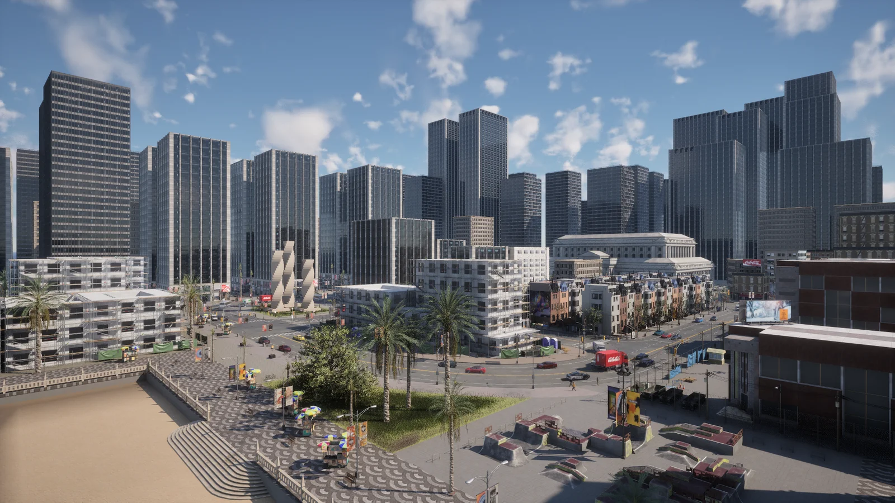
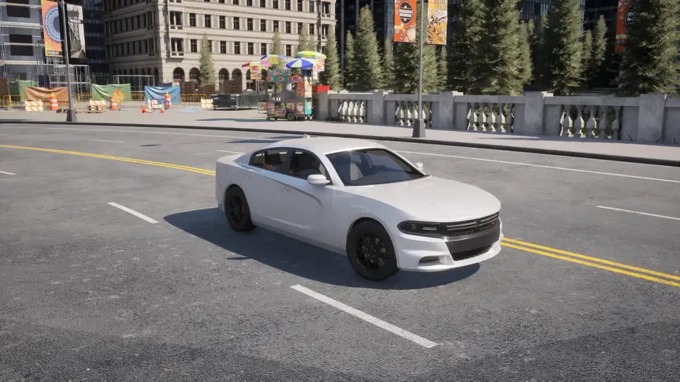

# First steps with CARLA

A walk through a standard CARLA workflow: launch the server, connect a client, load a map, add an ego vehicle, traffic and a camera, and set it all in motion. It is deliberately light on detail; each section links to the page that goes deeper.

Before starting, you need a [running CARLA server](start_quickstart.md#running-carla) and the `carla` Python package [installed](start_quickstart.md#install-client-library).

* [__Launching CARLA and connecting the client__](#launching-carla-and-connecting-the-client)
* [__Loading a map__](#loading-a-map)
* [__Spectator navigation__](#spectator-navigation)
* [__Adding the ego vehicle__](#adding-the-ego-vehicle)
* [__Adding NPCs__](#adding-npcs)
* [__Add sensors__](#add-sensors)
* [__Animate vehicles with Traffic Manager__](#animate-vehicles-with-traffic-manager)
* [__Choose your map__](#choose-your-map)
* [__Choose your vehicles__](#choose-your-vehicles)
* [__The full script__](#the-full-script)

---
## Launching CARLA and connecting the client

Launch CARLA with the executable on Windows or the shell script on Linux:

```sh
cd /carla/root
./CarlaUnreal.sh
```

To drive CARLA through the Python API, connect a client to the server port. The client controls the simulator through the [__client and world objects__](foundations.md#client). Open a Python notebook or a new script and start with:

```py
import carla
import random

# Connect to the client and retrieve the world object
client = carla.Client('localhost', 2000)
world = client.get_world()
```

The [__client__](python_api.md#carla.Client) maintains the connection to the server and carries the methods that apply commands and load or export data.

The port defaults to 2000 and can be any free port; the host can be an IP address instead of *localhost*, so the server can run on one machine and the client on another. That is useful to keep the GPU running the simulator separate from the one training a network.

!!! Note
    This page assumes CARLA is running in the default [__asynchronous__](adv_synchrony_timestep.md) mode. In synchronous mode some of the code below needs a `world.tick()` to advance.

---
## Loading a map

Ask the server which maps it has, then load one:

```py
print(client.get_available_maps())

world = client.load_world('Town10HD_Opt')
```

`load_world()` takes the map's own name — `Town10HD_Opt`, not `Town10`. Case does not matter, the rest of the name does.

Which maps a server has depends on how it was built or packaged, so `get_available_maps()` is the list that counts. A source build has all fifteen maps; a package has whatever was cooked into it, and anything else arrives as a [content pack](content_authoring_packs.md). See [Maps](core_map.md) for what ships.

`client.reload_world()` resets the current map to its initial state without changing it. More about maps in [Maps](core_map.md).

---
## Spectator navigation


<div class="img-caption">The spectator view of Town10HD_Opt when the server starts.</div>

The spectator is a view into the simulation. It opens in a new window when the server runs on a machine with a screen, and it is the quickest way to see the result of what a script does: vehicles appearing, the weather changing, a layer toggled on or off.

Fly it with the mouse and the QWE-ASD keys:

| Key | Movement |
| --- | --- |
| `W` / `S` | forward / backward |
| `A` / `D` | left / right |
| `E` / `Q` | up / down |

Hold down the right mouse button and move the mouse to look around.

The spectator is also an actor, so a client can read and set its transform:

```py
# Retrieve the spectator object
spectator = world.get_spectator()

# Get the location and rotation of the spectator through its transform
transform = spectator.get_transform()
location = transform.location
rotation = transform.rotation

# Set the spectator at the map origin, with 0 degrees pitch, yaw and roll
spectator.set_transform(carla.Transform())
```

---
## Adding the ego vehicle

The __ego vehicle__ is the focus of the simulation: the one that carries the sensors and that an autonomous stack drives. It is marked by setting its `role_name` attribute to `hero` before spawning, which is what lets the simulator treat it specially — for instance in [hybrid physics mode](adv_traffic_manager.md#hybrid-physics-mode), where only the vehicles near the ego get full physics.

Spawn it first, and take its spawn point out of the list so the traffic does not collide with it:

```py
spawn_points = world.get_map().get_spawn_points()
ego_spawn = spawn_points.pop(random.randrange(len(spawn_points)))

ego_bp = world.get_blueprint_library().find('vehicle.lincoln.mkz')
ego_bp.set_attribute('role_name', 'hero')
ego_vehicle = world.spawn_actor(ego_bp, ego_spawn)
```

---
## Adding NPCs

With the ego in place, populate the map with traffic. Pick the vehicles from the blueprint library and spawn them on the remaining spawn points:

```py
# Get the blueprint library and filter for the vehicle blueprints
vehicle_blueprints = world.get_blueprint_library().filter('*vehicle*')

# Spawn 50 vehicles on random spawn points. try_spawn_actor returns None
# instead of raising when the point is already taken.
for spawn_point in random.sample(spawn_points, 50):
    world.try_spawn_actor(random.choice(vehicle_blueprints), spawn_point)
```

CARLA also provides pedestrians. Vehicles, pedestrians and sensors are all __actors__; see [Actors](core_actors.md).

---
## Add sensors

Autonomous vehicles perceive their environment through sensors: cameras, optical flow, LIDAR, RADAR, accelerometers. CARLA models all of them, and they can be attached to a vehicle or left at a fixed point to act as, say, a CCTV camera.

Attach an RGB camera to the ego vehicle:

```py
# Create a transform to place the camera on top of the vehicle
camera_init_trans = carla.Transform(carla.Location(z=1.5))

# We create the camera through a blueprint that defines its properties
camera_bp = world.get_blueprint_library().find('sensor.camera.rgb')

# We spawn the camera and attach it to our ego vehicle
camera = world.spawn_actor(camera_bp, camera_init_trans, attach_to=ego_vehicle)
```

A sensor starts producing data when `listen()` is called with a callback that says what to do with each frame. This one saves every frame to disk:

```py
# Save every frame to disk as out/<frame number>.png
camera.listen(lambda image: image.save_to_disk('out/%06d.png' % image.frame))
```

[Sensors and data](core_sensors.md) covers the rest of the sensors and what each one returns.

---
## Animate vehicles with Traffic Manager

Hand the vehicles over to the [__Traffic Manager__](adv_traffic_manager.md), which drives them around the map following the road rules:

```py
for vehicle in world.get_actors().filter('*vehicle*'):
    vehicle.set_autopilot(True)
```

The simulation is now running, with traffic driving around the map and a camera recording from the ego vehicle. The Traffic Manager has many knobs for shaping that traffic — speed, distance to the car in front, whether a vehicle runs lights.

---
## Choose your map


<div class="img-caption">Town10HD_Opt from the default spectator position, from above, and at street level.</div>

CARLA ships several towns, from a dense city centre to a mining environment. Browse them in the [map catalogue](catalogue.md) and load the one that suits the scenario.

---
## Choose your vehicles


<div class="img-caption">Montage of several of the available vehicle blueprints: cars, vans, trucks, motorcycles and bicycles.</div>

CARLA provides a library of vehicles to fill a simulation with traffic. Browse the models in the [vehicle catalogue](catalogue_vehicles.md), or list the blueprints from a client:

```py
for bp in world.get_blueprint_library().filter('vehicle'):
    print(bp.id)
```

---
## The full script

The pieces above, in order, with the cleanup that keeps the server usable afterwards:

```py
import carla
import random

client = carla.Client('localhost', 2000)
client.set_timeout(10.0)
world = client.load_world('Town10HD_Opt')

actors = []
camera = None
try:
    spawn_points = world.get_map().get_spawn_points()
    ego_spawn = spawn_points.pop(random.randrange(len(spawn_points)))

    ego_bp = world.get_blueprint_library().find('vehicle.lincoln.mkz')
    ego_bp.set_attribute('role_name', 'hero')
    ego_vehicle = world.spawn_actor(ego_bp, ego_spawn)
    actors.append(ego_vehicle)

    vehicle_blueprints = world.get_blueprint_library().filter('*vehicle*')
    for spawn_point in random.sample(spawn_points, 50):
        npc = world.try_spawn_actor(random.choice(vehicle_blueprints), spawn_point)
        if npc is not None:
            actors.append(npc)

    camera_bp = world.get_blueprint_library().find('sensor.camera.rgb')
    camera = world.spawn_actor(camera_bp, carla.Transform(carla.Location(z=1.5)), attach_to=ego_vehicle)
    camera.listen(lambda image: image.save_to_disk('out/%06d.png' % image.frame))

    for vehicle in world.get_actors().filter('*vehicle*'):
        vehicle.set_autopilot(True)

    input('Recording. Press enter to stop.\n')
finally:
    if camera is not None:
        camera.stop()
        camera.destroy()
    client.apply_batch([carla.command.DestroyActor(actor) for actor in actors])
```

This is the most basic setup. From here, the rest of the documentation covers the other sensors, the weather, the recorder and everything else that makes a simulation more realistic.
