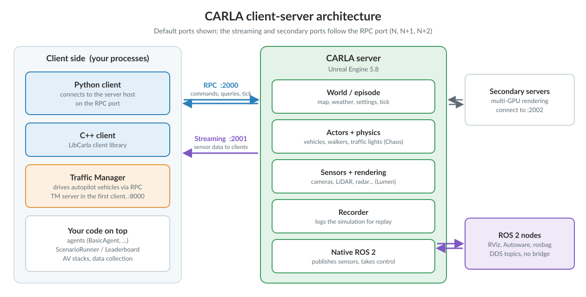

# CARLA

!!! Note
    These pages document the Unreal Engine 5 line. The Unreal Engine 4.26 line has [its own documentation](https://carla.readthedocs.io/en/latest/).

- [__The simulator__](#the-simulator)
- [__The project__](#the-project)

CARLA is an open-source driving simulator for use in autonomous driving applications. It was built from scratch with a modular and flexible API to address a range of tasks involved in the problem of driving. One of the main goals of CARLA is to help democratize autonomous driving R&D, serving as a tool that can be easily accessed and customized by users. To do so, the simulator has to meet the requirements of different use cases within the general problem of driving, such as learning driving policies or training perception algorithms. CARLA is built on Unreal Engine 5.8 to run the simulation and uses the [ASAM OpenDRIVE](https://www.asam.net/standards/detail/opendrive/) standard to define roads and urban settings. Control over the simulation is granted through a Python and C++ API.

In order to smooth the process of developing, training and validating driving systems, CARLA evolved to become an ecosystem of projects, built around the main platform by the community. In this context, it helps to understand how CARLA works in order to make full use of its capabilities.

---
## The simulator

The CARLA simulator consists of a client-server architecture. The server is responsible for everything related to the simulation itself: sensor rendering, computation of physics, updates on the world-state and its actors and much more. CARLA aims for realistic results, so the server needs a dedicated, high-performance GPU; see the [quick start](start_quickstart.md) for the requirements.

The client side consists of a set of client modules controlling the behavior of actors and the state of the environment within the simulation. This is achieved by leveraging the CARLA API (in Python or C++), a layer that mediates between server and client that is constantly evolving to provide new functionalities.

On top of this structure, CARLA provides a number of features that cover different aspects of driving simulation. These are some of the key modules:

* __[Traffic Manager](adv_traffic_manager.md)__: drives the vehicles that are not the ego, so a scene has realistic urban traffic around it.
* __[Sensors](ref_sensors.md)__: cameras, LiDAR, radar, GNSS, IMU and more. Sensors are actors themselves, attached to a vehicle or another actor. Their data can be read live or saved to disk.
* __[Recorder](adv_recorder.md)__: replays a simulation exactly, to evaluate a run afterwards or re-run it with a different sensor rig.
* __[Native ROS 2](ros2_native.md)__: the server publishes and subscribes ROS 2 topics directly, with no bridge process.
* __[Open assets](catalogue.md)__: maps, vehicles, pedestrians and props, all customizable, plus [content packs](content_packs.md) to ship your own.
* __[C++ client](tuto_cpp.md)__: the same API from C++, for integrating CARLA into a native stack.
* __[NVIDIA integrations](nvidia.md)__: DLSS, neural reconstruction (NuRec) and the Alpamayo 2 Super driving stack.
* __[ScenarioRunner](ts_traffic_simulation_overview.md)__ and __[Scenic](tuto_G_scenic.md)__: specific scenarios and routes, including the ones behind the [CARLA Leaderboard](https://leaderboard.carla.org/).

---
## The project

CARLA grows fast and steady, widening the range of solutions provided and opening the way for the different approaches to autonomous driving. It does so while never forgetting its open-source nature. The project is transparent, acting as a white box where anybody is granted access to the tools and the development community. In that democratization is where CARLA finds its value.

Talking about how CARLA grows means talking about a community of developers who dive together into the complex question of autonomous driving. Everybody is free to explore with CARLA, find their own solutions and then share their achievements with the rest of the community.

This documentation will be a companion along the way. The next page contains __[quick start](start_quickstart.md)__ instructions for those eager to install a CARLA release. There is also a [build guide](build_carla.md) for Linux and Windows, to build CARLA from source and dive full-length into its features.

Welcome to CARLA.

<a href="../build_linux_ue5" class="btn btn-neutral" title="Build CARLA on Linux">
<b>Linux</b> build</a>

<a href="../build_windows_ue5" class="btn btn-neutral" title="Build CARLA on Windows">
<b>Windows</b> build</a>

