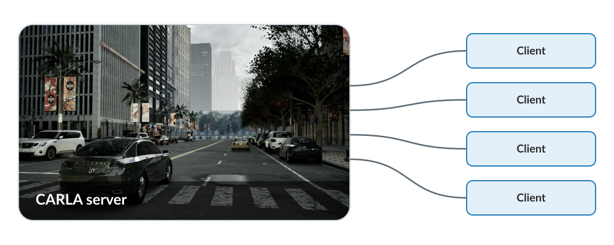

# CARLA

!!! important
    This document refers to the latest version of CARLA built with Unreal Engine 5. For documentation relating to the Unreal Engine 4 version of CARLA please visit the [documentation for this version](https://carla.readthedocs.io/en/latest/).

CARLA is an open-source driving simulator for use in autonomous driving applications. It was built from scratch with a modular and flexible API to address a range of tasks involved in the problem of driving. One of the main goals of CARLA is to help democratize autonomous driving R&D, serving as a tool that can be easily accessed and customized by users. To do so, the simulator has to meet the requirements of different use cases within the general problem of driving, such as learning driving policies or training perception algorithms. CARLA is built on Unreal Engine 5.8 to run the simulation and uses the [ASAM OpenDRIVE](https://www.asam.net/standards/detail/opendrive/) standard to define roads and urban settings. Control over the simulation is granted through a Python and C++ API.

In order to smooth the process of developing, training and validating driving systems, CARLA evolved to become an ecosystem of projects, built around the main platform by the community. In this context, it helps to understand how CARLA works in order to make full use of its capabilities.

---
## The simulator

The CARLA simulator consists of a client-server architecture. The server is responsible for everything related to the simulation itself: sensor rendering, computation of physics, updates on the world-state and its actors and much more. CARLA aims for realistic results, so the server needs a dedicated, high-performance GPU; see the [quick start](start_quickstart.md) for the requirements.

The client side consists of a set of client modules controlling the behavior of actors and the state of the environment within the simulation. This is achieved by leveraging the CARLA API (in Python or C++), a layer that mediates between server and client that is constantly evolving to provide new functionalities.

The CARLA simulator combines a number of different features that handle different important aspects of the driving simulation. The following is a summary of some of the key modules:

* __[Traffic manager](core_traffic_manager.md)__: A built-in system that takes control of the vehicles besides the one used for learning. It acts as a conductor provided by CARLA to recreate urban-like environments with realistic behaviours.
* __[Sensors](ref_sensors.md)__: Vehicles rely on them to gather information about their surroundings. In CARLA they are a specific kind of actor attached to the vehicle and the data they receive can be retrieved and stored to ease the process. Currently the project supports different types of these, from cameras to radars, lidar and many more.
* __[Recorder](core_recorder.md)__: The recorder can replay a simulation exactly to enable retrospective evaluation of the outcome of a simulation and to rerun the simulation with alternative configurations of sensors, for example.
* __[ROS 2](ros2_native.md)__: CARLA natively supports connectivity with ROS 2, a widely used set of software libraries and tools for robotics and autonomous driving.
* __[Open assets](catalogue.md)__: CARLA facilitates different maps for urban settings with control over weather conditions and a blueprint library with a wide set of actors to be used. However, these elements can be customized and new ones can be created following simple guidelines.
* __[Scenario runner](core_traffic.md) & [Scenic](scenic.md)__: In order to ease the learning process for vehicles, CARLA provides a series of routes describing different situations to iterate on, and Scenic can generate many varied scenarios from a single definition. These also set the basis for the [CARLA challenge](https://leaderboard.carla.org/), open for everybody to test their solutions and make it to the leaderboard.
* __[Neural reconstruction](nvidia_nurec.md)__: CARLA integrates NVIDIA Neural Reconstruction (NuRec), which turns recorded camera and lidar data from real drives into photorealistic 3D scenes. CARLA runs the actors, physics and sensors inside these scenes, so a real recording can be replayed and then altered with the full CARLA API.

---
## The project

CARLA grows fast and steady, widening the range of solutions provided and opening the way for the different approaches to autonomous driving. It does so while never forgetting its open-source nature. The project is transparent, acting as a white box where anybody is granted access to the tools and the development community. In that democratization is where CARLA finds its value.

Talking about how CARLA grows means talking about a community of developers who dive together into the complex question of autonomous driving. Everybody is free to explore with CARLA, find their own solutions and then share their achievements with the rest of the community.

This documentation will be a companion along the way. The next page contains __[quick start](start_quickstart.md)__ instructions for those eager to install a CARLA release. There is also a [build guide](build_carla.md) for Linux and Windows, to build CARLA from source and dive full-length into its features.

Welcome to CARLA.

<a href="../build_linux_ue5" class="btn btn-neutral" title="Build CARLA on Linux">
<b>Linux</b> build</a>

<a href="../build_windows_ue5" class="btn btn-neutral" title="Build CARLA on Windows">
<b>Windows</b> build</a>

