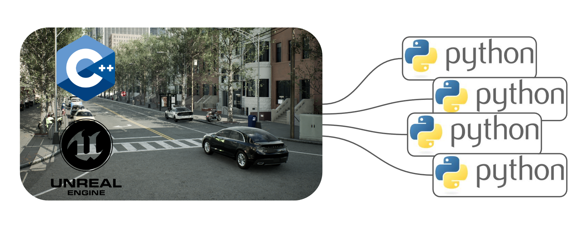

# Introduction

CARLA is an open-source driving simulator for autonomous driving research. It runs on Unreal Engine 5.8, describes its roads with [ASAM OpenDRIVE](https://www.asam.net/standards/detail/opendrive/), and is driven through a Python and C++ API.

- [__The simulator__](#the-simulator)
- [__The project__](#the-project)

!!! Note
    These pages document the Unreal Engine 5 line. The Unreal Engine 4.26 line has [its own documentation](https://carla.readthedocs.io/en/latest/).

---
## The simulator

The CARLA simulator consists of a scalable client-server architecture. The server is responsible for everything related to the simulation itself: sensor rendering, computation of physics, updates on the world-state and its actors and much more. Since CARLA requires significant graphical computing resources, it is necessary to use a dedicated, high-performance GPU.

The client side consists of a set of client modules controlling the behavior of actors and the state of the environment within the simulation. This is achieved by leveraging the CARLA API (in Python or C++), a layer that mediates between server and client that is constantly evolving to provide new functionalities.

<i>The Unreal Engine server and the Python or C++ clients that drive it.</i>

<i>CARLA client-server architecture: clients, Traffic Manager, server components and default ports.</i>

The CARLA simulator combines a number of different features that handle different important aspects of the driving simulation. The following is a summary of some of the key modules:

* __[Traffic Manager](adv_traffic_manager.md)__: drives the vehicles that are not the ego, so a scene has realistic urban traffic around it.
* __[Sensors](ref_sensors.md)__: cameras, LiDAR, radar, GNSS, IMU and more, attached to an actor as a special kind of actor themselves. Their data can be read live or saved to disk.
* __[Recorder](adv_recorder.md)__: replays a simulation exactly, to evaluate a run afterwards or re-run it with a different sensor rig.
* __[Native ROS 2](ros2_native.md)__: the server publishes and subscribes ROS 2 topics directly, with no bridge process.
* __[Open assets](catalogue.md)__: maps, vehicles, pedestrians and props, all customizable, plus [content packs](content_packs.md) to ship your own.
* __[C++ client](tuto_cpp.md)__: the same API from C++, for integrating CARLA into a native stack.
* __[NVIDIA integrations](nvidia.md)__: DLSS, neural reconstruction (NuRec) and the Alpamayo 2 Super driving stack.
* __[ScenarioRunner](ts_traffic_simulation_overview.md)__ and __[Scenic](tuto_G_scenic.md)__: specific scenarios and routes, including the ones behind the [CARLA Leaderboard](https://leaderboard.carla.org/).

---
## The project

CARLA is open source, and everything above — the simulator, the assets and the tooling — is open to inspection and modification. The project grows through its community, and [contributions](cont_contribution_guidelines.md) are welcome.

The next page is the __[quick start](start_quickstart.md)__, for installing a release. To build from source instead, see the [build guide](build_carla.md).

<a href="../build_linux_ue5" class="btn btn-neutral" title="Build CARLA on Linux">
<b>Linux</b> build</a>

<a href="../build_windows_ue5" class="btn btn-neutral" title="Build CARLA on Windows">
<b>Windows</b> build</a>

