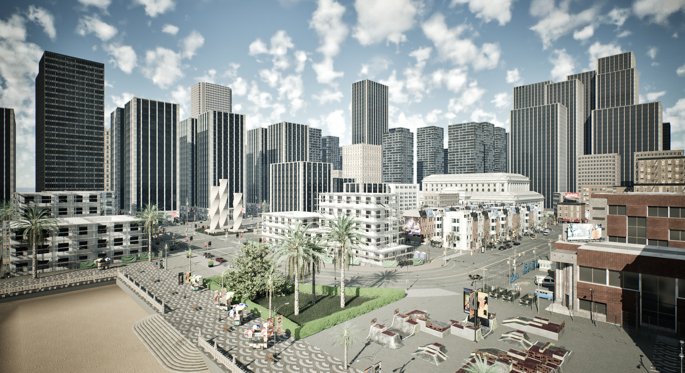

# Quick start package installation

This guide shows how to download and install the packaged version of CARLA. The package includes the CARLA server and two options for the client library. There are additional assets that can be downloaded and imported into the package. Advanced customization and development options that require use of the Unreal Engine editor are not available but these can be accessed by using the build version of CARLA for either [Windows](build_windows_ue5.md) or [Linux](build_linux_ue5.md).

* __[Before you begin](#before-you-begin)__  
* __[CARLA package installation](#carla-package-installation)__
* __[Install client library](#install-client-library)__
* __[Running CARLA](#running-carla)__    
* __[Running CARLA with a Docker container](#running-carla-using-a-docker-container)__   
* __[Follow-up](#follow-up)__

---
## Before you begin

The following requirements should be fulfilled before installing CARLA:

* __System requirements__: CARLA is built for Windows and Linux systems.
* __Operating system__: CARLA Unreal Engine 5 version requires **Ubuntu 22.04/24.04** or **Windows 11**.
* __An adequate GPU__: CARLA aims for realistic simulations that require a lot of compute power. We recommend at minimum an NVIDIA RTX 3000 series or better with at least **16 Gb of VRAM**. NVIDIA RTX 40 and 50 series GPUs are also supported. A dedicated GPU, separate from the GPU used for CARLA, is highly recommended to handle large machine learning workloads.
* __GPU drivers__: CARLA Unreal Engine 5 version requires NVIDIA RTX driver release **550 or later for Ubuntu** and NVIDIA RTX driver release **560 or later for Windows**. For NVIDIA RTX 50 series (Blackwell) GPUs, driver release **570 or later** is required.
* __Disk space__: CARLA requires **130 GB** of hard disk (or SSD) space.
* __Python__: [Python](https://www.python.org/downloads/) is the main scripting language in CARLA. CARLA supports Python 3 on Linux and Windows.
* __Pip__: The CARLA Python client requires __pip3__ version 20.3 or higher. Check it, and upgrade it if needed:

```sh
pip3 -V
pip3 install --upgrade pip
```

* __Three TCP ports and a good internet connection.__ 2000 (RPC), 2001 (sensor streaming) and 2002 (secondary server) by default. Make sure that these ports are not blocked by firewalls or any other applications.
* __Other requirements.__ The example scripts need `pygame` and `numpy`, on both platforms:

```sh
pip3 install --user pygame numpy
```

!!! Warning
    CARLA requires the **Microsoft Visual C++ Redistributable** to run on Windows. Without it, the simulator fails to launch with no error message at all. Install the **x64** version under "Visual Studio 2015, 2017, 2019, and 2022" from the [Microsoft website](https://learn.microsoft.com/en-us/cpp/windows/latest-supported-vc-redist).

---
## CARLA package installation

Download the desired CARLA package from GitHub:

- [Download the latest release from GitHub](https://github.com/carla-simulator/carla/releases/latest)

The [Download](download.md) page lists the current release, the previous ones and the __nightly build__, which carries every change merged since the last release and is the most unstable version of CARLA.

The package is a compressed file named `Carla-<version>-<platform>-Shipping.tar.gz` on Linux, or the equivalent `.zip` on Windows. Download and extract it: it contains a precompiled simulator, the Python API wheel and example scripts.

!!! note
    The documentation you are currently viewing is for the Unreal Engine 5 versions of CARLA. If you are intending to use the Unreal Engine 4 version of CARLA, you should refer to the [correct documentation](https://carla.readthedocs.io/en/latest/).

---
## Install client library

Install the CARLA client library from the wheel provided with the package:

```sh
cd CARLA_ROOT/PythonAPI/carla/dist/
pip3 install carla-*.whl
```

Only one wheel ships with a package, built for one Python minor version and one platform: `carla-<version>-cp310-cp310-linux_x86_64.whl` for Python 3.10 on Linux, `...-win_amd64.whl` on Windows. Installing it on another Python version fails, so use the interpreter the wheel was built for.

__Install the client library in a virtual environment__ to avoid conflicts between CARLA versions.

---
## Running CARLA

Linux:

```sh
cd path/to/carla/root
./CarlaUnreal.sh
```
 
Windows:

```sh
cd path/to/carla/root
CarlaUnreal.exe
```

!!! note
    If CARLA fails to launch on Windows without any error message or log output, ensure that you have installed the [Microsoft Visual C++ Redistributable](https://learn.microsoft.com/en-us/cpp/windows/latest-supported-vc-redist) (x64 version). This is a common issue on fresh Windows installations.

A window containing a view over Town 10 will pop up. This is the _spectator view_. To fly around the city use the mouse and `WASD` keys, holding down the right mouse button to control the direction.



This window is driven by the simulator server which is now running and waiting for a client to connect and interact with the world. You can try some of the example scripts to create traffic in the city and drive a vehicle around the map. Open up two separate terminals and run the following commands:

```sh
# Terminal A: populate the city with traffic, and leave it running
cd PythonAPI/examples
pip3 install -r requirements.txt
python3 generate_traffic.py

# Terminal B: drive a vehicle around
cd PythonAPI/examples
python3 manual_control.py
```

On Windows, use `cd PythonAPI\examples`.

---
## Running CARLA using a Docker container

For Linux users, CARLA is also available as a Docker image, which is the easiest way to run it on the cloud, on a cluster, or on a machine that does not meet the prerequisites.

```sh
docker pull carlasim/carla:0.10.0

docker run \
    --device=nvidia.com/gpu=all \
    --net=host \
    carlasim/carla:0.10.0 bash CarlaUnreal.sh -RenderOffScreen -nosound
```

This needs Docker and the NVIDIA Container Toolkit, with CDI generated (`sudo nvidia-ctk cdi generate --output=/etc/cdi/nvidia.yaml`). See [CARLA in Docker](build_docker.md) for the prerequisites, the legacy `--runtime=nvidia` form and how to run the image with a display.

---
## Follow-up

By now you should have a packaged version of CARLA up and running. If you came across any difficulties during the installation process, feel free to post in the [CARLA forum](https://github.com/carla-simulator/carla/discussions/) or in the [Discord](https://discord.gg/8kqACuC) channel.

The next step is to learn more about the core concepts in CARLA. Start with the [__First steps__](tuto_first_steps.md) tutorial to start learning and then refer to the [Foundations](foundations.md), [Actors](core_actors.md), [Maps](core_map.md) and [Sensors](core_sensors.md) sections to form a deeper understanding of CARLA's functionality. You should also familiarize yourself with the Python API classes and methods in the [Python API reference](python_api.md).
