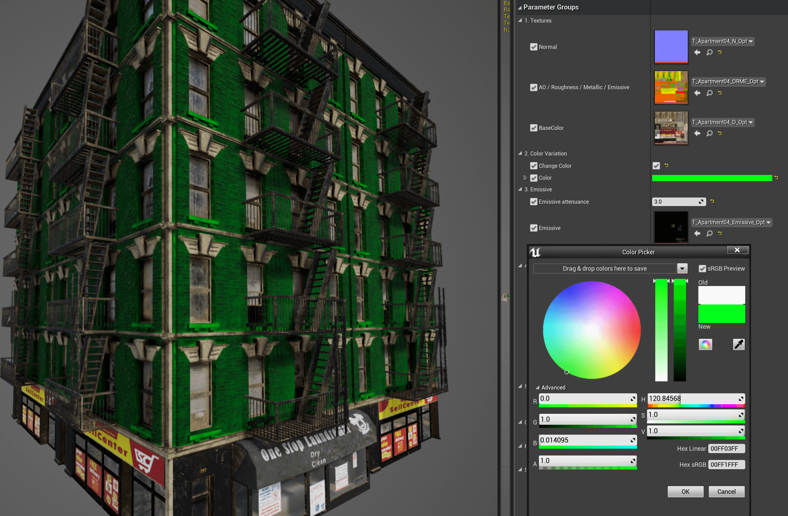
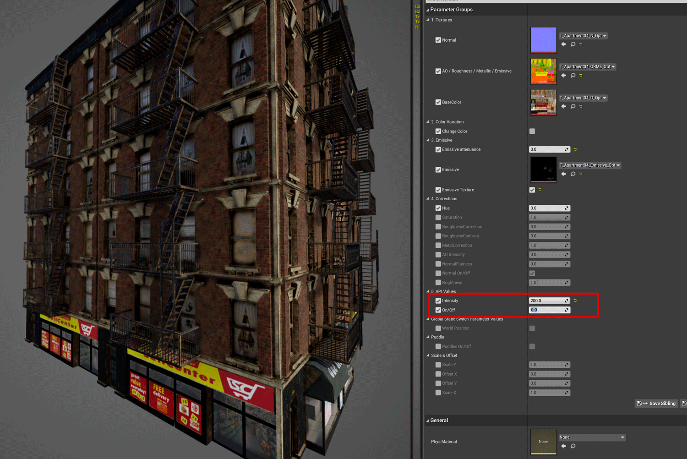
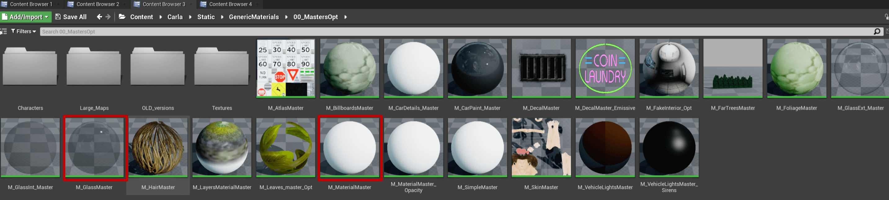

# Material customization

CARLA ships a set of master materials that every asset instances. Editing an instance changes how that asset looks without touching the master or the mesh. This page covers the building and environment materials; vehicle paint is covered in [Content authoring - vehicle materials](tuto_content_authoring_vehicles_materials.md).

*   [__Master materials__](#master-materials)
*   [__Building textures__](#building-textures)
*   [__Customize a building material__](#customize-a-building-material)

!!! Important
    This tutorial applies to users working from a source build, with access to the Unreal Editor.

---
## Master materials

The masters live in `Content/Carla/Static/GenericMaterials`, split between the general ones and the optimized ones used by the `_Opt` maps.

| Master | Path | Applied to |
| --- | --- | --- |
| `M_MaterialMaster` | `00_MastersOpt` | The general building and environment shader. |
| `M_ProceduralBuildingMaster` | `00_MastersOpt` | Procedurally generated buildings. |
| `M_GlassMaster` | `000_Masters` | Building glass. |
| `M_RoadMaster` | `000_Masters` | Road surfaces. |
| `M_GeneralMaster` | `000_Masters` | Props and other static meshes. |
| `M_TriplanarMaster` | `000_Masters` | Meshes with no usable UVs, textured by world position. |
| `M_DecalMaster` | `000_Masters` | Decals projected onto a surface. |
| `M_CarPaintMaster` | `000_Masters/Vehicles` | Vehicle bodywork — see [vehicle materials](tuto_content_authoring_vehicles_materials.md). |

To customize an asset, right-click the master, choose __Create Material Instance__, move the instance into the asset's own folder and assign it to the mesh. Editing the master itself changes every asset in the simulator.

---
## Building textures

A building material combines four textures, each packing several properties into its channels.

*   __Diffuse__ — the base painting of the material.
    *   `RGB` — the base colors.
    *   `Alpha` — a mask; the white areas are the ones the shader can recolor, which is how one material yields several variants.

*   __ORME__ — four properties in one texture.
    *   `R` — ambient occlusion.
    *   `G` — roughness.
    *   `B` — metallic map.
    *   `Alpha` — emissive mask; the white areas take the emissive color and intensity.

*   __Normal__ — the normal map, in `RGB`.

*   __Emissive__ — if present, the base colors of the emissive elements, in `RGB`.

---
## Customize a building material

Both building shaders expose their parameters on the material instance.

__Glass shader__ — `M_GlassMaster`:

| Parameter | Effect |
| --- | --- |
| `Opacity` | Enables color changes on the white area of the __Diffuse__ `Alpha` texture. |
| `Color` | Tint applied to that white area. |

__Building shader__ — `M_MaterialMaster`:

| Parameter | Effect |
| --- | --- |
| `Change Color` | Enables color changes on the white area of the __Diffuse__ `Alpha` texture. |
| `Color` | Tint applied to that white area. |
| `Emissive Texture` | Enables the __Emissive__ texture. |
| `EmissiveColor` | Tint applied to the white area of the __ORME__ emissive mask. |
| `Emissive atenuance` | Divides the intensity set in __BP_Lights__ to obtain the emissive value. |
| `RoughnessCorrection` | Scales the roughness map. |
| `MetallicCorrection` | Scales the metallic map. |
| `NormalFlatness` | Scales the normal map. |

!!! Note
    Textures can also be swapped at runtime, without the editor, through [`carla.World.apply_color_texture_to_object`](python_api.md#carla.World.apply_color_texture_to_object). See [Texture streaming](tuto_G_texture_streaming.md).

Generic material documentation is in the [Unreal Engine docs](https://dev.epicgames.com/documentation/en-us/unreal-engine/unreal-engine-materials).
