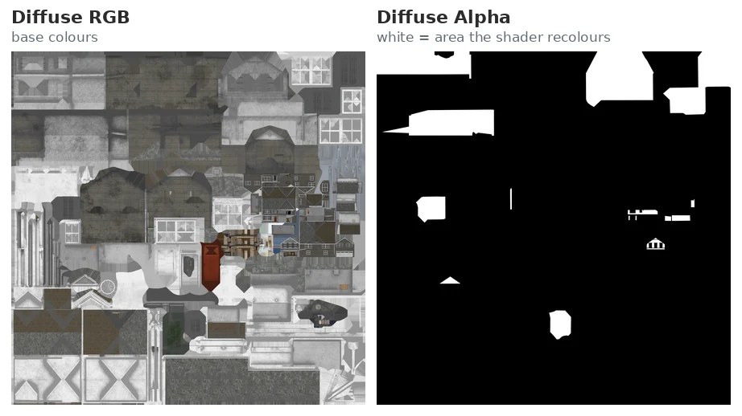
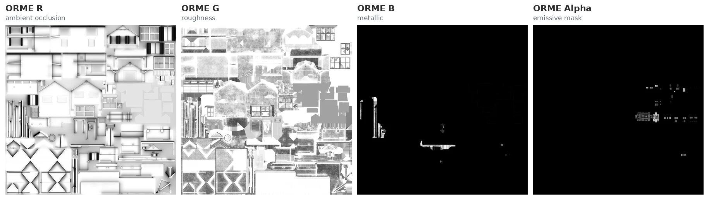
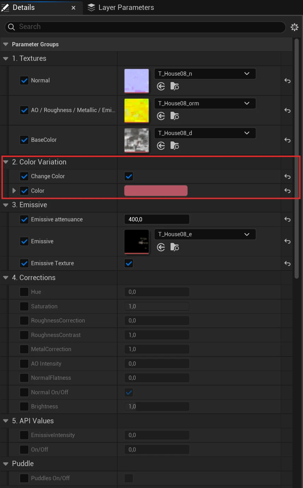

# Material customization

CARLA ships a set of master materials that every asset instances. Editing an instance changes how that asset looks without touching the master or the mesh. This page covers the building and environment materials; vehicle paint is covered in [Content authoring - vehicle materials](tuto_content_authoring_vehicles_materials.md).

*   [__Master materials__](#master-materials)
*   [__Building textures__](#building-textures)
*   [__Customize a building material__](#customize-a-building-material)

!!! Important
    This tutorial applies to users working from a source build, with access to the Unreal Editor.

---
## Master materials

The masters live in `Content/Carla/Static/GenericMaterials`, split between the general ones and the optimized ones used by the `_Opt` maps.

| Master | Path | Applied to |
| --- | --- | --- |
| `M_MaterialMaster` | `00_MastersOpt` | The general building and environment shader. |
| `M_ProceduralBuildingMaster` | `00_MastersOpt` | Procedurally generated buildings. |
| `M_GlassMaster` | `000_Masters` | Building glass. |
| `M_RoadMaster` | `000_Masters` | Road surfaces. |
| `M_GeneralMaster` | `000_Masters` | Props and other static meshes. |
| `M_TriplanarMaster` | `000_Masters` | Meshes with no usable UVs, textured by world position. |
| `M_DecalMaster` | `000_Masters` | Decals projected onto a surface. |
| `M_CarPaintMaster` | `000_Masters/Vehicles` | Vehicle bodywork — see [vehicle materials](tuto_content_authoring_vehicles_materials.md). |

To customize an asset, right-click the master, choose __Create Material Instance__, move the instance into the asset's own folder and assign it to the mesh. Editing the master itself changes every asset in the simulator.

---
## Building textures

A building material combines four textures, each packing several properties into its channels.

*   __Diffuse__ — the base painting of the material.
    *   `RGB` — the base colors.
    *   `Alpha` — a mask; the white areas are the ones the shader can recolor, which is how one material yields several variants.

<i>The Diffuse texture of <code>MI_House08</code> split into its colour and alpha channels.</i>

*   __ORME__ — four properties in one texture.
    *   `R` — ambient occlusion.
    *   `G` — roughness.
    *   `B` — metallic map.
    *   `Alpha` — emissive mask; the white areas take the emissive color and intensity.

*   __Normal__ — the normal map, in `RGB`.

*   __Emissive__ — if present, the base colors of the emissive elements, in `RGB`.

<i>The ORME texture of <code>MI_House08</code>, one channel per panel: the lit windows of the alpha channel are what glows at night.</i>

---
## Customize a building material

Both building shaders expose their parameters on the material instance, grouped as in the editor. Tick a parameter to override the master's value.

<i>The parameters of <code>MI_House08</code>, an instance of <code>M_MaterialMaster</code>; <b>Color Variation</b> tints the white area of the Diffuse alpha.</i>

__Building shader__ — `M_MaterialMaster`:

| Group | Parameter | Effect |
| --- | --- | --- |
| Textures | `BaseColor`, `AO / Roughness / Metallic / Emissive`, `Normal` | The Diffuse, ORME and Normal textures. |
| Color Variation | `Change Color` | Enables the tint on the white area of the __Diffuse__ `Alpha` channel. |
| Color Variation | `Color` | Tint multiplied with the base color in that area. |
| Emissive | `Emissive Texture` | Takes the emissive color from the __Emissive__ texture instead of `EmissiveColor`. |
| Emissive | `Emissive`, `EmissiveColor` | The emissive texture, or the flat color used on the white area of the __ORME__ emissive mask. |
| Emissive | `Emissive attenuance` | Divides `EmissiveIntensity` to obtain the emissive strength. |
| Corrections | `Hue`, `Saturation`, `Brightness` | Color corrections applied on top of the base color. |
| Corrections | `RoughnessCorrection`, `RoughnessContrast`, `MetalCorrection`, `AO Intensity` | Adjust the ORME channels. |
| Corrections | `NormalFlatness`, `Normal On/Off` | Flatten or disable the normal map. |
| API Values | `EmissiveIntensity`, `On/Off` | Set at runtime by CARLA's light system when building lights turn on and off; leave them at 0 in the instance. |
| Puddle | `Puddles On/Off` | Wet-weather puddles on the surface. |
| Scale & Offset, UVs | `Scale X/Y`, `Offset X/Y`, `Rotation`, `World Position`, `Triplanar` | Texture tiling and projection. |

__Glass shader__ — `M_GlassMaster`:

| Parameter | Effect |
| --- | --- |
| `Diffuse Text Y/N`, `ORME Text Y/N`, `Normal Text Y/N` | Use the `Diffuse`, `ORME` and `Normal` textures, or flat values. |
| `Color` | Tint of the glass. |
| `Transparency` | How transparent the glass is. |
| `Roughness`, `Metallic`, `Occlusion` | Flat values used when no ORME texture is set. |
| `Opacity Mask Y/N` | Takes the opacity from the `Diffuse` texture instead of `Transparency`. |
| `EmissiveColor`, `Intensity`, `Emissive attenuance`, `On/Off` | Emissive for lit windows: `EmissiveColor` times `Intensity` divided by `Emissive attenuance`, switched by `On/Off`. |

!!! Note
    Textures can also be swapped at runtime, without the editor, through [`carla.World.apply_color_texture_to_object`](python_api.md#carla.World.apply_color_texture_to_object). See [Texture streaming](tuto_G_texture_streaming.md).

Generic material documentation is in the [Unreal Engine docs](https://dev.epicgames.com/documentation/en-us/unreal-engine/unreal-engine-materials).
