# Material customization

CARLA ships a set of master materials in `Content/Carla/Static/GenericMaterials/000_Masters`, and the assets of the simulator use instances of them. Editing an instance changes how that asset looks without touching the master or the mesh. This page explains the seven masters most static assets are built on: what each one is for, the textures it reads, the parameters you can change on an instance, and an example in a CARLA town.

*   [__Master materials__](#master-materials)
*   [__General master__](#general-master)
*   [__Simple master__](#simple-master)
*   [__Glass master__](#glass-master)
*   [__Fake interior master__](#fake-interior-master)
*   [__Decal master__](#decal-master)
*   [__Road master__](#road-master)
*   [__Vegetation master__](#vegetation-master)

!!! Important
    This tutorial applies to users working from a source build, with access to the Unreal Editor.

---
## Master materials

| Master | Use |
| --- | --- |
| `M_GeneralMaster` | The default for most assets: facades, sidewalks, ground, props. Color variation, color corrections, emissive and wet weather. |
| `M_SimpleMaster` | A lighter master for assets that need no color variation, emissive or weather effects: props, poles and vehicle parts. |
| `M_GlassMaster` | Transparent glass of buildings and some vehicle parts. |
| `M_FakeInterior` | The rooms seen through building windows, and the windows that light up at night. |
| `M_DecalMaster` | Decals projected onto other surfaces: potholes, cracks, oil, manholes, fallen leaves. |
| `M_RoadMaster` | Road surfaces and lane markings. |
| `M_VegetationMaster` | Trees, palms, bushes and grass, with wind and color variation. |

Vehicles have their own masters in `000_Masters/Vehicles`, covered in [Content authoring - vehicle materials](tuto_content_authoring_vehicles_materials.md) and [Content authoring - vehicles](tuto_content_authoring_vehicles.md#lights).

To customize an asset, right-click the master, choose __Create Material Instance__, move the instance into the asset's own folder and assign it to the mesh. Open the instance and tick a parameter to override the master's value; unticked parameters keep the master's value. Editing the master itself changes every asset that uses it.

Some parameters only appear when the switch they depend on is ticked: for example `Triplanar` appears with `World Position`, and the textures of __Variations__ with `AddVariations`. The screenshots below were taken with those switches ticked, so that every parameter is visible.

---
## General master

`M_GeneralMaster` is the master to start from for most static assets. It handles textures and UVs, color variation through a mask, color corrections, an emissive layer and the wet-weather effects. The example uses the textures of `House08`, a house with a real color mask and lit windows, in an instance of `M_GeneralMaster` placed in Town02.

### Textures

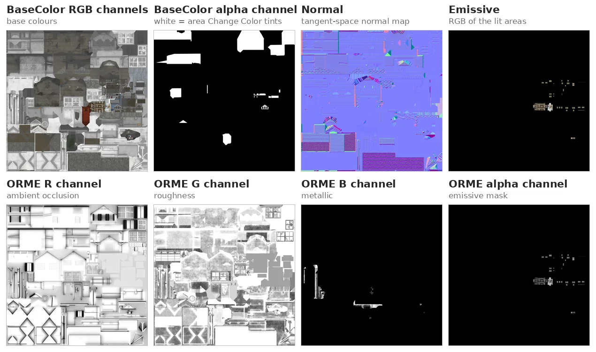
<div style="text-align: right"><i>The textures of House08.</i></div>

*   __BaseColor__ — the `RGB` channels are the base color. The `Alpha` channel is the color mask: the white areas are the ones __Change Color__ tints. On House08 only the siding panels are white, so the tint never reaches the windows, the roof or the garage.
*   __AO / Roughness / Metallic / Emissive__ (ORME) — four properties in one texture, one per channel: the `R` channel is ambient occlusion, `G` roughness, `B` metallic, and the `Alpha` channel is the emissive mask (the areas that can glow; on House08 the garage windows, the door and the porch lamps).
*   __Normal__ — the normal map, in `RGB`: bricks, boards and frames change the shading without changing the geometry.
*   __Emissive__ — optional; the colors of the emissive areas when a flat color is not enough, see [Emissive](#emissive).

### Parameters

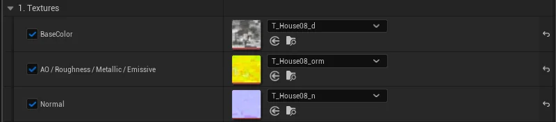

__1. Textures__ — `BaseColor`, `AO / Roughness / Metallic / Emissive` and `Normal`, the three textures above.

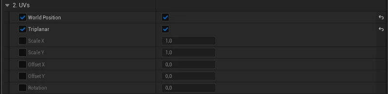

__2. UVs__

*   `World Position` — maps the textures by world position instead of the mesh UVs: a 2D projection that needs no UVs and keeps the texture size constant on any mesh. Facades and sidewalks use it.
*   `Triplanar` — with `World Position`, projects the texture from the three axes, so vertical and horizontal faces are covered without stretching.
*   `Scale X/Y`, `Offset X/Y`, `Rotation` — tiling, offset and rotation of the textures. With `World Position` the scale applies to world units, so it is small: `MI_Facade01` uses `0.002`.

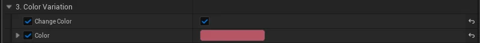

__3. Color Variation__

*   `Change Color` — enables the tint.
*   `Color` — multiplied with the base color in the white area of the BaseColor alpha channel. One texture set gives as many variants as instances.

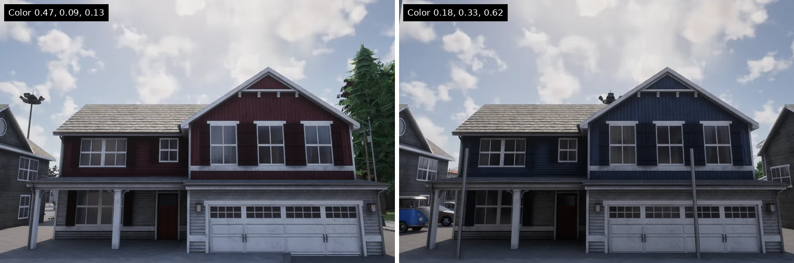
<div style="text-align: right"><i>Two instances of House08 in Town02 that differ only in <b>Color</b>. The tint follows the mask: only the siding changes.</i></div>


__4. Color Corrections__ — applied to the base color after the tint.

*   `Brightness` — makes the color lighter above 1.
*   `Contrast` — above 1, darkens the dark tones more than the light ones.
*   `Hue` — rotates the hue; `0.5` turns the red siding green-blue.
*   `Saturation` — below 1 the color moves towards grey; `0` is fully grey.
*   `Tint Color`, `Tint Intensity` — a second tint over the whole material, weighted by `Tint Intensity`.

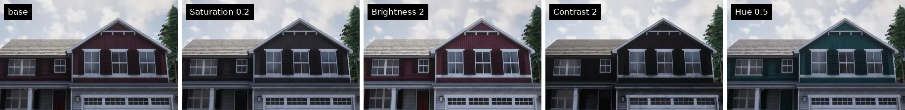
<div style="text-align: right"><i>The same house with one color correction at a time.</i></div>

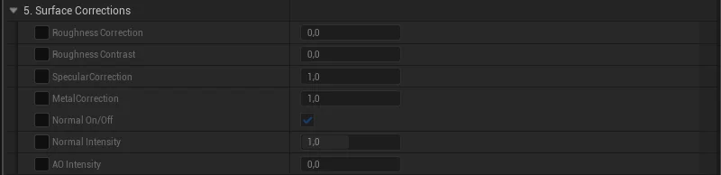

__5. Surface Corrections__ — adjust the ORME and normal channels: `Roughness Correction` and `Roughness Contrast` (roughness), `SpecularCorrection`, `MetalCorrection` (metallic), `AO Intensity` (ambient occlusion), `Normal On/Off` and `Normal Intensity` (disable or scale the normal map).

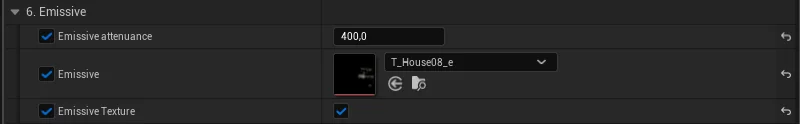

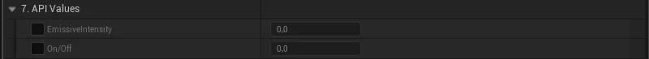

__6. Emissive__ and __7. API Values__ — see [Emissive](#emissive).

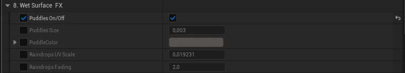

__8. Wet Surface FX__ — `Puddles On/Off` enables puddles when the weather is wet; `Puddles Size`, `PuddleColor`, `Raindrops UV Scale` and `Raindrops Fading` shape the puddles and the ripples of the rain. The surface also darkens with the weather's wetness, set by CARLA through a material parameter collection; see the [Road master](#road-master) example.

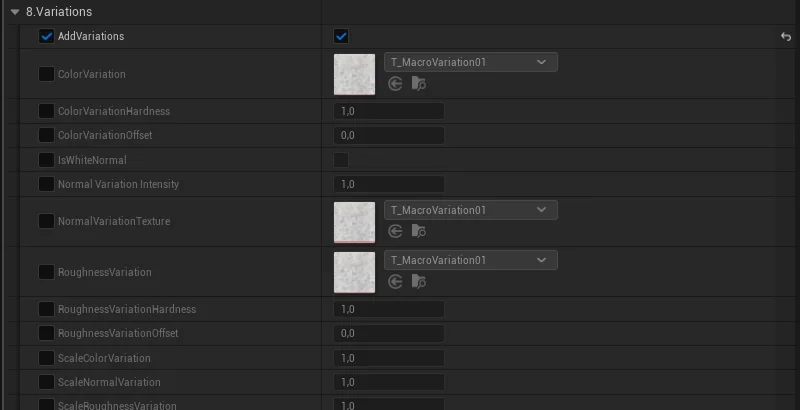

__8. Variations__ — with `AddVariations`, extra tiling textures (`ColorVariation`, `RoughnessVariation`, `NormalVariationTexture`) break up large surfaces, each with its `Scale`, `Hardness`, `Offset` and `Intensity`.

### Emissive

The emissive output of the material is

```
emissive mask (ORME alpha channel) × color × EmissiveIntensity / Emissive attenuance,   switched by On/Off
```

where *color* is the flat `EmissiveColor`, or the RGB of the `Emissive` texture when `Emissive Texture` is ticked.

*   __`EmissiveIntensity` and `On/Off`__ (group __7. API Values__) simulate the input that arrives from the CARLA API at runtime, so you can see in the editor how the material looks lit without launching PIE. They are 0 in the master, so nothing glows by default; set them in the instance to preview the emissive, or to keep an element always on, such as the shop sign below (`EmissiveIntensity` 25, `On/Off` 1).
*   __`Emissive attenuance`__ — at runtime, the general emissive intensity comes from the API through the light blueprint `BP_Lights`, and it is the same for every emissive material lit by that light; its value comes from the light defaults in `Content/Carla/Config/Lights/Defaults.json` (the file the Light Defaults tool edits). `Emissive attenuance` divides that general value for one instance, so you can tune the emissive of a single material without changing the global one: from 1 to 4 the instance is four times dimmer. The value is a divisor, not a subtraction.
*   __Flat color or RGB texture__ — a flat `EmissiveColor` lights the whole emissive mask with one color, which is right for a lamp. For a sign or an advertising panel, which has to glow with its own image, tick `Emissive Texture` and set the `Emissive` texture: its RGB gives the color of each texel, still masked by the ORME alpha channel.

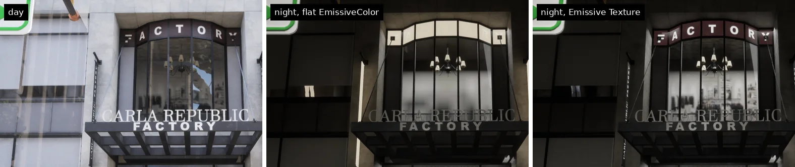
<div style="text-align: right"><i>The shop sign of Skysc19 in Town10 with an instance of <code>M_GeneralMaster</code> made from the textures of <code>MI_Shop02_Btt_Details_A</code>. At night the flat <code>EmissiveColor</code> lights the whole band in one color; the <code>Emissive</code> texture lights the letters with their own colors.</i></div>

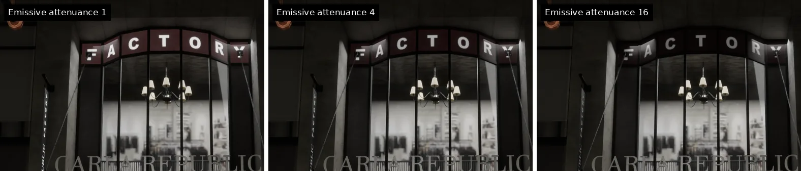
<div style="text-align: right"><i>The same sign with the same <code>EmissiveIntensity</code> and three values of <b>Emissive attenuance</b>.</i></div>

---
## Simple master

`M_SimpleMaster` is an ultra-light master for assets that need no color variation, emissive or weather effects, which make the general master heavier: props such as trash cans, cones and speed bumps, poles and vehicle parts. Each channel can come from a texture or from a flat value.

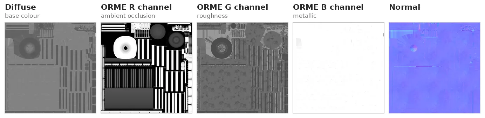
<div style="text-align: right"><i>The textures of <code>MI_TrashCan_3</code>: <code>Diffuse</code>, the three channels of the ORME texture, and <code>Normal</code>.</i></div>

### Parameters

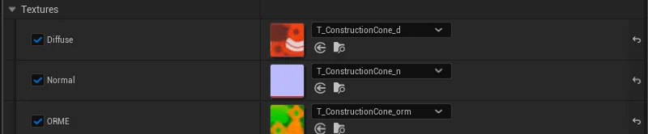

__Textures__ — `Diffuse`, `Normal` and `ORME`, with the same channel layout as the general master.

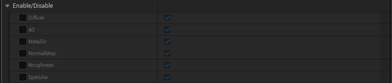

__Enable/Disable__ — one switch per channel: `Diffuse`, `AO`, `Metallic`, `NormalMap`, `Roughness`, `Specular`. Ticked, the channel comes from its texture; unticked, from the flat value of __Parameters__ (`Base Color Value` replaces the Diffuse). `OpacityMap` takes the opacity from the Diffuse alpha channel.

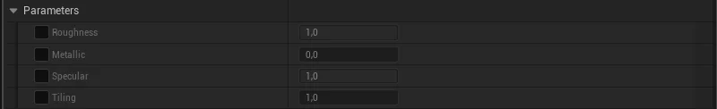

__Parameters__ — the flat `Roughness`, `Metallic` and `Specular` values used when their switch is off, and `Tiling` of the mesh UVs.

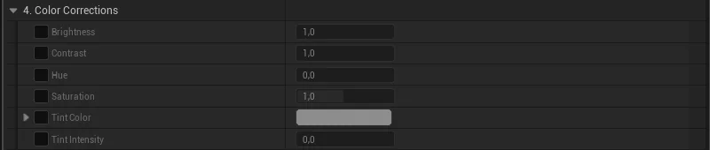

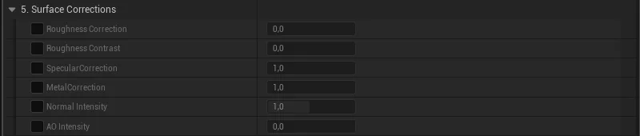

__4. Color Corrections__ and __5. Surface Corrections__ — the same corrections as the [general master](#general-master).

The master also has up to three dirt layers (`Dirt Texture 1-3`, `DirtMasks`, `Dirt Color`, `Dirt Opacity`, `Dirt Roughness`, `Rim Color`), used on some vehicles.

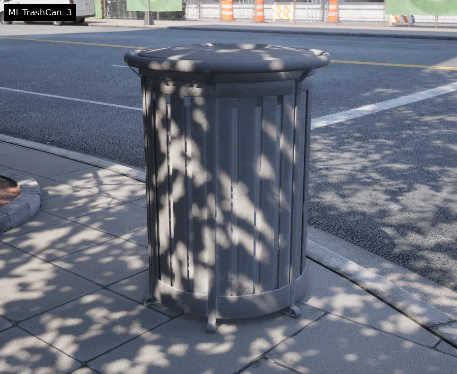
<div style="text-align: right"><i><code>MI_TrashCan_3</code> on a Town10 sidewalk.</i></div>

---
## Glass master

`M_GlassMaster` is for transparent glass: shop windows and building glass, and some vehicle parts. It is translucent, so what is behind it shows through. Most instances use flat values and no textures.

### Parameters

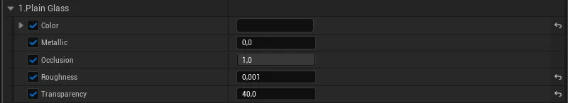

__1. Plain Glass__ — the flat values used when no texture is set.

*   `Color` — tint of the glass.
*   `Transparency` — the opacity of the glass in percent, despite its name: 0 is fully transparent, 100 fully opaque. The master's default is 50; `MI_Glass` uses 40.
*   `Roughness`, `Metallic`, `Occlusion` — how blurred and how metallic the reflections are.

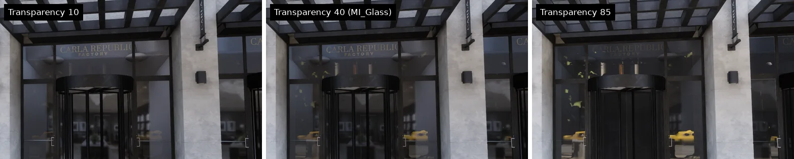
<div style="text-align: right"><i>A shop window of Town10 (<code>MI_Glass</code>) with three values of <b>Transparency</b>.</i></div>

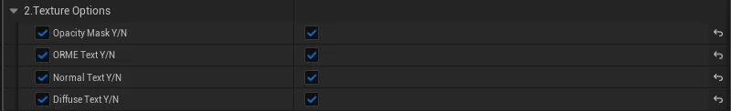

__2. Texture Options__ — `Diffuse Text Y/N`, `ORME Text Y/N`, `Normal Text Y/N` take the color, the ORME values and the normal from textures instead of flat values; `Opacity Mask Y/N` takes the opacity from the Diffuse texture instead of `Transparency`. Ticking them shows the __Textures__ and __UVs__ groups below and hides the flat values they replace.

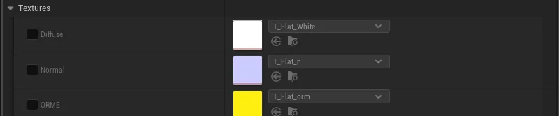

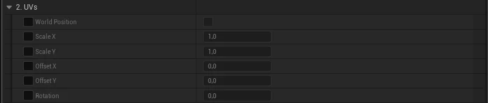

__Textures__ and __2. UVs__ — the `Diffuse`, `Normal` and `ORME` textures, and their tiling and projection as in the general master.

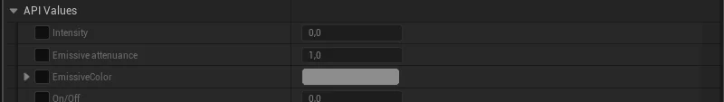

__API Values__ — `EmissiveColor` times `Intensity` divided by `Emissive attenuance`, switched by `On/Off`. No CARLA code sets them at runtime; lit windows use the [fake interior master](#fake-interior-master).

---
## Fake interior master

The rooms behind building windows are not modelled. A separate mesh slot behind the glass uses an instance of `M_FakeInterior`, which samples a cubemap of a room so that the room shifts with the view angle, and the same material makes the windows glow at night. It reads two cubemaps, `FakeInterior` (the room by day) and `FakeInteriorEmissive` (its lights by night), instead of 2D textures.

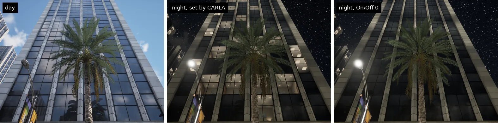
<div style="text-align: right"><i>Skysc19 in Town10, whose windows use <code>MI_Skysc19_FakeInterior_A</code>: by day, at night as CARLA lights it, and at night with <code>On/Off</code> forced to 0.</i></div>

### Parameters

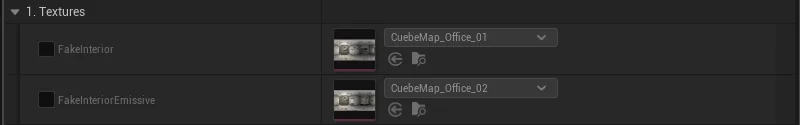

__1. Textures__ — `FakeInterior` and `FakeInteriorEmissive`, the two cubemaps.

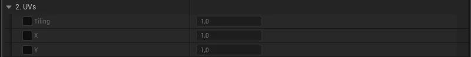

__2. UVs__ — `Tiling`, `X` and `Y`: how many rooms fit in the window and their offset.

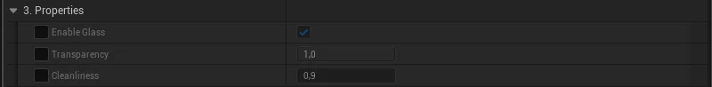

__3. Properties__ — `Enable Glass` turns on the glass roughness over the room; `Transparency` blends between `GlassColor` (0) and the room (1); `Cleanliness` removes the roughness noise (1 is clean glass).

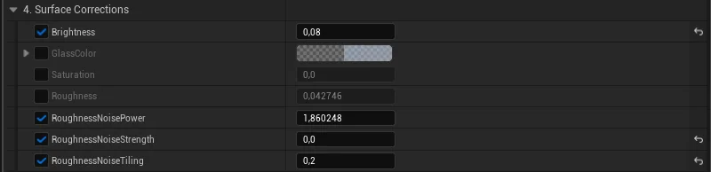

__4. Surface Corrections__ — `Brightness` and `Saturation` of the room, `GlassColor`, and the glass `Roughness` with the noise that varies it (`RoughnessNoisePower`, `RoughnessNoiseStrength`, `RoughnessNoiseTiling`).

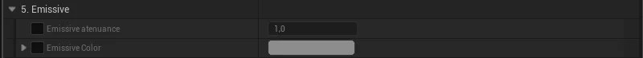

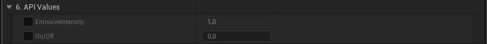

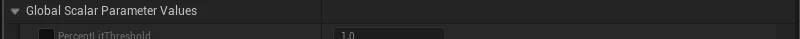

__5. Emissive__, __6. API Values__ and `PercentLitThreshold` — the window glow is `FakeInteriorEmissive` times `EmissiveIntensity / Emissive atenuance` times `Emissive Color`, switched by `On/Off`, and faded in by the weather's night factor as the sun goes down.

CARLA sets `EmissiveIntensity`, `Emissive Color`, `On/Off` and `PercentLitThreshold` on every material in `Content/Carla/Static/Building/` whose name contains `FakeInterior`, when the level loads and when a World Partition cell streams in. The values come from the `ProceduralBuildings` and `LegacyBuildings` entries of `Content/Carla/Config/Lights/Defaults.json`, where `intensity` is the percentage of windows (procedural buildings) or of whole buildings (legacy buildings) that are lit. `Emissive atenuance` is the per-building control: the fake interiors of Town15 divide the same building default by 8 to 10.

To make a new building light up at night, give its window slot an instance of `M_FakeInterior`, name the instance with `FakeInterior` in it, and save the instance under `Content/Carla/Static/Building/`.

---
## Decal master

`M_DecalMaster` is the master of the decals in `Content/Carla/Static/FX/Decals`: potholes, cracks, oil, manholes, tar snakes and fallen leaves. Place a __Decal__ actor, assign a decal instance and scale the actor to set the projected area. The decal paints over whatever surface is below it.

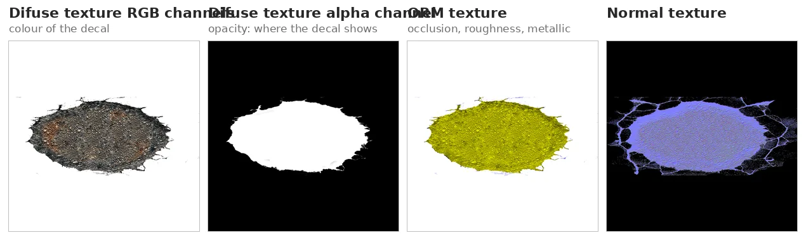
<div style="text-align: right"><i>The textures of <code>DI_PotHole01</code>: the alpha channel of the Difuse texture is the opacity, so only the hole is painted.</i></div>

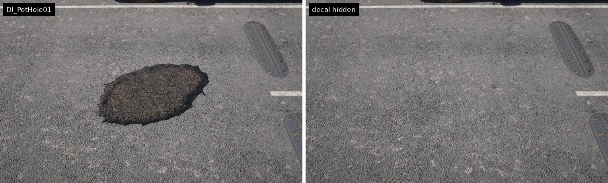
<div style="text-align: right"><i><code>DI_PotHole01</code> on a Town10 road, and the same road with the decal actor hidden.</i></div>

### Parameters

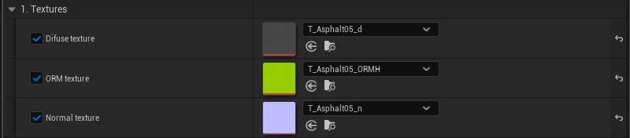

__1. Textures__ — `Difuse texture` (color, with the opacity in its alpha channel), `ORM texture` and `Normal texture`.

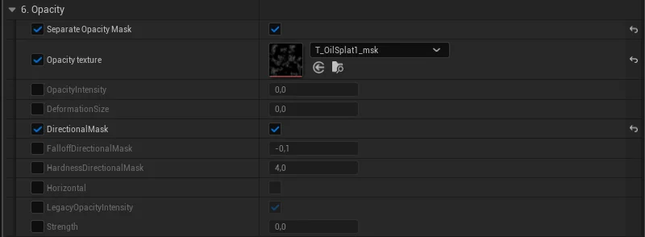

__6. Opacity__

*   `Separate Opacity Mask`, `Opacity texture` — take the opacity from a separate texture instead of the alpha channel of `Difuse texture`; `DI_OilSplat01` uses a mask this way over an asphalt texture.
*   `DirectionalMask`, `Horizontal`, `FalloffDirectionalMask`, `HardnessDirectionalMask`, `DeformationSize`, `Strength` — fade the decal along one axis of the decal box, with a noisy edge; `Horizontal` picks the axis.

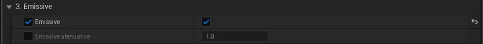

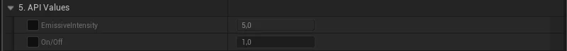

__3. Emissive__ and __5. API Values__ — `Emissive` makes the decal emit its own color. Unlike the other masters, `EmissiveIntensity` (5) and `On/Off` (1) default to on, so a decal with `Emissive` ticked glows by itself.

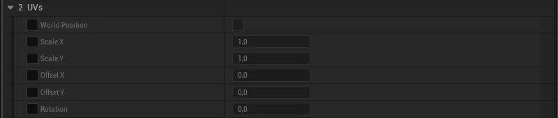

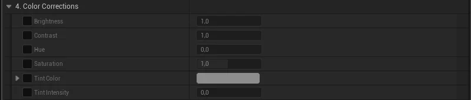

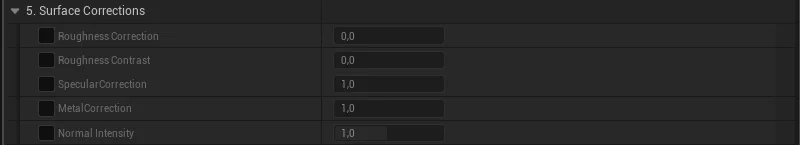

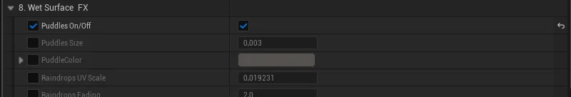

__2. UVs__, __4. Color Corrections__, __5. Surface Corrections__ and __8. Wet Surface FX__ — the same controls as the [general master](#general-master).

---
## Road master

`M_RoadMaster` is the master of the road surfaces and lane markings. It builds the asphalt from a base layer plus optional layers of rubble, oil, grime, large-scale variation, patches, cracks and wheel marks, each with its own `Do ...` switch, and it reacts to the weather with puddles and wetness. Painting roads with it is covered in [Content authoring - maps](tuto_content_authoring_maps.md#prepare-the-master-material).

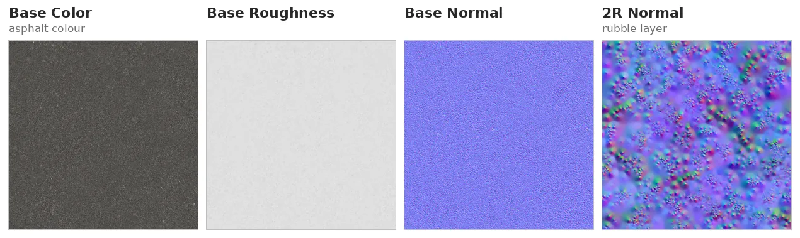
<div style="text-align: right"><i>Some of the textures of <code>MI_Road_Asphalt_B</code>, the asphalt of Town10.</i></div>

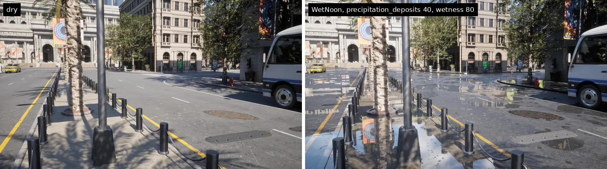
<div style="text-align: right"><i>The same Town10 street dry and with the <code>WetNoon</code> weather preset, <code>precipitation_deposits</code> 40 and <code>wetness</code> 80. The road (<code>M_RoadMaster</code>) and the sidewalks (<code>M_GeneralMaster</code>) take the puddles and the darkening from the weather.</i></div>

### Parameters

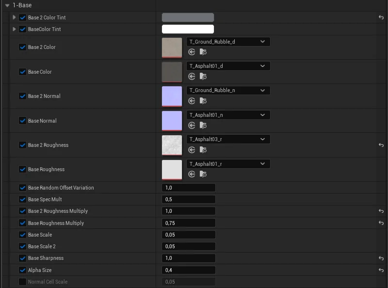

__1-Base__ — the base asphalt: `Base Color`, `Base Normal`, `Base Roughness` and a second set (`Base 2 ...`) blended by `Alpha_Bases`, with their tints, roughness multipliers and scale. `Base Random Offset Variation` and `Normal Cell Scale` break the repetition of the tiles.

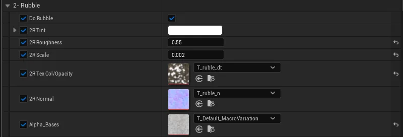

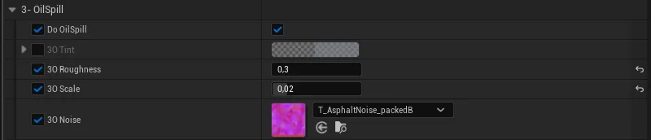

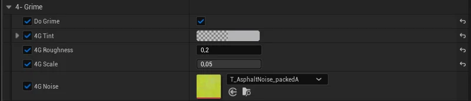

__2- Rubble__, __3- OilSpill__, __4- Grime__ — layers of loose gravel, oil stains and grime, each enabled by its `Do ...` switch and controlled by its tint, roughness, scale and noise texture.


__5- MacroVary__ — large-scale light and dark variation (`5MV Tint Dark`, `5MV Tint Light`), so long roads do not look uniform from a distance.


__6- Patches__, __7- Cracks__, __8- WheelMarks__ — repaired patches, cracks, and the darker tracks left by tyres. Their parameters appear when the switch is ticked.


__91- Puddle__, __0b Decals__, __99 -LaneMarking__ — `Do Puddle` adds the material's own puddles; `Enable Decal 0b` lets decals paint on the road; `LaneMark` turns the instance into a lane-marking material, as in `MI_Road_Asphalt_B_LaneMarkingWhite`.

---
## Vegetation master

`M_VegetationMaster` is the master of trees, palms, bushes and grass. It is two-sided and masked, it moves with the wind of the weather, and it can vary its color across a forest.


<div style="text-align: right"><i>The textures of <code>MI_Palm_Leaf</code>.</i></div>


<div style="text-align: right"><i>A palm of Town10.</i></div>

### Parameters


__0 - Textures__ — `Albedo`, `Normal`, and `RDO (Roughness // Displacement // Occlusion)`. With `UseOpacityMask`, the leaf cut-out comes from the `Opacity Mask` texture instead of the Albedo alpha channel.


__00 - Global__ and __05-Grass__ — `Plant` and `GrassGradient` select variants of the shader for plants and grass; `GrassGradient` blends the color with a world-position gradient.


__1. Uvs__ — `UseUniformTiling` and `Tiling`.


__13 - ColorVariation__ — with `ColorVariations`, tints the vegetation with `Color Var Color 01-03`, varying with the world position, so the same tree does not look identical everywhere; `Random Color Int` and `Random Color Variation Amount` control the strength.


__2. Adjustments__ — `Albedo Controls`, `AlbedoTint`, `Tint Intensity`, `Spec/Rough/Normal Intensities`, `AO Controls`, `UseFresnelSpecular`, and sharpening of the albedo and normal.


__3. SubSurfaceScattering__ — light passing through the leaves: `Subsurface Intensity`, `Thickness`, and a custom color or texture.


__4 - Wind__ and __2 - Wind__ — `EnableWind` moves the mesh with the wind intensity of the weather; `Wind Multiplyer` scales it and `Vertical Offset` shifts the motion. The second wind group holds a `Contrast` value.

!!! Note
    Textures can also be swapped at runtime, without the editor, through [`carla.World.apply_color_texture_to_object`](python_api.md#carla.World.apply_color_texture_to_object). See [Texture streaming](tuto_G_texture_streaming.md).

Generic material documentation is in the [Unreal Engine docs](https://dev.epicgames.com/documentation/en-us/unreal-engine/unreal-engine-materials).
