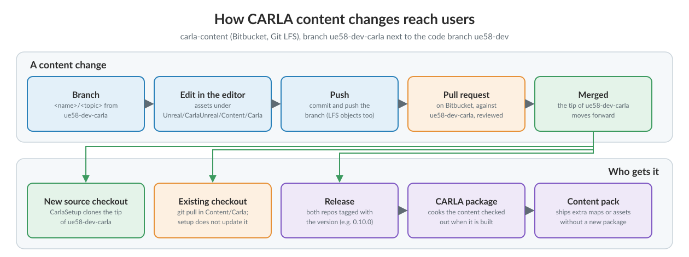

# Updating the content

CARLA's maps, vehicles, walkers, props and materials live in a repository of their own, [__carla-content__](https://bitbucket.org/carla-simulator/carla-content), next to the code repository. This page is for whoever maintains or changes that content: how a source checkout gets it, how to update it, how a change is merged, and how a release fixes the content it ships. To contribute assets as an outside contributor, start with [Art contributions](cont_contribution_guidelines.md#art-contributions).

- [__Where the content lives__](#where-the-content-lives)
- [__Getting the content__](#getting-the-content)
- [__Updating a checkout__](#updating-a-checkout)
- [__Merging a change__](#merging-a-change)
- [__Releases__](#releases)


<div style="text-align: right"><i>How a change to the content repository reaches source checkouts, releases and packages.</i></div>

---
## Where the content lives

The content repository is a Git repository on Bitbucket with every asset under [Git LFS](https://git-lfs.com/) (`*/** filter=lfs` in its `.gitattributes`). A source checkout keeps it in `Unreal/CarlaUnreal/Content/Carla`, which the code repository does not track. Each code branch has its content branch:

| Code branch (carla) | Content branch (carla-content) |
| --- | --- |
| `ue58-dev` | `ue58-dev-carla` |
| `ue5-dev` | `ue5-dev` |

The content branch is followed at its tip: no file in the code repository pins a content commit. `Util/ContentVersions.txt` is left over from the 0.9.x releases, which downloaded the content as dated packages; no script reads it.

---
## Getting the content

`CarlaSetup.sh` (`CarlaSetup.bat` on Windows) clones the content branch into `Unreal/CarlaUnreal/Content/Carla` when that folder does not exist. To clone it by hand, from `Unreal/CarlaUnreal/Content` and with Git LFS installed:

```sh
git clone -b ue58-dev-carla https://bitbucket.org/carla-simulator/carla-content.git Carla
```

Cloning needs no account. `--single-branch --depth 1` downloads only the latest commit of the branch, which is enough to build and run CARLA; drop them to have the history for your own branches. Before launching the editor, the build checks that `Content/Carla/Blueprints` exists; without the content the editor crashes.

---
## Updating a checkout

`CarlaSetup.sh` does not touch content that is already there, so a checkout stays at the content commit it was cloned at until it is updated by hand:

```sh
git -C Unreal/CarlaUnreal/Content/Carla checkout ue58-dev-carla
git -C Unreal/CarlaUnreal/Content/Carla pull
```

Git LFS downloads the binary files of the new commits during the pull. When the code and the content change together (a new vehicle and its blueprint factory, for instance), update both repositories at the same time (`ue58-dev` and `ue58-dev-carla`), or the editor may load assets the code does not know yet.

---
## Merging a change

A content change goes through a pull request on Bitbucket, as code does on GitHub:

1. Create a branch from `ue58-dev-carla`. Team members name it `<name>/<topic>` (`marcos/ue58_TwoWheelFloating`); outside contributors get a `contributors/<name>` branch (see [Art contributions](cont_contribution_guidelines.md#art-contributions)).
2. Edit the assets in the CARLA editor and save them under `Unreal/CarlaUnreal/Content/Carla`. Commit and push the branch; Git LFS uploads the binary files.
3. Before opening the pull request, merge the latest `ue58-dev-carla` into the branch and check the editor still opens the maps you touched.
4. Open the pull request against `ue58-dev-carla`. When it is merged, Bitbucket writes a merge commit named `Merged in <branch> (pull request #<n>)`.

A change that needs code too (a new blueprint attribute, a C++ class an asset uses) is two pull requests: one on GitHub against `ue58-dev` and one on Bitbucket against `ue58-dev-carla`. Merge them together, so neither branch is broken in between.

---
## Releases

A release fixes the content it ships with a tag in the content repository, named after the CARLA version, next to the same tag in the code repository: `0.10.0` is a tag in both. To build a release, check out the tag in both repositories:

```sh
git -C Unreal/CarlaUnreal/Content/Carla fetch --tags
git -C Unreal/CarlaUnreal/Content/Carla checkout 0.10.0
```

The `package` target cooks whatever content is checked out in `Unreal/CarlaUnreal/Content/Carla` (see [Build a package](build_linux_ue5.md#build-a-package-with-carla-ue5)). Towns and assets the package does not cook can reach the users of a release later as a [content pack](content_packs.md), without a new package.
