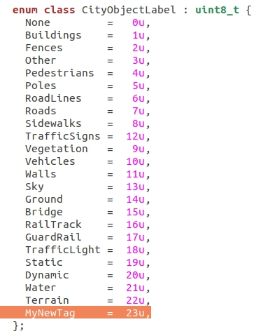
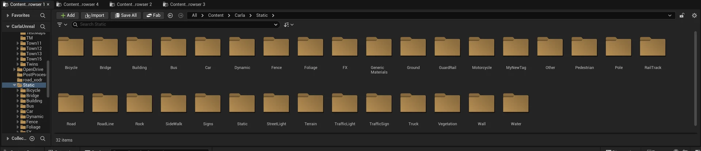
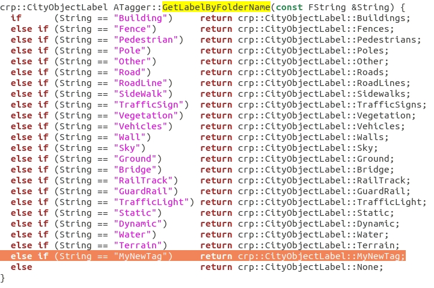
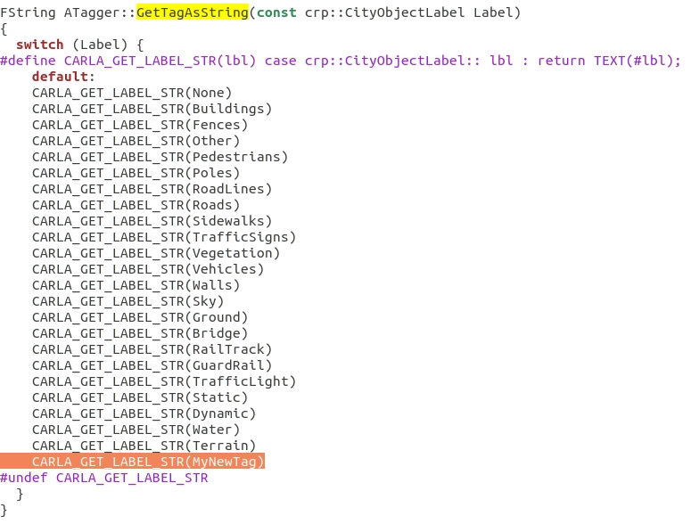
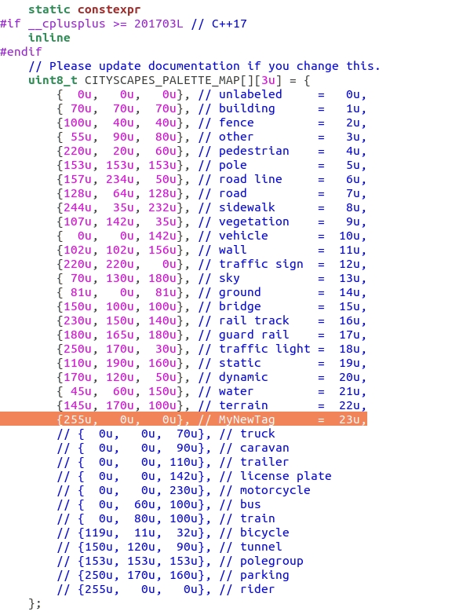
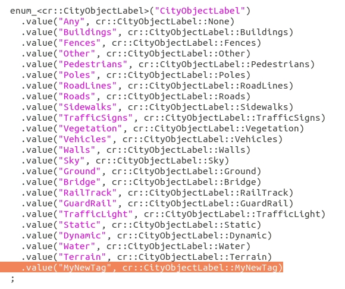

# Create semantic tags

Learn how to define customized tags for semantic segmentation. These can additionally be added to [carla.CityObjectLabel](python_api.md#carla.CityObjectLabel) to filter the bounding boxes that [carla.World](python_api.md#carla.World) retrieves.

*   [__Create a new semantic tag__](#create-a-new-semantic-tag)  
	*   [1. Create the tag ID](#1-create-the-tag-id)  
	*   [2. Create the UE folder for assets](#2-create-the-ue-folder-for-assets)  
	*   [3. Create two-way correspondence between UE and the code tag](#3-create-two-way-correspondence-between-ue-and-the-code-tag)  
	*   [4. Define a color code](#4-define-a-color-code)  
    *   [5. Add the tagged meshes](#5-add-the-tagged-meshes)
*   [__Add a tag to carla.CityObjectLabel__](#add-a-tag-to-carlacityobjectlabel)

---

## Create a new semantic tag

### 1. Create the tag ID

__Open `ObjectLabel.h`__ in `LibCarla/source/carla/rpc`. Add your new tag by the end of the enum using the same formatting as the rest.



!!! Note
    Tags do not have to appear in order. However, it is good practice to list them in order.

### 2. Create the UE folder for assets

__Open the Unreal Engine Editor__ and go to `Content/Carla/Static`. Create a new folder named after your tag.

The label is read from the asset's path, at a fixed depth: the folder has to sit directly under `Content/Carla/Static/` (or under `Content/Carla/Static/UE5UseOnly/`), not nested deeper. A content pack uses `/<Pack>/Static/<Tag>/` instead.



!!! Note
    The UE folder and the tag do not necessarily have to be named the same. However, it is good practice to do so.

### 3. Create two-way correspondence between UE and the code tag

__3.1. Open `Tagger.cpp`__ in `Unreal/CarlaUnreal/Plugins/Carla/Source/Carla/Game`. Go to __`GetLabelByFolderName`__ Add the your tag by the end of the list. The string being compared is the name of the UE folder used in [__2.__](#2-create-the-ue-folder-for-assets), so use the exact same name here.



__3.2. Go to `GetTagAsString`__ in the same `Tagger.cpp`. Add the new tag by the end of the switch.



__3.3. Go to `GetTagFromString`__, still in `Tagger.cpp`, and add the matching `if (Tag.Contains("<YourTag>")) return crp::CityObjectLabel::<YourTag>;` line. Without it the tag cannot be read back from a name, which is what `ATagger::SetLabelTag` uses to replace an existing tag.

!!! Warning
    `GetTagFromName` builds its lookup table by walking the enum only as far as `CityObjectLabel::Rock`. A label added after `Rock` is never put in that table and will not round-trip. Either insert the new label before `Rock`, or raise the loop bound to the last enum value.

### 4. Define a color code

__Open `CityScapesPalette.h`__ in `LibCarla/source/carla/image`. Add the color code of your new tag by the end of the array.



!!! Warning
    The position in the array must match the tag id. The enum currently ends at `Rock = 29u`, so a new tag takes the next free value.

### 5. Add the tagged meshes

The new semantic tag is ready to be used. Only the meshes stored inside the UE folder of a tag are tagged as such. Move or import the corresponding meshes to the new folder, in order for the to be tagged properly.

---

## Add a tag to [carla.CityObjectLabel](python_api.md#carla.CityObjectLabel)

This step is not directly related with semantic segmentation. However, these tags can be used to filter the bounding box query in [carla.World](python_api.md#carla.World). In order to do this, the tag must be added to the [carla.CityObjectLabel](python_api.md#carla.CityObjectLabel) enum in the PythonAPI.

__Open `World.cpp`__ in `PythonAPI/carla/src` and add the new tag at the end of the `CityObjectLabel` enum.




---

Post in the [CARLA forum](https://github.com/carla-simulator/carla/discussions) for any issues, doubts or suggestions.

__What's next?__ The [sensors reference](ref_sensors.md) covers the semantic segmentation camera that consumes these tags, and [adding props](content_authoring_props.md) covers importing the meshes to tag.

Finally, rebuild the server and the Python API so both sides know the new label, and add it to `PythonAPI/docs/world.yml` and the semantic tag table in `ref_sensors.md`:

```sh
cmake --build Build/Release --target carla-server
cmake --build Build/Release --target carla-python-api-install
```
