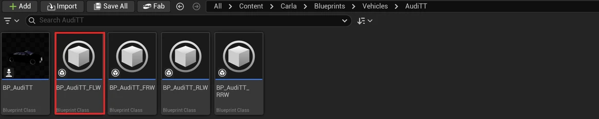
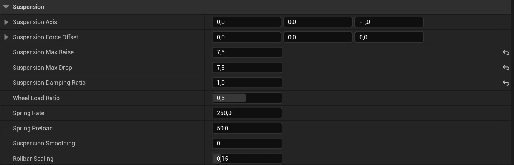

# Customize vehicle suspension

CARLA vehicles run on Unreal's Chaos vehicle physics, where the suspension is defined per wheel. This page covers the parameters, where to change them permanently in the editor, and how to change them at runtime from the Python API.

*   [__Wheel suspension__](#wheel-suspension)
*   [__Suspension parameters__](#suspension-parameters)
*   [__Editing a wheel blueprint__](#editing-a-wheel-blueprint)
*   [__Changing the suspension at runtime__](#changing-the-suspension-at-runtime)

---
## Wheel suspension

Each wheel of a vehicle is a `UChaosVehicleWheel` asset with its own parameters, the suspension among them. A four-wheeled vehicle therefore has four independent suspensions, which CARLA's vehicles set to the same values unless the vehicle calls for otherwise.

The wheel blueprints live next to the vehicle blueprint in `Content/Carla/Blueprints/Vehicles/<VehicleName>/` and are named `BP_<VehicleName>_<F|R><L|R>W`:

*   `F` or `R` — front or rear.
*   `L` or `R` — left or right.


<div class="img-caption">The Audi TT folder: the vehicle blueprint and its four wheel blueprints; the front left wheel is <code>BP_AudiTT_FLW</code>.</div>

---
## Suspension parameters

These are the properties under the __Suspension__ category of a wheel blueprint, with the defaults CARLA applies when a vehicle does not override them.

| Parameter | Default | Meaning |
| --- | --- | --- |
| `Suspension Axis` | `(0, 0, -1)` | Direction, in body space, along which the suspension force is applied. |
| `Suspension Force Offset` | `(0, 0, 0)` | Offset from the wheel at which that force is applied. |
| `Suspension Max Raise` | `10.0` | How far the wheel can travel above its resting position, in cm. |
| `Suspension Max Drop` | `10.0` | How far the wheel can drop below its resting position, in cm. |
| `Suspension Damping Ratio` | `0.5` | How fast the spring comes to rest, in `[0, 1]`. Higher damps the bouncing sooner. |
| `Wheel Load Ratio` | `0.5` | How much the load on the wheel affects its friction, in `[0, 1]`. `0` ignores the load, `1` is the realistic end; lower values cure lift-off oversteer. |
| `Spring Rate` | `250.0` | Spring force, in N/m. |
| `Spring Preload` | `50.0` | Spring preload, in N/m. |
| `Suspension Smoothing` | `0` | Smoothing of the suspension length, `0` off to `10` maximum. High values can make a wheel visibly sink into the ground for a frame. |
| `Rollbar Scaling` | `0.15` | Anti-roll bar effect, in `[0, 1]`. |
| `Sweep Shape` | `Raycast` | How the ground is found: `Raycast` (fastest), `Spherecast`, or `Shapecast` (uses the wheel's collision shape, slowest). |
| `Sweep Type` | `SimpleSweep` | Geometry the sweep tests against: `SimpleSweep` or `ComplexSweep`. |

CARLA's vehicles override several of these. The Audi TT's front left wheel, for example, uses `Suspension Max Raise` and `Max Drop` of `7.5`, a `Suspension Damping Ratio` of `1.0`, and a `Spherecast` with `ComplexSweep`.

!!! Note
    A stiffer vehicle wants smaller `Suspension Max Raise` and `Max Drop` with a higher `Spring Rate` and `Damping Ratio`; a soft, off-road one wants the opposite. Raise `Rollbar Scaling` to keep a tall vehicle from leaning in corners.

---
## Editing a wheel blueprint

__1.__ Open the vehicle's folder in the Unreal editor and double-click the wheel blueprint you want to change, for example `BP_AudiTT_FLW`.

__2.__ In the __Details__ panel, open the __Suspension__ category and set the values.


<div class="img-caption">The Suspension category of <code>BP_AudiTT_FLW</code>; the arrows on the right mark the values that differ from the defaults.</div>

__3.__ Repeat for the other three wheels, or set them all at once by selecting the four assets and editing the shared property.

__4.__ Compile, save, and drive the vehicle to check the result.

!!! Warning
    `Wheel Radius` has to keep the wheel resting on the road, neither hovering above it nor sunk into it. Changing the suspension travel without checking the radius is the usual cause of a floating vehicle.

---
## Changing the suspension at runtime

The same values are exposed per wheel on [carla.WheelPhysicsControl](python_api.md#carla.WheelPhysicsControl), so a client can change them without rebuilding the content. Read the current control, modify the wheels, and apply it back:

```py
vehicle = world.get_actor(vehicle_id)
physics_control = vehicle.get_physics_control()

# Keep the existing wheels and change only what is needed: a fresh
# WheelPhysicsControl would reset every other field to its default.
wheels = []
for wheel in physics_control.wheels:
    wheel.suspension_max_raise = 15.0
    wheel.suspension_max_drop = 15.0
    wheel.suspension_damping_ratio = 0.4
    wheel.spring_rate = 200.0
    wheels.append(wheel)

physics_control.wheels = wheels
vehicle.apply_physics_control(physics_control)
```

Runtime changes last until the vehicle is destroyed or the map is reloaded. See [Control vehicle physics](tuto_G_control_vehicle_physics.md) for the rest of the physics control.
