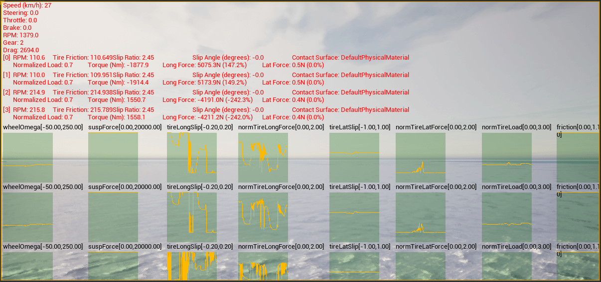

# Control and monitor vehicle physics

Physics properties can be tuned for vehicles and their wheels.
These changes are applied **only** on runtime, and values are set back to default when the execution ends.

These properties are controlled through a
[carla.VehiclePhysicsControl](python_api.md#carla.VehiclePhysicsControl) object,
which also provides the control of each wheel's physics through a
[carla.WheelPhysicsControl](python_api.md#carla.WheelPhysicsControl) object.

- [__Vehicle control code example__](#vehicle-control-code-example)
- [__Viewing vehicle telemetry__](#viewing-vehicle-telemetry)
- [__Driving the wheels by hand__](#driving-the-wheels-by-hand)

---
## Vehicle control code example

```py
import carla
import random

def main():
    # Connect to client
    client = carla.Client('127.0.0.1', 2000)
    client.set_timeout(2.0)

    # Get World and Actors
    world = client.get_world()
    actors = world.get_actors()

    # Get a random vehicle from world (there should be one at least)
    vehicle = random.choice([actor for actor in actors if 'vehicle' in actor.type_id])

    # Create Wheels Physics Control
    front_left_wheel  = carla.WheelPhysicsControl(tire_friction=2.0, max_steer_angle=70.0)
    front_right_wheel = carla.WheelPhysicsControl(tire_friction=2.0, max_steer_angle=70.0)
    rear_left_wheel   = carla.WheelPhysicsControl(tire_friction=3.0, max_steer_angle=0.0)
    rear_right_wheel  = carla.WheelPhysicsControl(tire_friction=3.0, max_steer_angle=0.0)

    wheels = [front_left_wheel, front_right_wheel, rear_left_wheel, rear_right_wheel]

    # Change Vehicle Physics Control parameters of the vehicle
    physics_control = vehicle.get_physics_control()

    physics_control.torque_curve = [carla.Vector2D(x=0, y=400), carla.Vector2D(x=1300, y=600)]
    physics_control.max_rpm = 10000
    physics_control.moi = 1.0
    physics_control.use_gear_autobox = True
    physics_control.gear_switch_time = 0.5
    physics_control.mass = 10000
    physics_control.drag_coefficient = 0.25
    physics_control.steering_curve = [carla.Vector2D(x=0, y=1), carla.Vector2D(x=100, y=1), carla.Vector2D(x=300, y=1)]
    physics_control.use_sweep_wheel_collision = True
    physics_control.wheels = wheels

    # Apply Vehicle Physics Control for the vehicle
    vehicle.apply_physics_control(physics_control)
    print(physics_control)

if __name__ == '__main__':
    main()
```

---

## Viewing vehicle telemetry

Vehicle telemetry can be visualised by calling the [`Vehicle.show_debug_telemetry`](python_api.md#carla.Vehicle.show_debug_telemetry) method. This will provide graph views of several metrics on the server window as well as vehicle reference points on the simulation window. Only one vehicle can be shown at a time: enabling a second one disables the first.



You can try the telemetry visualisation tool in the example script `manual_control.py` located in `PythonAPI/examples`. Activate the telemetry view by pressing `T`.

To read the same state from the client instead of watching it, [`Vehicle.get_telemetry_data`](python_api.md#carla.Vehicle.get_telemetry_data) returns what the solver last computed: the applied control, forward speed, engine RPM and gear, and the slip and angular velocity of each wheel.

```py
telemetry = vehicle.get_telemetry_data()
print(telemetry.speed, telemetry.engine_rpm, telemetry.gear)

for wheel in telemetry.wheels:
    print(wheel.lat_slip, wheel.long_slip, wheel.omega)
```

---
## Driving the wheels by hand

The wheels normally follow the physics: Chaos turns them while it simulates the vehicle, and when it is not — physics disabled, or another component moving the vehicle — they roll by the distance the vehicle travels.

A replay or a co-simulation platform that already knows where its wheels are can take them over instead:

```py
vehicle.set_wheel_animation_override(True)

vehicle.set_wheel_steer_direction(carla.VehicleWheelLocation.FL_Wheel, 30.0)   # degrees
vehicle.set_wheel_pitch_angle(carla.VehicleWheelLocation.FL_Wheel, 90.0)       # degrees of roll
vehicle.set_wheel_suspension_offset(carla.VehicleWheelLocation.FL_Wheel, 0.05) # metres
```

While the override is on, the wheels show those values and nothing else, whether or not Chaos is simulating the vehicle. `get_wheel_steer_angle`, `get_wheel_pitch_angle` and `get_wheel_suspension_offset` read them back.

!!! Note
    The override is visual only — it moves no physics and changes no collision. The setters raise an error while it is off, and every one of these calls raises for a wheel the vehicle does not have.
