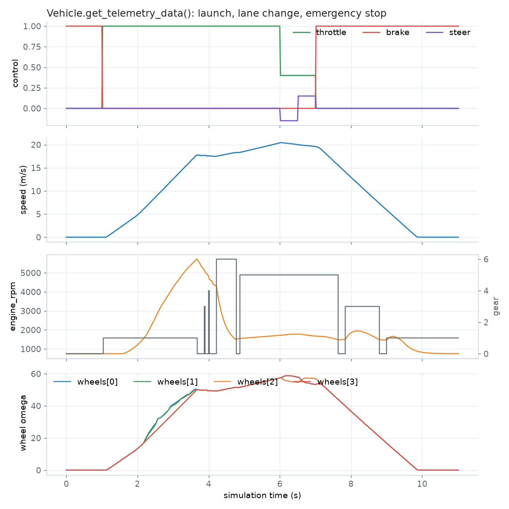

# Control and monitor vehicle physics

Physics properties can be tuned for vehicles and their wheels.
These changes are applied **only** on runtime, and values are set back to default when the execution ends.

These properties are controlled through a
[carla.VehiclePhysicsControl](python_api.md#carla.VehiclePhysicsControl) object,
which also provides the control of each wheel's physics through a
[carla.WheelPhysicsControl](python_api.md#carla.WheelPhysicsControl) object.

- [__The fields worth changing__](#the-fields-worth-changing)
- [__Vehicle control code example__](#vehicle-control-code-example)
- [__Viewing vehicle telemetry__](#viewing-vehicle-telemetry)
- [__Driving the wheels by hand__](#driving-the-wheels-by-hand)

---
## The fields worth changing

__Always read, modify, apply.__ `get_physics_control()` returns the vehicle's current setup; change the fields you care about on it and send it back with `apply_physics_control()`. Constructing a fresh `VehiclePhysicsControl` or `WheelPhysicsControl` resets every field you did not set to its default, which silently rebuilds the vehicle around a generic one.

On [carla.VehiclePhysicsControl](python_api.md#carla.VehiclePhysicsControl):

| Field | Units | What it does |
| --- | --- | --- |
| `mass` | kg | Vehicle mass. The single biggest influence on how it brakes and corners. |
| `drag_coefficient` | — | Aerodynamic drag, which sets the top speed. |
| `max_rpm` | rpm | Engine rev limit. Keep the `torque_curve` covering the same range. |
| `torque_curve` | list of `carla.Vector2D` (rpm, Nm) | Torque against engine speed. |
| `rev_up_moi` | kg·m² | Rotational inertia of the engine: how fast it revs up. |
| `use_automatic_gears`, `gear_change_time` | —, s | Automatic gearbox, and how long a shift takes. |
| `steering_curve` | list of `carla.Vector2D` (km/h, factor) | How much of `max_steer_angle` is available at a given speed. |
| `center_of_mass` | m | Offset of the centre of mass, which changes the weight transfer. |
| `use_sweep_wheel_collision` | — | Sweep the wheel's whole volume against the world instead of ray-casting from the axle. Costlier, but it stops wheels clipping kerbs. |

On each [carla.WheelPhysicsControl](python_api.md#carla.WheelPhysicsControl) in `physics_control.wheels`:

| Field | Units | What it does |
| --- | --- | --- |
| `friction_force_multiplier` | — | Grip of that wheel. The default is `3.5`; lower it for a slippery tyre. |
| `max_steer_angle` | degrees | How far the wheel turns. `0` on the rear wheels of a normal car. |
| `wheel_radius`, `wheel_width` | cm | Wheel dimensions. Changing these without checking the vehicle rests on the road is what makes a car float or sink. |
| `max_brake_torque`, `max_hand_brake_torque` | Nm | Braking force on that wheel. |
| `suspension_*`, `spring_rate` | see [suspension](tuto_D_customize_vehicle_suspension.md) | The suspension of that wheel. |

The wheels are ordered as [`carla.VehicleWheelLocation`](python_api.md#carla.VehicleWheelLocation) numbers them: `FL_Wheel`, `FR_Wheel`, `BL_Wheel`, `BR_Wheel` — front-left, front-right, back-left, back-right. Two-wheelers have two entries instead, `Front_Wheel` and `Back_Wheel`.

---
## Vehicle control code example

The values below are deliberately extreme — a 10-tonne vehicle with a 5000 rpm limit — so their effect is obvious when driving. Start from the vehicle's own values and change them a little at a time for anything realistic.

```py
import carla
import random

def main():
    # Connect to client
    client = carla.Client('127.0.0.1', 2000)
    client.set_timeout(2.0)

    # Get World and Actors
    world = client.get_world()
    actors = world.get_actors()

    # Get a random vehicle from world (there should be one at least)
    vehicle = random.choice([actor for actor in actors if 'vehicle' in actor.type_id])

    # Change the Vehicle Physics Control parameters of the vehicle
    physics_control = vehicle.get_physics_control()

    physics_control.torque_curve = [carla.Vector2D(x=0, y=400), carla.Vector2D(x=1300, y=600)]
    physics_control.max_rpm = 10000
    physics_control.rev_up_moi = 1.0
    physics_control.use_automatic_gears = True
    physics_control.gear_change_time = 0.5
    physics_control.mass = 10000
    physics_control.drag_coefficient = 0.25
    physics_control.steering_curve = [carla.Vector2D(x=0, y=1), carla.Vector2D(x=100, y=1), carla.Vector2D(x=300, y=1)]
    physics_control.use_sweep_wheel_collision = True

    # Change the wheels in place: a freshly constructed WheelPhysicsControl
    # would reset every other field of that wheel to its default.
    wheels = physics_control.wheels
    for wheel in wheels[:2]:
        wheel.friction_force_multiplier = 2.0
        wheel.max_steer_angle = 70.0
    for wheel in wheels[2:]:
        wheel.friction_force_multiplier = 3.0
        wheel.max_steer_angle = 0.0
    physics_control.wheels = wheels

    # Apply Vehicle Physics Control for the vehicle
    vehicle.apply_physics_control(physics_control)
    print(physics_control)

if __name__ == '__main__':
    main()
```

---

## Viewing vehicle telemetry

[`Vehicle.get_telemetry_data`](python_api.md#carla.Vehicle.get_telemetry_data) returns what the physics solver last computed for a vehicle:

| Field | Units | What it is |
| --- | --- | --- |
| `speed` | m/s | Forward speed. |
| `steer`, `throttle`, `brake` | — | The control the solver last applied, as it was received. |
| `engine_rpm` | rpm | Engine speed. |
| `gear` | — | Current gear. `0` while an automatic gearbox is changing gear. |
| `wheels` | list | One entry per wheel, in `FL_Wheel`, `FR_Wheel`, `BL_Wheel`, `BR_Wheel` order. |

And per wheel:

| Field | Units | What it is |
| --- | --- | --- |
| `lat_slip` | degrees | Slip angle of the tyre. |
| `long_slip` | — | Longitudinal slip ratio of the tyre. |
| `omega` | rad/s | Angular velocity of the wheel. |

```py
telemetry = vehicle.get_telemetry_data()
print(telemetry.speed, telemetry.engine_rpm, telemetry.gear)

for wheel in telemetry.wheels:
    print(wheel.lat_slip, wheel.long_slip, wheel.omega)
```

[`Vehicle.show_debug_telemetry`](python_api.md#carla.Vehicle.show_debug_telemetry) is a separate thing, and not a view of the same data: it prints each wheel's load in newtons and the friction of the surface under it as a text overlay on a rendered server window. Those two quantities are not in `get_telemetry_data`, and nothing it reports is on the overlay. `manual_control.py` toggles it with `T`, and only one vehicle can be shown at a time.

Logged every tick, `get_telemetry_data` shows what the solver does with the controls. Here a Lincoln MKZ launches at full throttle, changes lane and brakes to a stop; `gear` is `0` while the automatic transmission changes gear:


<div class="img-caption">Controls, speed, engine RPM and gear, and the angular velocity of the four wheels from <code>get_telemetry_data()</code>, at 50 Hz with 0.01 s physics substeps.</div>

---
## Driving the wheels by hand

The wheels normally follow the physics: Chaos turns them while it simulates the vehicle, and when it is not — physics disabled, or another component moving the vehicle — they roll by the distance the vehicle travels.

A replay or a co-simulation platform that already knows where its wheels are can take them over instead:

```py
vehicle.set_wheel_animation_override(True)

vehicle.set_wheel_steer_direction(carla.VehicleWheelLocation.FL_Wheel, 30.0)   # degrees
vehicle.set_wheel_pitch_angle(carla.VehicleWheelLocation.FL_Wheel, 90.0)       # degrees of roll
vehicle.set_wheel_suspension_offset(carla.VehicleWheelLocation.FL_Wheel, 0.05) # metres
```

While the override is on, the wheels show those values and nothing else, whether or not Chaos is simulating the vehicle. `get_wheel_steer_angle`, `get_wheel_pitch_angle` and `get_wheel_suspension_offset` read them back.

!!! Note
    The override is visual only — it moves no physics and changes no collision. The setters raise an error while it is off, and every one of these calls raises for a wheel the vehicle does not have.
