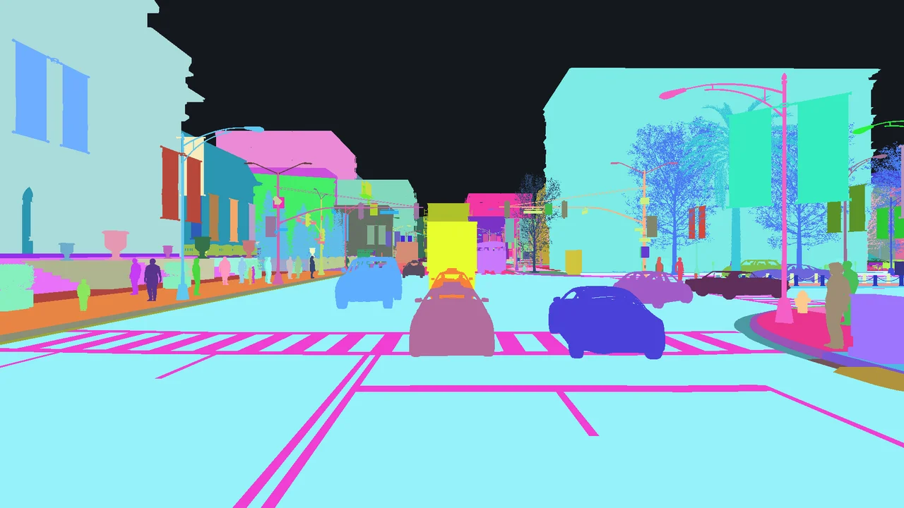

# Instance segmentation sensor

The instance segmentation camera gives every individual object in the scene its own pixel value, where the [semantic segmentation camera](ref_sensors.md#semantic-segmentation-camera) gives every object of the same class the same one. That is what makes per-instance masks — one vehicle separated from the vehicle parked behind it — possible.

- [__Example__](#example)
- [__Image output__](#image-output)
- [__Decoding the instance ids__](#decoding-the-instance-ids)

The blueprint is `sensor.camera.instance_segmentation`, and a wide-angle variant, `sensor.camera.instance_segmentation_fisheye`, exists as well. The full attribute list is in the [sensors reference](ref_sensors.md#instance-segmentation-camera).

```py
instance_camera_bp = world.get_blueprint_library().find('sensor.camera.instance_segmentation')
```

---
## Example

Set up a world with an instance segmentation camera watching a junction, and fill it with vehicles. The camera pose below is one on `Town10HD_Opt`.

```py
import carla
import random
import queue

client = carla.Client('localhost', 2000)
client.set_timeout(10.0)
world = client.load_world('Town10HD_Opt')

settings = world.get_settings()
settings.synchronous_mode = True
settings.fixed_delta_seconds = 0.05
world.apply_settings(settings)
```

Spawn the camera where the spectator can watch it from:

```py
# Get the map spawn points and the spectator
spawn_points = world.get_map().get_spawn_points()
spectator = world.get_spectator()

# Point the camera at a junction of Town10HD_Opt
cam_location = carla.Location(x=-46., y=152, z=18)
cam_rotation = carla.Rotation(pitch=-21, yaw=-93.4, roll=0)
camera_transform = carla.Transform(location=cam_location, rotation=cam_rotation)
spectator.set_transform(camera_transform)

# Retrieve the instance segmentation camera blueprint and spawn the camera
instance_camera_bp = world.get_blueprint_library().find('sensor.camera.instance_segmentation')
instance_camera = world.try_spawn_actor(instance_camera_bp, camera_transform)
```

Spawn vehicles around the camera to populate the scene with object instances:

```py
# Spawn vehicles within 80 m of the camera
vehicle_bp_library = world.get_blueprint_library().filter('*vehicle*')
vehicles = []
radius = 80
for spawn_point in spawn_points:
    vec = [spawn_point.location.x - cam_location.x, spawn_point.location.y - cam_location.y]
    if vec[0]*vec[0] + vec[1]*vec[1] < radius*radius:
        vehicle = world.try_spawn_actor(random.choice(vehicle_bp_library), spawn_point)
        if vehicle is not None:
            vehicles.append(vehicle)
world.tick()
```

Capture one frame:

```py
instance_image_queue = queue.Queue()
instance_camera.listen(instance_image_queue.put)
world.tick()
instance_image = instance_image_queue.get()
instance_image.save_to_disk('instance_segmentation.png')
```

Then put the server back as it was, or the next script will hang waiting for ticks:

```py
instance_camera.stop()
instance_camera.destroy()
client.apply_batch([carla.command.DestroyActor(v) for v in vehicles])

settings.synchronous_mode = False
settings.fixed_delta_seconds = None
world.apply_settings(settings)
```

---
## Image output

The image encodes the semantic label in the __R__ channel and the instance id in __G__ and __B__.



---
## Decoding the instance ids

The instance id is 16 bits, with `G` as the low byte and `B` as the high byte:

```py
import numpy as np

array = np.frombuffer(instance_image.raw_data, dtype=np.uint8)
array = array.reshape((instance_image.height, instance_image.width, 4))  # BGRA

semantic = array[:, :, 2]                                   # R: semantic label
instance = array[:, :, 1].astype(np.uint16) | (array[:, :, 0].astype(np.uint16) << 8)

# One boolean mask per instance in view
for value in np.unique(instance):
    mask = instance == value
```

!!! Warning
    The instance id is the engine's actor id, __not__ the `actor.id` the Python API returns. The two cannot be compared directly, so to tie a mask back to a `carla.Actor` the usual route is the actor's projected [bounding box](tuto_G_bounding_boxes.md) rather than the id.
