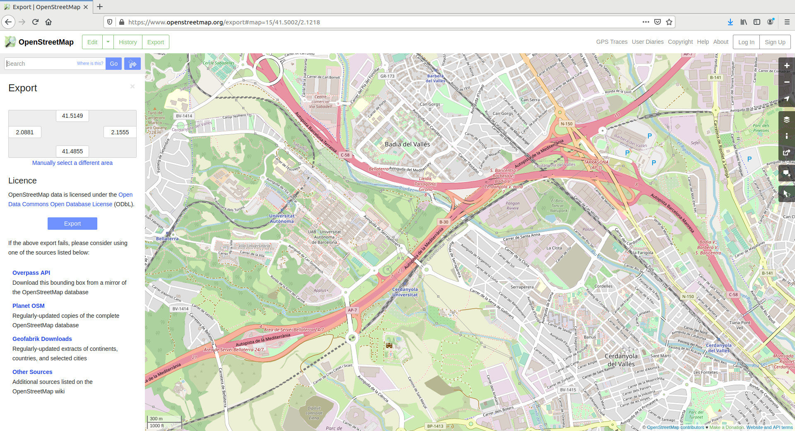
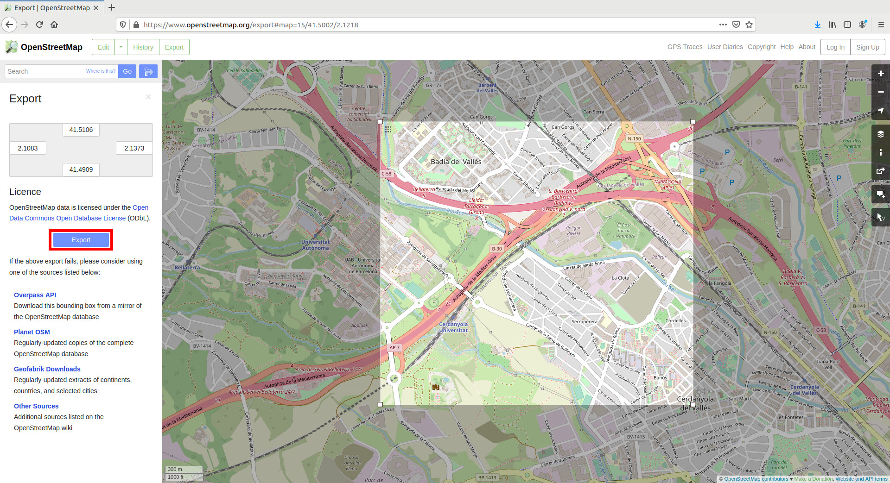

# Generate maps with OpenStreetMap

[OpenStreetMap](https://www.openstreetmap.org) is an open data map of the world developed by thousands of contributors and licensed under the [Open Data Commons Open Database License](https://opendatacommons.org/licenses/odbl/). Sections of the map can be exported to an XML formatted `.osm` file. CARLA converts that file to OpenDRIVE and then builds the world with [OpenDRIVE standalone mode](adv_opendrive.md) — the same pipeline, and the same result: not just the roads, but terrain, markings, signals and roadside furniture.

- [__Export a map with OpenStreetMap__](#export-a-map-with-openstreetmap)
- [__Using OpenStreetMap in CARLA__](#using-openstreetmap-in-carla)
- [__Convert OpenStreetMap format to OpenDRIVE format__](#convert-openstreetmap-format-to-opendrive-format)
    - [Generate traffic lights](#generate-traffic-lights)
- [__Ingest into CARLA__](#ingest-into-carla)
    - [A) Use your own script](#a-use-your-own-script)
    - [B) Pass `.xodr` to `config.py`](#b-pass-xodr-to-configpy)
    - [C) Pass `.osm` to `config.py`](#c-pass-osm-to-configpy)
    - [What the generated map includes](#what-the-generated-map-includes)

!!! Warning
    The OSM to OpenDRIVE conversion (`carla.Osm2Odr`, `carla.Osm2OdrSettings` and `config.py --osm-path`) is only compiled when the build is configured with `-DENABLE_OSM2ODR=ON`, which is __off by default__. Without it, those names raise `AttributeError` and the build log says "Building CARLA PythonAPI without OSM2ODR support". Reconfigure and rebuild the Python API to use this page.

---
## Export a map with OpenStreetMap

This section explains how to export your desired map information from OpenStreetMap:

__1.__ Navigate to the [OpenStreetMap website](https://www.openstreetmap.org). You will see the map view and a panel on the right side of the window where you can configure different map layers, query different features, toggle the legend, and more.

__2.__ Search for your desired location and zoom in to a specific area.


<div style="text-align: right"><i>The <b>Export</b> panel on openstreetmap.org.</i></div>

!!! Note
    If you would like to use a map of a large area, for example, Paris, you may consider using CARLA's [large map support](core_map.md#large-maps-and-world-partition).

__3.__ Click on _Export_ on the upper left side of the window to open the _Export_ panel.

__4.__ Click on _Manually select a different area_ in the _Export_ panel.

__5.__ Select a custom area by dragging the corners of the square area in the viewport.

__6.__ Click the _Export_ button in the _Export_ panel and save the map information of the selected area as a `.osm` file.


<div style="text-align: right"><i>Selecting the area to export with <b>Manually select a different area</b>, then <b>Export</b>.</i></div>

---
## Using OpenStreetMap in CARLA

There are three ways in, and which one you can use depends on whether the data is still in `.osm` or has been converted to `.xodr`. Keeping it as `.osm` is the most restrictive: the mesh generation cannot be parameterized.

| Input | Method | Parameterizable |
| --- | --- | --- |
| `.xodr` | [Your own script](#a-use-your-own-script), through `client.generate_opendrive_world()` | yes |
| `.xodr` | [`config.py --xodr-path`](#b-pass-xodr-to-configpy) | no |
| `.osm` | [`config.py --osm-path`](#c-pass-osm-to-configpy) | no |

The sections below cover the conversion and then each of the three.

---

## Convert OpenStreetMap format to OpenDRIVE format

This section demonstrates how to use the Python API to convert the `.osm` file we exported in the previous section to `.xodr` format so that it is ready for use in CARLA.

The [carla.Osm2OdrSettings](python_api.md#carla.Osm2OdrSettings) class is used to configure conversion settings such as offset values, traffic light generation, origin coordinates, and more. The full list of configurable parameters is found in the Python API [documentation](python_api.md#carla.Osm2OdrSettings). The [carla.Osm2Odr](python_api.md#carla.Osm2Odr) class uses these settings to parse the `.osm` data and output it in `.xodr` format.

Read the `.osm` file, convert it, and write the `.xodr` out. Pass `encoding='utf-8'` on both ends: OpenStreetMap exports are UTF-8, and on Windows Python would otherwise use the system code page and mangle any non-ASCII street name.

```py
# Read the .osm data
with open('path/to/osm/file', encoding='utf-8') as f:
    osm_data = f.read()

# Define the desired settings. In this case, default values.
settings = carla.Osm2OdrSettings()
# Set OSM road types to export to OpenDRIVE
settings.set_osm_way_types(["motorway", "motorway_link", "trunk", "trunk_link", "primary", "primary_link", "secondary", "secondary_link", "tertiary", "tertiary_link", "unclassified", "residential"])
# Convert to .xodr
xodr_data = carla.Osm2Odr.convert(osm_data, settings)

# Save the OpenDRIVE file
with open('path/to/output/file', 'w', encoding='utf-8') as f:
    f.write(xodr_data)
```

---
### Generate traffic lights

OpenStreetMap data can define which junctions are controlled with traffic lights. To use this traffic light data in CARLA, you need to enable it in the OSM map settings via the Python API before converting the `.osm` file to `.xodr` format:

```py
# Define the desired settings. In this case, default values.
settings = carla.Osm2OdrSettings()
# enable traffic light generation from OSM data
settings.generate_traffic_lights = True
# Convert to .xodr
xodr_data = carla.Osm2Odr.convert(osm_data, settings)
```

Traffic light data quality can vary depending on the region from which you extract data. Some traffic light information may be missing completely. To work within these limitations, you can use the Python API to configure all junctions to be controlled with traffic lights:

```py
settings.all_junctions_with_traffic_lights = True
```

You can also exclude certain roads, e.g., motorway links, from generating traffic lights:

```py
settings.set_traffic_light_excluded_way_types(["motorway_link"])
```

---
## Ingest into CARLA

This section explains how to use the different options available to ingest your OpenStreetMap information into CARLA using the [OpenDRIVE Standalone Mode](adv_opendrive.md).

### A) Use your own script

Generate the new map and block the simulation until it is ready by calling [`client.generate_opendrive_world()`](python_api.md#carla.Client.generate_opendrive_world). Use the [carla.OpendriveGenerationParameters](python_api.md#carla.OpendriveGenerationParameters) class to configure the mesh generation. See below for an example:

```py
import carla

client = carla.Client('localhost', 2000)
client.set_timeout(60.0)   # the mesh generation can take a while

with open('path/to/map.xodr', encoding='utf-8') as f:
    xodr_data = f.read()

vertex_distance = 2.0   # in meters
max_road_length = 500.0 # in meters
wall_height = 0.0       # in meters
extra_width = 0.6       # in meters
world = client.generate_opendrive_world(
    xodr_data, carla.OpendriveGenerationParameters(
        vertex_distance=vertex_distance,
        max_road_length=max_road_length,
        wall_height=wall_height,
        additional_width=extra_width,
        smooth_junctions=True,
        enable_mesh_visibility=True))
```

!!! Note
    `wall_height = 0.0` is strongly recommended. OpenStreetMap defines lanes in opposing directions as different roads. If walls are generated, this will result in wall overlapping and undesired collisions.

### B) Pass `.xodr` to `config.py`

After you have started a CARLA server, run the following command in a separate terminal to load your OpenStreetMap:

```sh
cd PythonAPI/util

python3 config.py -x=/path/to/xodr/file
```

[Default parameters](python_api.md#carla.OpendriveGenerationParameters) will be used.
### C) Pass `.osm` to `config.py`

After you have started a CARLA server, run the following command in a separate terminal to load your OpenStreetMap:

```sh
cd PythonAPI/util

python3 config.py --osm-path=/path/to/OSM/file
```

[Default parameters](python_api.md#carla.OpendriveGenerationParameters) will be used.


!!! Warning
    __TODO: this section needs a capture of a generated OSM world.__ The image that was here showed a 2D road-network plot, not a CARLA render, and contradicted the list below it. Producing a real one needs a build configured with `-DENABLE_OSM2ODR=ON`, since `carla.Osm2Odr` does not exist otherwise.

### What the generated map includes

Runtime map generation builds a complete drivable environment from the OpenDRIVE description alone:

*   __Terrain that follows the roads.__ A ground heightfield is generated under and around the road network, following the road elevation profile, so the world does not float over a flat plane. Gaps between carriageways (medians) are filled and kept flush with the road surface.
*   __Road detail.__ Lane markings are generated for the whole network, including through junctions; crosswalks defined in the OpenDRIVE file get real zebra markings; road materials and semantic segmentation tags are applied so camera and LiDAR ground truth works on generated maps.
*   __Elevation profiles.__ Each road follows its elevation profile, and the `shape` records of its `lateralProfile` are honored, so a crowned road keeps its real cross-section. `superelevation` is not applied: a banked curve is built flat.
*   __Street furniture.__ Street lights and other roadside props are procedurally scattered along the network, grounded on the terrain, and their lamps light up at night like the ones on the built-in maps.

Additional static geometry can be added at runtime with [`world.spawn_custom_mesh()`](python_api.md#carla.World.spawn_custom_mesh), which spawns a procedural mesh with collision from a vertex/triangle list and a material hint (`"grass"`, `"road"`, `"dirt"`, `"sidewalk"`, or a full Unreal material path).

!!! Warning
    The roads generated end abruptly at the borders of the map. This will cause the Traffic Manager to crash when vehicles are not able to find the next waypoint. To avoid this, the OSM mode in the Traffic Manager is set to __True__ by default ([`set_osm_mode()`](python_api.md#carla.TrafficManager.set_osm_mode)). This will show a warning and destroy vehicles when necessary.

---

Any issues and doubts related with this topic can be posted in the CARLA forum.

<div class="build-buttons">
<p>
<a href="https://github.com/carla-simulator/carla/discussions/" target="_blank" class="btn btn-neutral" title="Go to the CARLA forum">
CARLA forum</a>
</p>
</div>