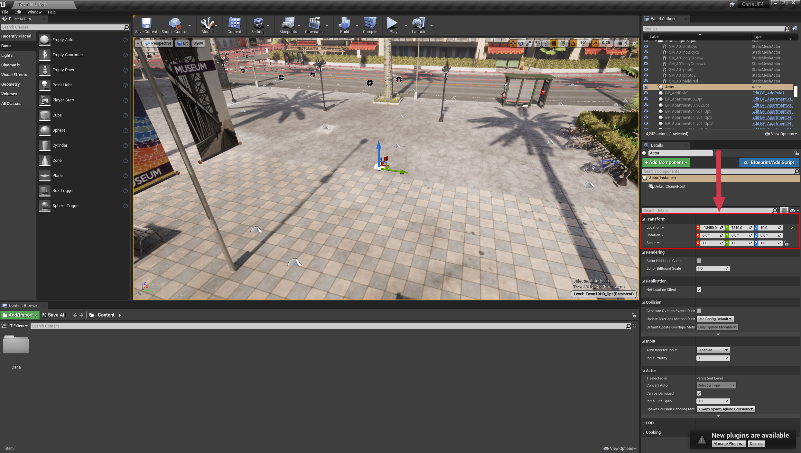

# Retrieve pedestrian ground truth bones through API

A pedestrian's skeleton can be read from the simulation as ground truth: a set of bones, each with a root vertex and a vector giving its orientation. Together they describe the pose, which is what a pose-estimation network is trained against or evaluated on.

This tutorial spawns a pedestrian, gives it an AI controller, then reads its skeleton and projects the bones onto a camera image.

- [__Setting up the simulator__](#setting-up-the-simulator)
- [__AI controller to guide the pedestrian around the map__](#ai-controller-to-guide-the-pedestrian-around-the-map)
- [__Build the skeleton__](#build-the-skeleton)
- [__Cleaning up__](#cleaning-up)

!!! Note
    `PythonAPI/examples/draw_skeleton.py` already does this end to end. This page builds it up piece by piece.

## Setting up the simulator

First, launch the CARLA simulator as per your standard workflow, either in standalone mode or inside the Unreal Editor. We will import several utility libraries to use for maths and plotting. To give us more control over the simulation, we will use [__synchronous mode__](adv_synchrony_timestep.md) in this tutorial. This means that our Python client controls the time progression of the simulator.

```py
import carla
import random
import numpy as np
import math
import queue
import cv2 #OpenCV to manipulate and save the images

# Connect to the client and retrieve the world object
client = carla.Client('localhost', 2000)
world = client.get_world()

# Set up the simulator in synchronous mode
settings = world.get_settings()
settings.synchronous_mode = True # Enables synchronous mode
settings.fixed_delta_seconds = 0.05
world.apply_settings(settings)

# We will also set up the spectator so we can see what we do
spectator = world.get_spectator()

```

---
## Spawning a pedestrian in the CARLA simulator

First, we want to spawn a pedestrian in the simulation. This can be done at a random location using `world.get_random_location_from_navigation()`, or it can be chosen using coordinates gathered from the Unreal Editor. In the unreal editor, add an empty actor to the location where you want to spawn your pedestrian, then use the inspector on the right hand side to query the coordinates.



!!! Note
    The Unreal Editor works in units of centimeters, while CARLA works in units of meters so the units must be converted. Ensure to divide the Unreal Editor coordinates by 100 before using in the CARLA simulator.


Once you have chosen your coordinates, you can then spawn the pedestrian. We will also spawn a camera to gather images. We also need a [`Queue`](https://docs.python.org/3/library/queue.html) object to allow us easy access to the data from the camera (as the camera sensor operates on its own thread, separate from the main Python thread running your script).

In order to see our pedestrian, we need to transform the camera so it is pointing at the pedestrian we spawn. For this we will use a function that calculates the translation and rotation needed to center the camera:

```py

def center_camera(ped, rot_offset=0):
    # Rotate the camera to face the pedestrian and apply an offset
    trans = ped.get_transform()
    offset_radians = 2 * math.pi * rot_offset/360
    x = math.cos(offset_radians) * -2
    y = math.sin(offset_radians) * 2
    trans.location.x += x
    trans.location.y += y
    trans.location.z += 1.5
    trans.rotation.pitch = -16
    trans.rotation.roll = 0
    trans.rotation.yaw = -rot_offset
    spectator.set_transform(trans)
    return trans

```

Now we'll spawn the pedestrian, the camera, a controller and move the spectator so we can see what we've done:

```py
# Get the pedestrian blueprint and spawn it
pedestrian_bp = random.choice(world.get_blueprint_library().filter('*walker.pedestrian*'))
# Any point on the navigation mesh is a valid spawn point for a pedestrian
transform = carla.Transform(world.get_random_location_from_navigation())
pedestrian = world.try_spawn_actor(pedestrian_bp, transform)
if pedestrian is None:
    raise RuntimeError('could not spawn the pedestrian, try another location')

# Spawn an RGB camera
camera_bp = world.get_blueprint_library().find('sensor.camera.rgb')
camera = world.spawn_actor(camera_bp, transform)

# Create a queue to store and retrieve the sensor data
image_queue = queue.Queue()
camera.listen(image_queue.put)

world.tick()
image_queue.get()
# We must call image_queue.get() each time we call world.tick() to
# ensure the timestep and sensor data stay synchronised
    
# Now we will rotate the camera to face the pedestrian
camera.set_transform(center_camera(pedestrian))
# Move the spectator to see the result
spectator.set_transform(camera.get_transform())

# Set up the AI controller for the pedestrian.... see below
controller_bp = world.get_blueprint_library().find('controller.ai.walker')
controller = world.spawn_actor(controller_bp, pedestrian.get_transform(), pedestrian)

# Start the controller and give it a random location to move to
controller.start()
controller.go_to_location(world.get_random_location_from_navigation())

# Move the world a few frames to let the pedestrian spawn
for frame in range(0,5):
    world.tick()
    trash = image_queue.get() 

```

---
## AI controller to guide the pedestrian around the map

The AI controller spawned above is what makes the pedestrian walk. It is attached to the pedestrian, started, and given a destination on the navigation mesh:

```py
controller_bp = world.get_blueprint_library().find('controller.ai.walker')
controller = world.spawn_actor(controller_bp, pedestrian.get_transform(), pedestrian)
controller.start()
controller.go_to_location(world.get_random_location_from_navigation())

```

Now the pedestrian will move autonomously with each time increment (`world.tick()`) of the simulation.

---
## Camera geometry

Now we need to perform some geometric calculations. First, we want to transform the world coordinates of the bones into camera coordinates, we do this using the inverse of the camera transform. This means that the coordinates are transformed to be relative to a camera located at the origin facing in the positive x-direction.

```py
# get 4x4 matrix to transform points from world to camera coordinates
world_2_camera = np.array(camera.get_transform().get_inverse_matrix())

```

Then, we need to project the 3D points onto the 2D field of view (FOV) of the camera to overlay them on the output images using the [__camera matrix__](https://en.wikipedia.org/wiki/Camera_matrix) or __projection matrix__. The following function produces the camera matrix needed for this 3D -> 2D transformation.

```py

def build_projection_matrix(w, h, fov):
    focal = w / (2.0 * np.tan(fov * np.pi / 360.0))
    K = np.identity(3)
    K[0, 0] = K[1, 1] = focal
    K[0, 2] = w / 2.0
    K[1, 2] = h / 2.0
    return K

```

---
## Build the skeleton

Now we can put the moving parts together. First, gather the bone coordinates from the simulation using `pedestrian.get_bones()` and then put together the skeleton and project it onto the 2D imaging plane of the camera sensor. The bones are joined into the complete skeleton using the pairs defined in __skeleton.txt__ that ships with these docs: [__skeleton.txt__](img/tuto_G_pedestrian_bones/skeleton.txt).

We need a function to iterate through the bone pairs defined in __skeleton.txt__ and join the bone coordinates into lines that can be overlaid onto a camera sensor image.

```py

def get_image_point(bone_trans, K, world_2_camera):
    # Calculate the 2D projection of a bone root, or None when it is behind
    # the camera, where the projection would come out mirrored.

    # get the world location of the bone root
    loc = bone_trans.world.location
    bone = np.array([loc.x, loc.y, loc.z, 1])
    # transform to camera coordinates
    point_camera = np.dot(world_2_camera, bone)

    # Now we must change from Unreal's coordinate system to a "standard" one
    # (x, y, z) -> (y, -z, x), and remove the fourth component
    point_camera = [point_camera[1], -point_camera[2], point_camera[0]]

    if point_camera[2] <= 0:
        return None

    # now project 3D->2D using the camera matrix
    point_img = np.dot(K, point_camera)
    # normalize
    point_img[0] /= point_img[2]
    point_img[1] /= point_img[2]

    return point_img[0:2]


def build_skeleton(ped, sk_links, K, world_2_camera):

    ######## get the pedestrian skeleton #########
    bones = ped.get_bones()

    # list where we will store the lines we will project
    # onto the camera output
    lines = []

    # cycle through the bone pairs in skeleton.txt and retrieve the joint positions
    for link in sk_links:

        # get the roots of the two bones to be joined
        bone_transform_1 = next(filter(lambda b: b.name == link[0], bones.bone_transforms), None)
        bone_transform_2 = next(filter(lambda b: b.name == link[1], bones.bone_transforms), None)

        # some bone names aren't matched
        if bone_transform_1 is not None and bone_transform_2 is not None:
           
            # Calculate the 2D projection of both bone roots; skip the link
            # when either of them is behind the camera
            start = get_image_point(bone_transform_1, K, world_2_camera)
            end = get_image_point(bone_transform_2, K, world_2_camera)
            if start is None or end is None:
                continue

            lines.append([start[0], start[1], end[0], end[1]])
            
    return lines

```

Next, let's read the bone pairs from __skeleton.txt__:

```py
skeleton_links = []
with open('skeleton.txt') as f:
    while True:
        line = f.readline()
        if not line:
            break
        stripped = list(map(str.strip, line.strip().split(',')))
        skeleton_links.append(stripped)


world.tick()
trash = image_queue.get()
```

Now we can iterate a few frames, building the skeleton in each frame and projecting the skeleton onto the camera sensor output. We use OpenCV to draw the skeleton onto the sensor output and save the image:

!!! Note
    Ensure that you have created a folder named __out/__ in your working directory to store the images

```py

for frame in range(0,360):
    
    # Move the camera around the pedestrian
    camera.set_transform(center_camera(pedestrian, frame + 200))
    
    # Advance the frame and retrieve an image
    world.tick()
    # Retrieve the frame from the queue
    image = image_queue.get()
    
    # get 4x4 matrix to transform points from world to camera coordinates
    world_2_camera = np.array(camera.get_transform().get_inverse_matrix())

    # get some attributes from the camera
    image_w = camera_bp.get_attribute("image_size_x").as_int()
    image_h = camera_bp.get_attribute("image_size_y").as_int()
    fov = camera_bp.get_attribute("fov").as_float()

    # calculate the camera matrix to project from 3D -> 2D
    K = build_projection_matrix(image_w, image_h, fov)
    
    # Build the list of lines that will display the skeleton
    lines = build_skeleton(pedestrian, skeleton_links, K, world_2_camera)

    # Reshape the data into a 2D RBGA array
    img = np.reshape(np.copy(image.raw_data), (image.height, image.width, 4)) 

    # Draw the lines into the image using OpenCV
    for line in lines:
        l = [int(x) for x in line]
        cv2.line(img, (l[0],l[1]), (l[2],l[3]), (255,0,0, 255), 2)
    
    # Save the image
    cv2.imwrite('out/skeleton%04d.png' % frame, img)

```

In the __out/__ folder you should now have a sequence of frames with the skeleton overlaid over the camera sensor output. The following animation can be reconstructed by joining the frames into a video:


---
## Cleaning up

The loop above leaves the server in synchronous mode and the actors in it. Restore both before the script ends:

```py
controller.stop()
camera.stop()
camera.destroy()
controller.destroy()
pedestrian.destroy()

settings = world.get_settings()
settings.synchronous_mode = False
settings.fixed_delta_seconds = None
world.apply_settings(settings)
```

---
## Summary

You have spawned a pedestrian with an AI controller, read the ground-truth 3D coordinates of its bones, and projected them onto the camera image. The same pieces make up the training and validation loop for a human pose estimation model.


