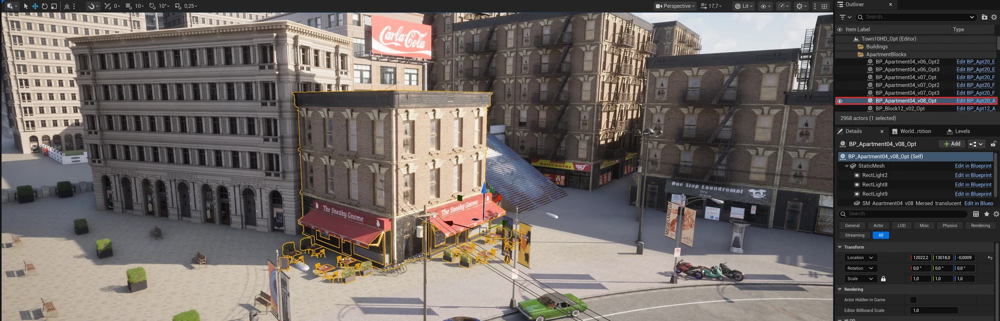
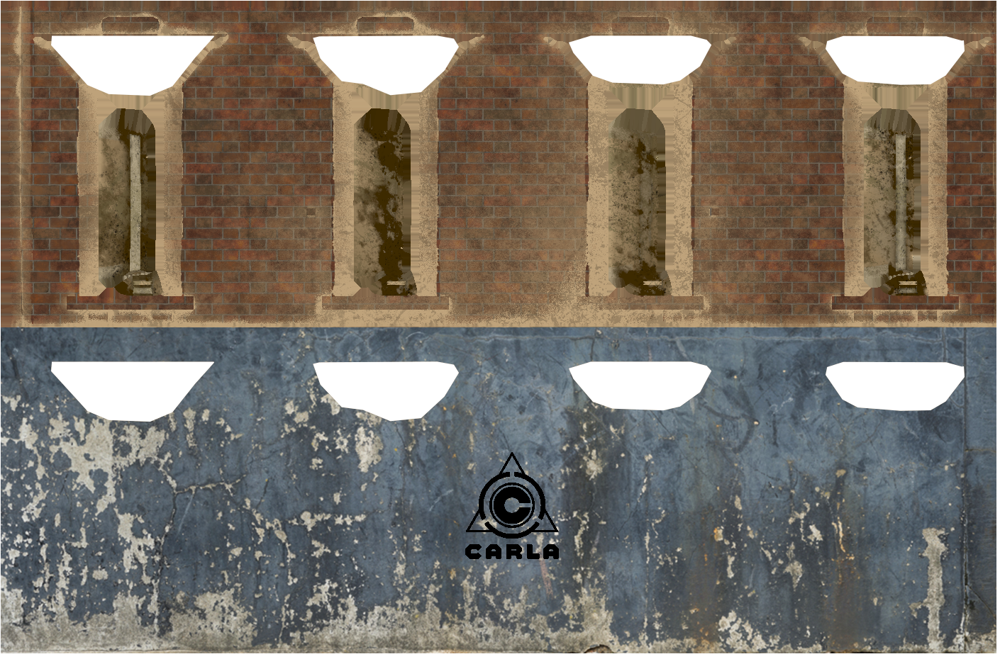

# Change textures through the API

The textures of map objects can be replaced while the simulation runs, which is how a building gets a different facade between two runs of the same scenario. This page covers finding the object, exporting its texture, and pushing a modified one back.

- [__Find the object__](#find-the-object)
- [__Export a texture to work with__](#export-a-texture-to-work-with)
- [__Update the texture through the API__](#update-the-texture-through-the-api)
- [__Which materials can be changed__](#which-materials-can-be-changed)

---
## Find the object

The API needs the object's name as the server knows it, and the quickest way to get it is to ask the server:

```py
# Filter world objects for those with 'Apartment' in the name
list(filter(lambda k: 'Apartment' in k, world.get_names_of_all_objects()))
```

On Town10HD_Opt that returns names such as `BP_Apartment04_v07_Opt_0`. [`world.get_environment_objects()`](python_api.md#carla.World.get_environment_objects) is useful for finding where an object is, but it names each mesh component rather than the object — `BP_Apartment04_v07_Opt_0_SM_1` — and the texture calls take the object name, so strip the `_SM_<n>` suffix before using it.

That works against any server, packaged or not. The alternative is the Unreal Editor, which also shows you what you are about to change — it needs a [source build](build_linux_ue5.md). Open the editor with Town10HD_Opt loaded and select a building:


<div style="text-align: right"><i>An apartment block selected in Town10HD_Opt; its label is highlighted in the Outliner.</i></div>

We have selected an apartment block for texture manipulation. Its label is in the Outliner panel, but __hover over it and use the *ID Name* in the tooltip__: the internal name, which is what the API takes, often differs from the label. Here the label is `BP_Apartment04_v08_Opt` and the internal name `BP_Apartment04_v08_Opt_0`.

The map decides which objects exist, so confirm the name against the server before using it — see [Find the object](#find-the-object). The snippets below call it `object_name`.

---
## Export a texture to work with

Now that we have selected a building, we can modify the texture used to control the building's appearance. __1.__ With the building selected, open the __Details__ panel and click its __Static Mesh__ component to show the mesh properties.

__2.__ In the __Static Mesh__ section, click the magnifying glass icon. The Content Browser jumps to the materials and textures the asset uses.

__3.__ Find the diffuse texture of the material — for this apartment block, a `T_Apartment04_D_*` asset. Double-click it to inspect it.

__4.__ Right-click it and choose __Asset Actions > Export__, saving in a format your image editor reads. TGA is used here.

Open the exported texture in your preferred image manipulation software and edit the texture as needed. In the image below, the original texture is visible in the top half, the lower half shows the modified texture.


<div style="text-align: right"><i>The exported diffuse texture (top) and an edited version (bottom).</i></div>

Export your modified texture into an appropriate location and then open up a code editor to run some Python to update the texture in the running CARLA simulation.

---
## Update the texture through the API

With the simulation running, read the modified file with the [__Python Imaging Library (PIL)__](https://pillow.readthedocs.io/en/stable/) and push it to the server.

### Connect to the simulator

```py
import carla
from PIL import Image

# Connect to client
client = carla.Client('127.0.0.1', 2000)
client.set_timeout(10.0)
world = client.get_world()

```

### Push the texture

After loading the modified image, instantiate a [carla.TextureColor](python_api.md#carla.TextureColor) object and populate the pixel data from the loaded image.

Use the `apply_color_texture_to_object(...)` method of the [carla.World](python_api.md#carla.World) object to update the texture. You should see the texture update in the spectator view.

The change is applied to every static mesh component of that object, but only the materials that expose the parameter actually change, so a building often repaints in part: applying a `Diffuse` texture to an apartment block in Town10HD_Opt repaints its railings and fire escapes and leaves the brick facade as it was, because the two are different materials.

A name the server does not know raises `RuntimeError: unable to find Actor to apply the texture`, so a typo fails loudly rather than silently. The new texture lasts for the rest of the session and is undone by [`client.reload_world()`](python_api.md#carla.Client.reload_world).

```py
# The object to retexture, as the server names it. Confirm it against
# world.get_names_of_all_objects() for the map you have loaded.
object_name = 'BP_Apartment04_v07_Opt_0'

# Load the modified texture
image = Image.open('modified_texture.tga').convert('RGBA')
height = image.size[1]
width = image.size[0]

# Instantiate a carla.TextureColor object and populate
# the pixels with data from the modified image
texture = carla.TextureColor(width ,height)
for x in range(0,width):
    for y in range(0,height):
        color = image.getpixel((x,y))
        r = int(color[0])
        g = int(color[1])
        b = int(color[2])
        a = 255
        texture.set(x, y, carla.Color(r,g,b,a))

# Now apply the texture to the building asset
world.apply_color_texture_to_object(object_name, carla.MaterialParameter.Diffuse, texture)

```

---
## Which materials can be changed

`apply_color_texture_to_object` writes into named texture parameters of the object's material, so it only reaches materials that expose them. [`carla.MaterialParameter`](python_api.md#carla.MaterialParameter) selects which one, and each value writes a small set of parameter names:

| Parameter | Texture it replaces | Material parameters written |
| --- | --- | --- |
| `Diffuse` | The base color map | `BaseColor`, `Difuse`, `Difuse 2`, `Difuse 3`, `Difuse 4` |
| `Normal` | The normal map | `Normal`, `Normal 2`, `Normal 3`, `Normal 4` |
| `AO_Roughness_Metallic_Emissive` | The packed ORME map | `AO / Roughness / Metallic / Emissive`, `ORMH` |
| `Emissive` | The emissive map | `Emissive` |

CARLA's generic master material, which most buildings and props use, exposes `BaseColor`, `Normal`, `Emissive` and `AO / Roughness / Metallic / Emissive`, so all four values reach it. The road master exposes only `BaseColor` and `Normal`, so `Emissive` and `AO_Roughness_Metallic_Emissive` do nothing on roads. A material that exposes none of the names above — a third-party asset, or one authored without them — silently keeps its original texture.

!!! Warning
    The per-pixel loop above is slow: a 2K texture is four million boundary calls. Downscale the image first, or build the pixel data in NumPy and set it row by row, when the texture is large. Call `image.convert('RGBA')` after opening it so palette and grayscale files give four channels.
