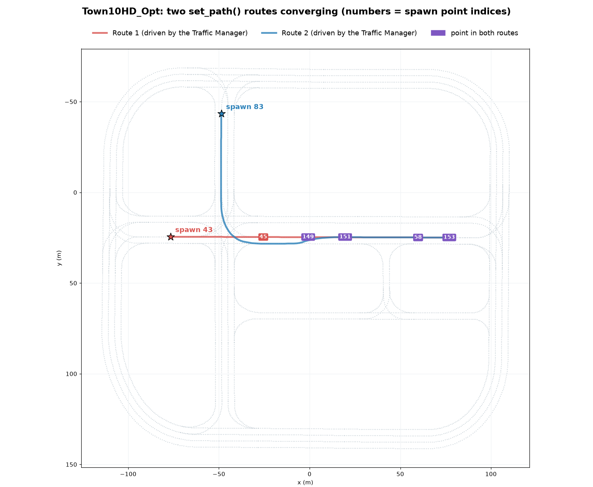
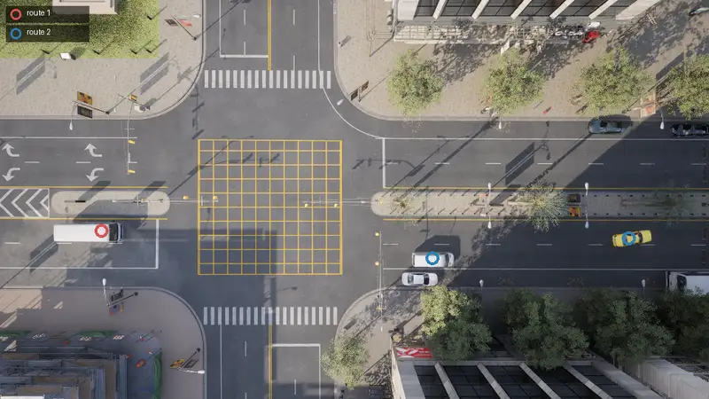

# Traffic Manager tutorial

The [Traffic Manager](adv_traffic_manager.md) (TM) drives the NPC vehicles that make up the traffic around the ego vehicle. This tutorial populates a map with traffic, then shapes its behavior: speeds, lane changes, routes and how it treats the ego.

- [__Setting up the simulator and the Traffic Manager__](#setting-up-the-simulator-and-the-traffic-manager)
- [__Spawning vehicles__](#spawning-vehicles)
- [__Controlling vehicles with Traffic Manager__](#controlling-vehicles-with-traffic-manager)
- [__Specify routes for vehicles__](#specify-routes-for-vehicles)
- [__Cleaning up__](#cleaning-up)

It needs a CARLA server running and the `carla` client installed. Every snippet runs against `Town10HD_Opt`, and the spawn point indices used later are that map's.

---
## Setting up the simulator and the Traffic Manager

First, we will initialise the TM and create some traffic randomly distributed around the city.

```py
import carla
import random

# Connect to the client and retrieve the world object
client = carla.Client('localhost', 2000)
client.set_timeout(10.0)
world = client.load_world('Town10HD_Opt')

# Set up the simulator in synchronous mode
settings = world.get_settings()
settings.synchronous_mode = True # Enables synchronous mode
settings.fixed_delta_seconds = 0.05
world.apply_settings(settings)

# Set up the TM in synchronous mode
traffic_manager = client.get_trafficmanager()
traffic_manager.set_synchronous_mode(True)

# Set a seed so the run can be repeated
traffic_manager.set_random_device_seed(0)
random.seed(0)

# We will also set up the spectator so we can see what we do
spectator = world.get_spectator()

```

---
## Spawning vehicles

When we create TM vehicles, they need a map location at which to spawn. We can define these ourselves using our own chosen map coordinates. However, to help with this, each CARLA map has a set of pre-defined spawn points spread evenly throughout the road network. We can use these spawn points to spawn our vehicles.

```py
spawn_points = world.get_map().get_spawn_points()
```

We can use CARLA's debug functions to see where the spawn points are. Run the following code then fly through the map and inspect where the spawn points are. This will come in handy when we want to choose more specific points to use for spawning or guiding vehicles.

```py
# Draw the spawn point locations as numbers in the map
for i, spawn_point in enumerate(spawn_points):
    world.debug.draw_string(spawn_point.location, str(i), life_time=10)

# In synchronous mode, we need to run the simulation to fly the spectator
while True:
    world.tick()
```

Now let's spawn some vehicles.

```py
# Select some models from the blueprint library
# Cars only: skip the bikes, motorcycles and trucks
blueprints = [bp for bp in world.get_blueprint_library().filter('*vehicle*')
              if bp.get_attribute('base_type').as_str() == 'car']

# Set a max number of vehicles and prepare a list for those we spawn
max_vehicles = 50
max_vehicles = min([max_vehicles, len(spawn_points)])
vehicles = []

# Take a random sample of the spawn points and spawn some vehicles
for i, spawn_point in enumerate(random.sample(spawn_points, max_vehicles)):
    temp = world.try_spawn_actor(random.choice(blueprints), spawn_point)
    if temp is not None:
        vehicles.append(temp)

# Run the simulation so we can inspect the results with the spectator
while True:
    world.tick()
    

```

If you fly through the map with the spectator now, you should see stationary vehicles occupying the roads in the map.

---
## Controlling vehicles with Traffic Manager

We can now give the TM control over our vehicles and let the simulation run. Once the TM takes control of the vehicles, they will move around the roads autonomously, following features of the road network like lanes and traffic lights and avoiding collisions with other vehicles.

The TM has a number of functions that allow specific behaviors to be modified for each vehicle. In the following example, we set each vehicle with a random probability of ignoring traffic lights, so some vehicles will tend to ignore traffic lights, while others will obey them. There are a number of different behaviours that can be set, refer to the Python API reference for details.

```py
# Parse the list of spawned vehicles and give control to the TM through set_autopilot()
for vehicle in vehicles:
    vehicle.set_autopilot(True, traffic_manager.get_port())
    # Randomly set the probability that a vehicle will ignore traffic lights
    traffic_manager.ignore_lights_percentage(vehicle, random.randint(0,50))

while True:
    world.tick()

```

If you now fly through the map with the spectator, you will see vehicles driving autonomously around the map. Buses and trucks swing wide through junctions, the way a long vehicle has to; `traffic_manager.vehicle_large_vehicle_wide_turn(vehicle, False)` turns that off for one vehicle, and `global_large_vehicle_wide_turn(False)` for all of them.


---
## Specify routes for vehicles

In the previous steps, we saw how to spawn a collection of vehicles into a map, then hand control of them over to the TM to create a busy town full of moving traffic. The TM has deeper functionality to control the behavior of vehicles more closely.

We will now use the `traffic_manager.set_path()` function to guide TM vehicles along specific paths. In this case, we will create two converging streams of traffic that will converge in the center of town and create congestion.

Firstly, we'll choose some waypoints to construct our path. Spawn points are convenient waypoints and in the same way as earlier we can use CARLA's debug tools to draw the locations of the spawn points on the map. By flying through the map with the spectator, we can choose the indices of the spawn points we want to use for our path. The `set_path()` function uses a list of coordinates specified as [carla.Locations](python_api.md#carla.Location).

```py
# Draw the spawn point locations as numbers in the map
for i, spawn_point in enumerate(spawn_points):
    world.debug.draw_string(spawn_point.location, str(i), life_time=10)

# In synchronous mode, we need to run the simulation to fly the spectator
while True:
    world.tick()
```

We choose our spawn points and waypoints to create two converging streams of traffic within the town, creating congestion, which might be an interesting scenario to present to an autonomous driving agent.

```py
spawn_points = world.get_map().get_spawn_points()

# Route 1
spawn_point_1 =  spawn_points[32]
# Create route 1 from the chosen spawn points
route_1_indices = [129, 28, 124, 33, 97, 119, 58, 154, 147]
route_1 = []
for ind in route_1_indices:
    route_1.append(spawn_points[ind].location)

# Route 2
spawn_point_2 =  spawn_points[149]
# Create route 2 from the chosen spawn points
route_2_indices = [21, 76, 38, 34, 90, 3]
route_2 = []
for ind in route_2_indices:
    route_2.append(spawn_points[ind].location)

# Now let's print them in the map so we can see our routes
world.debug.draw_string(spawn_point_1.location, 'Spawn point 1', life_time=30, color=carla.Color(255,0,0))
world.debug.draw_string(spawn_point_2.location, 'Spawn point 2', life_time=30, color=carla.Color(0,0,255))

for ind in route_1_indices:
    spawn_points[ind].location
    world.debug.draw_string(spawn_points[ind].location, str(ind), life_time=60, color=carla.Color(255,0,0))
    
for ind in route_2_indices:
    spawn_points[ind].location
    world.debug.draw_string(spawn_points[ind].location, str(ind), life_time=60, color=carla.Color(0,0,255))
    
while True:
    world.tick()

```




Now that we have chosen our spawn points and way points, we can now start spawning traffic and setting the spawned vehicles to follow our waypoint lists.

```py

# Set delay to create gap between spawn times
spawn_delay = 20
counter = spawn_delay

# Set max vehicles (set smaller for low hardward spec)
max_vehicles = 200
# Alternate between spawn points
alt = False

spawn_points = world.get_map().get_spawn_points()
while True:
    world.tick()

    n_vehicles = len(world.get_actors().filter('*vehicle*'))
    vehicle_bp = random.choice(blueprints)

    # Spawn vehicle only after delay
    if counter == spawn_delay and n_vehicles < max_vehicles:
        # Alternate spawn points
        if alt:
            vehicle = world.try_spawn_actor(vehicle_bp, spawn_point_1)
        else:
            vehicle = world.try_spawn_actor(vehicle_bp, spawn_point_2)

        if vehicle: # IF vehicle is succesfully spawned
            vehicle.set_autopilot(True, traffic_manager.get_port()) # Give the TM control over the vehicle

            # Set parameters of TM vehicle control, we don't want lane changes
            traffic_manager.update_vehicle_lights(vehicle, True)
            traffic_manager.random_left_lanechange_percentage(vehicle, 0)
            traffic_manager.random_right_lanechange_percentage(vehicle, 0)
            traffic_manager.auto_lane_change(vehicle, False)

            # Alternate between routes
            if alt:
                traffic_manager.set_path(vehicle, route_1)
                alt = False
            else:
                traffic_manager.set_path(vehicle, route_2)
                alt = True

            vehicle = None

        counter -= 1
    elif counter > 0:
        counter -= 1
    elif counter == 0:
        counter = spawn_delay

```

With the above code, we have created two converging streams of traffic originating from opposite sides of the map, guided by the `set_path()` function of the TM. This results in congestion on a road in the center of town. This kind of technique could be used on a larger scale to simulate multiple tricky cases for autonomous vehicles, such as a busy roundabout or highway intersection.



---
## Cleaning up

Every snippet above leaves the server in synchronous mode and the vehicles in it. Restore the settings and destroy the actors when the script ends, or the next client to connect will hang waiting for ticks that nobody sends:

```py
settings = world.get_settings()
settings.synchronous_mode = False
settings.fixed_delta_seconds = None
world.apply_settings(settings)
traffic_manager.set_synchronous_mode(False)

client.apply_batch([carla.command.DestroyActor(v) for v in vehicles])
```

Putting the loop inside `try: ... finally: ...` with that block in the `finally` is the shape to use, so a `Ctrl+C` cleans up too.
