# Content authoring - Maps

CARLA comes with a generous complement of assets for creating driving simulations out of the box. However, the real power of CARLA comes in its comprehensive extensibility, allowing users to create entirely custom environments populated with bespoke assets like buildings, benches, trash cans, statues, street lights and bus stops. 

In this tutorial we will cover the process of creating a simple map for use with CARLA. We will use two software packages to create parts of the map. We will create the road network using [__RoadRunner__](https://es.mathworks.com/products/roadrunner.html) and then add assets to the map through the [__Unreal Editor__](https://www.unrealengine.com/en-US/features/the-unreal-editor).

* __[Prerequisites](#prerequisites)__  
* __[Large maps](#large-maps)__
* __[Digital Twin Tool](#digital-twin-tool)__
* __[RoadRunner](#create-a-road-network-using-roadrunner)__  
* __[TrueVision designer](#truevision-designer)__
* __[Importing into CARLA](#importing-your-road-network-into-carla)__
* __[Importing assets](#importing-assets-and-adding-them-to-the-map)__
* __[Traffic lights](#traffic-lights)__
* __[Traffic signs](#traffic-signs)__ 
* __[Materials](#materials)__
* __[Road painter](#road-painter)__
    * [What is the road painter?](#what-is-the-road-painter)
    * [Road painter actor, master material and render target](#establish-the-road-painter-master-material-and-render-target)
    * [Prepare the master material](#prepare-the-master-material)
    * [Paint the road](#paint-the-road)
    * [Update the appearance of lane markings](#update-the-appearance-of-lane-markings)
* __[Trees and vegetation](#trees-and-vegetation)__
    * [Foliage tool](#foliage-tool)


## Prerequisites

To follow this guide you need CARLA built from source, so that you can use the Unreal Editor: follow the [__build instructions__](build_carla.md) for your operating system and check that the editor opens. You also need RoadRunner (or another OpenDRIVE editor) for the road network, and a 3D modelling application such as Blender, Maya or 3ds Max if you want to create your own assets.

## Large Maps

The following text details the procedures for creating and decorating a standard map. CARLA also supports Large Maps. Large maps are bigger in scale than standard maps, and can be up to 100 km<sup>2</sup> in size. Large maps work in a slightly different way to standard maps, because of hardware limitations, even in high end graphics cards. Large maps are split up into tiles, and only the tiles needed immediately (i.e. those closest to the Ego vehicle) are loaded during the simulation. Other tiles sit dormant until the data is needed. This facilitates the highest performance for CARLA simulations. Most of the details that follow are similar when building a Large Map, but there are some additional steps. Please follow [this guide](large_map_overview.md) to build a Large Map for CARLA.

## Digital Twin Tool

CARLA offers a procedural map generation tool, which ingests road network data from OpenStreetMap and decorates the map procedurally with buildings and vegetation. Read about how to use the tool [here](adv_digital_twin.md).

## Create a road network using RoadRunner

Open RoadRunner and create a new scene. Choose the Road Plan Tool and right click in the workspace to drop the first control point for the road. Click and drag elsewhere in the workspace to extend the road. 

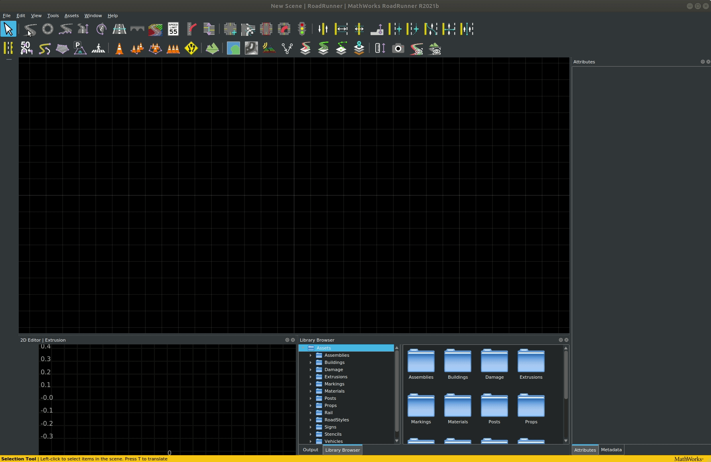
<div class="img-caption">Drawing a road with the Road Plan Tool in RoadRunner.</div>

For the purpose of this tutorial we use a simple oval road with a junction in the middle. For building more advanced networks please refer to the [__roadrunner documentation__](https://es.mathworks.com/products/roadrunner.html).

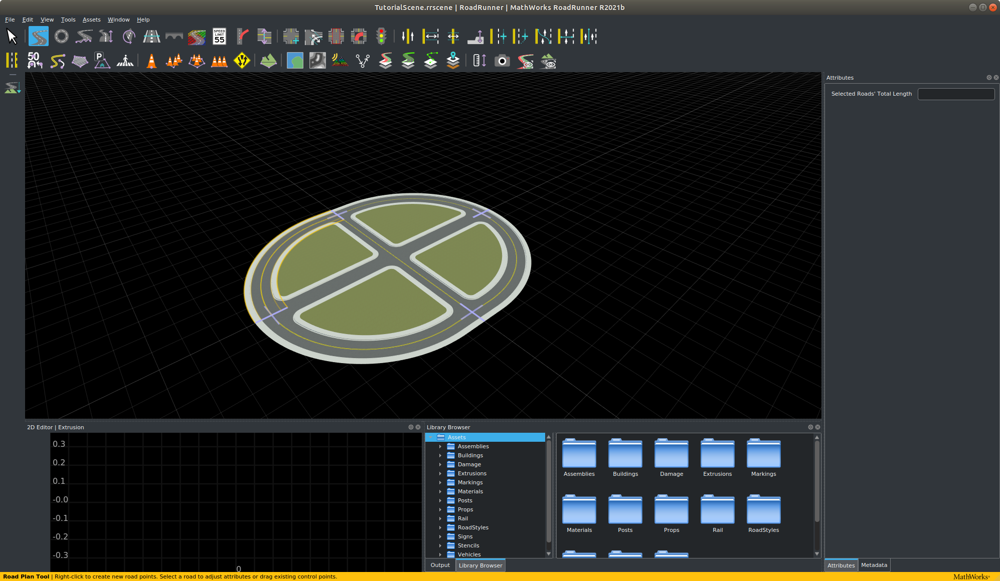
<div class="img-caption">The tutorial road network: an oval with a junction in the middle.</div>

Once you have made your map in RoadRunner you will be able to export it. Be aware that __the road layout cannot be modified after it has been exported.__ Before exporting, ensure that:

- The map is centered at (0,0) to ensure the map can be visualized correctly in Unreal Engine.
- The map definition is correct.
- The map validation is correct, paying close attention to connections and geometries.


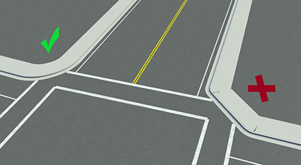
<div class="img-caption">A clean junction (left) and a broken one (right): check every junction before exporting.</div>

Once the map is ready, click on the `OpenDRIVE Preview Tool` button to visualize the OpenDRIVE road network and give everything one last check.

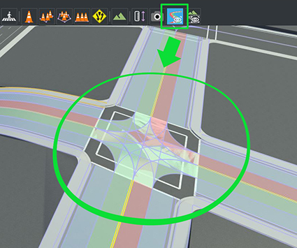
<div class="img-caption">The OpenDRIVE Preview Tool showing the lanes and junction connections that CARLA will read.</div>

!!! note
    _OpenDrive Preview Tool_ makes it easier to test the integrity of the map. If there are any errors with junctions, click on `Maneuver Tool`, and `Rebuild Maneuver Roads`.

Once you have created your desired road network, in the RoadRunner menu bar choose `File > Export > Carla (.fbx, .xodr, .rrdata, .xml)` and export to an appropriate location. 

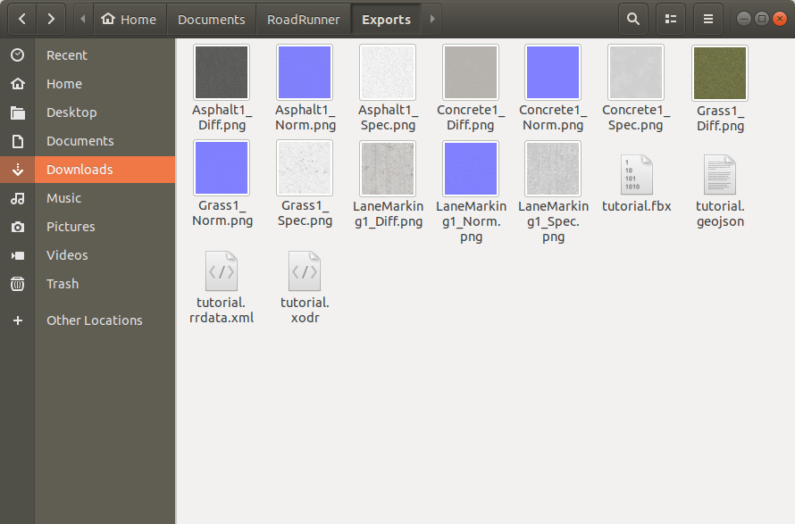
<div class="img-caption">The files RoadRunner writes with the CARLA export: meshes, textures, the .fbx, the .xodr and the .rrdata.xml.</div>

RoadRunner is the best application for creating custom maps. There are alternatives such as [__OpenStreetMap__](tuto_G_openstreetmap.md) that focus on generating maps from real road maps. 

## TrueVision designer

RoadRunner is a proprietary software that requires MATLAB. Some institutions like universities may have deals with MathWorks such that some users may be able to acquire a RoadRunner license. If you don't have budget for a license, a convenient open source alternative to RoadRunner is the [__TrueVision Designer__](https://www.truevision.ai/designer). This app has many of the same features as RoadRunner and is useful if you cannot acquire a license for RoadRunner. 

## Importing your road network into CARLA

The export files CARLA needs are the `.xodr` and the `.fbx`, and both must have the same name. Copy or move them into the `Import` folder at the root of the CARLA source tree.

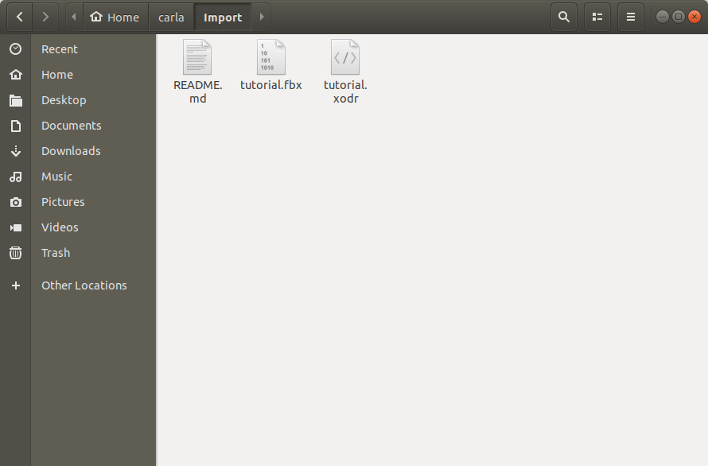
<div class="img-caption">The .fbx and .xodr copied into the Import folder of the CARLA tree.</div>

Then run the importer from the root of the CARLA source tree. It runs the editor headless, so it needs the path to the Unreal Engine and the `carla` Python package installed in the interpreter that runs it:

```sh
export CARLA_UNREAL_ENGINE_PATH=/path/to/UnrealEngine_5.5
python3 Util/Tools/Import.py --package tutorial
```

`--package` names the package the map is imported into. The importer creates a package descriptor in `Import/` if there is none, imports the geometry, applies CARLA's road materials, prepares the map for cooking and builds the Traffic Manager cache.

!!! Warning
    The importer also tries to build the pedestrian navigation mesh, and on this branch that step silently does nothing, because `RecastBuilder` and `FBX2OBJ` are not in `Util/DockerUtils/dist/`. Without them walkers cannot navigate the new map. Copy `RecastBuilder` from the build tree into that folder before importing: `cp $(find Build -name RecastBuilder -type f | head -1) Util/DockerUtils/dist/`.

Open the editor with `cmake --build Build/Release --target launch`. The map is in the new package folder of the content browser, at `Content > tutorial > Maps > <map name>`, with its OpenDRIVE file in the `OpenDrive` subfolder.

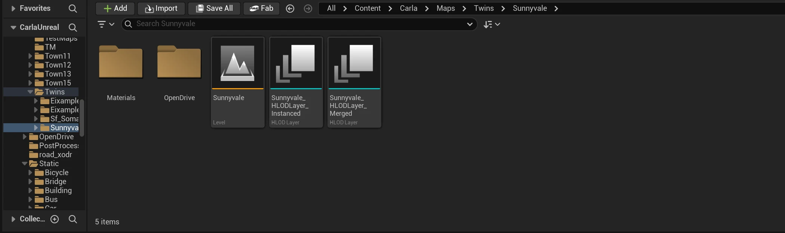
<div class="img-caption">The folder of an imported map in the Content Browser, here the Sunnyvale digital twin, with its level and OpenDRIVE subfolder.</div>

You have now created the road network, the basis of your map.

## Importing assets and adding them to the map

Now we have the road network as the basis for our map, we now want to create some content for the map, such as buildings. These assets can be created using a 3D modelling application such as Autodesk Maya, 3DS Max, Blender or any other 3D application with the appropriate export options. It is important that, at a minimum, the application is capable of `.fbx` export. 

There are several elements needed to create an asset in CARLA:

- [__Mesh__](https://en.wikipedia.org/wiki/Polygon_mesh) - a set of 3D coordinate vertices and the associated joining edges
- [__UV map__](https://en.wikipedia.org/wiki/UV_mapping) - a mapping of 3D vertices and edges to a 2D texture space to match textures with 3D locations
- [__Texture__](https://en.wikipedia.org/wiki/Texture_mapping) - a 2D image defining the colors and patterns to appear on the surface of the 3D object
- [__Normal map__](https://en.wikipedia.org/wiki/Normal_mapping) - a 2D image defining the directions of the normals on the surface of the object, to add 3D variations to the object's surface
- ORM map - a map defining the regions of metallicity, roughness and ambient occlusion

The ORM map uses the channels of a standard RGB image for three maps: the red channel holds the ambient occlusion, the green channel the roughness and the blue channel the metallic map. These maps (as well as the diffuse and normal maps) can be created using an application such as [__Adobe Substance 3D painter__](https://www.adobe.com/products/substance3d-painter.html).

Create a new folder in some appropriate location using the Unreal content browser. Within this folder you can either right click and select `Import to PATH/TO/FOLDER` near the top of the context menu, or drag and drop files directly into the content browser. 

We will import an FBX file containing the base mesh and the UV map, that we have exported from Blender.

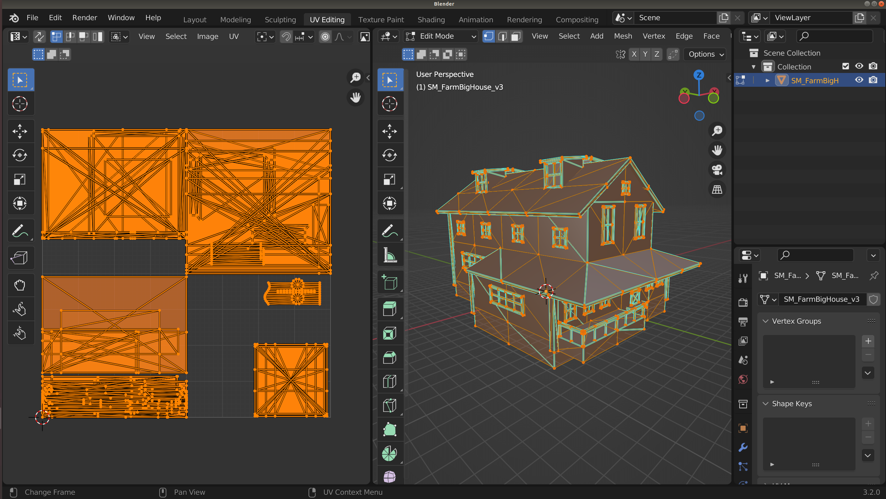
<div class="img-caption">The farmhouse mesh and its UV map in Blender.</div>

In the context menu, ensure that in the __Mesh__ section `Import Normals` is selected
 for `Normal Import Method` and that in the __Material__ section that `Do Not Create Material` is selected. Deselect `Import Textures` in the __Materials__ section since we will import them manually. These choices would differ if you wanted to use some textures already embedded in your FBX file. 

 Select `Import All`. Once the import has completed, double click on the imported asset that appears in the content browser to edit it. 

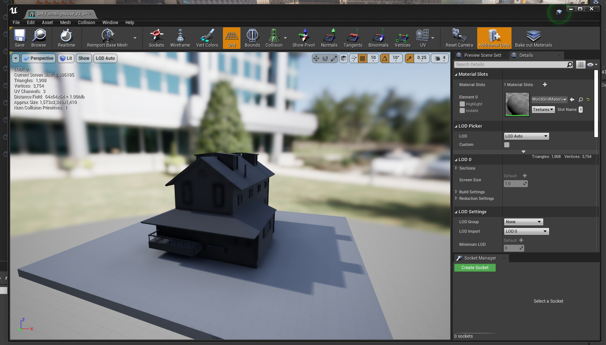
<div class="img-caption">The imported farmhouse in the static mesh editor, before its material is assigned.</div>

We should now import the textures, the diffuse texture for the diffuse colors, the normal map and the ORM map. 

Open the ORM map by double clicking and deselect the `sRGB` option, to ensure the texture is correctly applied. 

Right click in the content browser and select `Material` from the menu. A new material will be created in the content browser. Double click to edit it. Shift select the textures you imported and drag them into the material edit window, you will now get 3 new nodes in the material node editor. 

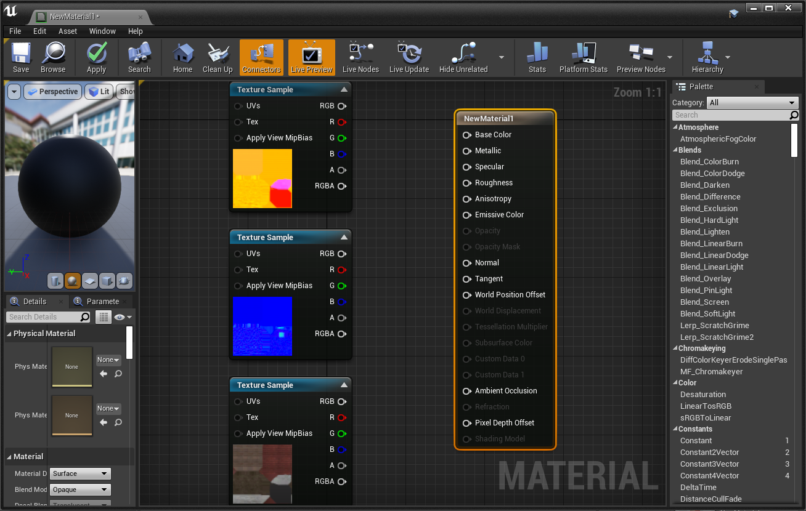
<div class="img-caption">A new material with the imported textures dragged into the material editor.</div>

Now connect the nodes according to the following rules:

- Diffuse RGB --> Base Color
- Normal RGB --> Normal
- ORM R --> Ambient occlusion
- ORM G --> Roughness
- ORM B --> Metallic

Your material node graph should now look similar to this: 

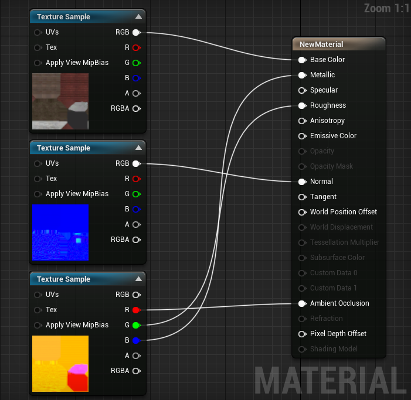
<div class="img-caption">The textures connected: diffuse to Base Color, normal to Normal, ORM channels to Ambient Occlusion, Roughness and Metallic.</div>

Save the material, then open the asset again and drag the material into the material slot. Your asset should now be fully textured.

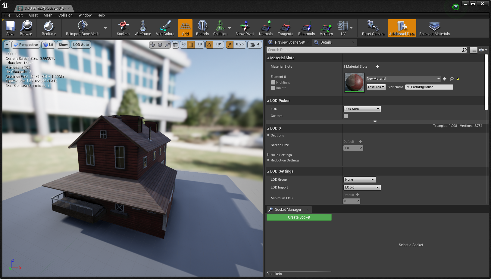
<div class="img-caption">The farmhouse with its material assigned.</div>

Now save the asset and it is ready for use in your map. You can now drag the asset from the content browser and place it into your map:

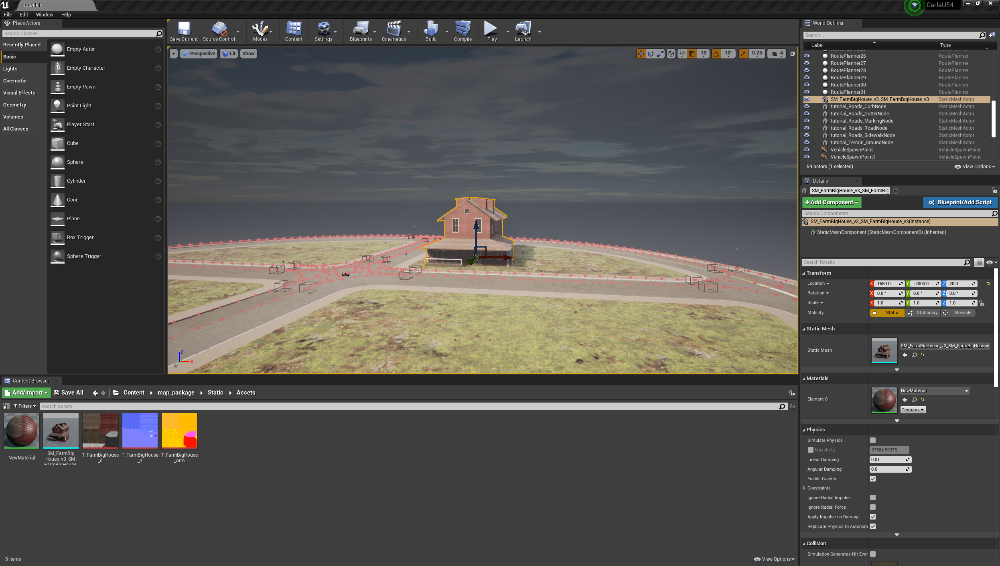
<div class="img-caption">The farmhouse placed in the map.</div>

Now save the map with __File > Save Current Level__ (`Ctrl + S`) and it is ready to use. Press __Play__ to run the simulation in the editor.

## Traffic lights

To add traffic lights to your new map:

__1.__ From the _Content Browser_, navigate to `Content > Carla > Blueprints > TrafficLight`. The `BP_TrafficLightNew_T10_master_*` blueprints are the traffic lights used in Town10HD_Opt; more are in `Content > Carla > Static > TrafficLight`.

__2.__ Drag the traffic lights into the scene and position them in the desired location. Press the space bar on your keyboard to toggle between positioning, rotation, and scaling tools.

__3.__ Adjust the [`trigger volume`][triggerlink] for each traffic light by selecting the _BoxTrigger_ component in the _Details_ panel and adjusting the values in the _Transform_ section. This will determine the traffic light's area of influence.

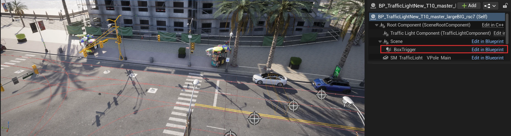
<div class="img-caption">A traffic light selected in Town10HD_Opt (yellow outline); its <code>BoxTrigger</code> component, outlined in the component list, is the trigger volume drawn over the lane in front of it.</div>

__4.__ For junctions, drag the `BP_TrafficLightGroup` actor into the level. Assign all the traffic lights in the junction to the traffic light group by adding them to the _Traffic Lights_ array in the _Details_ panel.


<div class="img-caption">A <code>BP_TrafficLightGroup</code> selected: its <b>Traffic Lights</b> array holds the lights of the junction.</div>

__5.__ Traffic light timing is only configurable through the Python API. See the documentation [here](core_actors.md#traffic-signs-and-traffic-lights) for more information.


<div class="img-caption">A Town10HD_Opt junction with its traffic lights and signs placed.</div>

[triggerlink]: python_api.md#carla.TrafficSign.trigger_volume

## Traffic signs

To add traffic signs to your new map:

__1.__ From the _Content Browser_, navigate to `Content > Carla > Static > TrafficSign`. You will find several different traffic sign blueprints to choose from.

__2.__ Drag the traffic signs into the scene and position them in the desired location. Press the space bar on your keyboard to toggle between positioning, rotation, and scaling tools.

__3.__ Adjust the [`trigger volume`][triggerlink] for each traffic sign by selecting the _BoxTrigger_ component in the _Details_ panel and adjusting the values in the _Transform_ section. This will determine the traffic sign's area of influence. Not all traffic signs have a trigger volume. Those that do, include the yield, stop and speed limit signs.

## Materials

The CARLA content library has a multitude of useful materials ready to use to change the look of your maps. In your content browser, navigate to `Carla > Static > GenericMaterials`. In here you will find numerous materials you can use to alter the appearance of your map. 

You can test the materials rapidly by dragging them onto map elements.


# Road Painter

The road painter is a tool that can be used to customize the appearance of the road, adding extra realism with additional textures, decals and meshes.

## What is the road painter?

The Road Painter tool is a blueprint that uses OpenDRIVE information to paint roads quickly. It takes a master material and applies it to a render target of the road to use as a canvas. The master material is made up of a collection of materials that can be blended using brushes and applied as masks. There is no need to apply photometry techniques nor consider the UVs of the geometry.

The road painter uses the OpenDRIVE information to paint the roads. Make sure that your `.xodr` file has the same name as your map for this to work correctly.

## Establish the road painter, master material and render target

__1. Create the `RoadPainter` actor.__

1. In the _Content Browser_, navigate to `Content > Carla > Blueprints > LevelDesign`.
2. Drag the `RoadPainter` into the scene.

__2. Calibrate the _Map Size (Cm)_ so that it is equal to the actual size of the map.__

1. Select the `RoadPainter` actor in the scene.
2. Go to the _Details_ panel and press the _z_Size_ button. You will see the value in _Map Size (Cm)_ change.


<div class="img-caption">The <code>RoadPainter</code> actor selected: <b>Map Size (Cm)</b> and the <b>z_Size</b> button that recomputes it.</div>

__3. The render target.__

The road painter paints into the texture set in _Paint > Render Target_, `RenderTexture` from `Content > Carla > Blueprints > LevelDesign > RoadPainterAssets` by default.

!!! Warning
    In this release `M_RoadMaster` has no texture parameter for the painted mask. It reads the mask from `RoadPainterAssets/RenderTexture_Town10HD` through the `WorldMaskFunction` material function, scaled by its _Map units (CM)_ parameter. A mask painted into any other render target does not reach the road materials, and a mask painted into `RenderTexture_Town10HD` changes every map whose roads use `M_RoadMaster`.

---

## Prepare the master material

CARLA's road materials are instances of `M_RoadMaster`, in `Content > Carla > Static > GenericMaterials > 000_Masters`. Ready-made instances are in `Content > Carla > Static > GenericMaterials > Roads`, such as `MI_Road_Asphalt_A`. Right-click `M_RoadMaster`, select _Create Material Instance_, and rename it `Tutorial_RoadMaster`.

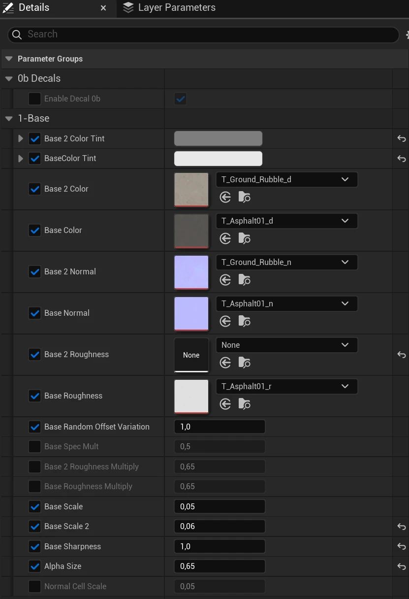
<div class="img-caption">A material instance of <code>M_RoadMaster</code>, the master the road materials are made from, with its parameter groups.</div>

The instance groups its parameters by layer:

| Group | What it controls |
| --- | --- |
| 1-Base | The base asphalt: `Base Color`, `Base Normal` and `Base Roughness` textures, a second base (`Base 2 *`), tints, scales and sharpness. |
| 2- Rubble, 3- OilSpill, and the following groups | Optional layers, each enabled by its switch: `Do Rubble`, `Do OilSpill`, `Do Grime`, `Do MacroVary`, `Do Patches`, `Do Cracks`, `Road Wheel Marks`, `Do Puddle`. |
| Additional materials | The `AddNewMaterials` switch enables a second and a third material (`SecondMaterialColor`, `SecondMaterialNormal`, `SecondMaterialOrm`, and the same for `ThirdMaterial*`), blended with `BlendingSecondMaterial` and `ThirdMaterialBlendingTexture`. |
| Global | `Map units (CM)`, which has to match the _Map Size (Cm)_ of the road painter. |

---

## Paint the road

__1. Create the link between the road painter and the roads.__

1. In the main editor window, search for `Road_Road` in the _Outliner_ search box.
2. Press `Ctrl + A` to select all the roads.
3. In the _Details_ panel, go to the _Materials_ section and apply `Tutorial_RoadMaster` to _Element 0_, _Element 1_, _Element 2_, and _Element 3_.

__2. Choose the material to customize.__

Each of the materials we added to `Tutorial_RoadMaster` are applied to the roads separately and application is configured with the _Brush_ tool. To apply and customize a material:

1. Select the road painter actor
2. In the _Details_ panel, select the material to work with in the _Mask Color_ dropdown menu.


<div class="img-caption"><b>Mask Color</b> selects which material the next strokes paint.</div>

__3. Set the brush and stencil parameters.__

There are a variety of stencils to choose from in `GenericMaterials/00_LegacyMaterials/Roads/RoadStencil/Alphas`. The stencil is used to paint the road according to your needs and can be adjusted using the following values:

- _Stencil size_ — Size of the brush.
- _Brush Strenght_ — Roughness of the outline.
- _Spacebeween Brushes_ — Distance between strokes (the variable names keep their original spelling).
- _Max Jitter_ — Size variation of the brush between strokes.
- _Stencil_ — The brush to use.
- _Rotation_ — Rotation applied to the stroke.

<br>
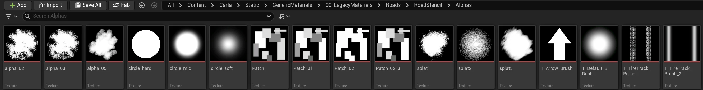
<div class="img-caption">The brush stencils in <code>GenericMaterials/00_LegacyMaterials/Roads/RoadStencil/Alphas</code>.</div>
<br>
__4. Apply each material to the desired portions of the road.__

Choose where to apply the selected material via the buttons in the _Default_ section of the _Details_ panel:

* _Paint all roads_ — Paint all the roads.
* _Paint by actor_ — Paint a specific, selected actor.
* _Paint over circle_ — Paint using a circular pattern, useful to provide variation.
* _Paint over square_ — Paint using a square pattern, useful to provide variation.

This section also contains options to erase the applied changes.

* _Clear all_ — Erase all the painted material.
* _Clear materials_ — Remove the currently active materials.
* _Clear material by actor_ — Remove the material closest to the selected actor.

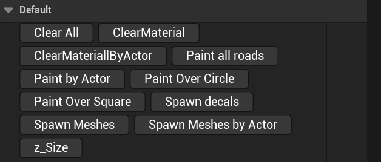
<div class="img-caption">The <code>RoadPainter</code> buttons in the Default category of its Details panel.</div>
<br>
__5. Add decals and meshes.__

You can explore the available decals and meshes in `Content > Carla > Static > FX > Decals` and `Content > Carla > Static`. Add them to road painter by extending and adding to the _Decals Spawn_ and _Meshes Spawn_ arrays. For each one you can configure the following parameters:

- _Number of Decals/Meshes_ - The amount of each decal or mesh to paint.
- _Decal/Mesh Scale_ — Scale of the decal/mesh per axis.
- _Fixed Decal/Mesh Offset_ — Deviation from the center of the lane per axis.
- _Random Offset_ — Max deviation from the center of the lane per axis.
- _Decal/Mesh Random Yaw_ — Max random yaw rotation.
- _Decal/Mesh Min Scale_ — Minimum random scale applied to the decal/mesh.
- _Decal/Mesh Max Scale_ — Max random scale applied to the decal/mesh.

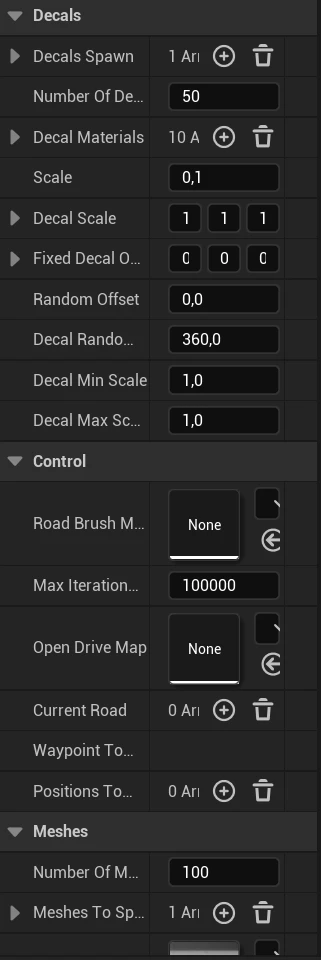
<div class="img-caption">The Decals and Meshes categories of the <code>RoadPainter</code>.</div>
<br>

Once you have configured your meshes and decals, spawn them by pressing `Spawn decals` and `Spawn meshes`.

!!! Note
    Make sure that meshes and decals do not have collisions enabled that can interfere with cars on the road and lower any bounding boxes to the level of the road.

__6. Experiment to get your desired appearance.__ 

Experiment with different materials, textures, settings, decals, and meshes to get your desired look. Below are some example images of how the appearance of the road changes during the process of painting each material.

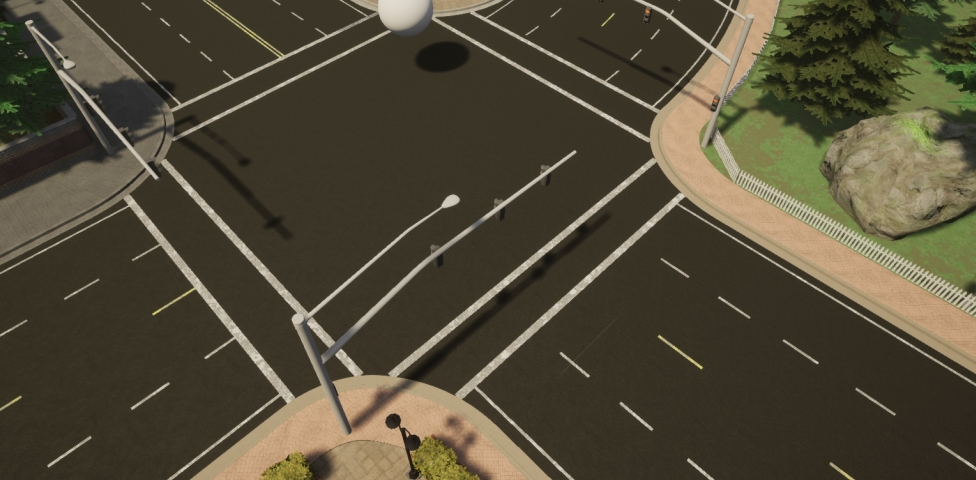
<div class="img-caption">Example of base road material. Captured on the UE4 version of CARLA.</div>
<br>
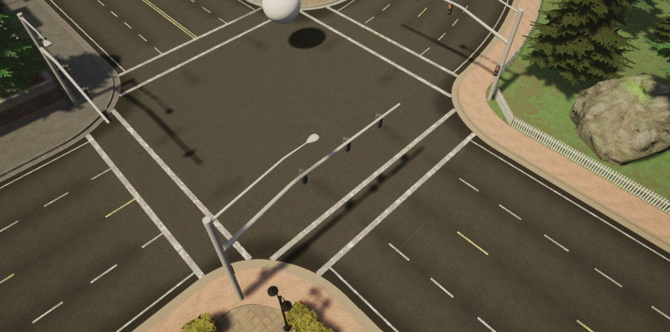
<div class="img-caption">Example after material 1 is applied. Captured on the UE4 version of CARLA.</div>
<br>
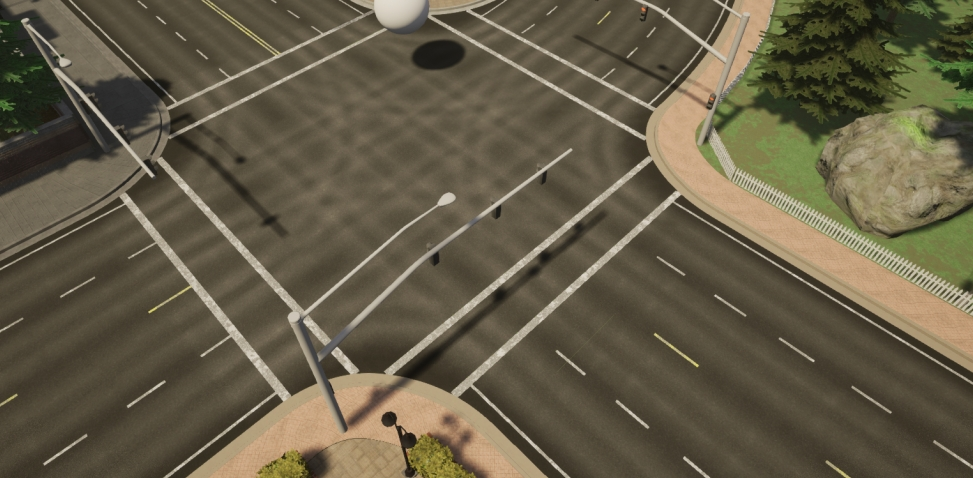
<div class="img-caption">Example after material 2 is applied. Captured on the UE4 version of CARLA.</div>
<br>
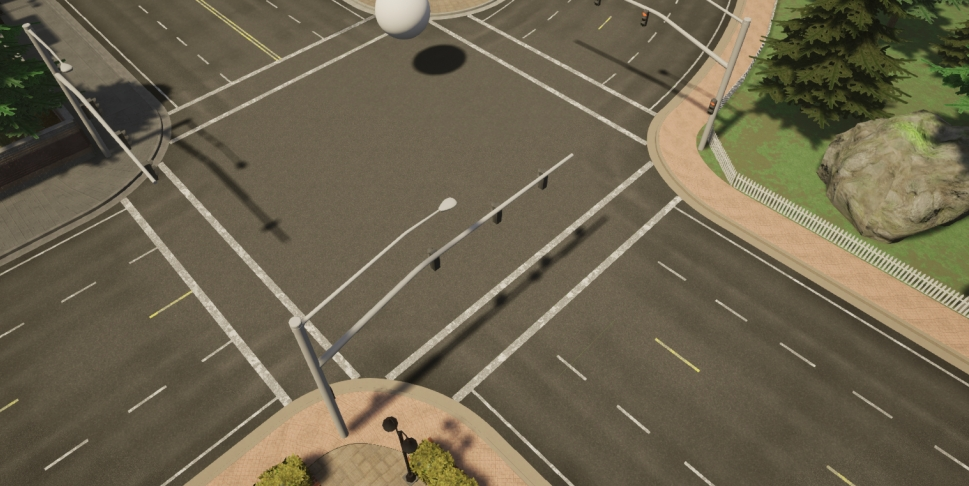
<div class="img-caption">Example after material 3 is applied. Captured on the UE4 version of CARLA.</div>
<br>

<div class="img-caption">Example after decals are applied. Captured on the UE4 version of CARLA.</div>
<br>
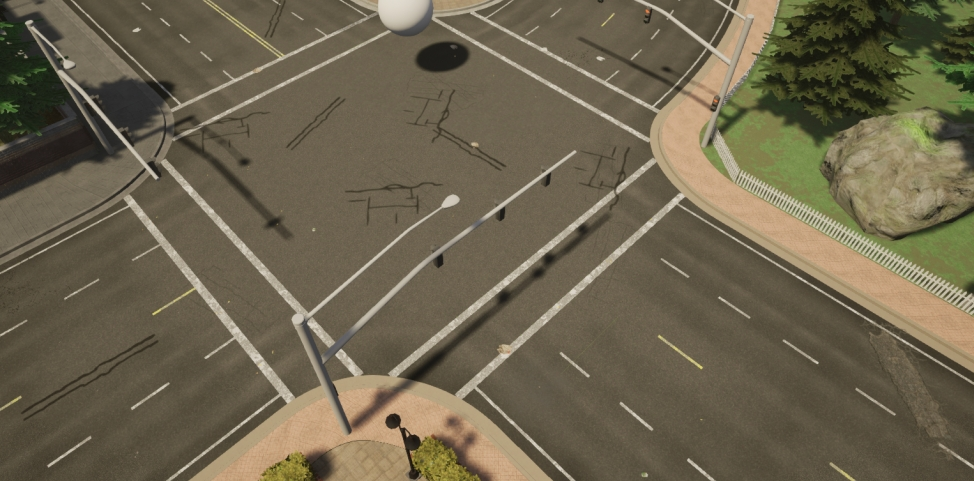
<div class="img-caption">Example after meshes are applied. Captured on the UE4 version of CARLA.</div>
<br>

---

## Update the appearance of lane markings

Lane markings use `M_RoadMaster` too, with its `LaneMark` switch on. `Content > Carla > Static > GenericMaterials > Roads` has ready-made instances, `MI_Road_Asphalt_B_LaneMarkingWhite` and `MI_Road_Asphalt_B_LaneMarkingYellow`. To make your own:

1. Right-click one of them, or your road instance, and select _Create Material Instance_. Rename it `Tutorial_LaneMarkings`.
2. Open it, and in _Static Switch Parameter Values_ enable `LaneMark`.
3. Set the color of the markings in `LaneColor`, and their texture scale in `UV Size HF`.
4. Save and close.
5. Drag the material onto the lane marking meshes you wish to color. Repeat for each color of lane marking.

---

## Trees and Vegetation

The CARLA content library has a comprehensive set of vegetation blueprints for you to add further realism to the off-road areas of your maps like sidewalks, parks, hillsides, fields and forests. 

Navigate to the vegetation folder in the CARLA content library: `Carla > Static > Vegetation`. You will find meshes and blueprints for many types of trees, bushes and shrubs. You can drag these elements into your map from the content browser. 


<div class="img-caption">A tree from <code>Static/Vegetation/Trees</code> (outlined in the Content Browser) dragged into the map.</div>

### Foliage tool

A useful tool for trees and vegetation is the [__Unreal Engine foliage tool__](https://dev.epicgames.com/documentation/en-us/unreal-engine/foliage-mode-in-unreal-engine). Activate it from the _Selection Mode_ dropdown in the toolbar, or with `Shift + 3`.

Drag your desired foliage item into the box labeled `+ Drop Foliage Here`. Set an appropriate density in the density field, then paint into the map with your foliage item. 

---

If you have any questions about the process, then you can ask in the [GitHub Discussions](https://github.com/carla-simulator/carla/discussions).

<div class="build-buttons">
<p>
<a href="https://github.com/carla-simulator/carla/discussions" target="_blank" class="btn btn-neutral" title="Go to CARLA's GitHub Discussions">
GitHub Discussions</a>
</p>
</div>
