# Content authoring - vehicles

CARLA provides a comprehensive set of vehicles out of the box in the blueprint library. CARLA allows the user to expand upon this with custom vehicles for maximum extensibility.

3D modeling of detailed vehicles is highly complex and requires a significant degree of skill. We therefore refer the reader to alternative sources of documentation on 3D modeling, since this is beyond the scope of this guide. There are, however, numerous sources of vehicle models in both free and proprietary online repositories. Hence the user has many options to turn to for creating custom vehicles for use in CARLA.

The key factors in preparing a custom vehicle for CARLA are rigging the vehicle armature and importing it into the Unreal Engine. After that, blueprints have to be set up for the car and for its wheels, and the lights wired. This guide covers those steps; [vehicle materials](tuto_content_authoring_vehicles_materials.md) covers the paint.

* __[Modeling](#modeling)__
    * [Vehicle parts](#vehicle-parts)
    * [Naming conventions](#naming-conventions)
* __[Rigging the vehicle using an armature](#rigging-the-vehicle-using-an-armature)__
    * [Import](#import)
    * [Add an armature](#add-an-armature)
    * [Assigning vehicle parts to bones](#assigning-vehicle-parts-to-bones)
    * [Export](#export)
* __[Importing into Unreal Engine](#importing-into-unreal-engine)__
    * [Setting up the physics asset](#setting-up-the-physics-asset)
    * [Creating the animation blueprint](#creating-the-animation-blueprint)
    * [Wheel blueprints](#wheel-blueprints)
* __[Vehicle blueprint](#vehicle-blueprint)__
    * [Vehicle movement component configuration](#vehicle-movement-component-configuration)
    * [Add vehicle to blueprint library](#add-vehicle-to-blueprint-library)
* __[Lights](#lights)__
    * [UV map](#uv-map)
    * [Importing](#importing)

Materials are covered separately, in [Content authoring - vehicle materials](tuto_content_authoring_vehicles_materials.md).

---
## Modeling

We recommend triangulating the model prior to export as best practice. CARLA vehicles are modeled using the size and scale of real-world vehicles as reference. Please ensure you pay careful attention to the units of your 3D application. Some work in centimeters while others work in meters.

### Vehicle parts

There are several parts of the vehicle that should be modeled as separate objects in the scene in Maya:

- Chassis, bodywork and interior: these should all be part of the same object
- Wheels: each wheel should be its own object
- Glass: all glass parts of the vehicle, including windows and light enclosure glass should be part of the same object
- Lights: all lights including brake lights, headlights, foglights and blinkers should be part of the same object

#### Naming conventions

We recommend the following naming convention for the various parts for organization:

- __Bodywork__: The exterior metallic part of the vehicle and the interior such as the seats and dashboard. This material is changed to Unreal Engine material. Logos and details can be added but, to be visible, they must be painted in a different color by using the alpha channels in the Unreal Engine editor.
- __Glass_Ext__: A layer of glass that allows visibility from the outside to the inside of the vehicle.
- __Glass_Int__: A layer of glass that allows visibility from the inside to the outside of the vehicle.
- __Lights__: Headlights, indicator lights, etc.
- __LightGlass_Ext__: A layer of glass that allows visibility from the outside to the inside of the light.
- __LightGlass_Int__: A layer of glass that allows visibility from the inside to the outside of the light.
- __LicensePlate__: A rectangular plane of 29x12 cm. You can use the CARLA provided `.fbx` for best results, download it [here](https://carla-assets.s3.eu-west-3.amazonaws.com/fbx/LicensePlate.rar). The texture will be assigned automatically in Unreal Engine.

Materials can be named using the format `M_CarPart_CarName`, e.g, `M_Bodywork_Mustang`.

Textures can be named using the format `T_CarPart_CarName`, e.g, `T_Bodywork_Mustang`. Textures should be sized as 2048x2048.

---
## Rigging the vehicle using an armature

To look realistic within the simulation, the car needs to have rotating and wheels, the front pair of which can turn with steering inputs. Therefore to prepare a vehicle for CARLA, an armature needs to be rigged to the car to identify the wheels and allow their movement.

### Import

Import or model the vehicle model mesh in your 3D modeling application. In this guide we will use Autodesk Maya. Ensure that the wheels are separable from the main body. Each wheel must be accessible as a distinct object in the scene.

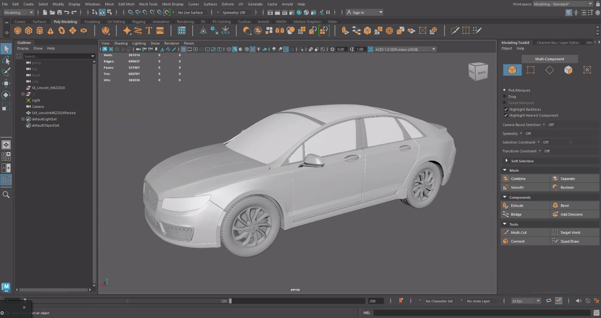
<div style="text-align: right"><i>The vehicle model in Maya, with each wheel as a separate object.</i></div>

It is important to ensure that the vehicle faces in the positive X direction, so the hood and windshield should be facing towards positive X. The car should also be oriented such that the floor to roof direction is in the positive Z direction. The wheels should be just grazing the X-Y plane and the origin should be situated where you would expect the vehicle's center of mass to be in the X-Y plane (not in the Z plane).

### Add an armature

Firstly add a bone to the center of the vehicle, ensure the object is properly centered, the root of the bone should be set at the origin. Name the bone `Vehicle_Base`.

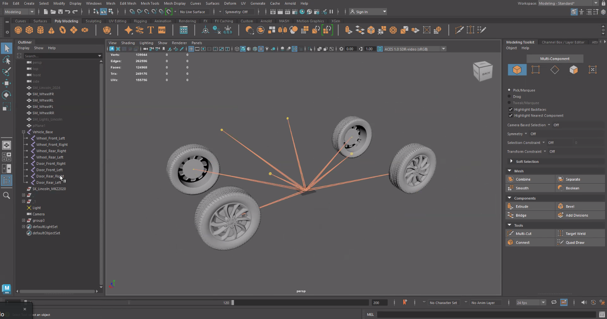
<div style="text-align: right"><i>The <code>Vehicle_Base</code> root bone at the origin and one bone per wheel, parented to it.</i></div>

From the vehicle base bone and add 4 more child bones (drag the child bones into the vehicle base in the outliner). Each of these bones needs to be located such that the root of the bone coincides with the center of the each wheel. It should be in the center both of the diameter and depth of the wheel It's important that the vehicle is laterally symmetric

For each wheel, it is recommended to name the bone according to the wheel it needs to be coupled to, this will help in identification later when you need to assign vertex groups to each bone:

- Wheel_Front_Left
- Wheel_Front_Right
- Wheel_Back_Left
- Wheel_Back_Right

__Doors__: If you want the doors of your vehicle to be opened through the API, you should also add 2 or 4 more bones to the vehicle base bone with the following names:

- Door_Front_Left
- Door_Front_Right
- Door_Back_Left
- Door_Back_Right

The door bones have their bases located at the expected pivot point of the door, i.e. where the hinge would be.

### Assigning vehicle parts to bones

Change to rigging mode. In the skin section, select *Bind skin* then select the relevant wheel bone (e.g. Wheel_Front_Right) and then shift click on the geometry you want to parent to that bone (e.g. the front right wheel). Repeat this with each wheel.

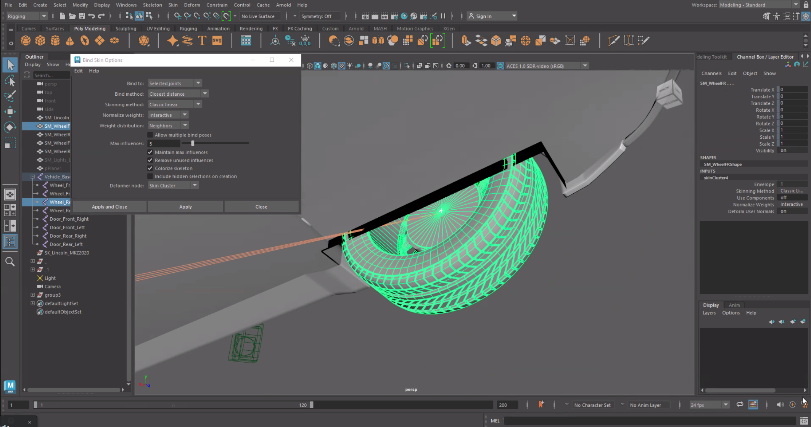
<div style="text-align: right"><i>Binding a wheel's geometry to its bone with <b>Bind skin</b>.</i></div>

Finally, repeat this process with the vehicle base bone and the chassis and bodywork geometry.

Select the Vehicle_Base bone in the outliner and ensure that all Translate and Rotate fields are zero in the Channel Box / Layer Editor and all the scale fields are set to 1.

Select the bone for each wheel, press E to activate the rotation widget, rotate the the bone around the axis of the wheel and ensure that the wheel geometry turns with the bone, this shows that the geometry is properly bound to the bone.

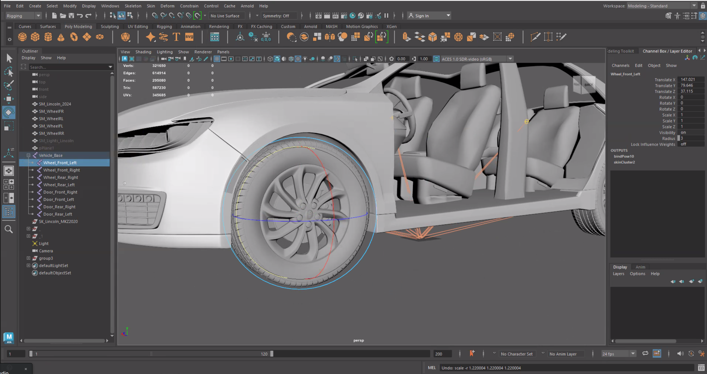
<div style="text-align: right"><i>Rotating a wheel bone to check that the wheel geometry turns with it.</i></div>

If you have added bones for the doors, you do not need to bind the door geometry to these since the door geometry must be exported and then imported into Unreal Engine separately.

### Export

Each vehicle part should be exported separately, you should have separate geometry objects for the following parts:

- the bodywork/chassis with 4 wheels (including the bones/armature)
- glass
- lights
- 4 doors (optional)
- collision mesh
- raycast mesh

For each part select the object and go to *File > Export selection*. Leave the default export options and select FBX format.

When exporting the bodywork/chassis and wheels, you should select all the mesh items and all the bones before exporting, to ensure the bones are included in the FBX and it is then imported into Unreal Engine as a skeletal mesh. All other parts should be exported individually, with no bones selected, to ensure they are imported as static meshes in Unreal Engine.

---
## Importing into unreal engine

Launch the Unreal Editor from the CARLA root directory using the following command:

```sh
cmake --build Build --target launch
```

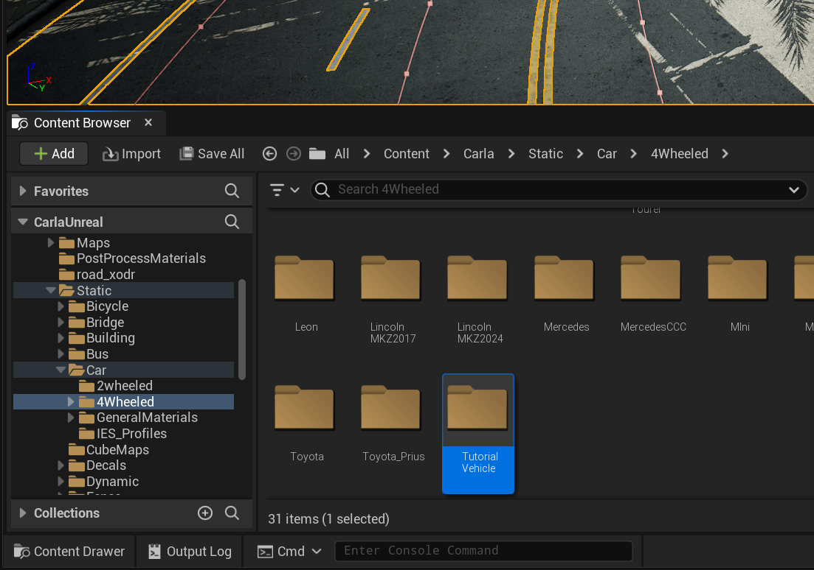
<div style="text-align: right"><i>A new folder for the vehicle under <code>Content/Carla/Static/Car/4Wheeled</code>.</i></div>

Open the content browser and create a new folder for your vehicle, for example `Carla > Static > Car > 4Wheeled > TutorialVehicle`. Note that the chosen directory will affect the semantic label of the vehicle in the semantic camera and LIDAR sensors. For example, if you are importing a truck model, you should create your directory in `Carla > Static > Truck`.

Drag the FBX containing the vehicle's chassis, bodywork, wheels and bones/armature into the content browser. If you have set up bones for the doors, you may get a warning message that the door bones are missing from the bind pose. This is expected, since the doors are imported and assigned separately. You may disregard this warning.

The importer should create a *Physics Asset* and a *Skeleton*. Select the skeletal mesh edit mode with the option highlighted in red:

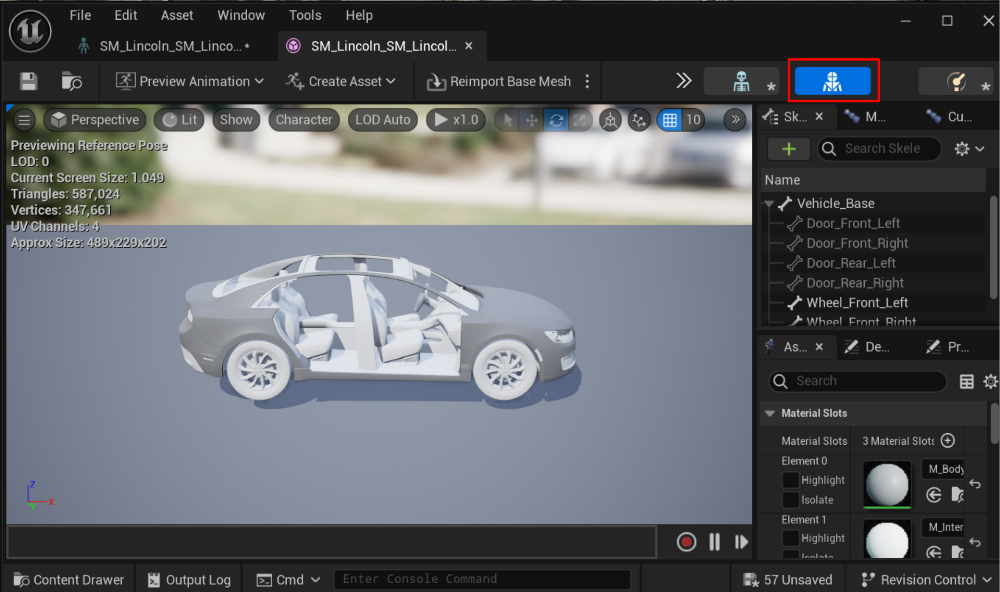
<div style="text-align: right"><i>The imported skeletal mesh; the button outlined in red opens the skeletal mesh editor.</i></div>

Select *File > Save As* to save a *Skeletal Mesh* file, which you will need later. You may want to add a prefix of *SK_* to identify the file as a skeletal mesh.

Drag the other FBX files you exported from Maya or Blender into the new directory in the content browser. Keep the default import options. To keep the folder more organized, you may want to add separate folders for the glass and lights meshes and drag those parts in separately. These parts should all be imported as *Static Mesh* items. If they appear as a *Skeleton* item, you may need to revise your export process in Maya or Blender and ensure you haven't accidentally included bones or other types of object in the export. You may want to add a prefix of *SM_* to any *Static Mesh* items you import for organization.

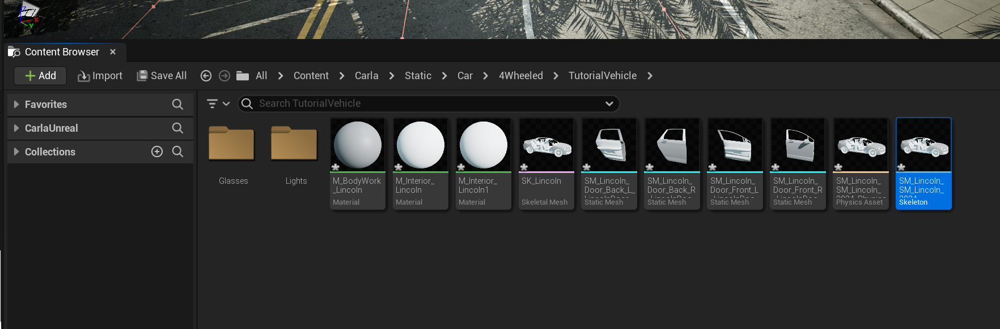
<div style="text-align: right"><i>The vehicle folder with the skeletal mesh, physics asset, skeleton and the static meshes for glass and lights.</i></div>

### Setting up the physics asset

You should have a *Physics Asset* file in the directory which was created on import. Double click on the physics asset to open the editor.

#### Collision mesh

__Automatically generated collision mesh__: First, we need to define the collision mesh. This can either be generated automatically by Unreal Engine or modeled manually. To generate it automatically, in the *Tools* panel, normally in the lower right corner of the *Physics asset* editor, in the *Body Creation* section, change the *Primitive Type* to *Single Convex Hull* then press *Generate All Bodies*. This will generate a single convex hull that covers most of the vehicle's body. If your vehicle is a more complicated shape, this might not capture the shape too well. In this case you can try selecting *Multi Convex Hull* as the *Primitive Type*. Press *Generate All Bodies* again and inspect the result. You may also wish to try other options like *Box*, *Capsule* or *Sphere* for the primitive type, these may suit vehicles with simpler geometric profiles.

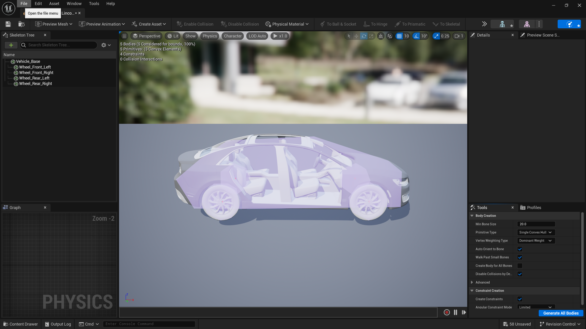
<div style="text-align: right"><i>The physics asset with a collision generated automatically as a single convex hull.</i></div>

__Modelled collision mesh__: If the built-in or automatically generated collision primitives do not fit the vehicle well, model the collision hull by hand. It should be a low poly analogue of the surface profile of your vehicle. High poly collision meshes may degrade physics performance. Generally for vehicles it's best not to include the wheel profile in the collision mesh.

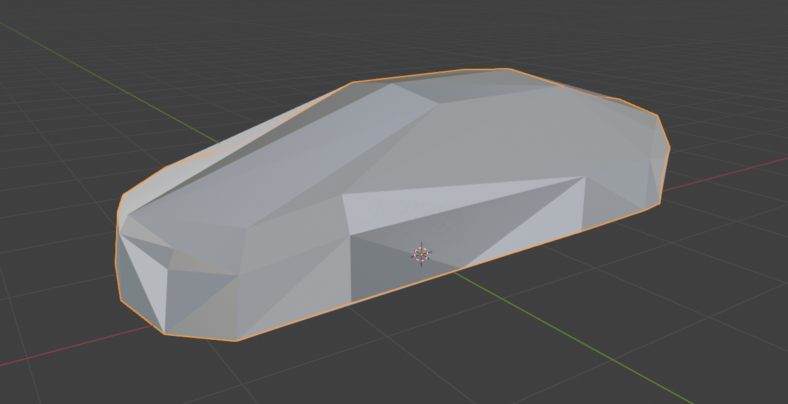
<div style="text-align: right"><i>A hand-modelled, low-poly collision hull following the body of the vehicle.</i></div>

To use the manually modeled collision mesh, first import it by dragging it into the vehicle's content folder. Right click on the *Vehicle_Base* item in the *Skeleton Tree* panel of the *Physics Asset* editor and select *Copy Collision From StaticMesh*.

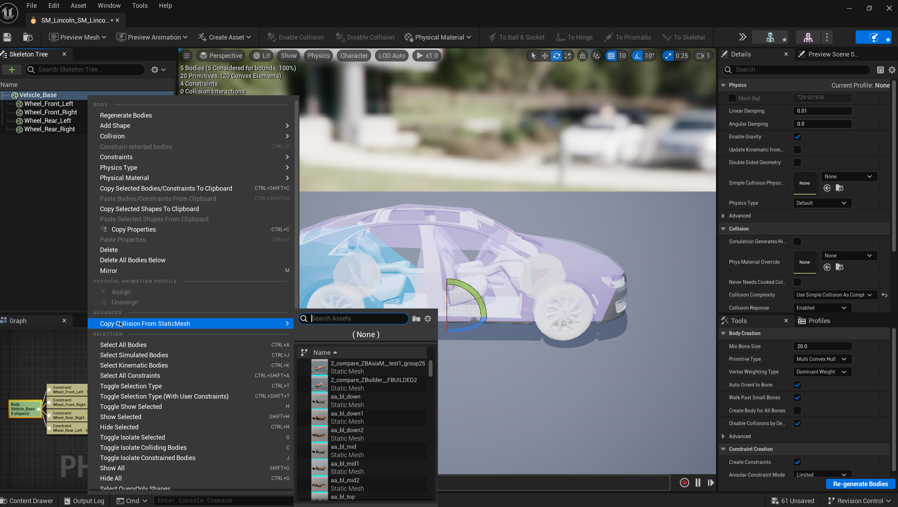
<div style="text-align: right"><i><b>Copy Collision From StaticMesh</b> on <code>Vehicle_Base</code> in the Skeleton Tree of the physics asset.</i></div>

Search for the collision mesh that you imported in the dialogue and select it. You should see the outline of the collision mesh in the viewport with a blue/purple hue. In the viewport, select and delete all parts of the automatically generated collision mesh was already there, to leave just the modeled collision mesh.

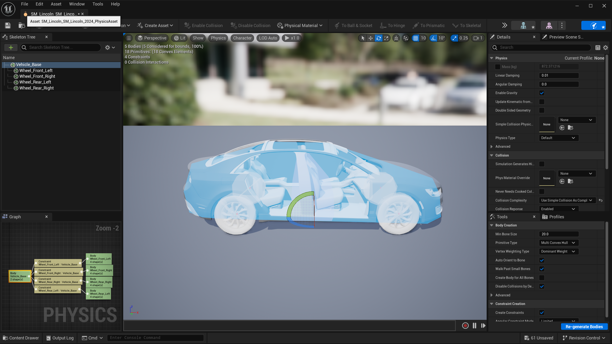
<div style="text-align: right"><i>The modelled collision mesh, in blue, replacing the generated one.</i></div>

__Wheels__:

After setting up the collision mesh for the vehicle itself, now we need to configure the collision primitives for the wheels.

Select all the wheels in the *Skeleton Tree* panel:

- Go to the *Tools* panel and change the *Primitive Type* to *Sphere*.
- Go to the *Details* panel and change *Physics Type* to *Kinematic*.
- Set the *Collision Response* to *Disabled*.
- Set *Linear Damping* to 0. This will eliminate any extra friction on the wheels.


- Enable *Simulation Generates Hit Event* for all meshes.
- Click *Re-generate Bodies*.
- Adjust the wheel sphere to the size of the wheel.
- Save and close the window.

### Creating the animation blueprint

In the content browser directory where you have your new vehicle asset, right click in an empty space and choose `Animation > Animation Blueprint` from the context menu. In the popup that opens, search for `CarlaVehicleAnimationInstance` for the *Parent Class* and in the *Specific Skeleton* field search for the *Skeleton* file created for your new vehicle. Name the blueprint and then click *Create*.

!!! Note
    `CarlaVehicleAnimationInstance` extends the engine's `VehicleAnimationInstance`, which only animates the wheels while the Chaos vehicle simulation moves the vehicle. With the CARLA class the wheels also roll when physics is disabled and the vehicle is moved through the API, during a replay, or when another physics engine drives it. A vehicle whose animation blueprint still uses `VehicleAnimationInstance` keeps working, but its wheels stay still in those cases; change the parent class through *File > Reparent Blueprint*.

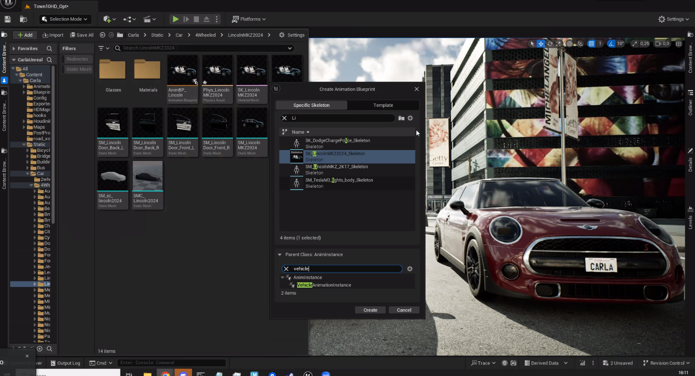
<div style="text-align: right"><i>Creating the animation blueprint for the vehicle's skeleton.</i></div>

In the content browser search for an existing, completed CARLA vehicle animation blueprint from the library, open the animation blueprint and copy the nodes from it. Go back to your vehicle's animation blueprint and paste the nodes.

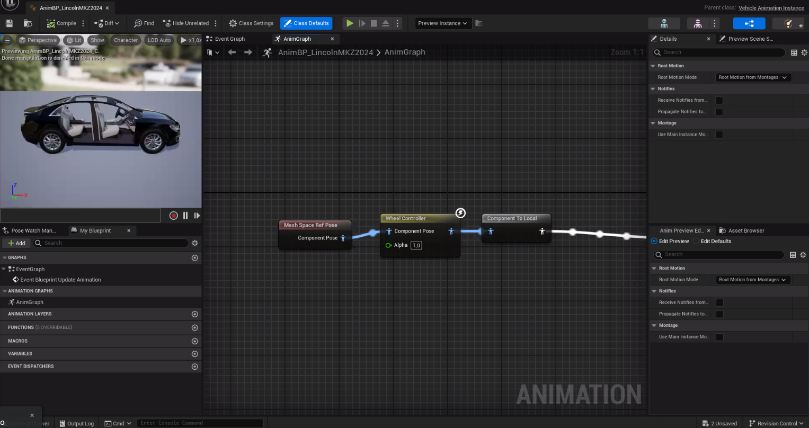
<div style="text-align: right"><i>The AnimGraph nodes copied from an existing CARLA vehicle animation blueprint.</i></div>

Save the animation blueprint.

### Wheel blueprints

Navigate with your content browser to `Content > Carla > Blueprints > Vehicles`, create a new folder for your vehicle.

Inside this folder create the one blueprint for each of the 4 wheels. Right-click and select *Blueprint class. Search for the *ChaosVehicleWheel* class and select it. Name each wheel blueprint similar to the following examples:

- BP_MyVehicle_FRW
- BP_MyVehicle_FLW
- BP_MyVehicle_RRW
- BP_MyVehicle_RLW

Open each blueprint individually and repeat the following configuration steps:

- Set the *Collision Mesh* to *Wheel_Shape*
- Set the *Axle Type* according to the wheel position (front or rear)
- Set the *Wheel Radius*, *Wheel Width* and *Wheel mass* according to the dimensions and specifications of your vehicle model, you may need to measure these dimensions in your 3D application
- Set the *Friction Force Multiplier* to 3.5
- Set the *Brake*, *Handbrake*, *Engine*, *ABS* and *Traction control*, *Front wheel drive*, *Rear wheel drive*, *Four wheel drive* settings according to the specification of your vehicle

Adjust the max steer angle as needed, the default value of 50 will suit most applications. Most vehicles have a max steering angle between 30 and 50.

For both front wheels enable *Affected By Steering*, ensure this parameter is disabled for the rear wheels.

Leave *MaxBrakeTorque* and *MaxHandBrakeTorque* at the default values unless you have alternative figures from a vehicle specification.

---
## Vehicle blueprint

Right click inside the vehicle's content directory and choose *Blueprint Class*. In the dialogue, search for *BaseVehiclePawn* and press *Select*. Rename the blueprint as BP_<vehicle_name>.

Click on the mesh in the component's panel:

- Set *EnablePhysics* to true
- Assign the vehicle skeletal mesh and AnimClass
- Set the *Center Of Mass Override* to be within the body of the vehicle, for example 50cm for a normal car. You may need to adjust this parameter if the vehicle behaves strangely, for example if it rolls easily on corners.
- In the components panel, select *Custom Collision (Inherited)* search for the raycast sensor mesh that you imported
- Modify the *Physics Constraints* components of the blueprint adding the respective components names

### Vehicle movement component configuration

- Open the VehicleMovementComponent in the details panel
- Create 4 new wheels by pressing the plus icon in the *Wheel setups* row
- Fill the *Wheel setups* variable with the Chaos vehicle wheels and respective bone names for each of the wheels

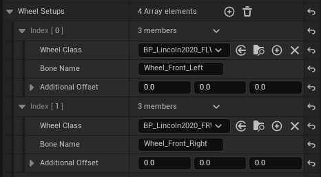
<div style="text-align: right"><i><b>Wheel Setups</b>: one entry per wheel, with its wheel blueprint and bone name.</i></div>

- Add points to the torque curve in the **Engine Setup** according to a reference or model
- Set the *Steering Curve* according to a reference or model
- Set the number of gears and gear ratios in the *Transmission setup

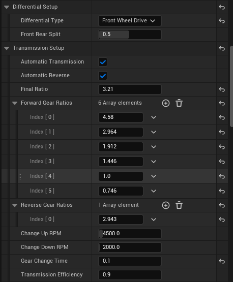
<div style="text-align: right"><i><b>Differential Setup</b> and <b>Transmission Setup</b> of the Chaos vehicle movement component.</i></div>

- In the *Steering Setup*, set the *Steering Type* to *Ackermann*
- Modify the mass, chassis width and height according to reference

### Add vehicle to blueprint library

A new blueprint does not reach the blueprint library on its own; it has to be registered in `Unreal/CarlaUnreal/Content/Carla/Config/VehicleParameters.json`. Add an entry of this shape:

```json
{
    "Make": "Tesla",
    "Model": "Model3",
    "Class": "/Game/Carla/Blueprints/Vehicles/TeslaModel3UE58/BP_TeslaModel3.BP_TeslaModel3_C",
    "NumberOfWheels": 4,
    "Generation": 3,
    "ObjectType": "",
    "BaseType": "car",
    "SpecialType": "electric",
    "HasDynamicDoors": true,
    "HasLights": true,
    "RecommendedColors": [ { "R": 235, "G": 238, "B": 240, "A": 255 } ],
    "SupportedDrivers": []
}
```

The blueprint id is built from the make and the model, lowercased: this entry becomes `vehicle.tesla.model3`. `BaseType` (`car`, `truck`, `van`, `bus`, `bicycle`, `motorcycle`) and `SpecialType` are what the catalogue and the blueprint filters group by, and `HasDynamicDoors` / `HasLights` declare whether the blueprint implements doors and lights.

!!! Warning
    The file is read once at startup. Restart the editor or the server before looking for the new blueprint.

A vehicle can also be shipped on its own, without rebuilding the simulator, as a [content pack](content_packs.md).

---
## Lights

All the lamps of a vehicle (headlights, position lights, brake lights, blinkers, fog and reverse lights) are one static
mesh, `SM_<Vehicle>_Emissive`, added to the vehicle blueprint as a *Static Mesh* component. Its material is an
instance of `M_VehicleLightsMaster` (in `Content/Carla/Static/GenericMaterials/000_Masters/Vehicles`). The material
reads a mask texture, `T_8Color_msk`, on the **first UV channel** to decide which light group each lamp belongs to, so
the UV map of the lights mesh is what assigns lamps to groups.

### UV map

Place the UVs of every lamp inside the cell of its group. The cells are flat-colored triangles; the texture alpha
separates the front and the rear version of the position and fog lights, so those two groups have two cells each.

| Cell color | Group | Material parameters |
| --- | --- | --- |
| Black | Low beam | `Low Beam Color` |
| Blue | High beam | `High Beam Color` |
| White, alpha 0 / alpha 1 | Front / rear position | `Front Position Color` / `Back Position Color` |
| Cyan, alpha 0 / alpha 1 | Front / rear fog | `Front Fog Color` / `Back Fog Color` |
| Yellow | Brake | `Brake Color` |
| Green | Reverse | `Reverse Color` |
| Red | Left blinker | `Blinker Color` |
| Magenta | Right blinker | `Blinker Color` |

A point inside each cell, in UV space (U right, V down): low beam `(0.85, 0.85)`, high beam `(0.65, 0.65)`, front
position `(0.25, 0.40)`, rear position `(0.40, 0.25)`, front fog `(0.25, 0.60)`, rear fog `(0.40, 0.75)`, brake
`(0.15, 0.15)`, reverse `(0.15, 0.85)`, left blinker `(0.85, 0.15)`, right blinker `(0.65, 0.35)`. The left and right
blinkers are the vehicle's own left and right.

If a tail lamp is both the position and the brake light, put it in the rear position cell and set `TailBrakeBoost` on
the material instance: the lamp then glows with `Back Position Color` x (1 + `TailBrakeBoost`) while braking.

### Importing

Import the lights mesh as a *Static Mesh*, create a material instance of `M_VehicleLightsMaster`
(`MI_<Vehicle>_Emissive`) and assign it to the lights mesh component of the vehicle blueprint. Glass meshes in front
of the lamps must use a translucent material; an opaque lamp housing hides the lamps even when they are lit.

The brightness of a group is the product of two values:

- `Intensity` of the vehicle class in `Content/Carla/Config/Lights/Defaults.json` (`perVehicleClass`), the same for
  every group of the vehicle. The CARLA vehicles use `200000`. `GroupIntensity` in the same file sets the real
  spot/point lights of each group, which light the scene but do not glow.
- The group color on the material instance (table above). Balance the groups of a new vehicle by eye against an
  existing one at night: CARLA uses the Audi TT as the reference for the front lamps and the Mercedes CCC for the rear
  lamps. Color values up to about 30 still make the glow grow; above that a lamp does not change.

By day the material multiplies the lamps by `DayBoost` (default `6`) so that daytime running lights and brake lights
stay visible in sunlight; the rear position lights are not boosted.

!!! Note
    With temporal anti-aliasing (TSR, the default), small or thin lamps lose most of their glow beyond about 10 m:
    TSR blends each frame with the previous ones and flattens bright features that cover a few pixels. Lamps of a few
    pixels therefore glow less than large ones however bright their color is. With FXAA (`r.AntiAliasingMethod 1`)
    they glow as expected, at the cost of more aliasing on fine geometry.
