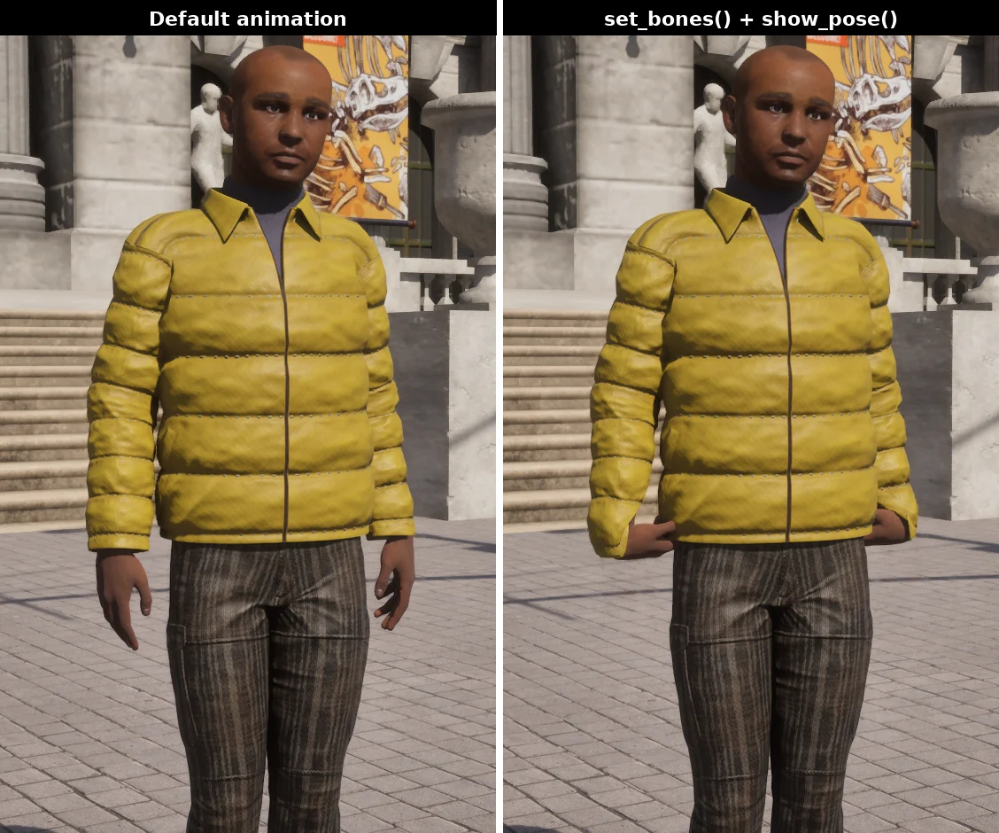
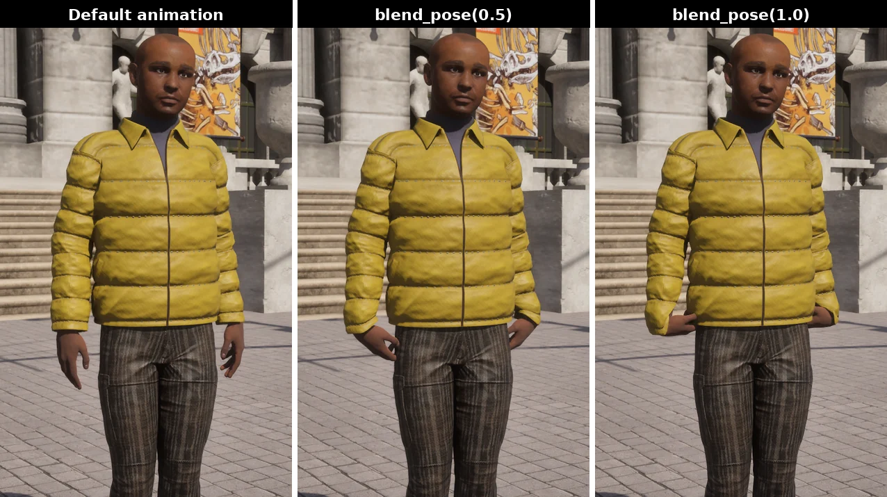

# Control walker skeletons

In this tutorial we describe how to manually control and animate the skeletons of walkers from the CARLA Python API. The reference of all classes and methods available can be found at [Python API reference](python_api.md).


<div class="img-caption">The same walker before and after the example on this page. Left, its default animation. Right, the custom pose shown with <code>show_pose()</code>: both hands rolled 90 degrees and turned in against the hips.</div>

- [__Walker skeleton structure__](#walker-skeleton-structure)
- [__Manually control walker bones__](#manually-control-walker-bones)

!!! Note
    This document assumes familiarity with the Python API. Read [Foundations](core_foundations.md) and the [first steps tutorial](start_first_steps.md) first.

---
## Walker skeleton structure

All walkers have the same skeleton hierarchy and bone names. Below is an image of the skeleton hierarchy.

```text
crl_root
└── crl_hips__C
    ├── crl_spine__C
    │   └── crl_spine01__C
    │       ├── crl_shoulder__L
    │       │   └── crl_arm__L
    │       │       └── crl_foreArm__L
    │       │           └── crl_hand__L ....... 5 finger chains
    │       ├── crl_neck__C
    │       │   └── crl_Head__C
    │       │       ├── crl_eye__L
    │       │       └── crl_eye__R
    │       └── crl_shoulder__R
    │           └── crl_arm__R
    │               └── crl_foreArm__R
    │                   └── crl_hand__R ....... 5 finger chains
    ├── crl_thigh__L
    │   └── crl_leg__L
    │       └── crl_foot__L
    │           └── crl_toe__L
    │               └── crl_toeEnd__L
    └── crl_thigh__R
        └── crl_leg__R
            └── crl_foot__R
                └── crl_toe__R
                    └── crl_toeEnd__R
```

Each hand carries the same five chains, four bones deep:

```text
crl_hand__L
├── crl_handThumb__L  →  crl_handThumb01__L  →  crl_handThumb02__L  →  crl_handThumbEnd__L
├── crl_handIndex__L  →  crl_handIndex01__L  →  crl_handIndex02__L  →  crl_handIndexEnd__L
├── crl_handMiddle__L →  crl_handMiddle01__L →  crl_handMiddle02__L →  crl_handMiddleEnd__L
├── crl_handRing__L   →  crl_handRing01__L   →  crl_handRing02__L   →  crl_handRingEnd__L
└── crl_handPinky__L  →  crl_handPinky01__L  →  crl_handPinky02__L  →  crl_handPinkyEnd__L
```

Every name is `crl_` plus the bone, plus a side: `__L` left, `__R` right, `__C` centre. The right hand repeats the block above with `__R`. `walker.get_bones()` returns the live list if you would rather read the names from the simulator than from this page.

---
## Manually control walker bones

Following is a detailed step-by-step example of how to change the bone transforms of a walker from the CARLA Python API

### Connect to the simulator

Import necessary libraries used in this example

```py
import carla
import random
```

Initialize the carla client

```py
client = carla.Client('127.0.0.1', 2000)
client.set_timeout(10.0)

world = client.get_world()

# The animation loop below ticks the server, so it has to own the clock
settings = world.get_settings()
settings.synchronous_mode = True
settings.fixed_delta_seconds = 0.05
world.apply_settings(settings)
```

### Spawn a walker

Spawn a random walker on the navigation mesh. The point returned lies on the ground, so it is raised 1 m: at ground height the walker's capsule collides with the pavement and the spawn fails.

```py
blueprint = random.choice(world.get_blueprint_library().filter('walker.*'))

# Pedestrians belong on the navigation mesh, not on a vehicle spawn point
location = world.get_random_location_from_navigation()
location.z += 1.0
spawn_point = carla.Transform(location)
walker = world.try_spawn_actor(blueprint, spawn_point)
if walker is None:
    raise RuntimeError('could not spawn the walker, try another location')
```

### Control walker skeletons

A walker's skeleton is modified by passing a [`carla.WalkerBoneControlIn`](python_api.md#carla.WalkerBoneControlIn) to [`walker.set_bones()`](python_api.md#carla.Walker.set_bones). Its `bone_transforms` member is a list of `(bone name, transform)` pairs, and it can be sent on every tick to animate the skeleton.

__Each transform is relative to the bone's parent__, so moving a parent carries its children with it. That also means a transform has to be built from the bone's current one: a default `carla.Transform()` has a zero location, which collapses the bone onto its parent's pivot rather than leaving it where it is. Read the current pose with [`walker.get_bones()`](python_api.md#carla.Walker.get_bones) and change only what you mean to change.

The walker keeps playing its animation until the custom pose is shown with [`show_pose()`](python_api.md#carla.Walker.show_pose). [`blend_pose()`](python_api.md#carla.Walker.blend_pose) mixes the animation and the custom pose by a factor in `[0, 1]`, and [`hide_pose()`](python_api.md#carla.Walker.hide_pose) goes back to the animation.

!!! Warning
    `set_bones` needs the walker to be driven by its default controller. With a `controller.ai.walker` attached, the AI controller overwrites the pose every tick and nothing visible happens.

The example below rotates both hands 90 degrees about their forward axis, keeping each bone's own location:

```py
bones = walker.get_bones()
current = {bone.name: bone.relative for bone in bones.bone_transforms}

transforms = []
for name in ('crl_hand__R', 'crl_hand__L'):
    relative = current[name]
    transforms.append((name, carla.Transform(
        location=relative.location,
        rotation=carla.Rotation(pitch=relative.rotation.pitch,
                                yaw=relative.rotation.yaw,
                                roll=relative.rotation.roll + 90))))

control = carla.WalkerBoneControlIn()
control.bone_transforms = transforms
walker.set_bones(control)
walker.show_pose()
```

To animate over time, send a new pose each tick and blend it in rather than snapping to it. The blend factor below climbs from 0 to 1 over the first 50 ticks (2.5 s at 0.05 s per tick), then holds:


<div class="img-caption">The loop below at three moments: the default animation before it starts, <code>blend_pose(0.5)</code> halfway through the blend, and <code>blend_pose(1.0)</code> with the custom pose fully shown.</div>

```py
for step in range(100):
    walker.set_bones(control)
    walker.blend_pose(min(step / 50.0, 1.0))
    world.tick()

walker.hide_pose()
walker.destroy()

# Put the server back as it was, or the next script will hang waiting for ticks
settings.synchronous_mode = False
settings.fixed_delta_seconds = None
world.apply_settings(settings)
```
