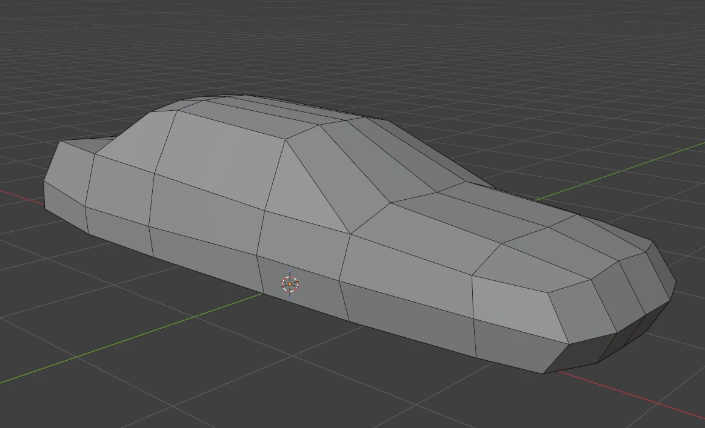
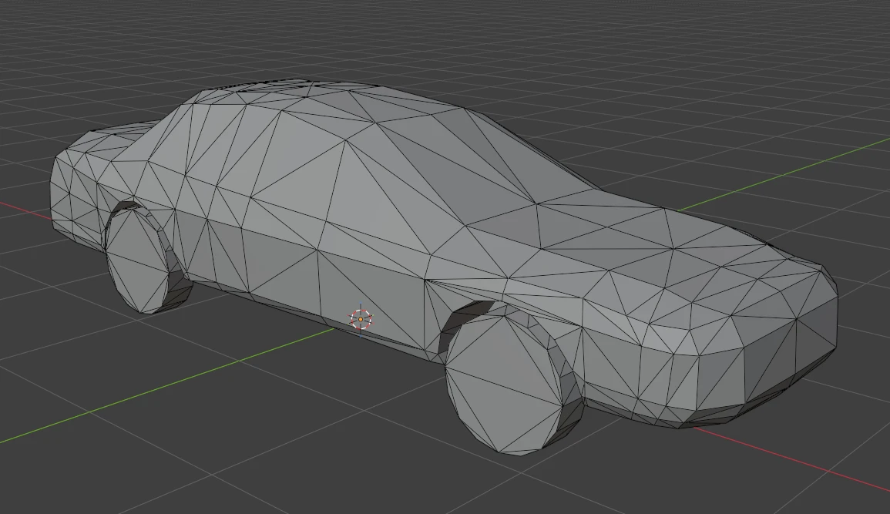

# Collision and sensor meshes (`SMC_` and `SM_sc_`)

Every CARLA vehicle needs two low-poly meshes besides its visible geometry. A vehicle without them can still look correct, but it collides badly and returns poor data to raycast sensors.

| Mesh | FBX file | Purpose | Where it goes in Unreal |
|---|---|---|---|
| Collision mesh | `SMC_<name>.fbx` | Physics: what the vehicle collides with. Body only, no wheels; Chaos wheel contact handles the tires. | Physics asset of `SK_<name>`. Right-click `Vehicle_Base` in the Skeleton Tree, choose *Copy Collision From StaticMesh*, pick `SMC_<name>`, then delete the generated hull. |
| Sensor mesh | `SM_sc_<name>.fbx` | Raycast sensors (LIDAR, semantic LIDAR, radar): the surface their rays hit. Body plus wheels, with a gap around each wheel. | `CustomCollision` component of `BP_<name>` → *Static Mesh*. The component already uses the `CustomSensorCollision` preset: invisible, no physics, it only answers the sensor trace channel. |

What the finished meshes look like:

*`SMC_<name>`: a low-poly hull of the bodywork, without the wheels.*

*`SM_sc_<name>`: the same hull plus the wheels as simple cylinders, with a gap around each wheel.*

Both are static meshes imported next to the vehicle in `Content/Carla/Static/Car/4Wheeled/<name>/`, or the folder that sets the vehicle's semantic class. Both must be low poly: the fewer triangles, the better. Around 1,000 triangles is a reference, not a hard limit; a vehicle with a complex shape can need somewhat more. The automatic hulls below come out at about 150–200 triangles for the body alone and about 700 with the wheels, so a result of several thousand usually means the decimation failed.

Common failures:
- `CustomCollision` is inherited from `BaseVehiclePawn`, and a vehicle duplicated from a donor keeps the donor's `SM_sc_` (for example `SM_sc_DodgeCharger`). LIDAR then returns the other car's shape. Set the vehicle's own mesh on the vehicle's Blueprint, not on the parent template: edit it via `get_object_for_blueprint(data, bp)`, never `SubobjectDataBlueprintFunctionLibrary.get_object`, which returns the parent's template and changes every car.
- After copying the collision, assign and save the vehicle's own physics asset on `SK_<name>`; an inherited template physics asset can survive (see [carla-integration.md](carla-integration.md)). Rebuild cooked Chaos collision and repackage.

## When the source already has them

Check the Blender scene first for objects named `SMC_<name>`, `SM_sc_<name>` or `SM_SC_<name>`. Some source files ship a hand-built pair. Do not rebuild them. Move them by the same transform as the body and wheels (recenter, unit-scale fix) and export them as they are.

## Building them automatically in Blender

Build both meshes as new objects. Use the visible body only as a read-only reference. This procedure was validated on several vehicles, including clean production assets and a 1.28 M-vertex AI-generated (Hunyuan3D) body. Use `bmesh` and the data API rather than `bpy.ops` when Blender runs headless or through MCP; viewport-dependent operators fail there.

### 1. Read the body as a point cloud

- **Never duplicate the dense body mesh and run topology operators on the copy** (`separate(type='LOOSE')`, boolean, decimate). On a mesh with unwelded vertices this creates thousands of objects. Read the vertices instead: `mesh.vertices.foreach_get('co', array)` into numpy, in world space, then keep every Nth vertex so that a few thousand points remain.
- Use only the body (and body-detail objects that belong to the shell). Leave out wheels, glass, lights, interior and doors.
- **Filter out side mirrors and other appendages** (antennas, spoilers). They pull the hull outward. Bin the points along the vehicle's length (X) into slices. In each slice, drop points whose lateral distance (Y) from the slice center is beyond the 90–95th percentile width of that slice, plus a small margin. Do not use the slice maximum. Check that the bounding-box width with the filter is clearly smaller than without it; if both are within a few centimeters, the mirrors are still in.

### 2. Build one shared body hull ("balloon")

1. Put the filtered points in a new `bmesh` and run `bmesh.ops.remove_doubles(bm, verts=bm.verts, dist=0.2)` (meters at real scale). Coarsening the input matters: without it, the hull keeps dense clusters where separate source surfaces meet, and no later decimation removes them.
2. `bmesh.ops.convex_hull(bm, input=bm.verts)`, then remove the interior geometry the operator returns.
3. Decimate with a `DECIMATE` modifier in `DISSOLVE` (planar) mode: `angle_limit` ≈ 20°, `delimit = set()`. Clear `use_edge_sharp` on every edge first. `COLLAPSE` mode can get stuck on curved panels. Bake with `obj.evaluated_get(depsgraph)` and `bpy.data.meshes.new_from_object(...)`.
4. Decimate the balloon **before** adding wheels. A decimate run after the wheel booleans can collapse the small wheel cylinders without any error.

### 3. Derive the two meshes

- **`SMC_<name>`**: a copy of the balloon, no wheels. Name the Blender object `smc_<name>`, not `UCX_<name>_0`: in this pipeline the collision is copied into the physics asset with *Copy Collision From StaticMesh*, and the `UCX_` static-mesh convention did not import the way it is needed. The FBX file is still `SMC_<name>.fbx`.
- **`SM_sc_<name>`**: another copy of the balloon plus one cylinder per wheel, with a visible gap:
  - Measure each wheel from its own world bounding box; wheels can differ. Build a real-size cylinder with `bmesh.ops.create_cone` (`cap_ends=True`, `segments=16`), placed and oriented with the `matrix` argument so that its axis is the wheel's spin axis.
  - Build a slightly larger clearance cylinder at the same place (radius +0.04 m, depth +0.06 m).
  - Per wheel, apply `DIFFERENCE` with the clearance cylinder, then `UNION` with the real cylinder. The difference must come first, or the union is carved away again. Without the clearance cylinder the wheel fuses flush with the body.
  - Apply the boolean steps one at a time and log the vertex count before and after. A step that leaves the count unchanged may have failed silently: retry it with another solver (`FLOAT` worked where `EXACT` and `MANIFOLD` did not). A no-op `DIFFERENCE` is fine when the body does not reach down to that wheel; check whether the bounding boxes overlap.
  - Finally, count the connected islands and remove leftover fragments of a few vertices.
- Delete the temporary balloon object and any orphaned mesh data once both copies exist.

### 4. Check and export

- Render each finished mesh isolated, from the side and from above. A triangle count alone can hide a dense patch or a missing wheel.
- Export each mesh to its own FBX, mesh only (`object_types={'MESH'}`, `use_selection=True`), with the same axis and unit settings as the skeletal mesh. Before selecting, unhide each object (`hide_set(False)`, `hide_viewport = False`); `select_set(True)` silently does nothing on hidden objects and the FBX comes out empty. Print `bpy.context.selected_objects` right before export.
- Do not triangulate by hand before export; Unreal triangulates on import.
- If the scene uses the centimeter-scale fix (`scene.unit_settings.scale_length = 0.01`, every object scaled ×100), include both meshes in that fix, and re-check `scale_length` immediately before each export.

## Verify in CARLA

- **Collision**: spawn the vehicle, let it settle on the ground, and drive it into a static obstacle and into another vehicle. The contact must happen at the body surface, with no gap and no launch.
- **Sensor mesh**: attach a `sensor.lidar.ray_cast` (or `semantic_lidar`) to a second actor aimed at the vehicle, save a few point clouds, and check that the points follow the vehicle's own silhouette including the wheels. The points must not follow a donor vehicle's shape, and the vehicle must not be missing from the cloud.
